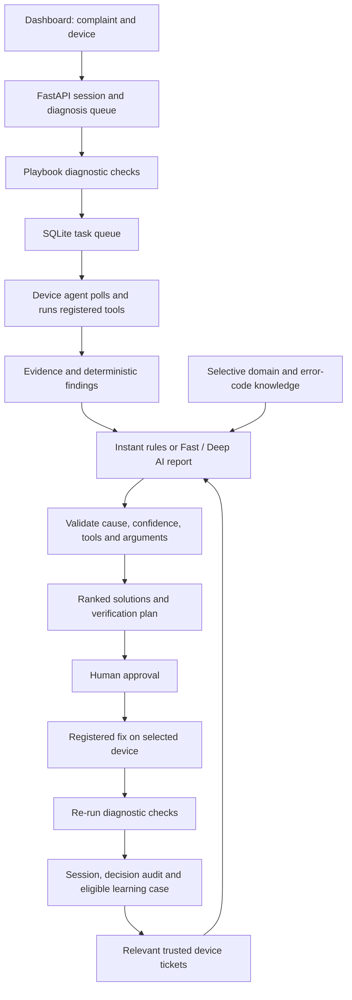

# Sentinel / AIops: purpose, history, and alignment review

Reviewed on 2026-11-04 against local HEAD `3d4f6cc` (commit title: Version 1.5.2), plus the changes described below.

## What it is and why it exists

Sentinel, now presented as **AIops**, is an IT troubleshooting application for Windows, Linux, and macOS devices. Its purpose is to save technician time: collect evidence, identify likely causes, explain uncertainty, propose useful fixes, and verify the result after a person approves a change. Monitoring, software management, performance analysis, and endpoint threat investigation support that workflow.

`aiops-brain` is its configured Ollama model, not a separately trained foundation model. The default base is `qwen3:4b`; a saved dashboard selection or environment setting can override it. The application supplies troubleshooting instructions, deterministic findings, selectively retrieved domain knowledge, and relevant past tickets. It does not update the base model's weights. `sentinel-tech` is a historical predecessor.

The later design deliberately targets a CPU-only Ubuntu server recorded in the task tracker as having 7.1 GB RAM. The governing principle is: **the server computes the structure and checks the evidence; the small model supplies judgement where rules are insufficient.** Hardware and deployment statements in the task tracker are historical, not a live measurement from this review.

## How it is built

| Layer | Responsibility | Main code |
| --- | --- | --- |
| Dashboard | Device selection, diagnosis reports, approvals, software/security/performance views | `frontend/index.html`, `frontend/app.js`, `frontend/style.css` |
| API and storage | Authentication, device enrollment, jobs, sessions, results and audit records | `backend/main.py`, `auth.py`, `device_store.py`, `task_queue.py`, `agent_brain/session_store.py` |
| Diagnostic engine | Baseline checks, optional investigation, findings, grounded reports, approved fixes and verification | `backend/agent_brain/planner.py`, `findings.py`, `playbooks.py`, `executor.py` |
| Reasoning knowledge | Selective domain cards, error codes, Event IDs, bugchecks, investigation guidance and escalation | `backend/agent_brain/knowledge/` |
| AI providers | Local Ollama by default; Groq explicitly configured as an optional cloud provider | `backend/llm/`, `backend/ai_technician.py` |
| Learning | Outcome records, feedback, scoped case recall, model instructions and dataset export | `backend/learning/` |
| Device agent | Outbound reports and task polling; typed tool registry, OS support and device-side risk limits | `agent/monitor_agent.py`, `agent/toolkit/` |
| Operations | nginx, FastAPI, Ollama, model initialization, optional ngrok, deployment and backups | `docker-compose.yml`, `Dockerfile`, `deploy/`, `.github/workflows/` |

Instant mode uses rules. Fast mode normally uses one direct model report. Deep mode can perform additional read-only investigation. Two diagnosis sessions may run concurrently by default, while model generation is serialized by default. This allows diagnostic work to overlap without making the CPU run two generations at once.

The current design requires explicit approval for device changes. AI investigation exposes read-only tools; proposed changes must pass tool/argument validation and device policy. Approval and result records are separate, and restart recovery handles delayed or missing results. Docker's container is distinguished from the actual server host, which needs its own enrolled agent.

## Development history

The review inspected reachable Git history and the plans, then checked the active implementation. A feature appearing in an old commit is not evidence that it remains in the current app.

| Period / commits | Change and motivation |
| --- | --- |
| 2026-08-21–22: `e82f174`, `3a2e37c`, `acacd15` | Device telemetry, rules, remote reporting, security checks, event logs and password protection. The early product was primarily a health monitor with cloud explanations. |
| 2026-10-04: `c2ff1fb` through `3e61c5a` | Earlier agentic/control experiments included approved commands, memory, Docker, software/automation, charts, notifications and roles. Several of these old modules are absent from the current tree; they are historical work, not current feature promises. |
| 2026-10-09: `6aaf4a4`, `c7336d7` | Current agent-brain/provider/shared-toolkit architecture, one-line enrollment, learning UI and playbook fix restrictions. Local inference reduced dependence on a cloud API. |
| 2026-10-13: `0e2e742` | Parallel checks, immediate rule findings, hardware diagnostics and smaller model calls addressed slow CPU inference and invented conclusions. |
| 2026-10-15–19: `37700d7`, `a587fcf`, `26c4a83`, `9afadbd` | Suggest-only replan, decision files, software quarantine, performance workflow, safer installation, approval/result recovery, real-host identity and isolated worker pools. |
| 2026-10-20–23: `ea79a2d`, `60eb267`, `14c3741`, `671f802`, `fe90240`, `efbefde` | Grounded causes and confidence, CPU-friendly Fast mode, open LAN enrollment, production configuration/backups, fuller solutions and agent re-enrollment. |
| 2026-10-29: `4cfed44` | Concurrent diagnosis sessions, Live Troubleshooting and endpoint threat investigation/response. |
| 2026-10-30: `3d4f6cc` | Reasoning contract, selective knowledge, error-code engines, clarification/escalation, reasoning evaluation, new diagnostic tools and fleet correlation. The task tracker still requires live verification. |

The first approved plan allowed an optional auto-fix setting. The later replan explicitly removed it. The current intent is human-approved changes, not autonomous remediation. Similarly, older 7B/8B default recommendations were superseded by the smaller CPU-server default.

## What the available decisions show

All **14 local JSON records** were reviewed: nine diagnoses, one performance analysis, one fix approval, one fix result, one rejection, and one software-action record. They span 2026-10-15–19. Three concern the old `local` container target. These are historical records, some from test complaints; they are not a representative production benchmark.

| Evidence | Implication |
| --- | --- |
| Slow/hanging laptop: high confidence blamed a 90.1%-used disk despite 23.3 GB free; RAM was 93.6% used. Its reasoning also referred to a Linux ticket during a Windows diagnosis. | Current-evidence grounding and OS/playbook-scoped recall are necessary. The October 20 grounding work addresses the cause-selection problem; this review closes the learning-relevance gap. |
| Recorded model answers took 662.5, 692.9, 805.0 and 812.1 seconds; other runs fell back after timeout/disconnection. | Response-time estimates must be measured on the deployed hardware. Small prompts, deterministic report structure, direct Fast mode and visible fallback reasons are justified. |
| Container health/performance checks appeared alongside real endpoints. | A container report must not be treated as the host PC, taught as a host lesson, or counted as another affected fleet device. |
| A DNS flush had an approval and a reported successful result, although the preceding network checks had already passed. | A command completing and a healthy later snapshot do not prove that it fixed the complaint. Current complaint-reproduction guards address this historical case; incomplete re-checks also need to stay unconfirmed. |
| An uninstall result was reconstructed after a server restart, with an explicit note that its original approval record was lost. | Keep the historical limitation visible. The later code records approval before dispatch and recovers results after restart. This review did not rewrite the record. |

The local `alerts.db` was opened read-only. It contains **zero learned cases, troubleshooting sessions, agent tasks, and remediation audit rows**. Therefore this checkout cannot establish whether case 32 was cleaned from the Ubuntu server, what model is currently selected there, or which agent versions are installed. The generated local model metadata is also historical.

## Alignment changes made in this review

1. **Relevant memory:** same OS and playbook, common-inflection normalization, a minimum weighted similarity score, and matching on complaint text rather than a previous model's guessed cause. Failed similar fixes still count against their success rate.
2. **Persistent target origin:** an additive `target_kind` column records agent/native-local/container origin. Container cases and ambiguous legacy-local cases are retained but excluded from recall and exports. Their history cannot inflate fleet counts. New verified native-local cases still work.
3. **Selective model context:** remove global ticket messages and global ticket lessons from the model definition. Eligible lessons and reasoning examples remain exportable, while diagnosis prompts receive only relevant recalled cases. A policy fingerprint causes old model definitions to refresh when Ollama is reachable at startup.
4. **Honest verification:** failed, absent or incomplete verification checks cannot turn an approved command into a resolved case. Model verification requires actual JSON booleans; a string such as `"false"` cannot become success through Python truthiness.
5. **Accurate product explanation:** the Learning tab distinguishes recorded cases from trusted device cases and explains that rebuilding does not retrain weights. README/model docs now describe the 4B default, current reasoning features and the two separate concurrency limits. The historical intelligence plan points to current status rather than claiming nothing is implemented.

These changes preserve the existing architecture, approval flow, base-model choice and historical decision records. They do not perform a fine-tune, rebuild a live model, install an agent, execute remediation, or deploy to the server.

## Validation and remaining work

The pre-change baseline passed **256 tests**. After the changes, **276 tests passed**, including 20 new regression cases for memory scope, migration, model refresh, fleet filtering and verification. The existing Starlette/httpx deprecation warning also appeared in the baseline.

The offline Instant-mode evaluation passed **10/10 scenarios on each of its seven checks**: cause, unrelated causes not blamed, confidence, OS-appropriate steps, solutions, hypotheses, and first-solution relevance. It used fixture evidence and temporary storage. All ten runs used rules as intended; these results do not measure actual model accuracy or device execution time. `git diff --check` passed.

Tests used the installed Python 3.13 interpreter; the deployment image uses Python 3.12. Browser rendering and real-model Fast/Deep runs were not exercised. These local checks do not replace server verification.

Still outstanding from the task tracker:

- Deploy the reviewed source and run real `qwen3:4b` Fast-mode evaluation for accuracy, fallbacks and timing. Confirm the brain refresh and new Learning copy in the deployed UI.
- Check simultaneous diagnosis/Performance jobs, queuing, and responsive telemetry on the Ubuntu server.
- Confirm current agent versions and rebuild/reinstall where needed for toolkit 1.8.0 tools. This pass changes server-side behavior only.
- Verify ngrok, host-agent identity and the relevant endpoint/software workflows in the actual deployment. Destructive actions require their normal explicit approvals.
- Review old production test cases and case 32 on the server; local records do not prove cleanup happened.
- The Groq model-switcher choice and cloud-warning flow remain backlog work. The existing environment-configured provider is not a completed UI feature.

This is a source/history alignment review with regression testing, not a claim that every backend path or production deployment has been audited or exercised live.

## Ask Technician follow-up (2026-11-05)

The chat implementation had defects separate from the earlier diagnosis/learning work: its prompt forced general questions into a health diagnosis; the API ignored the browser's history and instead shared a default per-device history; stored assistant turns lost their recommendations; and agent snapshots reached the model without freshness information. The returned API session id also gained another device suffix each time it was reused.

Chat now has a conversational, English-only prompt, a 700-token answer budget, and selective existing domain/error-code guidance. Per the user's preference, shared AI principles and threat chat also require English answers regardless of the input language. It retains up to six normalized history messages within a 6,000-character budget, including recommendation steps, and accepts only user/assistant roles. Browser conversations supply their own history; legacy API callers receive a stable, device-scoped session id. Snapshot source, age, status and availability accompany the model input and the decision record. Missing agent data does not cause a fallback to a container or another device.

The UI clears history and messages when the selected device changes, prevents concurrent sends, displays pending/error states, and shows the snapshot timestamp. Optional technical detail is displayed without forcing a root-cause label onto general answers. The chat still only gives advice: it does not browse, run tools or perform fixes.

Local validation: **292 unit tests passed**, including 16 new regression cases. JavaScript syntax and isolated UI logic checks passed (follow-up history, duplicate sends, error cleanup, device changes and historical labels). Browser rendering was not exercised; Playwright was unavailable in the installed Python environment. Tests use simulated model responses and cannot establish actual language quality or factual accuracy. The running LAN app at `http://10.164.48.204` still needs these source changes deployed and real English/Roman Urdu questions, follow-ups and offline-device scenarios checked against its model. No deployment, model replacement or device remediation was performed in this pass.
