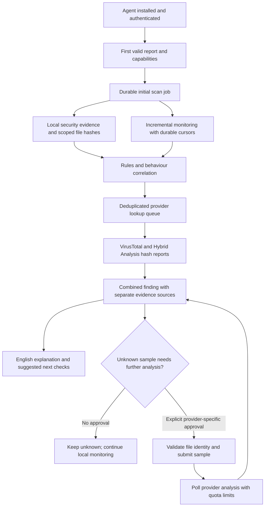

# Automatic threat detection and behaviour analysis

Date: 2026-11-05. Status: proposed implementation plan; not a completed or deployed feature.

## Confirmed requirements

- Support Windows, Linux and macOS in the first release, with explicit per-OS capability reporting.
- Automatically begin a security baseline after installation/enrollment and continue monitoring.
- Review both Security and Threat Detection, including searches and evidence quality.
- Integrate VirusTotal and Hybrid Analysis using the user's public/community keys.
- Look up SHA-256 hashes first. Uploading a file requires a separate approval naming the provider and file.
- Keep application output in English. AI explains evidence as a senior security engineer; it does not invent findings or execute remediation.
- Do not open, read or edit any `.env` file without explicit permission. API keys are entered through authenticated settings, not through chat or environment files.
- Preserve the separately requested Performance work: individual test rows, Hardware Tests, interactive component checks and explicitly started bounded load tests. That work is separate from this threat-monitoring plan.

## Current implementation and gaps

The existing agent registers and starts outbound task polling in `agent/monitor_agent.py`. The first report can trigger an onboarding troubleshooting session through `_ensure_onboarding` in `backend/main.py`.

`threat_loop` already checks for eligible online devices every five minutes. Its configured default scan interval is sixty minutes; it launches at most five devices per iteration. This is periodic log collection, not immediate installation-triggered behaviour monitoring. `agent/toolkit/threats.py` collects antivirus and security events, groups them and stores trusted scan manifests. `backend/threat_rules.py` produces findings, and `backend/threat_store.py` stores scans and analyst marks.

Existing Windows sources include Kaspersky, Defender, Security, System and PowerShell logs. Linux has authentication and ClamAV sources; macOS has limited authentication sources. The current collector does not provide a comprehensive process/file/network event history on all three operating systems.

There are unfinished local changes from the preceding Security/Performance request, including `backend/virustotal.py`, `agent/toolkit/component_tests.py` and `frontend/workbench.js`. Forty existing security/performance tests passed during that work, before subsequent edits. These changes still need complete regression tests, UI verification and review. They have not been deployed, and no user API key has been tested. Review and integrate this work before extending it; do not treat it as an approved production baseline.

## Intended lifecycle

The agent never executes suspicious samples for analysis. Sandbox behaviour reported by a provider is labelled as external sandbox evidence; it does not establish that the same behaviour occurred on the endpoint.

## 1. Installation baseline and reliable scheduling

1. Extend the first valid agent report with versioned capabilities: OS, agent version, readable event sources, process/network visibility, hashing/signature support and permission gaps.
2. Create a durable security-baseline job keyed by device identity and policy version. Enrollment retries, duplicate reports and server restarts must not start duplicate scans.
3. Run the first baseline within a proposed 60-second dispatch target when the agent is online and capacity is available; display queued state when capacity prevents this. Measure completion time rather than promising a fixed duration.
4. Collect antivirus status/detections, firewall and listening ports, startup entries, services/scheduled persistence, available authentication events, running executable metadata, signatures and selected hashes.
5. Prioritize files referenced by detections, running executables, persistence entries and recent executable/script changes. Bound enumeration and hashing by bytes, files and elapsed time; defer the rest with visible progress. Do not automatically walk all disks, network shares, archives or user documents.
6. Exclude secret/configuration stores, `.env` files and sensitive document locations from automatic file-content inspection or submission. Access-denied and excluded items remain visible as coverage limitations.
7. Retain the existing agent identity during reinstall. Resume pending baseline work after reconnect; only a policy/version change or explicit rescan creates a new baseline.

Automatic baseline collection does not start native antivirus operations that may quarantine or delete files. Reading AV evidence is automatic. A native AV scan is eligible for automatic operation only if its report-only behaviour can be verified; otherwise it needs an explicit action approval.

## 2. Continuous behaviour collection on all three operating systems

| Area | Windows | Linux | macOS |
| --- | --- | --- | --- |
| Process activity | Running-process observations; process-creation audit events where enabled; existing Sysmon where available | Process observations and existing journal/audit sources | Process observations and available unified-log evidence |
| Persistence | Services, scheduled tasks, startup folders and Run keys | systemd units/timers, cron and supported autostart locations | LaunchAgents, LaunchDaemons and supported login-item evidence |
| Network activity | Process-associated connections; existing Sysmon network/DNS events when enabled | Process-associated connections and available resolver/service logs | Process-associated connections and available system logs |
| Files | Scoped executable/script metadata, SHA-256 and signature information; existing file events | Scoped executable/script metadata, SHA-256, package ownership where available | Scoped executable/script metadata, SHA-256 and code-signing information |
| Authentication/tampering | Existing Security, System, PowerShell and antivirus events | Existing journal/auth/audit and antivirus evidence | Available authentication/security logs and protection status |

Implementation rules:

- Use incremental event cursors/bookmarks instead of rereading seven days of logs repeatedly. Identify a source by device, boot/log generation and event identity; detect log clearing or rotation.
- Proposed starting cadence: event batches every 30 seconds, process/network observations every 60 seconds, persistence comparisons every five minutes, posture refresh hourly. Measure overhead on each OS and tune these defaults through dashboard policy.
- Maintain a bounded local spool during disconnection; retry with backoff and acknowledge batches only after durable server storage. Report dropped events, spool overflow and telemetry gaps.
- Record both endpoint event time and server receipt time. Correlate processes by stable process identity plus boot/session context, not PID alone.
- Do not automatically enable audit policies, install Sysmon, add kernel modules, change macOS privacy permissions or install system extensions. Surface missing capabilities and offer a separately reviewed setup action.
- All OSes receive baseline coverage in release one. Snapshot-only sources must be labelled as such: they can miss short-lived processes and connections. Advanced macOS Endpoint Security collection is a separate signed/entitled component, not a capability the current Python agent can promise.

## 3. Explainable detection and correlation

Normalize evidence into a common event schema containing device, source, event id, event/receipt times, process and parent identities, relevant file hash/path, network destination, collection capability and redaction metadata.

Initial rules should cover:

- Suspicious parent/child execution chains and encoded shell commands, when the necessary event fields exist.
- Executables or scripts appearing in writable/temp locations followed by execution or a persistence change.
- New services, tasks, autostart items or privileged group memberships, correlated with creator/process evidence where available.
- Repeated authentication failures, privilege changes, antivirus disabling and security-log clearing.
- Unusual repeated outbound connections, correlated with process/file reputation and local history; avoid classifying a connection as malicious solely because it is new.
- High-volume file-change patterns only where a usable event source exists; absence of those events cannot rule out ransomware.

Every finding includes evidence references, affected device/component, first/last seen times, source freshness, severity, confidence, rationale, alternative explanations and next checks. Keep severity separate from confidence. Preserve provider disagreements; do not average incompatible scores into an invented probability.

Start with deterministic rules and versioned thresholds. A first-seen process is not automatically malicious. New-device baselines remain provisional; analyst-approved exclusions have a reason, scope, expiry and audit history. Feedback never silently disables protection or promotes a sample to globally trusted status.

The AI receives selected structured findings and writes an explanation after rules run. Endpoint command lines, filenames, script contents and provider reports are untrusted data, not instructions. No AI verdict can authorize quarantine, deletion, process termination or file submission.

## 4. VirusTotal and Hybrid Analysis enrichment

Build a shared provider interface with operations for capability/key validation, hash lookup, existing report retrieval, explicitly approved submission and bounded polling. Keep provider-specific adapters and response normalization separate from endpoint collection.

### Public/community-key constraints

VirusTotal currently documents 4 requests/minute and 500/day for its public API, plus restrictions on commercial products/services and business workflows that do not contribute new files. Eligible evaluation and production use must be distinguished. An upload approval is not a workaround for the provider's permitted-use rules. Review the intended production use before enabling the integration there. [Official public API limits and restrictions](https://docs.virustotal.com/reference/public-vs-premium-api)

Do not assume every behaviour report or private-submission option is available to either community key. VirusTotal documents a combined sandbox behaviour endpoint, but account access must be checked. [Behaviour summary API](https://docs.virustotal.com/reference/file-all-behaviours-summary)

The official Hybrid Analysis API page was reachable but its reference content could not be extracted in this review. Verify its current request methods, authentication requirements, submission visibility, supported analysis environments, response schemas and quotas against the actual account before implementing the adapter. No exact Hybrid Analysis quota or private-analysis entitlement is assumed here. [Official Hybrid Analysis API documentation](https://hybrid-analysis.com/docs/api/v2)

### Lookup policy

- Compute SHA-256 on the endpoint; send hashes to the server and then to the approved provider integrations. Keep full file paths, usernames and command lines out of reputation requests.
- Share deduplicated lookups across devices so the same hash does not consume fleet-wide quota repeatedly.
- Use persisted provider queues and quota budgets, covering lookups, submissions and polling. Honor `Retry-After`, apply backoff and reserve capacity for analyst requests.
- Proposed cache policy: known reports up to 24 hours, malicious/suspicious reports up to six hours, unknown hashes one hour. Retain report timestamps and show stale cache explicitly; these intervals are implementation defaults to validate, not guarantees about provider freshness.
- Distinguish known report, unknown hash, restricted capability, invalid key, rate limited, provider outage and pending analysis. None of these failure states means the file is clean.
- Display detection counts, named engine results, report age, sandbox signatures and provider links only when actually returned. Keep local evidence and provider evidence visibly separate.

### Approval-controlled file submission

- Unknown hashes remain unknown until a person decides whether further analysis is necessary.
- Show exact file identity/hash, size, selected provider, likely visibility and expiry before approval. Approval for VirusTotal never authorizes a Hybrid Analysis submission, or vice versa.
- Endpoint uploads require a new narrowly scoped agent task bound to a trusted scan item and SHA-256. Revalidate the open file's identity/hash before transfer, reject reparse/symlink substitutions and protected/sensitive paths, and send bytes only through the authenticated server transfer channel.
- Browser-selected samples clearly identify their source as the browser's device; they must not be silently attributed to another selected agent.
- Preserve file permissions and contents; never execute, unpack or locally detonate samples. Apply size/content-transfer budgets and automatic cleanup of staged files. Do not follow provider-supplied upload URLs without validating an explicit provider allowlist.
- Persist approval before dispatch. Use submission states `pending_approval`, `approved`, `submitting`, `submitted`, `analysing`, `completed`, `failed`, `expired` and `outcome_unknown`. Do not blindly retry an upload after an ambiguous network failure.
- Poll through the provider queue, not an unbounded browser timer. Expired approvals cannot submit files; changed files require new approval.

VirusTotal states that submitted contents may be shared with partners and premium customers. Public submissions must not be described as private. Hybrid Analysis visibility must be verified before enabling its upload control. [VirusTotal sharing model](https://docs.virustotal.com/docs/how-it-works)

## 5. Configuration, credentials and transport

- Add authenticated Settings > Threat Intelligence with separate VirusTotal and Hybrid Analysis entries, masked configured-state indicators, Test connection, Replace and Clear controls.
- Use server-memory keys for the initial eligible evaluation release; re-enter after a restart. Never return a stored key, save it in browser storage, put it in request URLs or decision logs, or distribute it to agents.
- Optional persistent keys require a separately selected OS secret store or encrypted storage with the encryption key outside the application database. Do not silently introduce plaintext database secrets.
- Require HTTPS for remote credential entry and authenticated sample transfer. The current `http://10.164.48.204` LAN deployment needs a trusted HTTPS endpoint before remote secret/file workflows are released. Plan the certificate/reverse-proxy change separately; no environment file changes are authorized by this document.
- Add origin/CSRF checks, strict input/schema validation, fixed provider endpoints, redirect restrictions, bounded bodies, authorization checks and sanitized errors.
- Policy and schedule settings belong in the application database with versioned audit history. Keep API-key storage separate from policy storage.

## 6. Storage and dashboard

Add versioned migrations for security baselines/jobs, per-source cursors, normalized events, file observations, provider cache/jobs, submission approvals, correlated findings and analyst suppressions. Preserve current device identities, task history and threat marks. Use bounded retention/cleanup and store references instead of duplicate sample bytes.

The dashboard should provide:

- Per-device initial-scan progress and coverage: supported, unavailable, permission denied, stale, backlogged or offline.
- Search across file/path/hash, process/parent, provider, behaviour rule, source/event id, destination, severity, status and time range; server-side pagination and filtering for larger event histories.
- A behaviour timeline and process tree only where sufficient evidence exists, with explicit local-vs-sandbox provenance.
- Separate reputation cards for VirusTotal and Hybrid Analysis, including unknown, quota and access limitations.
- A provider-specific pending-submission queue, audit history and existing approval-based remediation controls.
- Empty search results saying "No findings match these filters", not "Device is clean".
- Refresh/device switching that clears stale evidence and invalidates old action proposals.

## 7. Delivery sequence and acceptance gates

| Phase | Deliverable | Acceptance gate |
| --- | --- | --- |
| P0 | Review unfinished local security/performance changes; verify key entitlements, permitted use and transport design | Existing regressions pass; no claim that current WIP is production-ready; no `.env` access |
| P1 | Durable installation-triggered baseline and capability handshake for all three OSes | Exactly one initial scan per device/policy; reconnect/restart recovery; actual coverage shown |
| P2 | Incremental Windows/Linux/macOS collectors and bounded offline spool | Cursor recovery, log rotation, clock skew, PID reuse and permission-gap tests pass on each OS |
| P3 | Rules, correlation, provenance and analyst feedback | Benign/suspicious fixtures distinguish evidence from suspicion; no unsupported "clean" verdicts |
| P4 | Shared provider queue, hash adapters and authenticated settings | Mocked 401/403/404/429/5xx, cache, deduplication, quotas, secret-redaction and SSRF/redirect checks pass |
| P5 | Provider-specific approval and sample transfer/submission | No upload without valid matching approval; path/file-change, expiry, replay and ambiguous-outcome tests pass |
| P6 | Search, coverage, provider panels and behaviour timeline | Browser tests cover all three OS fixture types, filters, device changes, stale data and mobile layouts |
| P7 | Measured pilot and rollout | One controlled endpoint per OS; measured idle/scan CPU, RAM, I/O, queue latency and detection latency; then rebuild/reinstall agents and roll out gradually |

Proposed pilot performance targets: idle agent overhead below 2% CPU averaged over ten minutes and incremental monitoring memory below 150 MiB. These are targets to measure and adjust against actual hardware, not achieved results. Cap queues and hashing work independently of whether a target is achieved.

Use synthetic logs, mock provider responses and benign fixtures for automated tests. Any antivirus test artefact or sandbox sample used in a live pilot needs a specific testing decision because an installed AV may react automatically. Do not use real malware on ordinary endpoints.

Release gates include failure to record approvals, expired/changed samples, rate exhaustion across several devices, server/agent restart during submission, unavailable providers, stale/partial events, and instructions embedded in logs or reports. Tests must disable automatic dotenv loading so the repository's environment files are not read.

## Source references and remaining decisions

- Existing Sysmon can provide richer process, network and file telemetry; configuration affects coverage and volume. [Microsoft Sysmon documentation](https://learn.microsoft.com/sysinternals/downloads/sysmon)
- Richer native macOS collection would use Apple's Endpoint Security framework as a separately scoped component. [Apple Endpoint Security documentation](https://developer.apple.com/documentation/endpointsecurity)
- Confirm provider capabilities through each key's actual account, without displaying the keys. The plan assumes no paid/private privileges.
- Set final retention, hash budgets, schedules and alert thresholds after the three-OS pilot. Initial proposed defaults are intentionally labelled above.
- Hardware/performance verification and the earlier chat fixes remain pending alongside this plan; this document does not mark them complete or authorize deployment.

This planning pass does not install collectors, enable auditing, submit samples, use API keys, run endpoint scans, deploy the server or access `.env` files.
