# Sentinel / AIops: Deep Technical Analysis

Audit date: **2026-11-06** (Asia/Karachi). Scope: the current working tree of `Sentinel-LOCAL-DEVICE-AGENT`, including unfinished local changes, based on HEAD `96e352c` (`Version 2.0.1`). The attachment calls the root `Project-tool1`; that directory name does not match the supplied workspace. This report audits the supplied workspace, not an assumed second project.

This is a **static, read-only code audit**, not a deployment certification or penetration test. Only this report was created. Application modules were not imported, services were not started, installers were not executed, and tests were not run: those operations can load dotenv, create databases/caches, contact devices, or change state. `.env.example` was read under the explicit request; no actual `.env`, deployment `.env`, agent credential configuration, live database, or runtime decision/log content was accessed. Runtime values and deployed versions are **Not determinable from code**. Statements about earlier decisions below are attributed to the existing review, not presented as newly verified records.

Evidence uses repository-relative `path:line` and function names. The machine-extracted inventories enumerate declarations, route handlers, schemas and source references without importing the application. A declaration proves code exists; it does not establish that every platform branch works. Status definitions: **IMPLEMENTED** = an executable code path exists; **PARTIAL** = a material integration, correctness or verification gap remains; **PLANNED** = documented intent without an equivalent completed path. None means production-verified.

## Table of contents

1. [Executive Summary](#1-executive-summary)
2. [Problem Statement & Impact](#2-problem-statement--impact)
3. [System Architecture](#3-system-architecture)
4. [Module-by-Module Deep Dive](#4-module-by-module-deep-dive)
5. [End-to-End Workflows](#5-end-to-end-workflows)
6. [Algorithms & Core Logic](#6-algorithms--core-logic)
7. [Data Model](#7-data-model)
8. [API Catalog](#8-api-catalog)
9. [Security Model Review](#9-security-model-review)
10. [Quality & Operations](#10-quality--operations)
11. [Gaps, Technical Debt & Roadmap](#11-gaps-technical-debt--roadmap)
12. [Appendix](#12-appendix)

## 1. Executive Summary

- Sentinel, branded AIops in the interface, combines endpoint monitoring with evidence-based IT troubleshooting (`README.md`; `backend/main.py:54`).
- Windows, Linux and macOS agents send outbound reports and poll registered diagnostic/remediation tasks (`agent/monitor_agent.py:222`, `task_worker`, `run`).
- Rules identify resource, security, event-log and performance problems before a model explains them (`backend/rules_engine.py:evaluate_rules`; `backend/agent_brain/findings.py:analyze`).
- Ollama is the default local AI provider; Groq is an explicitly configured cloud alternative, not the only brain (`backend/llm/__init__.py:get_provider`).
- Diagnosis produces ranked solutions; device changes use explicit approval routes, registry validation and endpoint risk policy (`backend/agent_brain/planner.py:validate_fixes`, `apply_fix`; `agent/toolkit/registry.py:run_tool`).
- SQLite holds operational state; separate JSON/Markdown decision files record model advice and human decisions (`backend/config.py:DB_PATH`; `backend/decision_log.py:record`).
- The new Security Specialist, incremental observations and external intelligence services exist as **PARTIAL working-tree implementation**, with recovery, UI, identity and verification gaps detailed below (`backend/security_agent.py`; `backend/security_api.py`; `frontend/workbench.js:271`).

**Elevator pitch.** Sentinel turns a technician's complaint and a selected computer into a repeatable evidence-gathering workflow: collect relevant checks, derive deterministic findings, ask a local or configured cloud model for an explanation, validate its suggestions, then let a person approve a bounded action and re-check the result. Its useful distinction is the combination of inspectable rules, local inference, scoped ticket recall and an approval trail in one small deployment. It is not a full remote-desktop product, a proven enterprise EDR, or a self-training foundation model (`backend/agent_brain/planner.py:_diagnose`, `_verify`; `backend/learning/model_builder.py:build`; frontend navigation in `frontend/index.html:43`).

## 2. Problem Statement & Impact

### Problem-to-feature mapping

| IT-support problem | Code-backed response | Boundary |
| --- | --- | --- |
| Repeated manual collection of resource/process/network evidence | `collectors.collect_report`, toolkit `system_overview`, `top_processes`, `check_internet` | Snapshots and bounded tests, not continuous kernel instrumentation |
| Small models blame unrelated symptoms | `playbooks.is_related`, `planner.ground_root_cause`, `ground_fixes` | Grounding depends on the correctness/completeness of curated rules |
| Long AI work stalls the dashboard | `workers.run_ai`, `run_monitor`, async diagnosis admission | Dedicated thread pools and a single-process architecture; no distributed scheduler |
| Remote devices are behind NAT | `task_queue.enqueue_task`, `main.agent_next_task`, agent `task_worker` | Server must remain reachable at the stored URL |
| Unsafe automatic remediation | `planner.validate_fixes`, explicit apply routes, `registry.run_tool`, device policy | Shared operator identity and privileged endpoint execution still need protection |
| Software leaves residual files/keys | `software.uninstall_software`, `leftovers.find_leftovers`, `quarantine_leftovers`, `restore_quarantine` | Candidate matching is heuristic; preservation lasts seven days by policy |
| Unclear security alerts | `threats.threat_scan`, `threat_rules.analyze_threats`, `ai_technician.explain_threats` | Native log/scanner availability varies by OS and privilege |
| Repeating resolved tickets | `learning.store.find_similar`, `learned_fixes_for` | Lexical retrieval, not model weight training |
| A server container is mistaken for the host PC | `server_identity.server_device`, `server_snapshot` | Host identification needs an enrolled host agent or native-local deployment |
| Security activity is disconnected across snapshots | New `security_monitor.collect_events`, `security_agent.correlate` | PARTIAL; collection gaps and recovery limitations remain |

### Before versus after

| Stage | Manual workflow | With Sentinel | Evidence |
| --- | --- | --- | --- |
| Triage | Ask user for screenshots and individual commands | Select device and submit complaint/playbook | `main.start_troubleshoot`; `planner.collect_baseline` |
| Interpret | Compare logs, utilization and recent changes manually | Rules organize findings and AI explains them | `findings.analyze`; `planner._ai_report` |
| Decide | Operator chooses commands independently | Ranked manual/tool-backed solution cards | `planner.complete_solutions`; `frontend/app.js:renderSolutions` |
| Act | Technician runs commands directly | Explicit approval dispatches a registered tool | `main.troubleshoot_apply_fix`; `executor.execute` |
| Verify | Ask whether the problem improved | Repeat relevant observations, retain unknown when incomplete | `planner._verify` |
| Record | Write ticket notes manually | Session steps, audit rows, decision files, eligible cases | `session_store`; `decision_log.record`; `learning.store.record_session` |

Time savings, ticket reduction, detection accuracy, fleet capacity, and cost savings are **Not determinable from code**. Qualitatively, automation reduces repeated collection and improves reviewability. Source-backed timing parameters are a 10-second default report interval, 25-second task long-poll, 5-second dashboard loop, and offline cutoff after 30 seconds with a 10-second sweep; these are configuration/loop bounds, not latency SLAs (`agent/monitor_agent.py:33`, `:37`, `run`; `backend/main.py:monitor_loop`, `offline_loop`; `device_store.py:13`). Collection time, network retry and thread scheduling add delay.

### Comparison with established products

This comparison uses current official product documentation for competitor capabilities and repository evidence for Sentinel; it is not a benchmark or an assertion of feature parity.

| Product/category | Documented emphasis | Sentinel distinction and weakness |
| --- | --- | --- |
| Wazuh | File integrity monitoring, security configuration assessment, log analysis and active response ([official capabilities](https://documentation.wazuh.com/current/user-manual/capabilities/index.html)) | Sentinel emphasizes conversational diagnosis and approved toolkit actions. Its bounded native-log/snapshot collector is not equivalent to mature FIM or comprehensive endpoint-event coverage (`security_monitor.collect_events`; `security_agent.correlate`). |
| NinjaOne | RMM monitoring, patching, endpoint automation and remote access ([official RMM](https://www.ninjaone.com/rmm/)) | Sentinel provides selected software/update tools and local AI, but this tree has no equivalent tenant/RBAC administration or remote desktop and relies on one process/SQLite (`auth.py`; `main.py`; `Dockerfile`). |
| TeamViewer | Interactive and unattended remote support ([official unattended support](https://www.teamviewer.com/en/global/support/knowledge-base/teamviewer-remote/remote-control/provide-unattended-remote-support/)) | Sentinel's outbound task channel executes registered tools, not screen sharing or remote keyboard/mouse control (`executor.execute`; `monitor_agent.task_worker`). |
| AnyDesk | Remote desktop with unattended access ([official feature](https://anydesk.com/en/features/unattended-access)) | Sentinel's browser keyboard/camera/microphone tests concern the browsing device; they do not create a remote desktop session (`frontend/workbench.js:wbLocalTest`; `frontend/app.js:wireInputTesters`). |

## 3. System Architecture

### Components and actual names

| Component | Responsibility | Status/evidence |
| --- | --- | --- |
| FastAPI monolith | HTTP/WS, enrollment, reports, operator actions and background loops | IMPLEMENTED, `backend/main.py` |
| Vanilla browser application | Tabs, charts/telemetry, chat, solution cards, approval dialogs, job polling | IMPLEMENTED, `frontend/index.html`, `app.js`, `workbench.js`, `style.css` |
| Standalone endpoint agent | Configured reports, parallel read tasks, serialized changes, new security spool | Existing transport IMPLEMENTED; new security worker PARTIAL, `agent/monitor_agent.py` |
| Shared toolkit | OS-specific observations and bounded change tools | IMPLEMENTED declarations; platform availability varies, `agent/toolkit/__init__.py`, `registry.py` |
| Diagnosis planner | Baseline, optional tool investigation, rules, AI, grounding, approval, verification | IMPLEMENTED, `backend/agent_brain/planner.py` |
| AI adapter | Ollama default; Groq optional | IMPLEMENTED, `backend/llm/` |
| Experience/knowledge | SQLite case recall plus curated Python knowledge cards and generated Modelfile | IMPLEMENTED; no weight training, `backend/learning/`, `backend/agent_brain/knowledge/` |
| Security Specialist | Six read-only observations, durable job state, correlation, optional explanation | PARTIAL working tree, `backend/security_agent.py` |
| Reputation/sandbox providers | Policy gate, memory-only keys, quotas, lookup/submission/status | PARTIAL working tree, `backend/intelligence.py`, `security_samples.py` |
| Persistence | One server SQLite file, endpoint spool SQLite, JSON manifests and decisions | See section 7 |
| Operations | Docker/nginx/Ollama/ngrok, self-hosted CI deploy, OS installers/PyInstaller | Scripts exist; active deployment not verified |

The requested `client.py`, `agent_commands.py`, `fix_actions.py`, `fix_log.py`, `groq_agent.py`, `stress_test.py`, and `frontend/login.js` do **not** exist at the corresponding current paths. Their current equivalents are respectively `monitor_agent.py`, `task_queue.py` plus task routes, `toolkit/remediation.py` plus registry/planner validation, `session_store.py` plus `decision_log.py`, `llm/groq_provider.py` plus `ai_technician.py`, `component_tests.py`/`performance_checks.py`, and inline scripts in `login.html`. The report does not invent legacy modules.

### High-level components

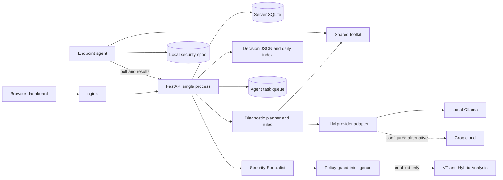

Evidence: `main.start_monitor`, `agent_brain.executor.execute`, `security_agent.run`, `intelligence.worker`, `monitor_agent.security_worker`, `docker-compose.yml`.

### LAN and roaming deployment

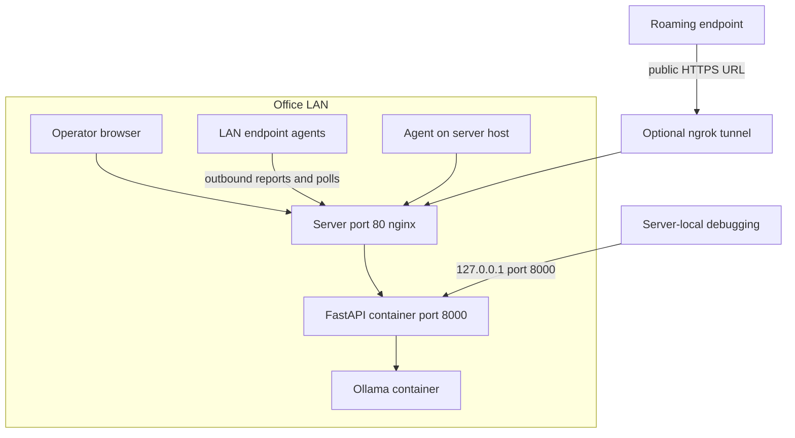

`_server_url` chooses explicit override, configured stable URL, discovered ngrok URL, then browser origin. Once installed, the endpoint reads its saved `server_url`; it does not rediscover a changed laptop IP. Reinstall templates update the URL while attempting to retain identity. A stable LAN address/DNS or stable reachable tunnel endpoint is therefore operationally necessary, but the actual configured address is **Not determinable from code** (`backend/main.py:1883`; `agent/monitor_agent.py:load_config`; `backend/install_templates/`).

### Trust boundaries

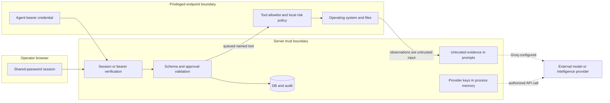

The endpoint trusts the authenticated server to make approval decisions; its `max_risk` and `allow_remediation` are local limits, not cryptographic proof of human consent. The model is not an authorization authority (`monitor_agent._task_result_for`; `registry.run_tool`; `planner._investigate`).

### Pinned and unpinned stack

`requirements.txt:1` describes Python 3.12 as the tested image baseline. Pins are FastAPI **0.143.0**, Uvicorn standard **0.54.0**, psutil **7.2.2**, httpx **0.28.1**, groq **1.7.0**, python-dotenv **1.2.4**, websockets **17.2**, and python-multipart **0.0.32**. Endpoint requirements pin psutil **7.2.2**, requests **2.34.2**, PyInstaller **6.22.3** (`agent/agent_requirements.txt`). Docker uses `python:3.12-slim`, `nginx:1.27-alpine`, `ngrok/ngrok:3-alpine` and `ollama/ollama:latest`; these are tags, not immutable digests (`Dockerfile`; `docker-compose.yml`). SQLite is the Python runtime's bundled library, with no separately pinned version. Source installers upgrade psutil/requests without these pins (`backend/install_templates/`). Installed dependency versions are **Not determinable from code**.

## 4. Module-by-Module Deep Dive

### Reading the inventory

The following inventory covers maintained Python source recursively in `backend/` and `agent/`, plus their install/build assets. Inputs are function signatures and route/tool schemas. Outputs show explicit return keys or expressions where statically visible; delegated return contracts must be followed to the named callee. Dependencies, exception handlers and side-effect sites are listed per module. Private helpers are retained because path validation, cleanup and parsing are security-relevant. Empty package markers are explicitly identified. Runtime logs, credentials, binary/build outputs and caches are excluded, not silently treated as source.

#### `agent/build_installer.py`

**Purpose:** Build the standalone agent on the target operating system. Evidence: `agent/build_installer.py:1`.

**Dependencies:** `import platform`; `import subprocess`.

**Explicit exception handlers:** None locally; caller/framework or delegated helpers handle failures.

**Side-effect/delegation sites:** No matching direct write/process/network call; check delegated interfaces and import-time registration.

**Data/re-export module:** name (6); no function/class declarations. Read by importing modules, never a standalone service.

#### `agent/monitor_agent.py`

**Purpose:** Standalone cross-platform health reporter for the central Device Health server. Evidence: `agent/monitor_agent.py:1`.

**Dependencies:** `import datetime`; `import json`; `import logging`; `import platform`; `import socket`; `import sys`; `import threading`; `import time`; `from concurrent.futures import ThreadPoolExecutor`; `from pathlib import Path`; `import psutil`; `import requests`.

**Explicit exception handlers:** `(AttributeError, OSError)`; `(NotImplementedError, OSError)`; `(PermissionError, OSError)`; `(psutil.NoSuchProcess, psutil.AccessDenied)`; `Exception`; `ImportError`; `NotEnrolled`; `OSError`; `requests.RequestException`

**Side-effect/delegation sites:** `requests.request` at `agent/monitor_agent.py:211`; `requests.post` at `agent/monitor_agent.py:262`; `requests.get` at `agent/monitor_agent.py:294`; `db.execute('SELECT id,body FROM batches ORDER BY created LIMIT 5').fetchall` at `agent/monitor_agent.py:333`; `db.execute` at `agent/monitor_agent.py:341`

| Symbol / evidence | Inputs | Purpose and return contract |
| --- | --- | --- |
| `get_security` ? `agent/monitor_agent.py:47` | `` | Refresh security posture on a fixed slow cadence; every check here is read-only. Other/delegated returns: _security_cache['data']. |
| `get_event_logs` ? `agent/monitor_agent.py:60` | `` | Refresh recent OS event log entries on a fixed slow cadence; read-only. Other/delegated returns: _event_log_cache['data']. |
| `get_performance` ? `agent/monitor_agent.py:79` | `config` | Refresh the active benchmark suite on a configurable cadence. Unlike get_security(), this briefly writes to disk and burns CPU, so it is opt-out (enable_performance_benchmark: false in agent_config.json) and defaults to a much longer interv Other/delegated returns: _performance_cache['data']; None. |
| `human_size` ? `agent/monitor_agent.py:100` | `value` | Other/delegated returns: f'{size:.2f} TB'; f'{size:.2f} {unit}'. |
| `cpu_frequency` ? `agent/monitor_agent.py:109` | `` | psutil raises on some VMs and ARM boards that expose no CPU frequency. Other/delegated returns: psutil.cpu_freq(); None. |
| `uptime_info` ? `agent/monitor_agent.py:117` | `` | Return keys (branch union): boot_time, uptime, uptime_seconds. |
| `collect_report` ? `agent/monitor_agent.py:123` | `config` | Return keys (branch union): system, cpu, memory, disk, network, battery, processes_count, top_processes, security, performance, event_logs. |
| `processor_name` ? `agent/monitor_agent.py:162` | `` | The marketing name (e.g. "12th Gen Intel(R) Core(TM) i5-1235U"); platform.processor() only gives "Intel64 Family 6 Model 154" on Windows. Other/delegated returns: `platform.processor() or 'Unknown'; str(winreg.QueryValueEx(key, 'ProcessorNameString')[0]).strip()`. |
| `load_config` ? `agent/monitor_agent.py:176` | `` | Other/delegated returns: config. |
| `save_config` ? `agent/monitor_agent.py:189` | `config` | No explicit returned value; state/side effects or class interface. |
| `_headers` ? `agent/monitor_agent.py:198` | `extra=None` | No explicit returned value; state/side effects or class interface. |
| `NotEnrolled` ? `agent/monitor_agent.py:202` | `class interface` | The server rejected this device's token (401): it does not know this device. No explicit returned value; state/side effects or class interface. |
| `request_with_retry` ? `agent/monitor_agent.py:206` | `method, url, **kwargs` | Other/delegated returns: response. |
| `register` ? `agent/monitor_agent.py:222` | `config` | Other/delegated returns: device_id; config['device_id']. |
| `register_until_accepted` ? `agent/monitor_agent.py:234` | `config` | Register; a server that refuses the token (enrollment closed, token unknown) is asked again later. Other/delegated returns: register(config). |
| `_task_result_for` ? `agent/monitor_agent.py:244` | `config, task` | Run a server-requested tool, enforcing this device's own remediation policy first. Other/delegated returns: result. |
| `_post_result` ? `agent/monitor_agent.py:259` | `base, headers, task, result` | No explicit returned value; state/side effects or class interface. |
| `_run_task` ? `agent/monitor_agent.py:270` | `config, base, headers, task, slots` | No explicit returned value; state/side effects or class interface. |
| `task_worker` ? `agent/monitor_agent.py:282` | `config, device_id` | Long-poll the server for diagnose/fix tasks (outbound only, works behind NAT). No explicit returned value; state/side effects or class interface. |
| `security_worker` ? `agent/monitor_agent.py:315` | `config` | Collect while disconnected; remove a spool batch only after a matching server ACK. No explicit returned value; state/side effects or class interface. |
| `run` ? `agent/monitor_agent.py:349` | `` | No explicit returned value; state/side effects or class interface. |

#### `agent/toolkit/__init__.py`

**Purpose:** Shared, allow-listed diagnose/fix toolkit used by the AIops server and agents. Evidence: `agent/toolkit/__init__.py:1`.

**Dependencies:** `from . import component_tests, diagnostics, hardware, leftovers, microsoft, remediation, security_monitor, software, threats, updates`; `from .registry import RISK_LEVELS, describe_tools, get_tool, list_tools, risk_rank, run_tool, tool_schemas`.

**Explicit exception handlers:** None locally; caller/framework or delegated helpers handle failures.

**Side-effect/delegation sites:** No matching direct write/process/network call; check delegated interfaces and import-time registration.

**Data/re-export module:** TOOLKIT_VERSION (6), `__all__` (8); no function/class declarations. Read by importing modules, never a standalone service.

#### `agent/toolkit/common.py`

**Purpose:** Small helpers shared by diagnostic and remediation tools. Commands are always passed as argument lists (never through a shell), so a tool argument can never be interpreted as extra shell syntax. Evidence: `agent/toolkit/common.py:1`.

**Dependencies:** `import ctypes`; `import os`; `import platform`; `import subprocess`.

**Explicit exception handlers:** `(AttributeError, OSError)`; `(NotImplementedError, OSError)`; `(OSError, subprocess.SubprocessError)`; `FileNotFoundError`; `OSError`; `subprocess.TimeoutExpired`

**Side-effect/delegation sites:** `run_command` at `agent/toolkit/common.py:56`

| Symbol / evidence | Inputs | Purpose and return contract |
| --- | --- | --- |
| `os_name` ? `agent/toolkit/common.py:16` | `` | Other/delegated returns: platform.system(). |
| `cpu_frequency` ? `agent/toolkit/common.py:20` | `` | psutil.cpu_freq(), or None where it raises (some VMs and ARM boards expose no CPU frequency). Other/delegated returns: psutil.cpu_freq(); None. |
| `is_admin` ? `agent/toolkit/common.py:30` | `` | Other/delegated returns: os.geteuid() == 0; bool(ctypes.windll.shell32.IsUserAnAdmin()); False. |
| `run_command` ? `agent/toolkit/common.py:39` | `command, timeout=DEFAULT_TIMEOUT_SECONDS` | Run an argument-list command and return {returncode, stdout, stderr}; never raises. Return keys (branch union): returncode, stdout, stderr. |
| `powershell` ? `agent/toolkit/common.py:55` | `script, timeout=DEFAULT_TIMEOUT_SECONDS` | Other/delegated returns: run_command(['powershell', '-NoProfile', '-NonInteractive', '-Command', script], timeout=timeou. |
| `human_size` ? `agent/toolkit/common.py:59` | `value` | Other/delegated returns: f'{size:.1f} TB'; 'N/A'; f'{size:.1f} {unit}'. |
| `directory_size` ? `agent/toolkit/common.py:70` | `path, max_files=200000` | Other/delegated returns: total. |

#### `agent/toolkit/component_tests.py`

**Purpose:** Component observations and explicitly started, bounded load checks. Evidence: `agent/toolkit/component_tests.py:1`.

**Dependencies:** `import glob`; `import hashlib`; `import json`; `import os`; `import tempfile`; `import time`; `import psutil`; `from .common import cpu_frequency, os_name, powershell, run_command`; `from .registry import tool`; `from .security_checks import collect_security_report`.

**Explicit exception handlers:** `(OSError, RuntimeError)`; `(OSError, RuntimeError, MemoryError)`; `ValueError`

**Side-effect/delegation sites:** `run_command` at `agent/toolkit/component_tests.py:60`; `powershell` at `agent/toolkit/component_tests.py:46`

| Symbol / evidence | Inputs | Purpose and return contract |
| --- | --- | --- |
| `security_snapshot` ? `agent/toolkit/component_tests.py:17` | `` | Return keys (branch union): ok, summary, data. |
| `component_observation` ? `agent/toolkit/component_tests.py:23` | `component` | Return keys (branch union): ok, summary, data. |
| `_peripherals` ? `agent/toolkit/component_tests.py:44` | `` | Return keys (branch union): available, inventory, note, devices, cameras, audio, graphics. |
| `_temperature` ? `agent/toolkit/component_tests.py:64` | `` | Other/delegated returns: max(readings) if readings else None; None. |
| `_load_guard` ? `agent/toolkit/component_tests.py:73` | `` | Other/delegated returns: temperature. |
| `bounded_stress` ? `agent/toolkit/component_tests.py:86` | `component, approved=False` | Return keys (branch union): ok, summary, data. |

#### `agent/toolkit/diagnostics.py`

**Purpose:** Read-only diagnostic tools the AI troubleshooter may call on its own. Each tool returns {ok, summary, data}. `summary` is a one-line, human-readable finding and `data` is kept compact on purpose: these results are fed to a small local LLM, so every extra token slows the diagnosis down. Evidence: `agent/toolkit/diagnostics.py:1`.

**Dependencies:** `import datetime`; `import glob`; `import json`; `import os`; `import platform`; `import re`; `import socket`; `import tempfile`; `import threading`; `import time`; `import urllib.request`; `from collections import Counter`; `from pathlib import Path`; `import psutil`; `from .common import cpu_frequency, human_size, is_admin, os_name, powershell, run_command, directory_size`; `from .event_logs import collect_event_log_report`; `from .performance_checks import collect_performance_report`; `from .registry import tool`; `from .security_checks import RISKY_PORTS, collect_security_report, get_pending_updates`.

**Explicit exception handlers:** `(AttributeError, OSError)`; `(OSError, ValueError)`; `(PermissionError, OSError)`; `(psutil.NoSuchProcess, psutil.AccessDenied)`; `Exception`; `OSError`; `json.JSONDecodeError`; `psutil.NoSuchProcess`

**Side-effect/delegation sites:** `run_command` at `agent/toolkit/diagnostics.py:295`; `run_command(['lsblk', '-d', '-n', '-o', 'NAME,ROTA,SIZE,MODEL'])['stdout'].splitlines` at `agent/toolkit/diagnostics.py:754`; `run_command(['lpstat', '-o'])['stdout'].splitlines` at `agent/toolkit/diagnostics.py:783`; `powershell` at `agent/toolkit/diagnostics.py:266`; `run_command(['systemd-analyze', 'blame', '--no-pager'], timeout=20)['stdout'].splitlines` at `agent/toolkit/diagnostics.py:303`; `powershell(script)['stdout'].partition` at `agent/toolkit/diagnostics.py:706`; `powershell(script)['stdout'].strip().lower` at `agent/toolkit/diagnostics.py:681`; `powershell(script)['stdout'].strip` at `agent/toolkit/diagnostics.py:681`

| Symbol / evidence | Inputs | Purpose and return contract |
| --- | --- | --- |
| `valid_host` ? `agent/toolkit/diagnostics.py:35` | `host` | Other/delegated returns: bool(HOST_PATTERN.match(host or '')). |
| `valid_service_name` ? `agent/toolkit/diagnostics.py:39` | `name` | Other/delegated returns: bool(SERVICE_PATTERN.match(name or '')). |
| `temp_directories` ? `agent/toolkit/diagnostics.py:47` | `` | Other/delegated returns: sorted((path for path in paths if os.path.isdir(path))). |
| `trash_directories` ? `agent/toolkit/diagnostics.py:61` | `` | Other/delegated returns: [path] if os.path.isdir(path) else []. |
| `system_overview` ? `agent/toolkit/diagnostics.py:78` | `` | Return keys (branch union): ok, summary, data. |
| `_process_sample` ? `agent/toolkit/diagnostics.py:128` | `` | Other/delegated returns: _sample['rows']. |
| `_measure_processes` ? `agent/toolkit/diagnostics.py:137` | `` | Other/delegated returns: rows. |
| `top_processes` ? `agent/toolkit/diagnostics.py:172` | `sort_by='cpu', limit=8` | Return keys (branch union): ok, summary, data. |
| `cleanup_candidates` ? `agent/toolkit/diagnostics.py:181` | `` | Return keys (branch union): ok, summary, data. |
| `startup_programs` ? `agent/toolkit/diagnostics.py:201` | `` | Return keys (branch union): ok, summary, data. |
| `parse_systemd_seconds` ? `agent/toolkit/diagnostics.py:256` | `text` | '1min 2.345s' -> 62.3, '850ms' -> 0.85 (systemd-analyze time format). Other/delegated returns: round(value + int(match.group(1) or 0) * 60, 1); None. |
| `_windows_boot` ? `agent/toolkit/diagnostics.py:265` | `` | Other/delegated returns: data. |
| `_linux_boot` ? `agent/toolkit/diagnostics.py:294` | `` | Other/delegated returns: data. |
| `boot_performance` ? `agent/toolkit/diagnostics.py:312` | `` | Return keys (branch union): ok, summary, data. |
| `_default_gateway` ? `agent/toolkit/diagnostics.py:337` | `` | Other/delegated returns: match.group(1) if match else None; output.strip() or None. |
| `_dns_servers` ? `agent/toolkit/diagnostics.py:349` | `` | Other/delegated returns: `[line.strip() for line in output.splitlines() if line.strip()][:6]; sorted(set(re.findall('nameserver\\[\\d+\\]\\s*:\\s*(\\S+)', output)))[:6]; [line.split()[1] for line in handle if line.startswith('nameserver')][:6]`. |
| `_ping` ? `agent/toolkit/diagnostics.py:364` | `host, count=4` | Return keys (branch union): host, reachable, packet_loss_percent, avg_ms. |
| `check_internet` ? `agent/toolkit/diagnostics.py:379` | `` | Return keys (branch union): ok, summary, data. |
| `ping_host` ? `agent/toolkit/diagnostics.py:441` | `host` | Return keys (branch union): ok, summary, data. |
| `dns_lookup` ? `agent/toolkit/diagnostics.py:449` | `hostname` | Return keys (branch union): ok, summary, data. |
| `test_tcp_port` ? `agent/toolkit/diagnostics.py:465` | `host, port` | Return keys (branch union): ok, summary, data. |
| `wifi_status` ? `agent/toolkit/diagnostics.py:481` | `` | Return keys (branch union): ok, summary, data. |
| `security_posture` ? `agent/toolkit/diagnostics.py:512` | `` | Return keys (branch union): ok, summary, data. |
| `event_log_errors` ? `agent/toolkit/diagnostics.py:530` | `` | Return keys (branch union): ok, summary, data. |
| `recent_crashes` ? `agent/toolkit/diagnostics.py:546` | `` | Return keys (branch union): ok, summary, data. |
| `_cim_date` ? `agent/toolkit/diagnostics.py:578` | `value` | The date part of a CIM/WMI datetime like '20230115000000.000000-000' -> 'YYYY-MM-DD', or None. Other/delegated returns: f'{match.group(1)}-{match.group(2)}-{match.group(3)}' if match else None. |
| `driver_inventory` ? `agent/toolkit/diagnostics.py:585` | `` | Return keys (branch union): ok, summary, data. |
| `service_status` ? `agent/toolkit/diagnostics.py:624` | `name` | Return keys (branch union): ok, summary, data. |
| `failed_services` ? `agent/toolkit/diagnostics.py:647` | `` | Return keys (branch union): ok, summary, data. |
| `update_status` ? `agent/toolkit/diagnostics.py:673` | `` | Return keys (branch union): ok, summary, data. |
| `battery_health` ? `agent/toolkit/diagnostics.py:698` | `` | Return keys (branch union): ok, summary, data. Other/delegated returns: int(handle.read().strip()); None. |
| `disk_health` ? `agent/toolkit/diagnostics.py:738` | `` | Return keys (branch union): ok, summary, data. |
| `printer_status` ? `agent/toolkit/diagnostics.py:767` | `` | Return keys (branch union): ok, summary, data. |
| `performance_benchmark` ? `agent/toolkit/diagnostics.py:790` | `` | Return keys (branch union): ok, summary, data. |

#### `agent/toolkit/event_logs.py`

**Purpose:** Cross-platform recent error/warning event log collection. Reads the OS-native event log (Windows Event Viewer, Linux journald, macOS unified log) for recent Warning/Error/Critical entries. Read-only, capped in both time window and event count, and every branch fails safe to an empty, clearly-labeled result rather than raising. Evidence: `agent/toolkit/event_logs.py:1`.

**Dependencies:** `import json`; `import platform`; `import subprocess`.

**Explicit exception handlers:** `(OSError, subprocess.SubprocessError)`; `(TypeError, ValueError, json.JSONDecodeError)`

**Side-effect/delegation sites:** No matching direct write/process/network call; check delegated interfaces and import-time registration.

| Symbol / evidence | Inputs | Purpose and return contract |
| --- | --- | --- |
| `_run` ? `agent/toolkit/event_logs.py:20` | `command, timeout=TIMEOUT_SECONDS` | stdout text, or None when the command failed or timed out. A failure must never read as "no events": that would hide real errors from every diagnosis. Other/delegated returns: result.stdout.strip(); None. |
| `_truncate` ? `agent/toolkit/event_logs.py:30` | `message` | Other/delegated returns: text if len(text) <= MESSAGE_MAX_CHARS else text[:MESSAGE_MAX_CHARS] + '...'. |
| `_collect_windows` ? `agent/toolkit/event_logs.py:35` | `` | Return keys (branch union): available, events, detail. |
| `_collect_linux` ? `agent/toolkit/event_logs.py:69` | `` | Return keys (branch union): available, events, detail. |
| `_collect_macos` ? `agent/toolkit/event_logs.py:90` | `` | Return keys (branch union): available, events, detail. |
| `collect_event_log_report` ? `agent/toolkit/event_logs.py:118` | `` | Return keys (branch union): platform, lookback_hours, available, detail, events, critical_count, error_count, warning_count. |

#### `agent/toolkit/hardware.py`

**Purpose:** Hardware health diagnostics: temperatures, CPU throttling, RAM, GPU and driver/device errors. Everything is collected in as few subprocesses as possible (one PowerShell call on Windows), because spawning shells is the slowest part of a diagnosis on a laptop. Evidence: `agent/toolkit/hardware.py:1`.

**Dependencies:** `import json`; `import re`; `from collections import Counter`; `import psutil`; `from .common import cpu_frequency, human_size, os_name, powershell, run_command`; `from .registry import tool`.

**Explicit exception handlers:** `OSError`; `json.JSONDecodeError`

**Side-effect/delegation sites:** `run_command` at `agent/toolkit/hardware.py:201`; `powershell` at `agent/toolkit/hardware.py:67`

| Symbol / evidence | Inputs | Purpose and return contract |
| --- | --- | --- |
| `_as_list` ? `agent/toolkit/hardware.py:45` | `value` | Other/delegated returns: value if isinstance(value, list) else [value]; []. |
| `_model_name` ? `agent/toolkit/hardware.py:51` | `maker, model` | Other/delegated returns: (model if model.lower().startswith(maker.lower()) else f'{maker} {model}'.strip()) or None. |
| `_registry_text` ? `agent/toolkit/hardware.py:56` | `path, name` | Other/delegated returns: `str(winreg.QueryValueEx(key, name)[0]).strip() or None; None`. |
| `_windows` ? `agent/toolkit/hardware.py:66` | `` | Return keys (branch union): model, cpu, temperatures_c, memory_modules, gpus, problem_devices, hardware_errors_7d. |
| `_read` ? `agent/toolkit/hardware.py:107` | `path` | Other/delegated returns: handle.read().strip(); ''. |
| `_linux` ? `agent/toolkit/hardware.py:115` | `` | Other/delegated returns: data. |
| `_macos` ? `agent/toolkit/hardware.py:143` | `` | Other/delegated returns: data. |
| `_finalize` ? `agent/toolkit/hardware.py:160` | `data` | Add the cross-platform bits (frequency, RAM total) and derive the one-line summary. Return keys (branch union): ok, summary, data. |
| `hardware_health` ? `agent/toolkit/hardware.py:193` | `` | Other/delegated returns: _finalize(data). |
| `rescan_hardware` ? `agent/toolkit/hardware.py:200` | `` | Return keys (branch union): ok, summary, changed. |
| `_input_kind` ? `agent/toolkit/hardware.py:221` | `name, device_class` | Other/delegated returns: 'mouse'; 'keyboard'; 'touchpad'. |
| `_windows_connection` ? `agent/toolkit/hardware.py:234` | `device_id` | Other/delegated returns: 'other'; 'Bluetooth'; 'built-in'. |
| `_physical_device` ? `agent/toolkit/hardware.py:249` | `device_id` | One physical device can show up as several HID collections (a touchpad also registers a "mouse"): HID\ELAN076D&COL01\5&36A7250&0&0000 and ...&COL03\5&36A7250&0&0002 -> ELAN076D&#124;5&36A7250&0. Other/delegated returns: `re.sub('&COL[0-9A-F]+', '', parts[1]) + '&#124;' + parts[2].rsplit('&', 1)[0]; device_id`. |
| `_windows_inputs` ? `agent/toolkit/hardware.py:258` | `` | Other/delegated returns: devices. |
| `parse_proc_input` ? `agent/toolkit/hardware.py:281` | `text` | Keyboards and pointing devices from /proc/bus/input/devices (one block per device). Other/delegated returns: devices. |
| `input_devices` ? `agent/toolkit/hardware.py:304` | `` | Return keys (branch union): ok, summary, data. |

#### `agent/toolkit/leftovers.py`

**Purpose:** Leftovers of an uninstalled program: find them, move them to a quarantine, restore them. The server only ever sends ids: an inventory id (resolved from the record this agent kept when the program was uninstalled), candidate ids from this agent's own last leftover scan, and quarantine batch ids. Paths and registry keys always come from this device, never from the server. Quarantine moves folders and files into a per-batch folder and exports registry keys to .reg files before deleting them, so every batch can be restored for QUARANTINE_DAYS; older batches are purged by the agent. Evidence: `agent/toolkit/leftovers.py:1`.

**Dependencies:** `import json`; `import os`; `import re`; `import shutil`; `import stat`; `import subprocess`; `import sys`; `import time`; `import uuid`; `from datetime import datetime, timezone`; `from pathlib import Path`; `from .common import directory_size, human_size, os_name`; `from .registry import tool`.

**Explicit exception handlers:** `(OSError, ValueError)`; `(OSError, shutil.Error)`; `(OSError, subprocess.SubprocessError)`; `OSError`

**Side-effect/delegation sites:** `path.parent.mkdir` at `agent/toolkit/leftovers.py:82`; `path.write_text` at `agent/toolkit/leftovers.py:83`; `batch.mkdir` at `agent/toolkit/leftovers.py:559`; `scan_file.unlink` at `agent/toolkit/leftovers.py:587`; `shutil.rmtree` at `agent/toolkit/leftovers.py:639`; `removed.append` at `agent/toolkit/leftovers.py:482`; `Path(item['original']).parent.mkdir` at `agent/toolkit/leftovers.py:625`; `shutil.move` at `agent/toolkit/leftovers.py:626`

| Symbol / evidence | Inputs | Purpose and return contract |
| --- | --- | --- |
| `storage_root` ? `agent/toolkit/leftovers.py:49` | `` | Other/delegated returns: Path('/var/lib/aiops-agent'); Path(configured); Path(os.getenv('ProgramData', 'C:\\ProgramData')) / 'SentinelAgent'. |
| `_quarantine_dir` ? `agent/toolkit/leftovers.py:61` | `` | Other/delegated returns: storage_root() / 'quarantine'. |
| `_scans_dir` ? `agent/toolkit/leftovers.py:65` | `` | Other/delegated returns: storage_root() / 'leftover-scans'. |
| `_uninstalled_file` ? `agent/toolkit/leftovers.py:69` | `` | Other/delegated returns: storage_root() / 'uninstalled.json'. |
| `_read_json` ? `agent/toolkit/leftovers.py:73` | `path, default` | Other/delegated returns: json.loads(Path(path).read_text(encoding='utf-8')); default. |
| `_write_json` ? `agent/toolkit/leftovers.py:80` | `path, data` | No explicit returned value; state/side effects or class interface. |
| `remember_uninstalled` ? `agent/toolkit/leftovers.py:86` | `entry_id, info` | Called after a successful uninstall: the uninstall registry entry is gone afterwards, so keep what a leftover scan needs (name, publisher, install folder). Never raises. No explicit returned value; state/side effects or class interface. |
| `normalize` ? `agent/toolkit/leftovers.py:102` | `name` | '7-Zip 26.03 (x64)' -> '7 zip'; 'Adobe Acrobat (64-bit)' -> 'adobe acrobat'. Other/delegated returns: ' '.join(text.split()). |
| `match_names` ? `agent/toolkit/leftovers.py:113` | `info` | Normalized names a leftover may carry: the display name, and the install folder's own name. Other/delegated returns: {name for name in names if len(name) >= 3 and name not in GENERIC_NAMES}. |
| `_confidence_for` ? `agent/toolkit/leftovers.py:122` | `normalized, names, publisher` | Other/delegated returns: None; 'high'; 'low'. |
| `_norm_path` ? `agent/toolkit/leftovers.py:133` | `path` | Other/delegated returns: os.path.normcase(os.path.abspath(str(path))).rstrip('\\/'). |
| `_overlaps` ? `agent/toolkit/leftovers.py:137` | `path, others` | True when path is, contains or sits inside another installed program's folder. Other/delegated returns: False; True. |
| `_is_dir` ? `agent/toolkit/leftovers.py:150` | `path` | Path.is_dir() raises PermissionError for folders this account may not read (another user's profile); a scan must skip those, not fail. Other/delegated returns: Path(path).is_dir(); False. |
| `_exists` ? `agent/toolkit/leftovers.py:159` | `path` | Other/delegated returns: Path(path).exists(); False. |
| `_windows_scan_roots` ? `agent/toolkit/leftovers.py:166` | `` | (folder, label, confidence when the name matches). Shortcut folders hold .lnk files too. Other/delegated returns: [(root, label, confidence) for root, label, confidence in roots if _is_dir(root)]. |
| `agent_dir` ? `agent/toolkit/leftovers.py:190` | `` | Folder the agent runs from (the PyInstaller exe's folder, or the agent package). Other/delegated returns: `Path(sys.executable).parent if getattr(sys, 'frozen', False) else Path(__file__).resolve().pare`. |
| `_protected_paths` ? `agent/toolkit/leftovers.py:195` | `` | Other/delegated returns: {_norm_path(path) for path in protected}. |
| `_path_candidates` ? `agent/toolkit/leftovers.py:205` | `names, publisher, other_locations, roots` | Other/delegated returns: [item for item in found if item['confidence'] != 'low' or _norm_path(Path(item['path']).parent). |
| `_registry_roots` ? `agent/toolkit/leftovers.py:250` | `` | Other/delegated returns: roots. |
| `_subkeys` ? `agent/toolkit/leftovers.py:269` | `winreg, hive, path, view` | Other/delegated returns: []; names. |
| `_registry_candidates` ? `agent/toolkit/leftovers.py:283` | `names, publisher` | Other/delegated returns: found. |
| `_windows_other_locations` ? `agent/toolkit/leftovers.py:310` | `exclude_name` | Install folders of every other installed program (their files must never be offered). Other/delegated returns: locations. |
| `_linux_candidates` ? `agent/toolkit/leftovers.py:328` | `package, homes=None, bases=('/etc', '/var/lib', '/var/log', '/opt')` | Other/delegated returns: found. |
| `_size` ? `agent/toolkit/leftovers.py:348` | `path` | Other/delegated returns: directory_size(target, max_files=SIZE_SCAN_MAX_FILES) if _is_dir(target) else target.stat().st_; 0. |
| `_modified` ? `agent/toolkit/leftovers.py:356` | `path` | Other/delegated returns: datetime.fromtimestamp(Path(path).stat().st_mtime, timezone.utc).isoformat(); None. |
| `_reg` ? `agent/toolkit/leftovers.py:363` | `*args, timeout=60` | Other/delegated returns: (result.returncode == 0, (result.stderr or result.stdout).strip()[:300]); (False, str(error)). |
| `_still_safe` ? `agent/toolkit/leftovers.py:372` | `candidate` | Re-check a cached candidate right before acting on it. Other/delegated returns: `_exists(Path(candidate['path'])) and key not in _protected_paths() and (not key.startswith(stor; root in REGISTRY_ROOT_NAMES and depth >= 2 and (normalize(candidate['path'].rsplit('\\', 1)[-1]`. |
| `_is_link` ? `agent/toolkit/leftovers.py:383` | `path` | A symlink, junction or any other reparse point (Python 3.11 cannot see junctions otherwise). Other/delegated returns: stat.S_ISLNK(info.st_mode) or bool(getattr(info, 'st_file_attributes', 0) & getattr(stat, 'FILE; False. |
| `_same_volume` ? `agent/toolkit/leftovers.py:392` | `first, second` | Other/delegated returns: os.stat(first).st_dev == os.stat(second).st_dev; False. |
| `_owner` ? `agent/toolkit/leftovers.py:402` | `path` | Owner of a file or folder: a SID string on Windows, a uid elsewhere; None when unknown. Other/delegated returns: None; os.lstat(path).st_uid; ctypes.wstring_at(text.value). |
| `_written_by_agent` ? `agent/toolkit/leftovers.py:436` | `path` | True when a scan or quarantine manifest was written by this agent (or an administrator), not planted by another user. Checked before trusting one, whatever the folder's permissions are. Other/delegated returns: owner in trusted or owner == _owner(storage_root()); False. |
| `_read_agent_json` ? `agent/toolkit/leftovers.py:448` | `path, default` | Other/delegated returns: _read_json(path, default) if _written_by_agent(path) else default. |
| `_has_links` ? `agent/toolkit/leftovers.py:452` | `path, limit=50000` | True if the item is, or contains, a symlink or junction (checked without following them), or is too big to check. Such items are never moved: a copy across drives, or anything that later walks the item as SYSTEM, would follow the link into  Other/delegated returns: False; True. |
| `_safe_name` ? `agent/toolkit/leftovers.py:467` | `text` | Other/delegated returns: `re.sub('[^A-Za-z0-9._-]+', '_', text)[:60] or 'item'`. |
| `purge_expired` ? `agent/toolkit/leftovers.py:471` | `older_than_days=QUARANTINE_DAYS` | Delete quarantine batches older than the restore window. Called by the agent once a day. Other/delegated returns: removed. |
| `find_leftovers` ? `agent/toolkit/leftovers.py:492` | `id` | Return keys (branch union): ok, summary, data. |
| `quarantine_leftovers` ? `agent/toolkit/leftovers.py:542` | `scan_id, candidate_ids` | Return keys (branch union): ok, changed, summary, data. |
| `restore_quarantine` ? `agent/toolkit/leftovers.py:600` | `batch_id` | Return keys (branch union): ok, changed, summary, data. |
| `list_quarantine` ? `agent/toolkit/leftovers.py:645` | `` | Return keys (branch union): ok, summary, data. |

#### `agent/toolkit/microsoft.py`

**Purpose:** Microsoft products: list them, and remove one completely (its registry keys too), with a 7-day restore. Office and Microsoft 365 leave a Click-to-Run service, scheduled tasks, folders and registry keys behind that an ordinary uninstall misses, and that Click-to-Run updater can block other installs ("another installation is in progress", error 1618). remove_office uses Microsoft's own scrubber (GetHelpCmd / SaRAcmd) when it is on the device, and otherwise does Microsoft's documented manual cleanup. Either way every registry key and folder it removes is first backed up into the same quarantine the Software tab restores from, so a mistake is reversible. The server only ever sends a product id that this agent's own microsoft_products listing produced; paths, keys and package names are resolved again on the device, never taken from the server. Evidence: `agent/toolkit/microsoft.py:1`.

**Dependencies:** `import os`; `import re`; `import shutil`; `import subprocess`; `import time`; `import uuid`; `from datetime import datetime, timezone`; `from pathlib import Path`; `from . import leftovers, software`; `from .common import is_admin, os_name`; `from .registry import tool`; `from .software import _run, _tail`.

**Explicit exception handlers:** `(OSError, shutil.Error)`; `ImportError`; `OSError`

**Side-effect/delegation sites:** `_powershell_json` at `agent/toolkit/microsoft.py:205`; `self.batch.mkdir` at `agent/toolkit/microsoft.py:272`; `remove_office` at `agent/toolkit/microsoft.py:458`; `remove_appx` at `agent/toolkit/microsoft.py:460`; `stored.write_text` at `agent/toolkit/microsoft.py:309`; `removed.append` at `agent/toolkit/microsoft.py:352`; `removed_keys.append` at `agent/toolkit/microsoft.py:387`; `shutil.move` at `agent/toolkit/microsoft.py:298`

| Symbol / evidence | Inputs | Purpose and return contract |
| --- | --- | --- |
| `_expand` ? `agent/toolkit/microsoft.py:79` | `path` | Other/delegated returns: os.path.expandvars(path). |
| `_scrubber_path` ? `agent/toolkit/microsoft.py:83` | `` | Microsoft's command-line scrubber, if the operator placed it on the device (env var, agent folder, tools). Other/delegated returns: None; str(candidate); str(candidate / name). |
| `_office_version` ? `agent/toolkit/microsoft.py:110` | `entry` | The scrubber -OfficeVersion value for an Office entry ('2016', 'M365', ...), or 'All' when unsure. Other/delegated returns: 'All'; 'M365'; label. |
| `_office_products` ? `agent/toolkit/microsoft.py:122` | `entries` | Office/365 installs from the registry inventory, plus a Click-to-Run remnant if one is left behind. Other/delegated returns: products. |
| `_clicktorun_state` ? `agent/toolkit/microsoft.py:148` | `` | Return keys (branch union): service, config, running. |
| `_service_exists` ? `agent/toolkit/microsoft.py:155` | `name` | Other/delegated returns: code == 0. |
| `_reg_key_exists` ? `agent/toolkit/microsoft.py:160` | `key` | Other/delegated returns: ok. |
| `_process_running` ? `agent/toolkit/microsoft.py:165` | `name` | Other/delegated returns: any(((process.info.get('name') or '').lower() == lowered for process in psutil.process_iter(['n; False. |
| `_install_blocker` ? `agent/toolkit/microsoft.py:174` | `` | Why a new install might be refused (error 1618 and friends), for the listing and the fix tool. Return keys (branch union): installer_in_progress, clicktorun_running, reboot_pending, msiexec_count. |
| `_msiexec_processes` ? `agent/toolkit/microsoft.py:184` | `` | No explicit returned value; state/side effects or class interface. |
| `_store_apps` ? `agent/toolkit/microsoft.py:194` | `` | Removable Store (Appx) apps for the current and all users (never frameworks or system components). Other/delegated returns: apps. |
| `microsoft_products` ? `agent/toolkit/microsoft.py:227` | `` | Return keys (branch union): ok, summary, data. |
| `_Backup` ? `agent/toolkit/microsoft.py:265` | `class interface` | Exports registry keys and moves folders into one quarantine batch, in the leftovers manifest format, so the Software tab's Restore puts them back. Scheduled-task XML is saved for the record (tasks are not auto-restored). Return keys (branch union): batch_id, restore_until, backed_up. Other/delegated returns: ok; entry['ok']. |
| `_Backup.__init__` ? `agent/toolkit/microsoft.py:269` | `self, program` | No explicit returned value; state/side effects or class interface. |
| `_Backup.registry` ? `agent/toolkit/microsoft.py:275` | `self, key` | Other/delegated returns: ok. |
| `_Backup.folder` ? `agent/toolkit/microsoft.py:285` | `self, path` | Other/delegated returns: entry['ok']. |
| `_Backup.task_xml` ? `agent/toolkit/microsoft.py:305` | `self, task_name, xml` | No explicit returned value; state/side effects or class interface. |
| `_Backup.finish` ? `agent/toolkit/microsoft.py:314` | `self` | Return keys (branch union): batch_id, restore_until, backed_up. |
| `_delete_office_tasks` ? `agent/toolkit/microsoft.py:326` | `backup` | Back up (XML) and delete every task under \Microsoft\Office\. Other/delegated returns: deleted. |
| `_delete_office_services` ? `agent/toolkit/microsoft.py:344` | `backup` | Other/delegated returns: removed. |
| `_run_scrubber` ? `agent/toolkit/microsoft.py:356` | `scrubber, version` | Return keys (branch union): ran, exit_code, status, ok, message, output. |
| `_manual_office_removal` ? `agent/toolkit/microsoft.py:365` | `version` | Microsoft's documented manual Click-to-Run / MSI cleanup, everything backed up first. Return keys (branch union): ran, ok, status, services_removed, tasks_removed, registry_keys_removed, folders_moved, uninstalled, message. |
| `remove_office` ? `agent/toolkit/microsoft.py:401` | `version='All'` | Remove Office/365 completely: Microsoft's scrubber when present, otherwise the manual cleanup (restorable). Return keys (branch union): ok, changed, summary, data. |
| `remove_appx` ? `agent/toolkit/microsoft.py:425` | `full_name` | Remove a Store app for every user and deprovision it (so it does not return for new users). Return keys (branch union): ok, summary, data, changed. |
| `remove_microsoft` ? `agent/toolkit/microsoft.py:455` | `id` | Other/delegated returns: result; remove_office(rest or 'All'); remove_appx(rest). |
| `fix_install_blocker` ? `agent/toolkit/microsoft.py:470` | `` | Return keys (branch union): ok, changed, summary, data. |

#### `agent/toolkit/performance_checks.py`

**Purpose:** Active, on-demand performance benchmarks. Unlike collectors.py (which reads passive OS counters), these functions run a small real workload — writing/reading a temp file, hashing data, opening a TCP connection — so they measure actual throughput and latency rather than current utilization. Because they briefly use CPU, disk, and network, they are meant to be triggered on demand or on an infrequent background cadence, never on every monitoring tick. Evidence: `agent/toolkit/performance_checks.py:1`.

**Dependencies:** `import hashlib`; `import os`; `import platform`; `import socket`; `import tempfile`; `import time`.

**Explicit exception handlers:** `OSError`

**Side-effect/delegation sites:** `os.remove` at `agent/toolkit/performance_checks.py:92`

| Symbol / evidence | Inputs | Purpose and return contract |
| --- | --- | --- |
| `benchmark_cpu` ? `agent/toolkit/performance_checks.py:28` | `` | Hash a fixed payload as fast as possible for a fixed duration. This is a stable, comparable single-core throughput figure — not a hardware FLOPS rating — useful for spotting a regression against a device's own history (thermal throttling, b Return keys (branch union): available, ops_per_second, duration_seconds, detail. |
| `benchmark_disk` ? `agent/toolkit/performance_checks.py:52` | `` | Write then read a temp file to measure real throughput. The file lives in the OS temp directory for the duration of the test and is always deleted afterward; nothing user-owned is touched. Return keys (branch union): available, write_mbps, read_mbps, test_size_mb, detail. |
| `benchmark_network` ? `agent/toolkit/performance_checks.py:97` | `` | Time a raw TCP handshake to a couple of well-known, reliable hosts. Uses TCP connect rather than ICMP ping so it works without elevated privileges on every platform. Return keys (branch union): available, average_latency_ms, targets, detail. |
| `collect_performance_report` ? `agent/toolkit/performance_checks.py:128` | `` | Run the full benchmark suite and return a single combined report. Return keys (branch union): platform, cpu, disk, network. |

#### `agent/toolkit/registry.py`

**Purpose:** Allow-listed tool registry shared by the server and the remote agent. Every diagnostic or fix the AI can trigger is a registered Tool with a fixed id, a typed parameter schema, a risk level, and the operating systems it supports. Nothing outside this registry can be executed, and arguments are validated against the schema before the tool function is called. Evidence: `agent/toolkit/registry.py:1`.

**Dependencies:** `import time`; `from dataclasses import dataclass, field`; `from .common import os_name`.

**Explicit exception handlers:** `(TypeError, ValueError)`; `Exception`; `ValueError`

**Side-effect/delegation sites:** No matching direct write/process/network call; check delegated interfaces and import-time registration.

| Symbol / evidence | Inputs | Purpose and return contract |
| --- | --- | --- |
| `Tool` ? `agent/toolkit/registry.py:21` | `class interface` | No explicit returned value; state/side effects or class interface. |
| `tool` ? `agent/toolkit/registry.py:34` | `tool_id, description, risk='read', params=None, required=(), os=ALL_OS, timeout=90, ai_visible=True` | Other/delegated returns: decorator; fn. |
| `risk_rank` ? `agent/toolkit/registry.py:45` | `risk` | Other/delegated returns: RISK_LEVELS.index(risk) if risk in RISK_LEVELS else len(RISK_LEVELS). |
| `get_tool` ? `agent/toolkit/registry.py:49` | `tool_id` | Other/delegated returns: _TOOLS.get(tool_id). |
| `list_tools` ? `agent/toolkit/registry.py:53` | `target_os=None, max_risk='high', min_risk='read'` | Other/delegated returns: [item for item in _TOOLS.values() if target_os in item.os and risk_rank(min_risk) <= risk_rank(. |
| `describe_tools` ? `agent/toolkit/registry.py:61` | `target_os=None, max_risk='high', min_risk='read'` | Other/delegated returns: [{'id': item.id, 'description': item.description, 'risk': item.risk, 'params': item.params, 're. |
| `tool_schemas` ? `agent/toolkit/registry.py:68` | `target_os=None, max_risk='read', min_risk='read'` | Function-calling schemas in the OpenAI/Ollama tools format. Other/delegated returns: [{'type': 'function', 'function': {'name': item.id, 'description': item.description, 'parameter. |
| `validate_args` ? `agent/toolkit/registry.py:84` | `item, args` | Return cleaned args or raise ValueError. Unknown keys are rejected. Other/delegated returns: cleaned. |
| `run_tool` ? `agent/toolkit/registry.py:129` | `tool_id, args=None, max_risk='read', target_os=None` | Execute one registered tool and always return a result dict (never raises). Return keys (branch union): tool_id, risk, args, ok, summary, data, changed, rollback_hint, duration_ms. |

#### `agent/toolkit/remediation.py`

**Purpose:** Fix actions ("remediation") the AI may _propose_ but never run on its own. These only execute after a person approves them in the dashboard (there is no automatic path), and the device agent can refuse them with allow_remediation/max_risk in agent_config.json. Every action is a fixed, allow-listed operation; arguments are validated and never reach a shell. Evidence: `agent/toolkit/remediation.py:1`.

**Dependencies:** `import os`; `import shutil`; `import time`; `import psutil`; `from .common import human_size, is_admin, os_name, powershell, run_command`; `from .diagnostics import temp_directories, trash_directories, valid_service_name`; `from .registry import tool`.

**Explicit exception handlers:** `(psutil.AccessDenied, psutil.TimeoutExpired)`; `FileNotFoundError`; `OSError`; `PermissionError`; `psutil.AccessDenied`; `psutil.NoSuchProcess`; `psutil.TimeoutExpired`

**Side-effect/delegation sites:** `run_command` at `agent/toolkit/remediation.py:127`; `powershell` at `agent/toolkit/remediation.py:88`; `process.terminate` at `agent/toolkit/remediation.py:192`; `run_command(['nmcli', '-t', '-f', 'DEVICE,STATE', 'device'])['stdout'].splitlines` at `agent/toolkit/remediation.py:142`; `process.kill` at `agent/toolkit/remediation.py:196`; `os.remove` at `agent/toolkit/remediation.py:69`; `shutil.rmtree` at `agent/toolkit/remediation.py:96`

| Symbol / evidence | Inputs | Purpose and return contract |
| --- | --- | --- |
| `_result` ? `agent/toolkit/remediation.py:44` | `command_result, success_message, failure_prefix` | Return keys (branch union): ok, changed, summary, data. |
| `clear_temp_files` ? `agent/toolkit/remediation.py:58` | `older_than_hours=24` | Return keys (branch union): ok, changed, summary, data, rollback_hint. |
| `empty_recycle_bin` ? `agent/toolkit/remediation.py:86` | `` | Return keys (branch union): ok, changed, summary. Other/delegated returns: _result(result, 'Recycle Bin emptied', 'Could not empty the Recycle Bin'). |
| `clear_windows_update_cache` ? `agent/toolkit/remediation.py:106` | `` | Other/delegated returns: _result(powershell(script, timeout=600), 'Windows Update cache cleared and services restarted',. |
| `flush_dns` ? `agent/toolkit/remediation.py:120` | `` | Other/delegated returns: `_result(result, 'DNS cache flushed', 'DNS flush failed (no systemd-resolved cache on this syste; _result(run_command(['ipconfig', '/flushdns']), 'DNS cache flushed', 'DNS flush failed'); _result(run_command(['killall', '-HUP', 'mDNSResponder']), 'DNS cache flushed', 'DNS flush fail`. |
| `renew_ip` ? `agent/toolkit/remediation.py:134` | `` | Return keys (branch union): ok, summary. Other/delegated returns: _result(run_command(['nmcli', 'device', 'reapply', devices[0]], timeout=60), f'Connection re-ap; _result(run_command(['ipconfig', '/renew'], timeout=110), 'IP address renewed', 'IP renewal fai; _result(run_command(['ipconfig', 'set', name, 'DHCP']), f'DHCP renewed on {name}', 'IP renewal . |
| `reset_network_stack` ? `agent/toolkit/remediation.py:149` | `` | Return keys (branch union): ok, changed, summary, data, rollback_hint. |
| `restart_service` ? `agent/toolkit/remediation.py:163` | `name` | Return keys (branch union): `ok`, `summary`. Other/delegated returns: `_result(run_command(['launchctl', 'kickstart', '-k', allowed[name]], timeout=110), f'{name} res; _result(powershell(f"Restart-Service -Name '{name}' -Force -ErrorAction Stop", timeout=110), f'; _result(run_command(['systemctl', 'restart', name], timeout=110), f'Service {name} restarted',`. |
| `kill_process` ? `agent/toolkit/remediation.py:177` | `pid, expected_name` | Return keys (branch union): ok, changed, summary, rollback_hint. |
| `disable_startup_item` ? `agent/toolkit/remediation.py:207` | `name` | Return keys (branch union): ok, summary, changed, rollback_hint. |
| `restore_startup_item` ? `agent/toolkit/remediation.py:226` | `name` | Return keys (branch union): ok, summary, changed. |
| `clear_print_queue` ? `agent/toolkit/remediation.py:248` | `` | Other/delegated returns: _result(run_command(['cancel', '-a']), 'All print jobs cancelled', 'Could not cancel print jobs; _result(powershell(script, timeout=110), 'Print queue cleared and spooler restarted', 'Could no. |
| `trigger_update_scan` ? `agent/toolkit/remediation.py:260` | `` | Other/delegated returns: _result(run_command(['softwareupdate', '-l'], timeout=590), 'macOS update check completed', 'Up; _result(run_command(['UsoClient.exe', 'StartScan']), 'Windows Update scan started in the backgr; _result(run_command(['apt-get', 'update'], timeout=590), 'Package lists refreshed', 'Package re. |
| `sync_time` ? `agent/toolkit/remediation.py:270` | `` | Other/delegated returns: _result(run_command(['timedatectl', 'set-ntp', 'true']), 'NTP time sync enabled', 'Time sync fa; _result(run_command(['w32tm', '/resync', '/force'], timeout=50), 'Clock resynchronised', 'Time ; _result(run_command(['sntp', '-sS', 'time.apple.com'], timeout=50), 'Clock resynchronised', 'Ti. |
| `repair_system_files` ? `agent/toolkit/remediation.py:280` | `` | Other/delegated returns: _result(result, 'System File Checker finished: ' + (text.strip().splitlines()[-1] if text.strip. |
| `repair_windows_image` ? `agent/toolkit/remediation.py:288` | `` | Other/delegated returns: _result(run_command(['DISM', '/Online', '/Cleanup-Image', '/RestoreHealth'], timeout=3500), 'DI. |

#### `agent/toolkit/security_checks.py`

**Purpose:** Cross-platform, read-only security posture checks. Every check fails safe to 'unknown' rather than raising. Evidence: `agent/toolkit/security_checks.py:1`.

**Dependencies:** `import ctypes`; `import json`; `import os`; `import platform`; `import re`; `import subprocess`; `import psutil`.

**Explicit exception handlers:** `(AttributeError, OSError)`; `(OSError, subprocess.SubprocessError)`; `(TypeError, ValueError)`; `(TypeError, ValueError, json.JSONDecodeError)`; `(psutil.AccessDenied, OSError)`; `(psutil.NoSuchProcess, psutil.AccessDenied)`

**Side-effect/delegation sites:** No matching direct write/process/network call; check delegated interfaces and import-time registration.

| Symbol / evidence | Inputs | Purpose and return contract |
| --- | --- | --- |
| `_run` ? `agent/toolkit/security_checks.py:17` | `command, timeout=TIMEOUT_SECONDS` | Other/delegated returns: result.stdout.strip() if result.returncode == 0 else ''; ''. |
| `is_admin` ? `agent/toolkit/security_checks.py:25` | `` | Other/delegated returns: os.geteuid() == 0; bool(ctypes.windll.shell32.IsUserAnAdmin()); None. |
| `get_firewall_status` ? `agent/toolkit/security_checks.py:34` | `` | Return keys (branch union): available, enabled, detail. |
| `windows_security_center_antivirus` ? `agent/toolkit/security_checks.py:57` | `` | Antivirus products registered with Windows Security Center, third-party ones included. productState packs the status in its middle bytes: 0x1000 set means real-time protection is on, 0x10 set means signatures are out of date (e.g. 0x41000 = Other/delegated returns: products; []. |
| `get_antivirus_status` ? `agent/toolkit/security_checks.py:79` | `` | Return keys (branch union): available, enabled, detail. |
| `get_disk_encryption_status` ? `agent/toolkit/security_checks.py:112` | `` | Return keys (branch union): available, encrypted, detail. |
| `get_pending_updates` ? `agent/toolkit/security_checks.py:134` | `` | Return keys (branch union): available, detail, note, pending_count. |
| `get_listening_ports` ? `agent/toolkit/security_checks.py:150` | `` | Return keys (branch union): available, ports, count, detail. |
| `get_macos_protections` ? `agent/toolkit/security_checks.py:170` | `` | Return keys (branch union): gatekeeper_enabled, sip_enabled. Other/delegated returns: None. |
| `collect_security_report` ? `agent/toolkit/security_checks.py:178` | `` | Return keys (branch union): running_as_admin, firewall, antivirus, disk_encryption, updates, listening_ports, macos_protections. |

#### `agent/toolkit/security_monitor.py`

**Purpose:** Read-only security observations. No arbitrary paths, shell execution or environment-file access. Evidence: `agent/toolkit/security_monitor.py:1`.

**Dependencies:** `import datetime`; `import hashlib`; `import json`; `import os`; `from pathlib import Path`; `import re`; `import sqlite3`; `import stat`; `import subprocess`; `import threading`; `import time`; `import uuid`; `import xml.etree.ElementTree as ET`; `import psutil`; `from .common import os_name`; `from .leftovers import agent_dir`; `from .registry import tool`.

**Explicit exception handlers:** `(OSError, requests.RequestException)`; `(OSError, subprocess.SubprocessError)`; `(ValueError, AttributeError)`; `(ValueError, AttributeError, TypeError)`; `(ValueError, TypeError)`; `(ValueError, TypeError, KeyError, ET.ParseError)`; `(psutil.AccessDenied, OSError)`; `OSError`

**Side-effect/delegation sites:** `root.mkdir` at `agent/toolkit/security_monitor.py:239`; `db.execute` at `agent/toolkit/security_monitor.py:241`; `db.execute("SELECT body FROM state WHERE name='cursors'").fetchone` at `agent/toolkit/security_monitor.py:248`; `requests.post` at `agent/toolkit/security_monitor.py:305`; `db.execute('SELECT COUNT(*) FROM batches').fetchone` at `agent/toolkit/security_monitor.py:263`; `db.execute('SELECT COALESCE(SUM(LENGTH(body)),0) FROM batches').fetchone` at `agent/toolkit/security_monitor.py:263`

| Symbol / evidence | Inputs | Purpose and return contract |
| --- | --- | --- |
| `_run` ? `agent/toolkit/security_monitor.py:28` | `args, timeout=20` | Other/delegated returns: (result.returncode, result.stdout[:500000]); (1, ''). |
| `features` ? `agent/toolkit/security_monitor.py:37` | `text` | Return indicators, never raw command lines or potentially credential-bearing log text. Other/delegated returns: [name for name, pattern in patterns.items() if re.search(pattern, text)]. |
| `_identity` ? `agent/toolkit/security_monitor.py:48` | `source, data` | Other/delegated returns: hashlib.sha256((source + json.dumps(data, sort_keys=True, default=str)).encode()).hexdigest(). |
| `_safe_path` ? `agent/toolkit/security_monitor.py:52` | `path` | Other/delegated returns: False; stat.S_ISREG(candidate.stat().st_mode). |
| `process_snapshot` ? `agent/toolkit/security_monitor.py:68` | `` | Return keys (branch union): ok, summary, data. |
| `executable_hashes` ? `agent/toolkit/security_monitor.py:98` | `` | Return keys (branch union): ok, summary, data. |
| `persistence_snapshot` ? `agent/toolkit/security_monitor.py:144` | `` | Return keys (branch union): ok, summary, data. |
| `collect_events` ? `agent/toolkit/security_monitor.py:178` | `cursors` | Other/delegated returns: (events[:500], coverage, next_cursors). |
| `state_db` ? `agent/toolkit/security_monitor.py:237` | `` | Other/delegated returns: db. |
| `enqueue_observations` ? `agent/toolkit/security_monitor.py:246` | `kind` | Other/delegated returns: batch. |
| `capabilities` ? `agent/toolkit/security_monitor.py:273` | `` | Return keys (branch union): ok, summary, data. |
| `event_snapshot` ? `agent/toolkit/security_monitor.py:278` | `` | Return keys (branch union): ok, summary, data. |
| `transfer_sample` ? `agent/toolkit/security_monitor.py:286` | `scan_id, item_id, sha256, transfer_id` | Return keys (branch union): ok, summary, data. |

#### `agent/toolkit/software.py`

**Purpose:** Installed software: inventory with available updates, plus uninstall and update actions. The server only ever sends an inventory id (or a package id). The agent looks the program up again on this device and runs that program's own registered silent uninstaller or the package manager, so no command line from the server is ever executed. Programs without a silent uninstaller are refused: as SYSTEM, a GUI uninstaller would open where nobody can click it and hang. Evidence: `agent/toolkit/software.py:1`.

**Dependencies:** `import glob`; `import json`; `import os`; `import re`; `import shutil`; `import subprocess`; `import time`; `from .common import is_admin, os_name`; `from .registry import tool`.

**Explicit exception handlers:** `(TypeError, ValueError)`; `FileNotFoundError`; `OSError`; `subprocess.TimeoutExpired`

**Side-effect/delegation sites:** No matching direct write/process/network call; check delegated interfaces and import-time registration.

| Symbol / evidence | Inputs | Purpose and return contract |
| --- | --- | --- |
| `_run` ? `agent/toolkit/software.py:38` | `command, timeout, env=None` | Run a command (argument list, or a registered uninstall command line on Windows) as UTF-8 text. Other/delegated returns: (result.returncode, result.stdout.decode('utf-8', 'replace'), result.stderr.decode('utf-8', 're; (127, '', 'program not found'); (124, '', f'timed out after {timeout}s'). |
| `_tail` ? `agent/toolkit/software.py:56` | `text, limit=600` | Other/delegated returns: text[-limit:]. |
| `_protected` ? `agent/toolkit/software.py:61` | `name` | Other/delegated returns: any((word in lowered for word in PROTECTED_NAMES)). |
| `_windows_roots` ? `agent/toolkit/software.py:70` | `` | Other/delegated returns: roots. |
| `_registry_values` ? `agent/toolkit/software.py:91` | `key` | Other/delegated returns: values. |
| `_windows_entry_from_values` ? `agent/toolkit/software.py:104` | `root_tag, subkey, values` | Return keys (branch union): `id`, `name`, `version`, `publisher`, `install_date`, `size_mb`, `scope`, `uninstall_method`, `can_uninstall`, `_uninstall`, `_quiet`, `_install_location`, `_uninstall_dir`. Other/delegated returns: `None`. |
| `_uninstaller_dir` ? `agent/toolkit/software.py:135` | `command` | Folder of the program's own uninstaller ('"C:\Program Files\7-Zip\Uninstall.exe" /S' -> its folder). Other/delegated returns: folder if len(folder) > 3 else None; None. |
| `_remember` ? `agent/toolkit/software.py:144` | `entry_id, name, publisher=None, install_location=None, uninstall_dir=None` | No explicit returned value; state/side effects or class interface. |
| `_windows_inventory` ? `agent/toolkit/software.py:150` | `` | Other/delegated returns: entries. |
| `_windows_entry` ? `agent/toolkit/software.py:179` | `entry_id` | Look one inventory id up again in the registry (never trust details sent by the server). Other/delegated returns: None; _windows_entry_from_values(tag, subkey, _registry_values(key)). |
| `winget_path` ? `agent/toolkit/software.py:197` | `` | Other/delegated returns: max(candidates, key=os.path.getmtime) if candidates else None; found. |
| `parse_winget_table` ? `agent/toolkit/software.py:206` | `text` | Rows of a winget table (winget upgrade), sliced by the header's column positions. Other/delegated returns: rows; []. |
| `_windows_updates` ? `agent/toolkit/software.py:230` | `entries` | Other/delegated returns: ('winget', None); (None, 'winget (App Installer) is not installed, so updates were not checked.'); (None, f"winget could not check for updates: {_tail(err or out, 200) or f'exit code {code}'}"). |
| `_windows_uninstall` ? `agent/toolkit/software.py:255` | `entry_id` | Return keys (branch union): ok, summary, data, changed. Other/delegated returns: _winget_uninstall(package, package). |
| `_winget_uninstall` ? `agent/toolkit/software.py:287` | `package, name` | Return keys (branch union): ok, changed, summary, data. |
| `_winget_installed` ? `agent/toolkit/software.py:302` | `winget, package` | The server only sends a package id; act on it only if winget reports it installed here. Other/delegated returns: code == 0 and any((row.get('Id', '').lower() == package.lower() for row in parse_winget_table(o. |
| `_windows_update` ? `agent/toolkit/software.py:308` | `package` | Return keys (branch union): ok, changed, summary, data. |
| `_linux_inventory` ? `agent/toolkit/software.py:323` | `` | Other/delegated returns: (entries, manager). |
| `_linux_installed` ? `agent/toolkit/software.py:359` | `package` | Other/delegated returns: False; code == 0 and 'install ok installed' in out; code == 0. |
| `_linux_package_action` ? `agent/toolkit/software.py:369` | `action, package` | Return keys (branch union): ok, changed, summary, data. |
| `_macos_inventory` ? `agent/toolkit/software.py:405` | `` | Other/delegated returns: entries. |
| `_public` ? `agent/toolkit/software.py:425` | `entry` | Other/delegated returns: {key: value for key, value in entry.items() if not key.startswith('_')}. |
| `installed_software` ? `agent/toolkit/software.py:432` | `check_updates=True` | Return keys (branch union): ok, summary, data. |
| `uninstall_software` ? `agent/toolkit/software.py:454` | `id` | Return keys (branch union): ok, summary. Other/delegated returns: _windows_uninstall(id); _linux_package_action('remove', id). |
| `update_software` ? `agent/toolkit/software.py:465` | `package_id` | Return keys (branch union): `ok`, `summary`. Other/delegated returns: `_windows_update(package_id); _linux_package_action('upgrade', package_id)`. |

#### `agent/toolkit/threats.py`

**Purpose:** Endpoint threat detection: what the antivirus found and the security events worth a look, read from the device's own logs, plus the actions a person can approve on one finding (rescan, quarantine, delete). threat_scan is read-only. It reads Kaspersky Endpoint Security, the Kaspersky Network Agent log, Microsoft Defender, the Windows Security / System / PowerShell logs (Linux: sshd/sudo/useradd and ClamAV; macOS: sshd and sudo), groups what belongs together (606 detections inside one ISO are one item) and writes a scan file. The server only ever sends a scan id and an item id. The path an action works on always comes from this agent's own scan file, never from the server (the rule leftovers.py follows). A quarantined threat goes into the leftovers quarantine, so the Software tab's Restore puts it back. Evidence: `agent/toolkit/threats.py:1`.

**Dependencies:** `import hashlib`; `import json`; `import os`; `import re`; `import shutil`; `import time`; `import uuid`; `from collections import Counter`; `from datetime import datetime, timezone`; `from pathlib import Path`; `from . import leftovers`; `from .common import is_admin, os_name`; `from .registry import tool`; `from .software import _run, _tail`.

**Explicit exception handlers:** `(OSError, ValueError)`; `(OSError, shutil.Error)`; `(TypeError, ValueError)`; `ImportError`; `OSError`; `ValueError`

**Side-effect/delegation sites:** `_powershell_json` at `agent/toolkit/threats.py:410`; `batch.mkdir` at `agent/toolkit/threats.py:805`; `shutil.rmtree` at `agent/toolkit/threats.py:807`; `shutil.move` at `agent/toolkit/threats.py:812`; `os.remove` at `agent/toolkit/threats.py:845`; `item.unlink` at `agent/toolkit/threats.py:571`; `powershell_attack_signs` at `agent/toolkit/threats.py:401`

| Symbol / evidence | Inputs | Purpose and return contract |
| --- | --- | --- |
| `powershell_attack_signs` ? `agent/toolkit/threats.py:127` | `script` | The distinct attack signs in a script block (at most 5), or [] for a harmless one. Other/delegated returns: signs; []. |
| `_clip` ? `agent/toolkit/threats.py:159` | `value, limit=FIELD_MAX_CHARS` | Other/delegated returns: text if len(text) <= limit else text[:limit - 3] + '...'. |
| `_time` ? `agent/toolkit/threats.py:164` | `text` | A UTC datetime from PowerShell's 'o' format (7 fraction digits), ISO text or epoch seconds; None if unreadable. Other/delegated returns: moment if moment.tzinfo else moment.replace(tzinfo=timezone.utc); None; datetime.fromtimestamp(text, timezone.utc). |
| `_iso` ? `agent/toolkit/threats.py:178` | `moment` | Other/delegated returns: moment.astimezone(timezone.utc).isoformat() if moment else None. |
| `peak_per_hour` ? `agent/toolkit/threats.py:182` | `moments` | The most events inside any 60-minute window. Other/delegated returns: best. |
| `parse_kaspersky` ? `agent/toolkit/threats.py:193` | `text` | 'Key: Value' lines of a Kaspersky Endpoint Security event into a dict (first value wins). Other/delegated returns: fields. |
| `split_container` ? `agent/toolkit/threats.py:204` | `path, object_name=None` | (file on disk, path inside it or None). Kaspersky writes 'C:\x.iso//inner//deeper'; Defender 'C:\x.zip->inner'. Other/delegated returns: ((text or object_name or '').strip(), None); (outer.strip(), (f'{inner}/{object_name}' if object_name and (not inner.endswith(object_name)) ; (joined, None). |
| `_on_disk` ? `agent/toolkit/threats.py:219` | `path` | Other/delegated returns: bool(path) and os.path.isfile(path); False. |
| `_size` ? `agent/toolkit/threats.py:226` | `path` | Other/delegated returns: os.path.getsize(path); None. |
| `_running` ? `agent/toolkit/threats.py:233` | `paths` | {normalised exe path: [{pid, name}]} for processes started from one of these files. Other/delegated returns: found. |
| `_Groups` ? `agent/toolkit/threats.py:250` | `class interface` | Collects events into items keyed by what they are about (a file, an account and source address, ...). Other/delegated returns: item; items. |
| `_Groups.__init__` ? `agent/toolkit/threats.py:253` | `self` | No explicit returned value; state/side effects or class interface. |
| `_Groups.add` ? `agent/toolkit/threats.py:256` | `self, key, kind, source, event_id, moment, fields, path=None, inner=None, extra=None` | Other/delegated returns: item. |
| `_Groups.finish` ? `agent/toolkit/threats.py:275` | `self` | Other/delegated returns: items. |
| `_kes_kind` ? `agent/toolkit/threats.py:297` | `fields, text` | Other/delegated returns: None; 'av_disabled'; 'av_settings_changed'. |
| `_add_kaspersky` ? `agent/toolkit/threats.py:312` | `groups, event` | No explicit returned value; state/side effects or class interface. |
| `_defender_path` ? `agent/toolkit/threats.py:340` | `raw` | Other/delegated returns: `str(raw or '').split(';')[0].strip(); part[6:]`. |
| `_add_windows_event` ? `agent/toolkit/threats.py:348` | `groups, event` | No explicit returned value; state/side effects or class interface. |
| `_collect_windows` ? `agent/toolkit/threats.py:407` | `hours` | Other/delegated returns: (sources, groups.finish(), antivirus); ([{'name': 'Windows event logs', 'available': False, 'count': 0, 'detail': raw['error']}], [], . |
| `_add_auth_line` ? `agent/toolkit/threats.py:430` | `groups, message, moment, source` | No explicit returned value; state/side effects or class interface. |
| `_journal_auth` ? `agent/toolkit/threats.py:448` | `hours, groups` | Other/delegated returns: (count, None); (None, _tail(err, 200) or f'journalctl exit code {code}'). |
| `_file_auth` ? `agent/toolkit/threats.py:471` | `hours, groups` | Debian/Ubuntu auth.log or RHEL secure, for systems without a persistent journal. Other/delegated returns: (count, None); (None, 'no journal entries and no /var/log/auth.log or /var/log/secure'); (None, f'cannot read {path}: {error}'). |
| `_clamav` ? `agent/toolkit/threats.py:498` | `hours, groups` | Return keys (branch union): name, available, count, detail. |
| `_collect_linux` ? `agent/toolkit/threats.py:527` | `hours` | Other/delegated returns: (sources, groups.finish(), []). |
| `_collect_macos` ? `agent/toolkit/threats.py:539` | `hours` | Other/delegated returns: ([{'name': 'Unified log (sshd, sudo)', 'available': True, 'count': count, 'detail': detail}], g; ([{'name': 'Unified log (sshd, sudo)', 'available': False, 'count': 0, 'detail': _tail(err, 200. |
| `_scans_dir` ? `agent/toolkit/threats.py:560` | `` | Other/delegated returns: leftovers.storage_root() / 'threat-scans'. |
| `_purge_old_scans` ? `agent/toolkit/threats.py:564` | `` | No explicit returned value; state/side effects or class interface. |
| `_scan_item` ? `agent/toolkit/threats.py:576` | `scan_id, item_id` | (item from this agent's own scan file, None) or (None, why not). Other/delegated returns: (item, None); (None, 'Invalid scan or item id'); (None, 'That threat scan expired or is unknown on this device. Scan again.'). |
| `_protected_roots` ? `agent/toolkit/threats.py:589` | `` | Folders whose files an action never moves or deletes (the OS, the antivirus itself, this agent). Other/delegated returns: [leftovers._norm_path(root) for root in roots]. |
| `_allowed_inside` ? `agent/toolkit/threats.py:607` | `` | Folders inside a protected root where downloaded or dropped files commonly sit. Other/delegated returns: []; [leftovers._norm_path(Path(os.environ.get('SystemRoot', 'C:\\Windows')) / 'Temp')]. |
| `unsafe_reason` ? `agent/toolkit/threats.py:614` | `path` | None when an action may move or delete this file, otherwise why not. Other/delegated returns: None; 'it is a shortcut link or junction'; 'the file is no longer there (or is not a regular file)'. |
| `_sha256` ? `agent/toolkit/threats.py:635` | `path, limit=4 * 1024 ** 3` | Other/delegated returns: digest.hexdigest(); None. |
| `_summary` ? `agent/toolkit/threats.py:654` | `items, sources, hours` | Other/delegated returns: text + (f". Not readable: {'; '.join(unreadable)}" if unreadable else ''). |
| `_fit` ? `agent/toolkit/threats.py:671` | `data` | Keep the result under DATA_LIMIT: fewer inner objects first, then the least urgent items. Other/delegated returns: data. |
| `threat_scan` ? `agent/toolkit/threats.py:687` | `hours=168` | Return keys (branch union): ok, summary, data. |
| `_kaspersky_cli` ? `agent/toolkit/threats.py:720` | `` | Other/delegated returns: None; str(found[0]). |
| `_version_key` ? `agent/toolkit/threats.py:730` | `path` | Other/delegated returns: [int(part) if part.isdigit() else 0 for part in re.split('[.-]', path.parent.name)]. |
| `_defender_cli` ? `agent/toolkit/threats.py:734` | `` | Other/delegated returns: str(fallback) if fallback.is_file() else None; str(found[0]). |
| `_scan_command` ? `agent/toolkit/threats.py:743` | `path` | (scanner name, argument list) for an inform-only scan of one file, or (None, why not). Other/delegated returns: (None, 'No command-line antivirus scanner is available on this system.'); (None, 'No command-line antivirus scanner found (Kaspersky avp.com or Defender MpCmdRun.exe).'); (None, 'No command-line antivirus scanner found (kesl-control or clamscan).'). |
| `threat_rescan` ? `agent/toolkit/threats.py:767` | `scan_id, item_id` | Return keys (branch union): ok, summary, data. |
| `quarantine_threat` ? `agent/toolkit/threats.py:795` | `scan_id, item_id` | Return keys (branch union): ok, changed, summary, data. |
| `delete_threat` ? `agent/toolkit/threats.py:831` | `scan_id, item_id, confirm` | Return keys (branch union): ok, changed, summary, data. |

#### `agent/toolkit/updates.py`

**Purpose:** Operating system updates: list what Windows Update, apt/dnf or softwareupdate offers, and install the updates a person approved. The server only sends update ids that os_updates reported. The agent searches again and installs only updates the fresh search still offers, so nothing the server invents can be installed. It never restarts the computer: when an update needs a restart, the result says so and the person restarts when it suits them. Evidence: `agent/toolkit/updates.py:1`.

**Dependencies:** `import json`; `import os`; `import re`; `import shutil`; `import time`; `from .common import is_admin, os_name`; `from .registry import tool`; `from .software import PACKAGE_NAME, _run, _tail`.

**Explicit exception handlers:** `OSError`; `json.JSONDecodeError`

**Side-effect/delegation sites:** `_powershell_json` at `agent/toolkit/updates.py:106`

| Symbol / evidence | Inputs | Purpose and return contract |
| --- | --- | --- |
| `_powershell_json` ? `agent/toolkit/updates.py:68` | `script, timeout` | Return keys (branch union): error. Other/delegated returns: json.loads(out.strip()) if out.strip() else {'error': _tail(err, 300) or f'PowerShell exit code. |
| `_as_list` ? `agent/toolkit/updates.py:76` | `value` | Other/delegated returns: value if isinstance(value, list) else [value]; []. |
| `_size_text` ? `agent/toolkit/updates.py:82` | `update` | Other/delegated returns: text. |
| `_windows_kind` ? `agent/toolkit/updates.py:94` | `update` | Other/delegated returns: 'update'; 'driver'; 'security'. |
| `_windows_updates` ? `agent/toolkit/updates.py:105` | `` | Return keys (branch union): source, updates, reboot_pending, can_install, ok, summary, data. |
| `_apt_updates` ? `agent/toolkit/updates.py:123` | `` | Return keys (branch union): source, updates, note. Other/delegated returns: None. |
| `_dnf_updates` ? `agent/toolkit/updates.py:144` | `` | Return keys (branch union): source, updates. Other/delegated returns: None. |
| `_linux_updates` ? `agent/toolkit/updates.py:160` | `` | Return keys (branch union): ok, summary, data. Other/delegated returns: result. |
| `_macos_updates` ? `agent/toolkit/updates.py:169` | `` | Return keys (branch union): source, updates, reboot_pending, can_install, ok, summary, data. |
| `os_updates` ? `agent/toolkit/updates.py:183` | `` | Return keys (branch union): ok, summary, data. Other/delegated returns: data. |
| `_wanted_ids` ? `agent/toolkit/updates.py:203` | `update_ids, pattern` | The ids a person ticked, or None. Empty is refused: an install always names its updates. Other/delegated returns: list(dict.fromkeys(ids)); None. |
| `_windows_install` ? `agent/toolkit/updates.py:211` | `update_ids` | Return keys (branch union): ok, changed, summary, data. |
| `_linux_install` ? `agent/toolkit/updates.py:238` | `update_ids` | Return keys (branch union): ok, changed, summary, data. |
| `install_os_updates` ? `agent/toolkit/updates.py:267` | `update_ids` | Other/delegated returns: _windows_install(update_ids) if os_name() == 'Windows' else _linux_install(update_ids). |

#### `backend/__init__.py`

**Purpose:** Empty package marker. Evidence: `backend/__init__.py` (zero lines).

**Dependencies:** .

**Explicit exception handlers:** None locally; caller/framework or delegated helpers handle failures.

**Side-effect/delegation sites:** No matching direct write/process/network call; check delegated interfaces and import-time registration.

**Data/re-export module:** ; no function/class declarations. Read by importing modules, never a standalone service.

#### `backend/agent_brain/__init__.py`

**Purpose:** Agentic troubleshooting: plan, diagnose with tools, propose and apply fixes, verify. Evidence: `backend/agent_brain/__init__.py:1`.

**Dependencies:** .

**Explicit exception handlers:** None locally; caller/framework or delegated helpers handle failures.

**Side-effect/delegation sites:** No matching direct write/process/network call; check delegated interfaces and import-time registration.

**Data/re-export module:** ; no function/class declarations. Read by importing modules, never a standalone service.

#### `backend/agent_brain/eval_cases.py`

**Purpose:** Diagnosis scenarios that measure how well the AI decides (python -m backend.agent_brain.evaluate) and that the unit tests reuse as regression cases. Each case is the evidence the baseline checks returned on a real ticket (names, addresses and SSIDs removed) and what a correct diagnosis must, and must not, say. Regexes are matched case-insensitively. cause the main root cause (the text before "Separate/Other problems") must match it not_blamed the main root cause must not match it (a finding that cannot cause this complaint) confidence the allowed confidence values first the first solution (title, why, steps) must match it forbidden no solution may match it (steps for the wrong operating system) Evidence: `backend/agent_brain/eval_cases.py:1`.

**Dependencies:** .

**Explicit exception handlers:** None locally; caller/framework or delegated helpers handle failures.

**Side-effect/delegation sites:** No matching direct write/process/network call; check delegated interfaces and import-time registration.

| Symbol / evidence | Inputs | Purpose and return contract |
| --- | --- | --- |
| `_ok` ? `backend/agent_brain/eval_cases.py:17` | `summary, data` | Return keys (branch union): ok, summary, data. |
| `_overview` ? `backend/agent_brain/eval_cases.py:21` | `cpu, ram, swap, disks, os_name='Windows 11 (10.0.26300)', uptime='3 days, 7:34:30', ram_total='15.6 GB'` | Other/delegated returns: `('system_overview', {}, _ok(summary, data))`. |
| `_processes` ? `backend/agent_brain/eval_cases.py:30` | `sort_by, rows` | Other/delegated returns: `('top_processes', {'sort_by': sort_by}, _ok(f'Top by {sort_by}: {top}', rows))`. |
| `_process` ? `backend/agent_brain/eval_cases.py:36` | `pid, name, cpu, memory_percent, memory` | Return keys (branch union): pid, name, cpu_percent, memory_percent, memory. |
| `_internet` ? `backend/agent_brain/eval_cases.py:63` | `dns_ok=True, dns_ms=8, tcp_ms=11, http_ok=True, gateway_loss=0` | Other/delegated returns: `('check_internet', {}, _ok(summary, data))`. |
| `_wifi` ? `backend/agent_brain/eval_cases.py:77` | `signal` | Other/delegated returns: `('wifi_status', {}, _ok(f'Wi-Fi connected to office-wifi, signal {signal}%, rx 144 Mbps', {'Sta`. |

#### `backend/agent_brain/evaluate.py`

**Purpose:** Measure the AI's diagnoses on fixed scenarios (eval_cases.py) without touching devices or the real database. docker compose exec -T sentinel python -m backend.agent_brain.evaluate [--mode fast|deep] [--case id,id] [--model qwen3:8b] [--json-out PATH] It runs the same pipeline as a real diagnosis (rules, prompt, model, grounding), starting from recorded evidence, against a throw-away database and decisions folder: nothing is learned, nothing runs on a device. The model answers one request at a time, so run it while no diagnosis is running. On a CPU a fast run of all cases takes roughly 10-30 minutes. Evidence: `backend/agent_brain/evaluate.py:1`.

**Dependencies:** `import argparse`; `import asyncio`; `import json`; `import os`; `import re`; `import shutil`; `import sqlite3`; `import sys`; `import tempfile`; `import time`; `from pathlib import Path`; `from .eval_cases import CASES, CASES_BY_ID`.

**Explicit exception handlers:** `Exception`; `sqlite3.Error`

**Side-effect/delegation sites:** `shutil.rmtree` at `backend/agent_brain/evaluate.py:166`; `connection.execute("SELECT value FROM settings WHERE key = 'ollama_model'").fetchone` at `backend/agent_brain/evaluate.py:117`; `Path(args.json_out).write_text` at `backend/agent_brain/evaluate.py:164`; `connection.execute` at `backend/agent_brain/evaluate.py:117`

| Symbol / evidence | Inputs | Purpose and return contract |
| --- | --- | --- |
| `main_cause` ? `backend/agent_brain/evaluate.py:29` | `report` | The root cause without the "Separate/Other problems" tail, which may name findings that did not cause it. Other/delegated returns: MAIN_CAUSE_END.split(report.get('root_cause') or '', maxsplit=1)[0]. |
| `_solution_text` ? `backend/agent_brain/evaluate.py:34` | `solution` | Other/delegated returns: ' '.join([str(solution.get('title') or ''), str(solution.get('why') or '')] + [str(step) for st. |
| `score` ? `backend/agent_brain/evaluate.py:38` | `case, report, seconds=None` | One result row. Each check is True/False; the totals line counts the Trues. Return keys (branch union): case, cause, not_blamed, confidence, os_steps, solutions, hypotheses, first, fallback, seconds, prompt_tok, output_tok, root_cause, confidence_value, first_solution. |
| `fixture_executor` ? `backend/agent_brain/evaluate.py:69` | `case` | Deep-mode investigation tools get the case's recorded evidence, or "not available"; nothing changes. Return keys (branch union): ok, summary. Other/delegated returns: run; {**result, 'tool_id': tool_id, 'args': args} if result else {'ok': False, 'summary': f'{tool_id. |
| `run_case` ? `backend/agent_brain/evaluate.py:84` | `case, mode` | Other/delegated returns: score(case, report, time.perf_counter() - started). |
| `format_rows` ? `backend/agent_brain/evaluate.py:97` | `rows` | Other/delegated returns: '\n'.join(lines); 'ok' if value is True else 'NO' if value is False else '-' if value is None else str(value). |
| `_saved_model` ? `backend/agent_brain/evaluate.py:110` | `db_path` | The model picked in the dashboard (read-only), so the evaluation measures what the app uses. Other/delegated returns: None; row[0] if row else None. |
| `main` ? `backend/agent_brain/evaluate.py:125` | `argv=None` | Other/delegated returns: 0. |

#### `backend/agent_brain/events.py`

**Purpose:** In-process pub/sub so the dashboard can watch a troubleshooting session live. Evidence: `backend/agent_brain/events.py:1`.

**Dependencies:** `import asyncio`.

**Explicit exception handlers:** `asyncio.QueueFull`

**Side-effect/delegation sites:** No matching direct write/process/network call; check delegated interfaces and import-time registration.

| Symbol / evidence | Inputs | Purpose and return contract |
| --- | --- | --- |
| `subscribe` ? `backend/agent_brain/events.py:8` | `session_id` | Other/delegated returns: queue. |
| `unsubscribe` ? `backend/agent_brain/events.py:14` | `session_id, queue` | No explicit returned value; state/side effects or class interface. |
| `publish` ? `backend/agent_brain/events.py:22` | `session_id, event` | No explicit returned value; state/side effects or class interface. |

#### `backend/agent_brain/executor.py`

**Purpose:** Run a toolkit tool on the right machine: in-process for this server, via the task queue for agents. Evidence: `backend/agent_brain/executor.py:1`.

**Dependencies:** `import asyncio`; `import os`; `import platform`; `import time`; `from dataclasses import dataclass`; `from agent.toolkit import get_tool, run_tool`; `from .. import task_signals`; `from ..device_store import get_device`; `from ..task_queue import CLAIM_TIMEOUT_SECONDS, enqueue_task, expire_stale_tasks, get_task`.

**Explicit exception handlers:** None locally; caller/framework or delegated helpers handle failures.

**Side-effect/delegation sites:** `enqueue_task` at `backend/agent_brain/executor.py:49`

| Symbol / evidence | Inputs | Purpose and return contract |
| --- | --- | --- |
| `Target` ? `backend/agent_brain/executor.py:22` | `class interface` | Other/delegated returns: self.device_id == LOCAL_DEVICE_ID. |
| `Target.is_local` ? `backend/agent_brain/executor.py:29` | `self` | Other/delegated returns: self.device_id == LOCAL_DEVICE_ID. |
| `resolve_target` ? `backend/agent_brain/executor.py:33` | `device_id` | Other/delegated returns: Target(device['device_id'], device['os_type'], device['nickname'] or device['hostname'], device; Target(LOCAL_DEVICE_ID, platform.system(), label); None. |
| `execute` ? `backend/agent_brain/executor.py:43` | `target, tool_id, args, max_risk, session_id=None` | Return keys (branch union): tool_id, args, ok, summary, data, remote_task_id. Other/delegated returns: await asyncio.to_thread(run_tool, tool_id, args, max_risk, target.os_type). |

#### `backend/agent_brain/findings.py`

**Purpose:** Instant, rule-based findings from diagnostic evidence (no LLM). These run in milliseconds right after the baseline checks, so the operator sees concrete problems within seconds. They also feed the LLM pre-digested facts, stand in for the AI report when the model is unavailable or too slow, and let a fix be verified deterministically by checking whether its finding disappeared. A finding is {key, severity, title, detail, source, fixes: [{tool_id, args, why}], tips: [manual suggestions]}. `key` identifies the same problem across runs (used for verification). Which findings can explain the user's complaint is decided by the playbook (playbooks.RELATED_FINDINGS); the rest are separate problems. Severity says how bad a finding is, not whether it caused the complaint. Evidence: `backend/agent_brain/findings.py:1`.

**Dependencies:** `import re`; `from agent.toolkit.remediation import PROTECTED_PROCESSES, RESTARTABLE_SERVICES`; `from ..rules_engine import disk_space_severity`; `from .playbooks import LINUX, MACOS, WINDOWS, is_complaint, is_related`.

**Explicit exception handlers:** `Exception`

**Side-effect/delegation sites:** No matching direct write/process/network call; check delegated interfaces and import-time registration.

| Symbol / evidence | Inputs | Purpose and return contract |
| --- | --- | --- |
| `_finding` ? `backend/agent_brain/findings.py:31` | `key, severity, title, detail, source, fixes=(), tips=()` | Return keys (branch union): key, severity, title, detail, source, fixes, tips. |
| `_fix` ? `backend/agent_brain/findings.py:35` | `tool_id, why, **args` | Return keys (branch union): tool_id, args, why. |
| `_bytes` ? `backend/agent_brain/findings.py:39` | `text` | Other/delegated returns: float(match.group(1)) * SIZE_UNITS[match.group(2)] if match else 0. |
| `_percent` ? `backend/agent_brain/findings.py:44` | `value` | Other/delegated returns: float(match.group(1)) if match else None. |
| `_system_overview` ? `backend/agent_brain/findings.py:53` | `data, summary, args, os_type` | Other/delegated returns: found. |
| `_top_processes` ? `backend/agent_brain/findings.py:78` | `data, summary, args, os_type` | Other/delegated returns: found. |
| `_check_internet` ? `backend/agent_brain/findings.py:95` | `data, summary, args, os_type` | Other/delegated returns: _speed_findings(stages, gateway_ping); [_finding('net_no_adapter', 'critical', 'No network connection', 'No network adapter has an IP ; [_finding('net_no_gateway', 'high', 'No route to the router', summary, 'check_internet', [_fix(. |
| `_speed_findings` ? `backend/agent_brain/findings.py:116` | `stages, gateway_ping` | Other/delegated returns: found. |
| `_wifi_status` ? `backend/agent_brain/findings.py:130` | `data, summary, args, os_type` | Other/delegated returns: []; [_finding('wifi_weak', 'high' if signal < 30 else 'medium', f'Weak Wi-Fi signal ({int(signal)}%; [_finding('wifi_disconnected', 'high', 'Wi-Fi is disconnected', summary, 'wifi_status')]. |
| `_security_posture` ? `backend/agent_brain/findings.py:140` | `data, summary, args, os_type` | Other/delegated returns: found. |
| `_threat_scan` ? `backend/agent_brain/findings.py:157` | `data, summary, args, os_type` | Open threat findings of medium severity or more (the Threat Detection tab has the details and the actions). Other/delegated returns: found[:6]; []. |
| `_event_log_errors` ? `backend/agent_brain/findings.py:171` | `data, summary, args, os_type` | Other/delegated returns: found. |
| `_recent_crashes` ? `backend/agent_brain/findings.py:182` | `data, summary, args, os_type` | Other/delegated returns: found. |
| `_disk_health` ? `backend/agent_brain/findings.py:194` | `data, summary, args, os_type` | Other/delegated returns: []; [_finding('disk_failing', 'critical', 'A physical disk reports failing health', (summary or ''). |
| `_battery_health` ? `backend/agent_brain/findings.py:205` | `data, summary, args, os_type` | Other/delegated returns: []; [_finding('battery_worn', 'high' if health < 50 else 'medium', f'Battery holds only {health}% o; [_finding('battery_worn', 'medium', f'Battery condition: {condition}', summary, 'battery_health. |
| `_update_status` ? `backend/agent_brain/findings.py:216` | `data, summary, args, os_type` | Other/delegated returns: found. |
| `_printer_status` ? `backend/agent_brain/findings.py:226` | `data, summary, args, os_type` | Other/delegated returns: found. |
| `_service_status` ? `backend/agent_brain/findings.py:238` | `data, summary, args, os_type` | Other/delegated returns: [_finding(f'service_down:{name}', 'high', f'Service {name} is {state}', summary, 'service_statu; []. |
| `_failed_services` ? `backend/agent_brain/findings.py:248` | `data, summary, args, os_type` | Other/delegated returns: []; [_finding('services_failed', 'medium', f'{len(data)} failed system service(s)', summary, 'faile. |
| `_cleanup_candidates` ? `backend/agent_brain/findings.py:254` | `data, summary, args, os_type` | Other/delegated returns: found. |
| `_startup_programs` ? `backend/agent_brain/findings.py:267` | `data, summary, args, os_type` | Other/delegated returns: []; [_finding('startup_many', 'low', f'{len(items)} programs start automatically', 'Many startup pr. |
| `_hardware_health` ? `backend/agent_brain/findings.py:274` | `data, summary, args, os_type` | Other/delegated returns: found. |
| `_boot_performance` ? `backend/agent_brain/findings.py:297` | `data, summary, args, os_type` | Other/delegated returns: found. |
| `_os_updates` ? `backend/agent_brain/findings.py:314` | `data, summary, args, os_type` | Other/delegated returns: found. |
| `_input_devices` ? `backend/agent_brain/findings.py:329` | `data, summary, args, os_type` | Other/delegated returns: found. |
| `_performance_benchmark` ? `backend/agent_brain/findings.py:343` | `data, summary, args, os_type` | Other/delegated returns: []; [_finding('disk_slow', 'medium', f'The disk is slow: it writes only {write} MB/s', 'An old hard. |
| `process_role` ? `backend/agent_brain/findings.py:388` | `name` | Other/delegated returns: PROCESS_ROLES.get(str(name or '').lower()). |
| `group_processes` ? `backend/agent_brain/findings.py:392` | `rows, field` | Rows of one process each -> one entry per program (Chrome runs as dozens of processes), biggest first. Other/delegated returns: sorted(apps.values(), key=lambda entry: entry['percent'], reverse=True). |
| `describe_apps` ? `backend/agent_brain/findings.py:407` | `apps, limit=4` | Other/delegated returns: ', '.join(parts). |
| `_uptime_days` ? `backend/agent_brain/findings.py:419` | `data` | Other/delegated returns: int(days.group(1)) if days else 0. |
| `_memory_tips` ? `backend/agent_brain/findings.py:424` | `os_type, apps, overview` | Concrete, OS-specific things a person can do about memory pressure, naming what holds the memory. Other/delegated returns: tips. |
| `_tip_dict` ? `backend/agent_brain/findings.py:456` | `title, why, *steps` | Return keys (branch union): title, why, steps, risk. |
| `_size_gb` ? `backend/agent_brain/findings.py:460` | `text` | Other/delegated returns: round(value / 1024 ** 3, 1) if value else None. |
| `analyze` ? `backend/agent_brain/findings.py:465` | `evidence, os_type` | Evidence is [(tool_id, args, result)]. Returns de-duplicated findings, most severe first. Other/delegated returns: sorted(found.values(), key=lambda item: SEVERITY_ORDER[item['severity']]). |
| `_name_the_culprits` ? `backend/agent_brain/findings.py:484` | `found, evidence, os_type=None` | High RAM/CPU from system_overview says what; top_processes says who (per program, not per process). Memory also gets concrete tips for this OS. No explicit returned value; state/side effects or class interface. |
| `summarize` ? `backend/agent_brain/findings.py:500` | `findings` | Other/delegated returns: f'{len(findings)} problem(s) found instantly (' + ', '.join((f'{count} {severity}' for severity; 'No problems detected by the instant checks.'. |
| `_topics` ? `backend/agent_brain/findings.py:544` | `finding` | Other/delegated returns: patterns. |
| `cited_finding` ? `backend/agent_brain/findings.py:551` | `text, findings` | The finding a diagnosis blames: the one its main cause (before any "Separate problems") names first. Other/delegated returns: best[1] if best else None. |
| `split_by_relevance` ? `backend/agent_brain/findings.py:563` | `findings, playbook` | (findings that can explain the complaint, separate problems), each most severe first. Other/delegated returns: (related, other). |
| `numbered` ? `backend/agent_brain/findings.py:570` | `findings, playbook=None, limit=10` | Findings in the order the AI sees them (complaint-related first), so F1, F2... map back to them. Other/delegated returns: `(related + other)[:limit]`. |
| `findings_block` ? `backend/agent_brain/findings.py:576` | `findings, playbook=None` | Compact text for the LLM prompt. With a specific complaint, findings are split into those that can explain it and separate problems, and numbered F1, F2... so the answer can point at one. Other/delegated returns: '\n'.join(lines); '- none (the automatic checks found nothing abnormal)'; f"- F{index} [{item['severity']}] {item['title']}: {item['detail']}". |
| `rule_report` ? `backend/agent_brain/findings.py:598` | `findings, issue, note=None, playbook=None` | A complete diagnosis built only from findings (instant mode, or when the AI is unavailable). It blames only a finding that can explain the complaint; the rest are listed as separate problems. Return keys (branch union): issue_summary, root_cause, confidence, severity, evidence, raw_fixes, manual_steps, reasoning. |
| `related_findings` ? `backend/agent_brain/findings.py:639` | `findings, tool_id` | Findings a given fix tool is meant to resolve. Other/delegated returns: [item for item in findings or [] if any((fix['tool_id'] == tool_id for fix in item.get('fixes',. |
| `verification_steps` ? `backend/agent_brain/findings.py:644` | `finding` | How to confirm a finding is gone: the check that detects it (source tool), and the condition that means it is fixed. Used to show a concrete verification plan before a fix is approved. Return keys (branch union): source, success. Other/delegated returns: None. |

#### `backend/agent_brain/knowledge/__init__.py`

**Purpose:** Selective, budgeted knowledge retrieval (spec §34-35). NEVER inject the whole knowledge base. `retrieve()` picks at most one domain card for the current issue (keyed off the matched playbook, else the issue's keywords), renders it compactly, and trims it to a character budget so the CPU model's prompt stays short. `investigate_tool_hint()` renders, for the same domain, which read-only checks answer which questions — so the model selects a tool to test a hypothesis, not because it exists. Everything here is pure and deterministic (no I/O, no model): easy to test and safe to call on every diagnosis. When nothing matches, it returns "" and the prompt is unchanged. Evidence: `backend/agent_brain/knowledge/__init__.py:1`.

**Dependencies:** `import json`; `import os`; `import re`; `from ...text import stems`; `from . import tool_knowledge`; `from .bugchecks import BUGCHECKS`; `from .domains import DOMAINS, DOMAINS_BY_ID`; `from .error_codes import ERROR_CODES`; `from .event_ids import EVENT_IDS`; `from .investigation_map import where`; `from .playbook_extras import GENERIC_QUESTIONS, extras_for`.

**Explicit exception handlers:** `ValueError`

**Side-effect/delegation sites:** No matching direct write/process/network call; check delegated interfaces and import-time registration.

| Symbol / evidence | Inputs | Purpose and return contract |
| --- | --- | --- |
| `_budget` ? `backend/agent_brain/knowledge/__init__.py:27` | `name, default` | Other/delegated returns: max(0, int(os.getenv(name, str(default)))); default. |
| `domain_budget` ? `backend/agent_brain/knowledge/__init__.py:34` | `mode='deep'` | Other/delegated returns: _budget('KNOWLEDGE_BUDGET_CHARS', 1200 if mode == 'deep' else 700). |
| `match_domain` ? `backend/agent_brain/knowledge/__init__.py:43` | `issue, playbook=None, found_keys=()` | The one most relevant domain card, or None. The matched playbook wins; otherwise the issue's words are scored against each card's keywords (whole stemmed words, so 'mic' is not 'Microsoft'). Other/delegated returns: best; DOMAINS_BY_ID[card_id]. |
| `render_domain` ? `backend/agent_brain/knowledge/__init__.py:59` | `card` | A compact, senior-engineer guidance block for one domain card. Other/delegated returns: '\n'.join(lines). |
| `_trim` ? `backend/agent_brain/knowledge/__init__.py:69` | `text, budget` | Keep whole lines up to the budget; never cut mid-line. Other/delegated returns: '\n'.join(kept); text. |
| `retrieve` ? `backend/agent_brain/knowledge/__init__.py:84` | `issue, playbook=None, found_keys=(), os_type=None, mode='deep'` | The domain-knowledge block for the diagnosis prompt, or "" when nothing matches. Other/delegated returns: _trim(render_domain(card), domain_budget(mode)); ''. |
| `investigate_tool_hint` ? `backend/agent_brain/knowledge/__init__.py:92` | `issue, playbook=None, found_keys=(), os_type=None` | For the matched domain: which check answers which question, plus its decision points, so the model picks the next check to TEST a hypothesis (spec §6-7, §27). Budget-capped; "" when no domain matches. Other/delegated returns: `_trim('\n'.join(lines), _budget('KNOWLEDGE_TOOL_HINT_CHARS', 700)); ''`. |
| `clarifying_questions` ? `backend/agent_brain/knowledge/__init__.py:104` | `issue, playbook=None, found_keys=(), limit=3` | Targeted questions to narrow an unclear problem (spec §28-29): the matched domain's, else generic. Each has a diagnostic purpose; used when the checks did not pin a cause. Other/delegated returns: `list(questions or GENERIC_QUESTIONS)[:limit]`. |
| `escalation_reasons` ? `backend/agent_brain/knowledge/__init__.py:112` | `issue, playbook=None, found_keys=()` | Domain-specific conditions that warrant escalation (spec §40), for the matched domain. Other/delegated returns: list(extras_for(card['id']).get('escalate_when', [])) if card else []. |
| `_corpus` ? `backend/agent_brain/knowledge/__init__.py:126` | `issue, evidence` | The text to scan for codes: the issue plus each check's summary and a capped dump of its data. Other/delegated returns: '\n'.join(parts). |
| `detect_codes` ? `backend/agent_brain/knowledge/__init__.py:139` | `issue, evidence=()` | [(kind, entry)] for every known code/Event-ID/bugcheck whose trigger matches. Deterministic. Other/delegated returns: hits. |
| `_render_code` ? `backend/agent_brain/knowledge/__init__.py:150` | `kind, entry` | Other/delegated returns: f"- {entry['label']}: {entry['meaning']} Investigate: {entry['investigate']} Do not conclude: {; f"- {entry['label']}: {entry['meaning']} Correlate: {entry['correlate']}". |
| `retrieve_codes` ? `backend/agent_brain/knowledge/__init__.py:156` | `issue, evidence=(), max_entries=4` | A compact block for the codes/Event-IDs/bugchecks present, or "" when none are. Budget-capped. Other/delegated returns: `_trim(body, _budget('KNOWLEDGE_CODES_CHARS', 1000)); ''`. |

#### `backend/agent_brain/knowledge/bugchecks.py`

**Purpose:** BSOD bugcheck knowledge (spec §12): correlate, never blame on sight. Each entry maps a bugcheck code/name to what it usually means and what to correlate it with. `triggers` match the hex code or the SCREAMING_CASE name in the issue text or the crash evidence. The guiding rule (shared by all): never blame a driver only because it appears in one crash — look for repetition, a recent change, WHEA and disk/RAM errors. Evidence: `backend/agent_brain/knowledge/bugchecks.py:1`.

**Dependencies:** .

**Explicit exception handlers:** None locally; caller/framework or delegated helpers handle failures.

**Side-effect/delegation sites:** No matching direct write/process/network call; check delegated interfaces and import-time registration.

**Data/re-export module:** BUGCHECKS (9); no function/class declarations. Read by importing modules, never a standalone service.

#### `backend/agent_brain/knowledge/domains.py`

**Purpose:** Domain knowledge cards (spec §9-24): how a senior engineer investigates each kind of problem. A card is terse, structured data, NOT prose: where to look (component keys from investigation_map), the investigative approach in one line, the likely causes, the read-only tools that help, and how to confirm a fix. The retriever (`knowledge/__init__.py`) renders at most one card, within a character budget, into the diagnosis prompt — so the CPU model gets senior-engineer guidance without a wall of text. `id` matches a playbook id (playbooks.py) where one exists, so retrieval keys straight off the matched playbook; `keywords` cover domains that have no playbook (Office, drivers, generic app crashes). Evidence: `backend/agent_brain/knowledge/domains.py:1`.

**Dependencies:** .

**Explicit exception handlers:** None locally; caller/framework or delegated helpers handle failures.

**Side-effect/delegation sites:** No matching direct write/process/network call; check delegated interfaces and import-time registration.

**Data/re-export module:** DOMAINS (13), DOMAINS_BY_ID (145); no function/class declarations. Read by importing modules, never a standalone service.

#### `backend/agent_brain/knowledge/error_codes.py`

**Purpose:** Error-code knowledge (spec §25): how to INVESTIGATE a code, not just "X means Y". Each entry is terse data with `triggers` (regexes matched against the issue text and the evidence), a plain meaning, where to look next, and a "do not conclude" guard against the obvious wrong jump. The retriever renders only the entries whose code is actually present, within a small budget, so the CPU model gets the right lead without a wall of codes. Evidence: `backend/agent_brain/knowledge/error_codes.py:1`.

**Dependencies:** .

**Explicit exception handlers:** None locally; caller/framework or delegated helpers handle failures.

**Side-effect/delegation sites:** No matching direct write/process/network call; check delegated interfaces and import-time registration.

**Data/re-export module:** ERROR_CODES (9); no function/class declarations. Read by importing modules, never a standalone service.

#### `backend/agent_brain/knowledge/event_ids.py`

**Purpose:** Event ID knowledge (spec §26): an Event ID is EVIDENCE, not a root cause. Each entry teaches what the event means, what to correlate it with, and the wrong conclusion to avoid. `triggers` match the provider name or an "event/id NNNN" mention in the issue text or the evidence (summaries and log samples). Only present events are rendered, within a budget. Evidence: `backend/agent_brain/knowledge/event_ids.py:1`.

**Dependencies:** .

**Explicit exception handlers:** None locally; caller/framework or delegated helpers handle failures.

**Side-effect/delegation sites:** No matching direct write/process/network call; check delegated interfaces and import-time registration.

**Data/re-export module:** EVENT_IDS (8); no function/class declarations. Read by importing modules, never a standalone service.

#### `backend/agent_brain/knowledge/investigation_map.py`

**Purpose:** The universal "where do I look?" map (spec §8). Each component is one place a problem can live, named in a few words and tied to the read-only tools that reveal it. Domain cards (domains.py) reference these keys so a card stays short and the labels stay consistent; the unknown-problem path (a later phase) walks this map directly. Kept compact on purpose: these labels are rendered into the CPU model's prompt, where every token costs time. One short phrase per component, not a paragraph. Evidence: `backend/agent_brain/knowledge/investigation_map.py:1`.

**Dependencies:** .

**Explicit exception handlers:** None locally; caller/framework or delegated helpers handle failures.

**Side-effect/delegation sites:** No matching direct write/process/network call; check delegated interfaces and import-time registration.

| Symbol / evidence | Inputs | Purpose and return contract |
| --- | --- | --- |
| `label` ? `backend/agent_brain/knowledge/investigation_map.py:39` | `key` | Other/delegated returns: entry[0] if entry else key.replace('_', ' '). |
| `tools_for` ? `backend/agent_brain/knowledge/investigation_map.py:44` | `key` | Other/delegated returns: entry[1] if entry else (). |
| `where` ? `backend/agent_brain/knowledge/investigation_map.py:49` | `keys` | A compact "where to look" phrase list for the given component keys. Other/delegated returns: [label(key) for key in keys]. |

#### `backend/agent_brain/knowledge/playbook_extras.py`

**Purpose:** Playbook-engine extras (spec §27, §29, §40): the investigative logic layer on top of the domain cards. A domain card (domains.py) says WHAT a problem is and WHERE to look. These extras add HOW a senior engineer works it: the targeted questions that narrow an unclear report, the decision points that pick the next check, when to escalate, and whether the domain's fixes are reversible. Kept separate so the cards stay compact and these are rendered only where they are used (questions/escalation in the unknown-handling and escalation steps; decision points in the deep-mode investigation hint). Keyed by domain id (domains.py). Every key must be a real domain id (a test enforces this). Evidence: `backend/agent_brain/knowledge/playbook_extras.py:1`.

**Dependencies:** .

**Explicit exception handlers:** None locally; caller/framework or delegated helpers handle failures.

**Side-effect/delegation sites:** No matching direct write/process/network call; check delegated interfaces and import-time registration.

| Symbol / evidence | Inputs | Purpose and return contract |
| --- | --- | --- |
| `extras_for` ? `backend/agent_brain/knowledge/playbook_extras.py:112` | `domain_id` | Other/delegated returns: DOMAIN_EXTRAS.get(domain_id, {}). |

#### `backend/agent_brain/knowledge/tool_knowledge.py`

**Purpose:** Tool knowledge (spec §42, §6-7): what question each read-only check answers. This teaches the model to pick a check to TEST A HYPOTHESIS, not run it because it exists. Kept to one short "question answered" line per tool (the registry already holds the description, risk, params and OS); the retriever renders a few of these as a hint during the deep-mode investigation, scoped to the domain. Only diagnostic (read) tools belong here; change tools are proposed as fixes, never as investigation. Evidence: `backend/agent_brain/knowledge/tool_knowledge.py:1`.

**Dependencies:** .

**Explicit exception handlers:** None locally; caller/framework or delegated helpers handle failures.

**Side-effect/delegation sites:** No matching direct write/process/network call; check delegated interfaces and import-time registration.

| Symbol / evidence | Inputs | Purpose and return contract |
| --- | --- | --- |
| `question` ? `backend/agent_brain/knowledge/tool_knowledge.py:42` | `tool_id` | Other/delegated returns: TOOL_QUESTIONS.get(tool_id). |
| `hint_lines` ? `backend/agent_brain/knowledge/tool_knowledge.py:46` | `tool_ids` | Compact - tool: question lines for the tools we have a question for, in the given order. Other/delegated returns: lines. |

#### `backend/agent_brain/planner.py`

**Purpose:** The agentic troubleshooting loop. 1. Baseline: run system_overview plus the matched playbook's tools, in parallel (CPU-sensitive measurements first). The model is loaded at the same time. 2. Instant findings: deterministic rules turn the evidence into concrete problems within seconds (see findings.py). "instant" mode stops here. 3. Investigate (deep mode only): the LLM calls further read-only tools until it has enough evidence. 4. Report: one call whose answer must follow a JSON schema turns evidence + findings + the model's own IT knowledge into a root cause and 3-4 ranked solutions. Fast mode answers directly; deep mode thinks first (streamed live, within a budget). Findings are split into those that can explain the complaint and separate problems, and the answer names the one it blames, so the server can check it (ground_root_cause) and set the confidence from the evidence rather than the model's say-so. A solution may name an allow-listed remediation tool, which makes it runnable after a person approves it. 5. Fix: ONLY when a person approves a solution in the dashboard. There is no automatic path. Then re-verify: by rules when the fix targeted a finding, otherwise by the LLM. The LLM can never execute a fix itself: during investigation it only sees read-risk tool schemas, every proposed fix is validated against the registry, and every diagnosis and every approval or rejection is written to the decisions folder (backend/decision_log.py). Evidence: `backend/agent_brain/planner.py:1`.

**Dependencies:** `import asyncio`; `import contextlib`; `import contextvars`; `import functools`; `import json`; `import logging`; `import os`; `import re`; `import time`; `from datetime import datetime`; `from agent.toolkit import get_tool, list_tools, tool_schemas`; `from agent.toolkit.registry import validate_args`; `from agent.toolkit.remediation import PROTECTED_PROCESSES, RESTARTABLE_SERVICES`; `from .. import decision_log, fleet_correlation`; `from ..alert_store import get_alerts`; `from ..learning import model_builder`; `from ..learning import store as learning_store`; `from ..llm import LLMDisconnectedError, LLMTimeoutError, LLMUnavailableError, get_provider`; `from ..llm.base import loads_lenient`; `from ..llm.brain import BRAIN_PRINCIPLES, MAX_SOLUTIONS, MIN_SOLUTIONS`; `from ..server_identity import is_container_target, server_device`; `from ..workers import ai_gate, diagnosis_limit, diagnosis_slots, run_ai`; `from . import events, findings, knowledge, session_store`; `from .executor import execute, resolve_target`; `from .playbooks import RELEVANT_FIXES, baseline_phases, filter_relevant_fixes, get_playbook, is_complaint, match_playbook, playbook_tips`.

**Explicit exception handlers:** `(KeyError, TypeError, ValueError)`; `Exception`; `LLMDisconnectedError`; `LLMUnavailableError`; `ValueError`

**Side-effect/delegation sites:** `decision_log.record` at `backend/agent_brain/planner.py:1296`; `execute` at `backend/agent_brain/planner.py:264`; `entry['checks'].remove` at `backend/agent_brain/planner.py:267`; `str(app.get('name') or '').lower().removesuffix` at `backend/agent_brain/planner.py:517`; `executed.add` at `backend/agent_brain/planner.py:1356`

| Symbol / evidence | Inputs | Purpose and return contract |
| --- | --- | --- |
| `report_schema` ? `backend/agent_brain/planner.py:117` | `finding_ids, fix_ids, investigated=False` | The JSON schema the answer must follow (Ollama enforces it while generating). "cause" comes first, so the model commits to a finding before it writes the explanation, and it can only be a finding that can explain the complaint (or "none", o Return keys (branch union): type, properties, required. |
| `diagnosis_thinking` ? `backend/agent_brain/planner.py:166` | `mode=None` | Deep thinking for the diagnosis report, in deep mode only (DIAGNOSIS_THINKING turns it off there too). On a CPU thinking costs several minutes; fast mode answers in one direct call from pre-digested evidence. Other/delegated returns: enabled if mode is None else enabled and mode == 'deep'. |
| `max_investigation_steps` ? `backend/agent_brain/planner.py:173` | `` | Other/delegated returns: max(0, min(12, int(os.getenv('AGENT_MAX_STEPS', '3')))); 3. |
| `default_mode` ? `backend/agent_brain/planner.py:180` | `` | Other/delegated returns: value if value in MODES else 'fast'. |
| `normalize_mode` ? `backend/agent_brain/planner.py:185` | `value` | Other/delegated returns: value if value in MODES else default_mode(). |
| `investigation_rounds` ? `backend/agent_brain/planner.py:190` | `mode, playbook` | Fast mode goes straight to the report from the baseline (a playbook's, or the broad general one). Other/delegated returns: max_investigation_steps() if mode == 'deep' else 0. |
| `_compact` ? `backend/agent_brain/planner.py:195` | `result, limit=TOOL_RESULT_CHARS` | Other/delegated returns: payload if len(payload) <= limit else payload[:limit] + '...(truncated)'. |
| `_lock` ? `backend/agent_brain/planner.py:203` | `session_id` | Other/delegated returns: _session_locks.setdefault(session_id, asyncio.Lock()). |
| `_publish_status` ? `backend/agent_brain/planner.py:207` | `session_id, status, message=''` | No explicit returned value; state/side effects or class interface. |
| `_set_phase` ? `backend/agent_brain/planner.py:212` | `session_id, phase, **extra` | No explicit returned value; state/side effects or class interface. |
| `_tracked` ? `backend/agent_brain/planner.py:219` | `session_id, phase` | Shows the session in the Live Troubleshooting tab while the block runs. No explicit returned value; state/side effects or class interface. |
| `_tracking` ? `backend/agent_brain/planner.py:230` | `phase` | Decorator form of _tracked for a coroutine whose first argument is the session id. Other/delegated returns: wrap; run; await function(session_id, *args, **kwargs). |
| `live_phase` ? `backend/agent_brain/planner.py:241` | `session_id` | What an active session is doing now, in words: {phase, since, waiting}, or None when it is not running here. Return keys (branch union): phase, since, waiting. Other/delegated returns: None. |
| `_run_step` ? `backend/agent_brain/planner.py:255` | `session_id, target, tool_id, args, max_risk='read', kind='tool'` | Other/delegated returns: result. |
| `_think` ? `backend/agent_brain/planner.py:273` | `session_id, text` | No explicit returned value; state/side effects or class interface. |
| `parse_inline_tool_calls` ? `backend/agent_brain/planner.py:279` | `content, allowed` | Small local models sometimes write the tool call as JSON text instead of a real call. Other/delegated returns: calls. |
| `parse_reply` ? `backend/agent_brain/planner.py:296` | `text` | (dict, truncated): the JSON object in a reply. A reply cut off by the token cap keeps its complete parts instead of falling back to the rules. Other/delegated returns: (value if isinstance(value, dict) else {}, True); (value if isinstance(value, dict) else {}, False); ({}, False). |
| `_parse_json` ? `backend/agent_brain/planner.py:312` | `text` | Other/delegated returns: `parse_reply(text)[0]`. |
| `first_sentence` ? `backend/agent_brain/planner.py:319` | `text` | The first sentence, not cut at "e.g." or "i.e." or inside brackets ("... service (e.g. Spooler, BITS)"). Other/delegated returns: text.rstrip('.'); before. |
| `_arg_hint` ? `backend/agent_brain/planner.py:330` | `tool, os_type` | How the model fills a fix's arguments: the allowed values, or where in the evidence they come from. Other/delegated returns: ', '.join((f"{name}: {spec.get('type')}" for name, spec in tool.params.items())); 'name: one of ' + ', '.join(sorted(RESTARTABLE_SERVICES.get(os_type, ()))); 'pid and expected_name of a process listed in the evidence'. |
| `catalog_tools` ? `backend/agent_brain/planner.py:341` | `os_type, only=None` | Other/delegated returns: [item for item in list_tools(os_type, max_risk='high', min_risk='low') if item.ai_visible and (. |
| `fix_catalog` ? `backend/agent_brain/planner.py:346` | `os_type, only=None` | One compact line per fix tool: - id (risk) args {...}: first sentence of the description. only limits the catalog (e.g. to a playbook's relevant fixes) to keep the prompt short. Other/delegated returns: '\n'.join(lines). |
| `known_items` ? `backend/agent_brain/planner.py:356` | `evidence` | Process ids/names and startup items the checks saw: the only ones a fix may name (the agent acts only on things it discovered itself, and the server holds the AI to the same rule). Return keys (branch union): processes, startup. |
| `_device_would_accept` ? `backend/agent_brain/planner.py:369` | `tool_id, args, os_type` | Drop fixes the device is certain to refuse, so the operator never sees a dead button. Other/delegated returns: True; args.get('name') in RESTARTABLE_SERVICES.get(os_type, ()); str(args.get('expected_name', '')).lower() not in PROTECTED_PROCESSES. |
| `_seen_by_the_checks` ? `backend/agent_brain/planner.py:378` | `tool_id, args, known` | Other/delegated returns: True; (args.get('pid'), str(args.get('expected_name', '')).lower()) in known['processes']; str(args.get('name', '')).lower() in known['startup']. |
| `validate_fixes` ? `backend/agent_brain/planner.py:386` | `raw_fixes, os_type, known=None` | Keep only fixes that name a real remediation tool for this OS with valid arguments. With known (known_items of the evidence), a process or startup item must be one the checks actually saw. Other/delegated returns: fixes. |
| `_offerable_without_args` ? `backend/agent_brain/planner.py:410` | `item, os_type` | A fix tool that may become a one-click solution without arguments: a real change tool for this OS that the AI is allowed to propose (actions only a person starts, like installing OS updates, never qualify). Other/delegated returns: item is not None and item.risk != 'read' and item.ai_visible and (os_type in item.os) and (not . |
| `promote_manual_steps` ? `backend/agent_brain/planner.py:416` | `manual_steps, fixes, os_type` | Turn manual instructions that a fix tool can perform into proposed fixes. Other/delegated returns: (remaining, fixes). |
| `_fix_key` ? `backend/agent_brain/planner.py:431` | `item` | Other/delegated returns: (item.get('tool_id'), json.dumps(item.get('args') or {}, sort_keys=True)). |
| `_steps` ? `backend/agent_brain/planner.py:435` | `value` | Other/delegated returns: [str(step).strip()[:300] for step in (value if isinstance(value, list) else []) if str(step).st. |
| `normalize_solutions` ? `backend/agent_brain/planner.py:441` | `raw_solutions, os_type, known=None` | 3-4 ranked solutions from the model. A tool_id survives only if the registry accepts it for this OS; otherwise the solution stays manual (the user follows its steps by hand). Other/delegated returns: solutions. |
| `fix_title` ? `backend/agent_brain/planner.py:483` | `tool_id, args` | A card title that says what this fix does here ("Close chrome.exe (PID 812)"), not the tool's description. Other/delegated returns: first_sentence(tool.description) if tool else tool_id; f"Close {args['expected_name']}" + (f" (PID {args['pid']})" if args.get('pid') else ''); f"Restart the {args['name']} service". |
| `_solution_from_fix` ? `backend/agent_brain/planner.py:496` | `fix` | Return keys (branch union): title, why, steps, risk, tool_id, args, source, status. |
| `_targets` ? `backend/agent_brain/planner.py:509` | `solution, finding` | Does this solution act on this finding (its fix, or it talks about it)? Other/delegated returns: any((re.search(f'\x08{re.escape(name)}\x08', text, re.I) for name in names)); True. |
| `_as_solution` ? `backend/agent_brain/planner.py:521` | `tip, source` | Return keys (branch union): steps, tool_id, args, source, status. |
| `complete_solutions` ? `backend/agent_brain/planner.py:525` | `report, playbook, found=(), os_type=None, evidence=()` | Order the solutions so the ones that fix the cause come first and at most one is for a separate problem, then top them up to 3-4: runnable fixes for the complaint's findings, the cause's own tips (e.g. which apps to close), then safe manual Other/delegated returns: report. |
| `link_solutions` ? `backend/agent_brain/planner.py:567` | `report` | Point each runnable solution at its entry in proposed_fixes (the list the approval endpoint uses). A solution whose fix was filtered out becomes manual. Other/delegated returns: report. |
| `normalize_report` ? `backend/agent_brain/planner.py:579` | `raw, issue, os_type, fallback_note=None, evidence=None` | evidence: when given, fixes may name only processes and startup items the checks saw. Return keys (branch union): solutions, issue_summary, root_cause, confidence, severity, evidence, proposed_fixes, manual_steps. |
| `without_finding_ids` ? `backend/agent_brain/planner.py:610` | `text` | The F1, F2... labels are for the model's answer only; a person reading the diagnosis does not know them. Other/delegated returns: FINDING_REFERENCE.sub('', FINDING_LABEL.sub('', str(text or ''))).strip(). |
| `hide_finding_ids` ? `backend/agent_brain/planner.py:615` | `report` | Other/delegated returns: report. |
| `tail_at_sentence` ? `backend/agent_brain/planner.py:624` | `text, limit=3000` | The end of a long reasoning text, starting at a sentence (not mid-word), marked when cut. Other/delegated returns: '... ' + (tail[start.end():] if start and start.end() < limit // 2 else tail); text. |
| `_handoff_reasoning` ? `backend/agent_brain/planner.py:634` | `thinking` | Start (the plan) and end (the conclusion) of a reasoning that ran out of budget. Other/delegated returns: thinking[:REASONING_HANDOFF_HEAD_CHARS] + '\n...\n' + tail_at_sentence(thinking, REASONING_HAND; thinking. |
| `_past_cases_block` ? `backend/agent_brain/planner.py:641` | `similar` | Other/delegated returns: "\n\nSimilar tickets resolved before (use as hints, but trust today's evidence first):\n" + '\n; ''. |
| `add_learned_fixes` ? `backend/agent_brain/planner.py:651` | `report, learned, os_type` | Propose fixes that resolved most similar past tickets if the model did not. Other/delegated returns: report. |
| `learn_from` ? `backend/agent_brain/planner.py:666` | `session_id` | Record the session as a learned case and rebuild the aiops-brain model when due. A diagnosis of the AIops container (Docker) teaches nothing: it describes the container, not a user's computer. No explicit returned value; state/side effects or class interface. |
| `_evidence_block` ? `backend/agent_brain/planner.py:685` | `evidence, limit` | Other/delegated returns: '\n'.join((f"- {tool_id} {(json.dumps(args) if args else '')}: {_compact(result, limit)}" for t. |
| `device_profile` ? `backend/agent_brain/planner.py:692` | `evidence` | One line about the machine (no hostname: it adds nothing and would leave the server with a cloud AI). Other/delegated returns: 'Device: ' + '; '.join(parts) if parts else ''. |
| `_digest_line` ? `backend/agent_brain/planner.py:708` | `tool_id, args, result` | Other/delegated returns: `f"- {tool_id}{(' ' + json.dumps(args) if args else '')}: {summary}"; f'- {tool_id}: (failed) {summary}'; f"- busiest programs by {field.split('_')[0]} (all their processes added up): " + findings.desc`. |
| `evidence_digest` ? `backend/agent_brain/planner.py:726` | `evidence` | What the fast-mode prompt says about the checks: one short line each, with the names and numbers that matter (which apps use the memory, which programs start at sign-in) instead of raw data. Prompt length is about half of the AI time on a C Other/delegated returns: '\n'.join((line for line in lines if line)). |
| `_summary_block` ? `backend/agent_brain/planner.py:734` | `evidence` | Other/delegated returns: evidence_digest(evidence). |
| `ai_call_timeout` ? `backend/agent_brain/planner.py:738` | `deep=False` | Deadline for one AI call during a diagnosis; past it the user gets the rule-based diagnosis instead of waiting for a model that is swapping. Deep-thinking calls get a longer deadline (they reason first). Other/delegated returns: max(30, int(os.getenv(name, default))); int(default). |
| `_chat` ? `backend/agent_brain/planner.py:748` | `messages, **kwargs` | Other/delegated returns: await run_ai(get_provider().chat, messages, **kwargs). |
| `_thinking_publisher` ? `backend/agent_brain/planner.py:765` | `session_id` | on_delta callback for a streamed AI call: forwards the model's reasoning to the session view about every 1.5 s. It runs in the provider's worker thread, so events are handed to the event loop. Other/delegated returns: on_delta. |
| `_warm_up` ? `backend/agent_brain/planner.py:782` | `` | No explicit returned value; state/side effects or class interface. |
| `_run_parallel` ? `backend/agent_brain/planner.py:791` | `session_id, target, calls, kind='tool'` | Run [(tool_id, args)] concurrently; returns [(tool_id, args, result)] in input order. Other/delegated returns: [(tool_id, args, result) for (tool_id, args), result in zip(calls, results)]. |
| `collect_baseline` ? `backend/agent_brain/planner.py:797` | `session_id, target, playbook` | Other/delegated returns: evidence. |
| `_record_findings` ? `backend/agent_brain/planner.py:804` | `session_id, found` | No explicit returned value; state/side effects or class interface. |
| `ground_fixes` ? `backend/agent_brain/planner.py:810` | `fixes, report, found, playbook` | A check-up has no complaint to anchor fixes to, and a clean low-confidence diagnosis has nothing to fix: in both cases only fixes tied to a finding (or learned) survive. Other/delegated returns: [fix for fix in fixes if fix['tool_id'] in linked or fix.get('learned')]; fixes. |
| `add_rule_fixes` ? `backend/agent_brain/planner.py:819` | `report, found, os_type` | Propose fixes that the instant findings point to, if the model did not already. Other/delegated returns: report. |
| `_rule_based_report` ? `backend/agent_brain/planner.py:829` | `found, issue, os_type, note=None, playbook=None` | Other/delegated returns: report. |
| `fallback_note` ? `backend/agent_brain/planner.py:839` | `error` | Why the AI gave no answer, in words that match what happened. Other/delegated returns: f'{lead}, instant rule-based diagnosis: {error}'. |
| `_ai_fallback` ? `backend/agent_brain/planner.py:850` | `found, issue, target, playbook, reason, ai=None` | Other/delegated returns: report. |
| `run_diagnosis` ? `backend/agent_brain/planner.py:856` | `session_id, mode=None, preset_evidence=None` | preset_evidence: [(tool_id, args, result)] that already ran (e.g. the Performance tab's full test); the diagnosis then starts from those results instead of running the baseline checks again. No explicit returned value; state/side effects or class interface. |
| `_record_preset` ? `backend/agent_brain/planner.py:888` | `session_id, preset_evidence` | Show checks that ran before the session as its steps, so the session view and the AI see them. Other/delegated returns: evidence. |
| `_diagnose` ? `backend/agent_brain/planner.py:898` | `session, target, mode, preset_evidence=None` | No explicit returned value; state/side effects or class interface. |
| `_recent_alert_lines` ? `backend/agent_brain/planner.py:965` | `alerts, limit=3` | Other/delegated returns: lines[:limit]. |
| `_ai_report` ? `backend/agent_brain/planner.py:978` | `session_id, target, issue, playbook, evidence, found, mode, warm_up` | Other/delegated returns: (report, similar, found); (_ai_fallback(found, issue, target, playbook, fallback_note(error)), similar, found). |
| `_ground_network` ? `backend/agent_brain/planner.py:1071` | `report, playbook, found, evidence` | Small models blame whatever finding they see for a network complaint (e.g. "a full disk breaks DNS"), even when told not to. When the traffic tests for it passed and found nothing network-related, say that plainly and list other findings as Other/delegated returns: True; False. |
| `_cap_confidence` ? `backend/agent_brain/planner.py:1105` | `report, cap, why` | No explicit returned value; state/side effects or class interface. |
| `ground_root_cause` ? `backend/agent_brain/planner.py:1111` | `report, playbook, found, evidence` | Check the diagnosis against the findings. A finding that cannot cause the complaint is never the cause: the one that can takes its place (the model's text is kept as ai_root_cause), or, when nothing found can explain the complaint, the repo Other/delegated returns: report. |
| `_component_for` ? `backend/agent_brain/planner.py:1198` | `finding` | Other/delegated returns: next((name for prefix, name in COMPONENT_BY_PREFIX if key.startswith(prefix)), None). |
| `_hypotheses` ? `backend/agent_brain/planner.py:1203` | `report, found, playbook` | What was weighed: findings that can explain the complaint (the cause is likely, the rest possible) and findings ruled out as the cause (separate problems that cannot cause this complaint). Other/delegated returns: hypotheses. |
| `_eliminated_causes` ? `backend/agent_brain/planner.py:1219` | `report, found` | Other/delegated returns: `[by_key[key]['title'] for key in report.get('other_findings') or [] if key in by_key]`. |
| `_tests_performed` ? `backend/agent_brain/planner.py:1224` | `evidence` | Other/delegated returns: labels. |
| `_verification_plan` ? `backend/agent_brain/planner.py:1234` | `report, found` | Return keys (branch union): steps, success. |
| `_remaining_uncertainty` ? `backend/agent_brain/planner.py:1245` | `report` | Other/delegated returns: note or '' if report.get('confidence') == 'medium' else ''; 'The problem did not appear during the checks, so it may be intermittent or limited to certain ; note or 'The evidence does not clearly point to a single cause.'. |
| `_escalation` ? `backend/agent_brain/planner.py:1263` | `report, found, evidence` | An escalation note when the evidence points to hardware/data-loss or is incomplete, else None. Assembled from facts already in the report; never invents a reason. Return keys (branch union): reasons, note. Other/delegated returns: None. |
| `enrich_report` ? `backend/agent_brain/planner.py:1276` | `report, found, playbook, evidence, issue=''` | Add the server-computed reasoning contract to a finished report (any mode). Rules only. Other/delegated returns: report. |
| `_record_diagnosis` ? `backend/agent_brain/planner.py:1293` | `session, target, report, found` | No explicit returned value; state/side effects or class interface. |
| `evidence_facts` ? `backend/agent_brain/planner.py:1318` | `found, evidence, limit=8` | Evidence bullets straight from the findings and tool summaries (no tokens spent generating them). Other/delegated returns: facts[:limit]. |
| `_investigate` ? `backend/agent_brain/planner.py:1325` | `session_id, target, issue, evidence, found_block, alert_lines, past_cases, rounds, playbook=None` | Let the LLM call more read-only tools (in parallel); returns its closing notes. Other/delegated returns: ''; reply['content']. |
| `apply_fix` ? `backend/agent_brain/planner.py:1368` | `session_id, index, approved_by='operator'` | Other/delegated returns: fix. |
| `record_late_fix_result` ? `backend/agent_brain/planner.py:1407` | `task, result, device_label` | An approved fix whose result reached the server after a restart: the coroutine that would have recorded it is gone, so record it here (audit row, decision, fix status). Returns False when the session is still running and records the result  Other/delegated returns: True; False. |
| `_set_solution_status` ? `backend/agent_brain/planner.py:1430` | `report, fix_index, status` | No explicit returned value; state/side effects or class interface. |
| `decide_solution` ? `backend/agent_brain/planner.py:1436` | `session_id, index, decision, decided_by='operator'` | A person marks a suggested solution as done by hand, or rejects it. Recorded, never executed. Other/delegated returns: solution. |
| `_verify` ? `backend/agent_brain/planner.py:1459` | `session, target, report, fix` | No explicit returned value; state/side effects or class interface. |

#### `backend/agent_brain/playbooks.py`

**Purpose:** Built-in IT troubleshooting playbooks. A playbook gives the agent a deterministic head start: its baseline tools run before the LLM is consulted, so even a small local model starts from real evidence instead of guessing which checks matter. Evidence: `backend/agent_brain/playbooks.py:1`.

**Dependencies:** `from ..text import stem, stems`.

**Explicit exception handlers:** None locally; caller/framework or delegated helpers handle failures.

**Side-effect/delegation sites:** No matching direct write/process/network call; check delegated interfaces and import-time registration.

| Symbol / evidence | Inputs | Purpose and return contract |
| --- | --- | --- |
| `is_related` ? `backend/agent_brain/playbooks.py:115` | `finding, playbook` | Can this finding explain the playbook's complaint? Without a specific complaint (no playbook, a check-up) every finding counts. Other/delegated returns: False; True; not severe_only or finding.get('severity', 'medium') in ('high', 'critical'). |
| `is_complaint` ? `backend/agent_brain/playbooks.py:128` | `playbook` | A specific complaint whose evidence can confirm or rule it out (not a check-up). Other/delegated returns: (playbook or {}).get('id') in RELATED_FINDINGS. |
| `filter_relevant_fixes` ? `backend/agent_brain/playbooks.py:133` | `fixes, playbook` | Drop fixes unrelated to the matched playbook (learned fixes are always kept). Other/delegated returns: [fix for fix in fixes if fix['tool_id'] in allowed or fix.get('learned')]; fixes. |
| `public_playbooks` ? `backend/agent_brain/playbooks.py:141` | `` | Other/delegated returns: [{'id': item['id'], 'title': item['title'], 'issue': item['issue']} for item in PLAYBOOKS]. |
| `get_playbook` ? `backend/agent_brain/playbooks.py:145` | `playbook_id` | Other/delegated returns: next((item for item in PLAYBOOKS if item['id'] == playbook_id), None). |
| `_keyword_hits` ? `backend/agent_brain/playbooks.py:155` | `keyword, tokens` | Positions where a (possibly multi-word) keyword occurs as whole, stemmed words. Other/delegated returns: [index for index in range(len(tokens) - len(parts) + 1) if tokens[index:index + len(parts)] == . |
| `match_playbook` ? `backend/agent_brain/playbooks.py:161` | `issue` | Pick the playbook whose keywords best match a free-text issue (None if nothing matches). Whole words only ("mic" is not in "Microsoft", "ram" is not in "program"), word forms count ("freezing" is "freeze"), a subject weighs twice a symptom, Other/delegated returns: best. |
| `baseline_tools` ? `backend/agent_brain/playbooks.py:179` | `playbook, os_type` | system_overview first, then the playbook's tools that apply to this OS, de-duplicated. Other/delegated returns: result. |
| `baseline_phases` ? `backend/agent_brain/playbooks.py:192` | `playbook, os_type` | Baseline tools split into [CPU-sensitive tools, everything else]; each phase runs in parallel. Other/delegated returns: [phase for phase in (first, [item for item in tools if item[0] not in CPU_SENSITIVE_TOOLS]) if . |
| `_tip` ? `backend/agent_brain/playbooks.py:203` | `title, why, *steps, os=None` | A manual suggestion; os limits it to those systems (None: any). Return keys (branch union): title, why, steps, risk, os. |
| `_for_os` ? `backend/agent_brain/playbooks.py:289` | `tips, os_type` | Tips for this OS; an unknown OS keeps them all (better a Windows step than none). Other/delegated returns: [tip for tip in tips if tip['os'] is None or os_type not in KNOWN_OS or os_type in tip['os']]. |
| `playbook_tips` ? `backend/agent_brain/playbooks.py:294` | `playbook, os_type=None, evidence=()` | The playbook's manual tips for this OS, then general ones. Network tips depend on what the checks saw. Other/delegated returns: `_for_os(tips, os_type) + _for_os(GENERIC_TIPS, os_type)`. |

#### `backend/agent_brain/session_store.py`

**Purpose:** SQLite persistence for troubleshooting sessions, their steps, and the remediation audit log. Evidence: `backend/agent_brain/session_store.py:1`.

**Dependencies:** `import json`; `import sqlite3`; `import uuid`; `from datetime import datetime, timezone`; `from ..config import DB_PATH`.

**Explicit exception handlers:** None locally; caller/framework or delegated helpers handle failures.

**Side-effect/delegation sites:** `connection.execute` at `backend/agent_brain/session_store.py:18`; `connection.commit` at `backend/agent_brain/session_store.py:59`; `connection.execute('SELECT * FROM troubleshoot_sessions WHERE session_id = ?', (session_id,)).fetchone` at `backend/agent_brain/session_store.py:115`; `connection.execute(query, params).fetchall` at `backend/agent_brain/session_store.py:135`; `connection.execute(f"SELECT {_SUMMARY_COLUMNS} FROM troubleshoot_sessions WHERE status IN ({', '.join('?' * len(ACTIVE_STATUSES))}) ORDER BY created_at", ACTIVE_STATUSES).fetchall` at `backend/agent_brain/session_store.py:151`; `connection.execute(f"SELECT {_SUMMARY_COLUMNS}, report_json FROM troubleshoot_sessions WHERE status NOT IN ({', '.join('?' * len(ACTIVE_STATUSES))}) AND updated_at >= ? ORDER BY updated_at DESC LIMIT ?", (*ACTIVE_STATUSES, since, limit)).fetchall` at `backend/agent_brain/session_store.py:161`; `connection.execute("SELECT session_id, report_json FROM troubleshoot_sessions WHERE status IN ('queued', 'running', 'fixing', 'verifying')").fetchall` at `backend/agent_brain/session_store.py:182`; `connection.execute('SELECT * FROM troubleshoot_steps WHERE session_id = ? ORDER BY id', (session_id,)).fetchall` at `backend/agent_brain/session_store.py:120`; `connection.execute('SELECT * FROM remediation_audit WHERE device_id = ? ORDER BY id DESC LIMIT ?', (device_id, limit)).fetchall` at `backend/agent_brain/session_store.py:222`; `connection.execute('SELECT * FROM remediation_audit ORDER BY id DESC LIMIT ?', (limit,)).fetchall` at `backend/agent_brain/session_store.py:224`

| Symbol / evidence | Inputs | Purpose and return contract |
| --- | --- | --- |
| `utc_now` ? `backend/agent_brain/session_store.py:11` | `` | Other/delegated returns: datetime.now(timezone.utc).isoformat(). |
| `_connect` ? `backend/agent_brain/session_store.py:15` | `` | Other/delegated returns: connection. |
| `_loads` ? `backend/agent_brain/session_store.py:63` | `value` | Other/delegated returns: json.loads(value) if value else None. |
| `_session_dict` ? `backend/agent_brain/session_store.py:67` | `row` | Other/delegated returns: data. |
| `_step_dict` ? `backend/agent_brain/session_store.py:74` | `row` | Other/delegated returns: data. |
| `create_session` ? `backend/agent_brain/session_store.py:81` | `device_id, device_label, os_type, issue, playbook_id=None` | Other/delegated returns: session_id. |
| `update_session` ? `backend/agent_brain/session_store.py:93` | `session_id, status=None, report=None, verify=None, error=None` | No explicit returned value; state/side effects or class interface. |
| `get_session` ? `backend/agent_brain/session_store.py:113` | `session_id, include_steps=True` | Other/delegated returns: session; None. |
| `list_sessions` ? `backend/agent_brain/session_store.py:125` | `device_id=None, limit=30` | Other/delegated returns: sessions. |
| `list_active_sessions` ? `backend/agent_brain/session_store.py:148` | `` | Sessions being diagnosed, fixed or re-checked right now (or waiting for a slot), oldest first. Other/delegated returns: [dict(row) for row in rows]. |
| `list_recent_finished` ? `backend/agent_brain/session_store.py:157` | `minutes=60, limit=5` | Sessions that finished in the last minutes, newest first. Other/delegated returns: sessions. |
| `mark_interrupted_sessions` ? `backend/agent_brain/session_store.py:177` | `` | Sessions left running by a server restart can never finish; close them out. A fix that was running is marked failed (outcome unknown) instead of staying "running", which would block both retry and reject. No explicit returned value; state/side effects or class interface. |
| `add_step` ? `backend/agent_brain/session_store.py:199` | `session_id, kind, tool_id=None, args=None, result=None, text=None` | Return keys (branch union): id, session_id, kind, tool_id, args, result, text, created_at. |
| `add_audit` ? `backend/agent_brain/session_store.py:210` | `session_id, device_id, tool_id, args, approved_by, ok, summary` | No explicit returned value; state/side effects or class interface. |
| `list_audit` ? `backend/agent_brain/session_store.py:219` | `limit=100, device_id=None` | Other/delegated returns: result. |

#### `backend/ai_technician.py`

**Purpose:** One-shot AI technician (explain a snapshot, explain logs, chat) on the configured LLM provider. Evidence: `backend/ai_technician.py:1`.

**Dependencies:** `import json`; `import logging`; `import re`; `from .llm import LLMModelError, LLMUnavailableError, get_provider`; `from .llm.base import loads_lenient`; `from .llm.brain import BRAIN_PRINCIPLES`.

**Explicit exception handlers:** `(TypeError, ValueError)`; `LLMUnavailableError`

**Side-effect/delegation sites:** `text.removeprefix('```json').removeprefix('```').removesuffix('```').strip` at `backend/ai_technician.py:276`; `text.removeprefix('```json').removeprefix('```').removesuffix` at `backend/ai_technician.py:276`; `text.removeprefix('```json').removeprefix` at `backend/ai_technician.py:276`; `text.removeprefix` at `backend/ai_technician.py:276`

| Symbol / evidence | Inputs | Purpose and return contract |
| --- | --- | --- |
| `ai_status` ? `backend/ai_technician.py:63` | `` | Return keys (branch union): available, provider, model, message. Other/delegated returns: get_provider().status(). |
| `is_ai_available` ? `backend/ai_technician.py:70` | `` | Other/delegated returns: bool(ai_status().get('available')). |
| `_completion` ? `backend/ai_technician.py:80` | `messages, max_tokens=SUMMARY_MAX_TOKENS, think=False` | Other/delegated returns: `get_provider().chat(messages, json_mode=True, max_tokens=max_tokens, think=False)['content']; get_provider().chat(messages, json_mode=True, max_tokens=max(max_tokens, THINKING_MAX_TOKENS),`. |
| `_clip` ? `backend/ai_technician.py:86` | `text, limit=140` | Other/delegated returns: text if len(text) <= limit else text[:limit - 1] + '…'. |
| `_event_groups` ? `backend/ai_technician.py:91` | `event_logs, limit` | Collapse repeated events into 'source #id xN: message', most frequent first. Other/delegated returns: [f"{source} #{event_id} x{group['count']}" + (f" [{group['level']}]" if group['level'] else ''). |
| `_alert_groups` ? `backend/ai_technician.py:107` | `alerts, limit=MAX_ALERT_GROUPS` | One line per category/severity with a count and the latest description. Other/delegated returns: [f"{severity} {category} x{group['count']}: {group['latest']}" for (category, severity), group . |
| `_detail` ? `backend/ai_technician.py:117` | `section` | Other/delegated returns: _clip(section.get('detail'), 120) or None; None. |
| `compact_report` ? `backend/ai_technician.py:123` | `report, alert_history=None` | A few hundred tokens with what a technician looks at first, instead of the raw report. Other/delegated returns: {key: value for key, value in digest.items() if value not in (None, '', [], {})}. |
| `_as_text` ? `backend/ai_technician.py:163` | `item` | Other/delegated returns: str(item); ': '.join((str(value).strip() for value in item.values() if isinstance(value, (str, int, float). |
| `_as_list` ? `backend/ai_technician.py:170` | `value` | Small models return list fields as a numbered string, a list of strings or a list of objects; iterating a string would yield single characters, so normalise to readable lines. Other/delegated returns: [item.strip() for item in items if item and item.strip()]. |
| `_parse_diagnosis` ? `backend/ai_technician.py:182` | `raw` | Return keys (branch union): summary, root_cause, severity, steps, suggested_actions, issues, prevention. |
| `_issue_explanations` ? `backend/ai_technician.py:207` | `value` | [{title, explanation, fix_steps}] from whatever shape the model returned. Other/delegated returns: items. |
| `diagnose` ? `backend/ai_technician.py:222` | `report, alert_history, issues=None, think=False` | Explain a device snapshot: the model explains each rule-detected problem (health_report) instead of judging raw numbers itself, which a small model gets wrong. Other/delegated returns: `_parse_diagnosis(raw)`. |
| `diagnose_logs` ? `backend/ai_technician.py:246` | `event_log_report, think=False` | Return keys (branch union): summary, root_cause, severity, steps, suggested_actions, issues, prevention, source. Other/delegated returns: _parse_diagnosis(raw). |
| `_parse_chat_reply` ? `backend/ai_technician.py:273` | `raw` | Return keys (branch union): plain_explanation, technical_root_cause, recommendations. |
| `normalize_chat_history` ? `backend/ai_technician.py:294` | `history` | Bound client/server history and retain the steps a follow-up can refer to. Other/delegated returns: list(reversed(kept)); []. |
| `chat` ? `backend/ai_technician.py:318` | `message, report, conversation_history, think=False, context=None` | Other/delegated returns: _parse_chat_reply(_completion(messages, max_tokens=CHAT_MAX_TOKENS, think=think)). |
| `review_leftovers` ? `backend/ai_technician.py:343` | `program, candidates, think=False` | Advice only: a person still ticks the boxes and approves the quarantine. Return keys (branch union): summary, items. |
| `_cloud_ai` ? `backend/ai_technician.py:389` | `` | Other/delegated returns: getattr(get_provider(), 'name', '') == 'groq'. |
| `_for_ai` ? `backend/ai_technician.py:396` | `finding, cloud` | The finding as the AI may see it. For a cloud AI, names, addresses and user folders are hidden everywhere (title and summary repeat the proof's values). Return keys (branch union): title, summary, path, proof. Other/delegated returns: finding; USER_FOLDER.sub('\\1[user]', text). |
| `_threat_context` ? `backend/ai_technician.py:413` | `analysis` | Other/delegated returns: ('\n'.join(lines) or 'No findings supplied. A scan may be missing or incomplete; this does not . |
| `_schema_completion` ? `backend/ai_technician.py:422` | `messages, schema, max_tokens, think=False` | Other/delegated returns: `get_provider().chat(messages, json_mode=schema, max_tokens=max_tokens, think=False)['content']; get_provider().chat(messages, json_mode=schema, max_tokens=max(max_tokens, THINKING_MAX_TOKENS)`. |
| `explain_threats` ? `backend/ai_technician.py:428` | `analysis, think=False` | What the findings mean and which come first. Advice only: actions are approved per finding in the dashboard. Return keys (branch union): summary, priorities, next_steps, source. |
| `threat_chat` ? `backend/ai_technician.py:451` | `message, analysis, history, think=False` | {reply, finding_id, action, pid} from the action chat. The caller checks the proposal against the finding's approvable actions (backend/threat_rules.proposal); nothing here runs anything. Return keys (branch union): reply, finding_id, action, pid. |

#### `backend/alert_store.py`

**Purpose:** Persistent SQLite storage for local diagnostic alerts. Evidence: `backend/alert_store.py:1`.

**Dependencies:** `import sqlite3`; `from datetime import datetime, timezone`; `from .config import DB_PATH`.

**Explicit exception handlers:** None locally; caller/framework or delegated helpers handle failures.

**Side-effect/delegation sites:** `connection.execute` at `backend/alert_store.py:12`; `connection.commit` at `backend/alert_store.py:26`; `connection.execute("SELECT id FROM alerts WHERE device_id = ? AND category = ? AND description = ? AND status = 'open' ORDER BY id DESC LIMIT 1", (device_id, alert['category'], alert['description'])).fetchone` at `backend/alert_store.py:33`; `connection.execute('PRAGMA table_info(alerts)').fetchall` at `backend/alert_store.py:23`; `connection.execute('SELECT id, timestamp, severity, category, description, status, device_id FROM alerts WHERE device_id = ? ORDER BY id DESC LIMIT ?', (device_id, limit)).fetchall` at `backend/alert_store.py:51`; `connection.execute('SELECT id, timestamp, severity, category, description, status, device_id FROM alerts ORDER BY id DESC LIMIT ?', (limit,)).fetchall` at `backend/alert_store.py:56`

| Symbol / evidence | Inputs | Purpose and return contract |
| --- | --- | --- |
| `_connect` ? `backend/alert_store.py:9` | `` | Other/delegated returns: connection. |
| `add_alert` ? `backend/alert_store.py:30` | `alert, device_id='local-server'` | Return keys (branch union): id, timestamp, status, device_id. Other/delegated returns: dict(recent). |
| `get_alerts` ? `backend/alert_store.py:48` | `limit=100, device_id=None` | Other/delegated returns: [dict(row) for row in rows]. |

#### `backend/auth.py`

**Purpose:** Shared-password session auth for the dashboard. This is a single-operator local tool, not a multi-user system, so there is no user table — just one shared password gating the whole dashboard. When DASHBOARD_PASSWORD (or, as a fallback, ADMIN_API_KEY) is set in .env, a signed session cookie is required to reach the UI and its APIs. When neither is set, the dashboard stays open exactly as it always has, so a fresh clone still works out of the box. Evidence: `backend/auth.py:1`.

**Dependencies:** `import hashlib`; `import hmac`; `import os`.

**Explicit exception handlers:** None locally; caller/framework or delegated helpers handle failures.

**Side-effect/delegation sites:** No matching direct write/process/network call; check delegated interfaces and import-time registration.

| Symbol / evidence | Inputs | Purpose and return contract |
| --- | --- | --- |
| `_dashboard_password` ? `backend/auth.py:18` | `` | Other/delegated returns: os.getenv('DASHBOARD_PASSWORD', '').strip() or os.getenv('ADMIN_API_KEY', '').strip(). |
| `auth_enabled` ? `backend/auth.py:22` | `` | Other/delegated returns: bool(_dashboard_password()). |
| `session_token` ? `backend/auth.py:26` | `` | Other/delegated returns: hmac.new(password.encode('utf-8'), b'sentinel-dashboard-session', hashlib.sha256).hexdigest(). |
| `_same` ? `backend/auth.py:31` | `provided, expected` | Constant-time comparison of bytes: compare_digest raises TypeError (a 500) on non-ASCII strings. Other/delegated returns: hmac.compare_digest(provided.encode('utf-8', 'surrogateescape'), expected.encode('utf-8', 'surr. |
| `check_password` ? `backend/auth.py:36` | `candidate` | Other/delegated returns: bool(password) and _same(candidate.strip(), password). |
| `has_valid_session` ? `backend/auth.py:41` | `cookies` | Other/delegated returns: _same(cookies.get(SESSION_COOKIE_NAME, ''), session_token()); True. |
| `is_public_path` ? `backend/auth.py:55` | `path` | Other/delegated returns: path in PUBLIC_PATHS or path.startswith(PUBLIC_PATH_PREFIXES). |

#### `backend/collectors.py`

**Purpose:** Windows-safe psutil collectors returning JSON-serializable dictionaries. Evidence: `backend/collectors.py:1`.

**Dependencies:** `import datetime`; `import logging`; `import platform`; `import socket`; `import psutil`; `from agent.toolkit.common import cpu_frequency`.

**Explicit exception handlers:** `(AttributeError, OSError)`; `(OSError, psutil.Error)`; `(PermissionError, OSError)`; `(psutil.NoSuchProcess, psutil.AccessDenied)`; `Exception`

**Side-effect/delegation sites:** No matching direct write/process/network call; check delegated interfaces and import-time registration.

| Symbol / evidence | Inputs | Purpose and return contract |
| --- | --- | --- |
| `human_size` ? `backend/collectors.py:16` | `value` | Other/delegated returns: f'{size:.2f} TB'; 'N/A'; f'{size:.2f} {unit}'. |
| `get_system_info` ? `backend/collectors.py:27` | `` | Return keys (branch union): os_name, os_version, os_release, architecture, processor, hostname, boot_time, uptime, uptime_seconds. |
| `get_cpu_info` ? `backend/collectors.py:43` | `` | Return keys (branch union): physical_cores, logical_cores, max_frequency_mhz, current_frequency_mhz, per_core_usage_percent, total_usage_percent. |
| `get_memory_info` ? `backend/collectors.py:57` | `` | Return keys (branch union): ram, swap. |
| `get_disk_info` ? `backend/collectors.py:74` | `` | Other/delegated returns: disks. |
| `get_network_info` ? `backend/collectors.py:93` | `` | Return keys (branch union): bytes_sent, bytes_received, interfaces. |
| `get_battery_info` ? `backend/collectors.py:111` | `` | Return keys (branch union): percent, charging, time_remaining. Other/delegated returns: None. |
| `get_top_processes` ? `backend/collectors.py:126` | `` | Return keys (branch union): top_by_cpu, top_by_memory. |
| `_safe` ? `backend/collectors.py:145` | `section, collector, fallback=None` | One unreadable section must not blank the whole dashboard. Logged once per section, not every 5 s. Other/delegated returns: value; fallback. |
| `collect_report` ? `backend/collectors.py:158` | `` | Return keys (branch union): system, cpu, memory, disk, network, battery, processes_count. |

#### `backend/config.py`

**Purpose:** Process-wide paths and settings shared by the server modules. Evidence: `backend/config.py:1`.

**Dependencies:** `import os`; `from pathlib import Path`; `from dotenv import load_dotenv`.

**Explicit exception handlers:** None locally; caller/framework or delegated helpers handle failures.

**Side-effect/delegation sites:** `DB_PATH.parent.mkdir` at `backend/config.py:13`

**Data/re-export module:** PROJECT_ROOT (10), DB_PATH (12), MODELS_DIR (15); no function/class declarations. Read by importing modules, never a standalone service.

#### `backend/decision_log.py`

**Purpose:** Every AI decision and every human approval, saved as files in the decisions folder. `decisions/YYYY-MM-DD/HHMMSS_<kind>_<id>.json` holds the full record; `decisions/YYYY-MM-DD/index.md` gets one line per decision so a person can skim a day. The AI only ever _suggests_; records of actions say who approved them, so the folder is an audit trail of what the model advised and what people chose. Evidence: `backend/decision_log.py:1`.

**Dependencies:** `import hashlib`; `import json`; `import logging`; `import os`; `import re`; `import threading`; `from datetime import datetime, timezone`; `from pathlib import Path`; `from .config import PROJECT_ROOT`.

**Explicit exception handlers:** `(OSError, ValueError)`; `OSError`

**Side-effect/delegation sites:** `day.mkdir` at `backend/decision_log.py:63`; `path.write_text` at `backend/decision_log.py:69`; `index.write_text` at `backend/decision_log.py:72`

| Symbol / evidence | Inputs | Purpose and return contract |
| --- | --- | --- |
| `decisions_dir` ? `backend/decision_log.py:29` | `` | Other/delegated returns: path if path.is_absolute() else PROJECT_ROOT / path. |
| `prompt_hash` ? `backend/decision_log.py:35` | `messages` | Short fingerprint of what the model was asked, to group identical prompts without storing them twice. Other/delegated returns: hashlib.sha256(json.dumps(messages, sort_keys=True, default=str).encode('utf-8')).hexdigest()[:. |
| `_summary` ? `backend/decision_log.py:40` | `kind, payload` | Other/delegated returns: kind; ' '.join(text.split())[:160]; ' '.join(str(payload[key]).split())[:160]. |
| `record` ? `backend/decision_log.py:53` | `kind, subject_id, payload` | Write one decision; never raises (a full disk must not break a diagnosis). Returns the file path or None. Other/delegated returns: str(path); None. |
| `recent` ? `backend/decision_log.py:83` | `limit=50` | Newest decisions first, across days. Other/delegated returns: items; []. |

#### `backend/device_store.py`

**Purpose:** SQLite persistence for registered agents using hashed bearer tokens. Evidence: `backend/device_store.py:1`.

**Dependencies:** `import hashlib`; `import json`; `import re`; `import secrets`; `import sqlite3`; `import threading`; `import uuid`; `from datetime import datetime, timezone`; `from .config import DB_PATH`.

**Explicit exception handlers:** `ValueError`

**Side-effect/delegation sites:** `connection.execute` at `backend/device_store.py:27`; `connection.execute('SELECT device_id, agent_token FROM devices WHERE agent_token_hash IS NULL AND agent_token IS NOT NULL').fetchall` at `backend/device_store.py:82`; `connection.commit` at `backend/device_store.py:92`; `connection.execute('SELECT expires_at FROM pending_agent_tokens WHERE token_hash = ?', (token_hash,)).fetchone` at `backend/device_store.py:142`; `connection.execute('SELECT * FROM devices WHERE agent_token_hash = ?', (token_hash,)).fetchone` at `backend/device_store.py:145`; `connection.execute('SELECT device_id, nickname, hostname, os_type, first_seen, last_seen, status, token_expires_at FROM devices WHERE device_id = ?', (device_id,)).fetchone` at `backend/device_store.py:182`; `connection.execute('SELECT * FROM devices WHERE agent_token_hash = ?', (hash_token(token),)).fetchone` at `backend/device_store.py:191`; `connection.execute('SELECT device_id, nickname, hostname, os_type, first_seen, last_seen, status, onboarding_session_id FROM devices WHERE device_id = ?', (device_id,)).fetchone` at `backend/device_store.py:218`; `connection.execute('SELECT expires_at FROM pending_agent_tokens WHERE token_hash = ?', (hash_token(token),)).fetchone` at `backend/device_store.py:229`; `connection.execute('SELECT id, device_id, timestamp, diagnostics_json, spike_detected FROM device_reports WHERE device_id = ? ORDER BY id DESC LIMIT 1', (device_id,)).fetchone` at `backend/device_store.py:271`; `connection.execute("SELECT device_id, last_seen FROM devices WHERE status = 'online'").fetchall` at `backend/device_store.py:281`; `connection.execute('SELECT device_id, nickname, hostname, os_type, first_seen, last_seen, status, token_expires_at, onboarding_session_id FROM devices ORDER BY nickname').fetchall` at `backend/device_store.py:295`; `connection.execute('PRAGMA table_info(devices)').fetchall` at `backend/device_store.py:73`

| Symbol / evidence | Inputs | Purpose and return contract |
| --- | --- | --- |
| `hash_token` ? `backend/device_store.py:16` | `token` | Other/delegated returns: hashlib.sha256(token.encode('utf-8')).hexdigest(). |
| `utc_now` ? `backend/device_store.py:20` | `` | Other/delegated returns: datetime.now(timezone.utc).isoformat(). |
| `_connect` ? `backend/device_store.py:24` | `` | Other/delegated returns: connection. |
| `_upgrade` ? `backend/device_store.py:72` | `connection` | No explicit returned value; state/side effects or class interface. |
| `create_pending_token` ? `backend/device_store.py:98` | `hours=24` | A one-time enrollment token. The Add Agent page makes one each time it opens, so expired tokens are purged and only the newest MAX_PENDING_TOKENS unclaimed ones stay valid. Other/delegated returns: (token, expires_at). |
| `clean_label` ? `backend/device_store.py:126` | `value, limit=100` | Hostnames and nicknames come from the device: keep printable text without markup characters. Other/delegated returns: ' '.join(text.split())[:limit]. |
| `register_device` ? `backend/device_store.py:132` | `token, hostname, os_type, nickname='', device_id=None, allow_open=False` | Claim a pending enrollment token, re-register a known device, or (open enrollment) enroll a new device with a secret it generated itself. Other/delegated returns: dict(row). |
| `get_device_by_token` ? `backend/device_store.py:189` | `token` | Other/delegated returns: dict(row); None. |
| `claim_onboarding` ? `backend/device_store.py:199` | `device_id, session_id` | Record the onboarding check for a device once; False if it already has one (or another request won). Other/delegated returns: changed == 1. |
| `set_onboarding_session` ? `backend/device_store.py:210` | `device_id, session_id` | No explicit returned value; state/side effects or class interface. |
| `get_device` ? `backend/device_store.py:216` | `device_id` | Other/delegated returns: dict(row) if row else None. |
| `is_valid_install_token` ? `backend/device_store.py:224` | `token` | True for an unexpired enrollment token or a token an enrolled device already owns (re-install). Other/delegated returns: get_device_by_token(token) is not None; False; datetime.fromisoformat(pending['expires_at']) > datetime.now(timezone.utc). |
| `delete_device` ? `backend/device_store.py:235` | `device_id` | Other/delegated returns: cursor.rowcount > 0. |
| `save_report` ? `backend/device_store.py:243` | `device_id, timestamp, diagnostics, spike_detected=False` | No explicit returned value; state/side effects or class interface. |
| `_decode_report` ? `backend/device_store.py:260` | `row` | Other/delegated returns: result; None. |
| `get_latest_report` ? `backend/device_store.py:269` | `device_id` | Other/delegated returns: _decode_report(row). |
| `mark_offline_devices` ? `backend/device_store.py:278` | `` | No explicit returned value; state/side effects or class interface. |
| `list_devices` ? `backend/device_store.py:292` | `` | Other/delegated returns: [dict(row) for row in rows]. |

#### `backend/event_logs.py`

**Purpose:** Re-export of the shared agent toolkit module so server and agent run identical checks. Evidence: `backend/event_logs.py:1`.

**Dependencies:** `from agent.toolkit.event_logs import *`; `from agent.toolkit.event_logs import collect_event_log_report`.

**Explicit exception handlers:** None locally; caller/framework or delegated helpers handle failures.

**Side-effect/delegation sites:** No matching direct write/process/network call; check delegated interfaces and import-time registration.

**Data/re-export module:** ; no function/class declarations. Read by importing modules, never a standalone service.

#### `backend/fleet_correlation.py`

**Purpose:** Fleet-wide correlation (spec §31, §41): read-only, over the learned-cases store. When the same kind of problem (same playbook) is diagnosed on several DIFFERENT devices within a short window, it may be a common-cause incident — a bad update or driver rollout, a printer or network outage — rather than one endpoint's problem. This module only reads what the app already records and surfaces a note; it never changes anything and starts no scans. Evidence: `backend/fleet_correlation.py:1`.

**Dependencies:** `import os`; `from collections import defaultdict`; `from datetime import datetime, timedelta, timezone`; `from .learning import store as learning_store`.

**Explicit exception handlers:** `(KeyError, TypeError, ValueError)`; `ValueError`

**Side-effect/delegation sites:** No matching direct write/process/network call; check delegated interfaces and import-time registration.

| Symbol / evidence | Inputs | Purpose and return contract |
| --- | --- | --- |
| `_window_days` ? `backend/fleet_correlation.py:16` | `` | Other/delegated returns: max(1, int(os.getenv('FLEET_WINDOW_DAYS', '7'))); 7. |
| `_min_devices` ? `backend/fleet_correlation.py:23` | `` | Other/delegated returns: max(2, int(os.getenv('FLEET_MIN_DEVICES', '3'))); 3. |
| `_recent` ? `backend/fleet_correlation.py:30` | `cases, window_days` | Other/delegated returns: recent. |
| `fleet_clusters` ? `backend/fleet_correlation.py:47` | `window_days=None, min_devices=None, limit=1000` | Clusters of the same playbook diagnosed on >= min_devices distinct devices in the window. Most-affected first. Read-only. Other/delegated returns: clusters. |
| `note_for` ? `backend/fleet_correlation.py:75` | `device_id, playbook_id, window_days=None, min_devices=None` | A fleet note for a diagnosis in progress, or None. Counts this device plus other distinct devices with the same playbook in the window; a note is returned only when the total reaches min_devices and at least one OTHER device is involved (so Return keys (branch union): signature, device_count, other_devices, message. Other/delegated returns: None. |

#### `backend/health_report.py`

**Purpose:** Detailed, rule-based health report for one device snapshot (no AI, instant). The AI analysis is layered on top of this: the rules decide _what_ is wrong from the measurements, the model explains _why_ and how to fix it, so a small local model cannot invent problems the data does not show. Evidence: `backend/health_report.py:1`.

**Dependencies:** `import re`; `from .ai_technician import _event_groups`; `from .rules_engine import CPU_WARNING_PERCENT, RAM_WARNING_PERCENT, SEVERITY_ORDER, evaluate_event_log_rules, evaluate_performance_rules, evaluate_rules, evaluate_security_rules`.

**Explicit exception handlers:** None locally; caller/framework or delegated helpers handle failures.

**Side-effect/delegation sites:** No matching direct write/process/network call; check delegated interfaces and import-time registration.

| Symbol / evidence | Inputs | Purpose and return contract |
| --- | --- | --- |
| `_issue` ? `backend/health_report.py:30` | `severity, category, title, evidence` | Return keys (branch union): severity, category, title, evidence. |
| `_from_alert` ? `backend/health_report.py:34` | `alert` | Other/delegated returns: _issue(alert['severity'], alert['category'], alert['description'], alert['description']). |
| `_real_processes` ? `backend/health_report.py:38` | `items` | Other/delegated returns: [item for item in items or [] if item.get('pid') != 0 and (item.get('name') or '').lower() not . |
| `_hog_issues` ? `backend/health_report.py:42` | `report` | Name the processes behind high CPU/RAM, which is what a technician needs to act on. Other/delegated returns: found. |
| `_extra_issues` ? `backend/health_report.py:62` | `report` | Other/delegated returns: found. |
| `_merge_noise` ? `backend/health_report.py:77` | `issues` | The alert rules fire once per adapter and per address; a report reads better with one line each. Other/delegated returns: merged. |
| `detect_issues` ? `backend/health_report.py:103` | `report` | Other/delegated returns: sorted(issues, key=lambda item: SEVERITY_ORDER.get(item['severity'], 9)). |
| `score` ? `backend/health_report.py:114` | `issues` | Other/delegated returns: (value, rating). |
| `_detail` ? `backend/health_report.py:121` | `section` | Other/delegated returns: section.get('detail') if isinstance(section, dict) and section.get('available') is not False el. |
| `details` ? `backend/health_report.py:125` | `report` | Everything worth showing about the machine, grouped for display. Return keys (branch union): system, resources, disks, battery, top_cpu, top_memory, security, performance, event_logs, network. |
| `build` ? `backend/health_report.py:190` | `report, collected_at=None` | Return keys (branch union): collected_at, score, rating, issues, details. |

#### `backend/intelligence.py`

**Purpose:** Provider policy, memory-only credentials and durable shared lookup budgets. Evidence: `backend/intelligence.py:1`.

**Dependencies:** `import asyncio`; `import hashlib`; `import json`; `import re`; `import secrets`; `import threading`; `import time`; `import httpx`; `from fastapi import APIRouter, Depends, HTTPException, Request`; `from .auth import auth_enabled, has_valid_session`; `from . import security_store as store`.

**Explicit exception handlers:** `(httpx.HTTPError, ValueError)`; `Exception`; `HTTPException`; `ValueError`

**Side-effect/delegation sites:** `db.execute` at `backend/intelligence.py:93`; `db.execute('SELECT COUNT(*) FROM intelligence_usage WHERE provider=? AND stamp>?', (provider, now - 60)).fetchone` at `backend/intelligence.py:94`; `db.execute('SELECT COUNT(*) FROM intelligence_usage WHERE provider=? AND stamp>?', (provider, now - 86400)).fetchone` at `backend/intelligence.py:95`; `httpx.Client` at `backend/intelligence.py:106`

| Symbol / evidence | Inputs | Purpose and return contract |
| --- | --- | --- |
| `operator` ? `backend/intelligence.py:21` | `request: Request` | No explicit returned value; state/side effects or class interface. |
| `secure_transport` ? `backend/intelligence.py:29` | `request` | No explicit returned value; state/side effects or class interface. |
| `policy` ? `backend/intelligence.py:35` | `provider` | Other/delegated returns: store.state_get('provider:' + provider, {'business_authorized': False, 'use_basis': '', 'per_mi. |
| `allowed` ? `backend/intelligence.py:41` | `provider` | Other/delegated returns: `bool(policy(provider).get('business_authorized') and _keys.get(provider))`. |
| `status` ? `backend/intelligence.py:45` | `provider` | Return keys (branch union): provider, configured, enabled, policy, storage, capabilities. |
| `configure` ? `backend/intelligence.py:51` | `provider, payload` | Other/delegated returns: status(provider). |
| `_reserve` ? `backend/intelligence.py:83` | `provider` | Other/delegated returns: _keys[provider]. |
| `request` ? `backend/intelligence.py:102` | `provider, method, path, **kwargs` | Other/delegated returns: response.json(); None. |
| `valid_hash` ? `backend/intelligence.py:129` | `sha` | Other/delegated returns: sha.lower(). |
| `normalize` ? `backend/intelligence.py:135` | `provider, raw, sha` | Return keys (branch union): provider, provenance, fetched_at, note. |
| `enqueue_hash` ? `backend/intelligence.py:153` | `provider, sha` | Other/delegated returns: identity. |
| `lookup` ? `backend/intelligence.py:162` | `provider, sha` | Return keys (branch union): cached. Other/delegated returns: report. |
| `worker` ? `backend/intelligence.py:177` | `` | No explicit returned value; state/side effects or class interface. |
| `get_settings` ? `backend/intelligence.py:204` | `provider: str` | Other/delegated returns: status(provider). |
| `set_settings` ? `backend/intelligence.py:209` | `provider: str, payload: dict, request: Request` | Other/delegated returns: configure(provider, payload). |
| `test_connection` ? `backend/intelligence.py:215` | `provider: str` | Other/delegated returns: result. |
| `get_file` ? `backend/intelligence.py:228` | `provider: str, sha: str` | Return keys (branch union): job_id. |

#### `backend/learning/__init__.py`

**Purpose:** Self-improvement: learn from every resolved ticket and distill it into the aiops-brain model. Evidence: `backend/learning/__init__.py:1`.

**Dependencies:** .

**Explicit exception handlers:** None locally; caller/framework or delegated helpers handle failures.

**Side-effect/delegation sites:** No matching direct write/process/network call; check delegated interfaces and import-time registration.

**Data/re-export module:** ; no function/class declarations. Read by importing modules, never a standalone service.

#### `backend/learning/admin.py`

**Purpose:** Inspect and clean the AI's learned cases (the memory it uses as hints and to build aiops-brain). docker compose exec -T sentinel python -m backend.learning.admin list [--trusted] [--device local] docker compose exec -T sentinel python -m backend.learning.admin delete --id 32 [--yes] docker compose exec -T sentinel python -m backend.learning.admin untrust-container [--yes] docker compose exec -T sentinel python -m backend.learning.admin delete-test-cases --since 2026-10-19 [--yes] docker compose exec -T sentinel python -m backend.learning.admin rebuild The changing commands only show what they would change until --yes is given. Wrong lessons come from test tickets with made-up complaints and from diagnoses of the AIops container mistaken for a real PC. Evidence: `backend/learning/admin.py:1`.

**Dependencies:** `import argparse`; `import sys`; `from . import model_builder`; `from . import store`.

**Explicit exception handlers:** None locally; caller/framework or delegated helpers handle failures.

**Side-effect/delegation sites:** `connection.execute(f'SELECT * FROM learned_cases WHERE {where} ORDER BY id', params).fetchall` at `backend/learning/admin.py:39`; `connection.executemany` at `backend/learning/admin.py:51`; `connection.commit` at `backend/learning/admin.py:52`; `connection.execute` at `backend/learning/admin.py:39`

| Symbol / evidence | Inputs | Purpose and return contract |
| --- | --- | --- |
| `_show` ? `backend/learning/admin.py:27` | `cases` | No explicit returned value; state/side effects or class interface. |
| `_select` ? `backend/learning/admin.py:37` | `where, params=()` | Other/delegated returns: [store._case_dict(row) for row in rows]. |
| `_apply` ? `backend/learning/admin.py:43` | `cases, statement, yes, done` | No explicit returned value; state/side effects or class interface. |
| `main` ? `backend/learning/admin.py:56` | `argv=None` | Other/delegated returns: 0; 1. |

#### `backend/learning/model_builder.py`

**Purpose:** Build the `aiops-brain` model: the AIops principles plus what the agent has learned. The brain is created at startup on top of the selected base model (and again whenever the base model or the principles change), so it always carries the AIops behaviour: best effort, suggest-only, 3-4 ranked solutions. Each rebuild also exports trusted device cases into knowledge.json and training_data.jsonl. Past tickets enter a diagnosis only through relevance-filtered recall, never as global model messages or global lessons. This is instruction and retrieval-based learning, not weight fine-tuning; training_data.jsonl is exported for a possible later LoRA fine-tune. Evidence: `backend/learning/model_builder.py:1`.

**Dependencies:** `import hashlib`; `import json`; `import logging`; `import os`; `import threading`; `from datetime import datetime, timezone`; `import httpx`; `from ..config import MODELS_DIR`; `from ..llm.brain import BRAIN_PRINCIPLES`; `from ..llm.catalog import selected_model`; `from . import store`.

**Explicit exception handlers:** `(OSError, ValueError)`; `(httpx.HTTPError, ValueError)`; `ValueError`; `httpx.HTTPError`

**Side-effect/delegation sites:** `LEARNED_DIR.mkdir` at `backend/learning/model_builder.py:166`; `(LEARNED_DIR / 'Modelfile').write_text` at `backend/learning/model_builder.py:167`; `(LEARNED_DIR / 'knowledge.json').write_text` at `backend/learning/model_builder.py:168`; `(LEARNED_DIR / 'training_data.jsonl').write_text` at `backend/learning/model_builder.py:169`; `VERSION_FILE.write_text` at `backend/learning/model_builder.py:195`; `httpx.get` at `backend/learning/model_builder.py:201`; `httpx.post` at `backend/learning/model_builder.py:174`

| Symbol / evidence | Inputs | Purpose and return contract |
| --- | --- | --- |
| `system_fingerprint` ? `backend/learning/model_builder.py:38` | `` | Refresh old models when either the principles or the learning policy changes. Other/delegated returns: hashlib.sha256((BUILD_POLICY + BASE_SYSTEM).encode('utf-8')).hexdigest()[:12]. |
| `learned_model_name` ? `backend/learning/model_builder.py:43` | `` | Other/delegated returns: os.getenv('LEARNED_MODEL_NAME', 'aiops-brain'). |
| `base_model_name` ? `backend/learning/model_builder.py:47` | `` | Other/delegated returns: selected_model(). |
| `rebuild_every` ? `backend/learning/model_builder.py:51` | `` | Other/delegated returns: max(1, int(os.getenv('LEARNING_REBUILD_EVERY', '3'))); 3. |
| `version_info` ? `backend/learning/model_builder.py:58` | `` | Return keys (branch union): version, trusted_cases, built_at, base_model, lessons. Other/delegated returns: json.loads(VERSION_FILE.read_text(encoding='utf-8')). |
| `_fix_names` ? `backend/learning/model_builder.py:65` | `case, applied_only=True` | Other/delegated returns: [fix['tool_id'] for fix in case.get('fixes', []) if not applied_only or fix.get('status') == 'a. |
| `lessons` ? `backend/learning/model_builder.py:69` | `cases` | One line per distinct (issue, root cause) learned from trusted cases, newest first. Other/delegated returns: result. |
| `_example_answer` ? `backend/learning/model_builder.py:92` | `case` | Other/delegated returns: json.dumps({'root_cause': case.get('effective_root_cause'), 'evidence': case.get('evidence', []. |
| `_modelfile` ? `backend/learning/model_builder.py:100` | `base, system, version` | Other/delegated returns: '\n'.join(lines) + '\n'. |
| `_exemplar_rows` ? `backend/learning/model_builder.py:130` | `` | Other/delegated returns: rows. |
| `export_training_data` ? `backend/learning/model_builder.py:141` | `cases` | Chat-format JSONL of trusted cases plus the curated reasoning exemplars, ready for a LoRA fine-tune. Other/delegated returns: '\n'.join(rows) + ('\n' if rows else ''). |
| `build` ? `backend/learning/model_builder.py:156` | `reason='manual'` | Regenerate models/aiops-brain and (re)create it in Ollama. Returns the new version info. Other/delegated returns: info. |
| `_installed_models` ? `backend/learning/model_builder.py:199` | `host` | Other/delegated returns: {item.get('name', '') for item in response.json().get('models', [])}; None. |
| `ensure_brain` ? `backend/learning/model_builder.py:208` | `reason='startup'` | Create or refresh aiops-brain when it is missing, built on another base model, or built with older principles. Returns the build info when it built, else None. Safe to call at every startup. Other/delegated returns: build(reason=reason); None. |
| `maybe_rebuild` ? `backend/learning/model_builder.py:223` | `` | Rebuild once enough new trusted cases have accumulated since the last build. Other/delegated returns: None; build(reason=f'auto: {trusted} trusted cases'). |

#### `backend/learning/store.py`

**Purpose:** Experience memory: every finished troubleshooting session becomes a learned case. The agent consults this memory before diagnosing (similar past cases and the fixes that actually resolved them) and the model builder distills it into the self-improving `aiops-brain` model. Operator feedback (thumbs up/down and a corrected root cause) outranks the agent's own verdict. Evidence: `backend/learning/store.py:1`.

**Dependencies:** `import json`; `import math`; `import os`; `import re`; `import sqlite3`; `from collections import Counter, defaultdict`; `from datetime import datetime, timezone`; `from ..config import DB_PATH`.

**Explicit exception handlers:** `sqlite3.OperationalError`

**Side-effect/delegation sites:** `connection.execute` at `backend/learning/store.py:54`; `connection.commit` at `backend/learning/store.py:80`; `connection.execute('SELECT * FROM learned_cases WHERE session_id = ?', (session_id,)).fetchone` at `backend/learning/store.py:141`; `connection.execute('SELECT * FROM learned_cases ORDER BY id DESC LIMIT ?', (limit,)).fetchall` at `backend/learning/store.py:147`

| Symbol / evidence | Inputs | Purpose and return contract |
| --- | --- | --- |
| `_stem` ? `backend/learning/store.py:25` | `word` | Fold common ticket inflections without an extra runtime dependency. Other/delegated returns: word[:-1] if len(word) > 4 and word.endswith('e') else word; word[:-3] + 'y'. |
| `utc_now` ? `backend/learning/store.py:43` | `` | Other/delegated returns: datetime.now(timezone.utc).isoformat(). |
| `tokenize` ? `backend/learning/store.py:47` | `text` | Other/delegated returns: `[_stem(word) for word in re.findall('[a-z0-9][a-z0-9\\-]+', (text or '').lower()) if word not i`. |
| `_connect` ? `backend/learning/store.py:51` | `` | Other/delegated returns: connection. |
| `_case_dict` ? `backend/learning/store.py:84` | `row` | Other/delegated returns: case. |
| `outcome_for` ? `backend/learning/store.py:92` | `session` | Collapse a finished session into a learning outcome. Other/delegated returns: 'diagnosed'; 'resolved'; 'unresolved'. |
| `record_session` ? `backend/learning/store.py:107` | `session` | Insert or refresh the learned case for a session that has a report. Other/delegated returns: get_case(session['session_id']); None. |
| `set_feedback` ? `backend/learning/store.py:129` | `session_id, helpful, note=None, corrected_root_cause=None` | Other/delegated returns: cursor.rowcount == 1. |
| `get_case` ? `backend/learning/store.py:139` | `session_id` | Other/delegated returns: _case_dict(row) if row else None. |
| `list_cases` ? `backend/learning/store.py:145` | `limit=100` | Other/delegated returns: [_case_dict(row) for row in rows]. |
| `is_device_case` ? `backend/learning/store.py:151` | `case` | Exclude containers and legacy local cases whose host/container origin is unknown. Other/delegated returns: True; False; case.get('target_kind') == 'local'. |
| `is_trusted` ? `backend/learning/store.py:160` | `case` | A case worth learning from: verified resolved or confirmed by the operator, and never rejected. Other/delegated returns: case.get('feedback') == 'up' or case.get('outcome') in GOOD_OUTCOMES; False; bool(case.get('corrected_root_cause')). |
| `find_similar` ? `backend/learning/store.py:169` | `issue, os_type=None, limit=3, trusted_only=True, playbook_id=None` | Recall relevant device cases from the same OS and playbook using weighted cosine similarity. Other/delegated returns: [dict(case, similarity=round(score, 3)) for score, case in scored[:limit]]; is_device_case(case) and (not trusted_only or is_trusted(case)) and (not os_type or (case.get('; []. |
| `fix_success_stats` ? `backend/learning/store.py:206` | `cases` | tool_id -> {"attempts", "resolved"} over cases where that fix was applied. Other/delegated returns: dict(stats). |
| `learned_fixes_for` ? `backend/learning/store.py:218` | `issue, os_type, min_resolved=2, min_rate=0.6, playbook_id=None` | Fixes that resolved most of the similar past cases (candidates to propose again). Other/delegated returns: sorted(result, key=lambda item: (item['resolved'], item['rate']), reverse=True). |
| `stats` ? `backend/learning/store.py:229` | `` | Return keys (branch union): total_cases, trusted_cases, outcomes, feedback, resolution_rate, top_fixes. |

#### `backend/llm/__init__.py`

**Purpose:** Pluggable LLM providers for the AIops technician and troubleshooting agent. LLM_PROVIDER=ollama (default, free, runs locally) or LLM_PROVIDER=groq. All providers speak one normalized message format: {"role": "system" | "user", "content": str} {"role": "assistant", "content": str, "tool_calls": [{"id", "name", "arguments": dict}]} {"role": "tool", "tool_call_id": str, "name": str, "content": str} and `chat()` returns {"content": str, "tool_calls": [{"id", "name", "arguments": dict}]}. Evidence: `backend/llm/__init__.py:1`.

**Dependencies:** `import os`; `from dotenv import load_dotenv`; `from .base import LLMDisconnectedError, LLMModelError, LLMTimeoutError, LLMUnavailableError`.

**Explicit exception handlers:** None locally; caller/framework or delegated helpers handle failures.

**Side-effect/delegation sites:** No matching direct write/process/network call; check delegated interfaces and import-time registration.

| Symbol / evidence | Inputs | Purpose and return contract |
| --- | --- | --- |
| `provider_name` ? `backend/llm/__init__.py:23` | `` | Other/delegated returns: os.getenv('LLM_PROVIDER', 'ollama').strip().lower() or 'ollama'. |
| `get_provider` ? `backend/llm/__init__.py:27` | `` | Other/delegated returns: _provider. |

#### `backend/llm/base.py`

**Purpose:** Shared provider errors and helpers. Evidence: `backend/llm/base.py:1`.

**Dependencies:** `import json`; `import re`.

**Explicit exception handlers:** `ValueError`

**Side-effect/delegation sites:** `text.removeprefix('```json').removeprefix('```').removesuffix('```').strip` at `backend/llm/base.py:30`; `text.removeprefix('```json').removeprefix('```').removesuffix` at `backend/llm/base.py:30`; `text.removeprefix('```json').removeprefix` at `backend/llm/base.py:30`; `text.removeprefix` at `backend/llm/base.py:30`

| Symbol / evidence | Inputs | Purpose and return contract |
| --- | --- | --- |
| `LLMUnavailableError` ? `backend/llm/base.py:9` | `class interface` | The provider cannot be reached or is not configured. No explicit returned value; state/side effects or class interface. |
| `LLMModelError` ? `backend/llm/base.py:13` | `class interface` | The provider is reachable but rejected the configured model or request. No explicit returned value; state/side effects or class interface. |
| `LLMTimeoutError` ? `backend/llm/base.py:17` | `class interface` | The model did not finish within the deadline (too slow on this machine right now). No explicit returned value; state/side effects or class interface. |
| `LLMDisconnectedError` ? `backend/llm/base.py:21` | `class interface` | The connection dropped mid-answer (e.g. the model runner restarted under memory pressure). No explicit returned value; state/side effects or class interface. |
| `loads_lenient` ? `backend/llm/base.py:25` | `raw` | json.loads, or the longest complete prefix of a reply cut off by the token limit (closing whatever brackets were still open), so a long answer is not thrown away. Other/delegated returns: json.loads(text); json.loads(text[:cut] + closers). |
| `clean_content` ? `backend/llm/base.py:73` | `text` | Drop reasoning blocks some local models emit before the answer, and repair mojibake. Other/delegated returns: text. |

#### `backend/llm/brain.py`

**Purpose:** How the AIops brain behaves, shared by every prompt and by the aiops-brain model. Ollama ignores a model's built-in SYSTEM prompt whenever a request brings its own system message (every AIops call does), so these principles are repeated in the request prompts rather than living only in the Modelfile. Evidence: `backend/llm/brain.py:1`.

**Dependencies:** .

**Explicit exception handlers:** None locally; caller/framework or delegated helpers handle failures.

**Side-effect/delegation sites:** No matching direct write/process/network call; check delegated interfaces and import-time registration.

**Data/re-export module:** BRAIN_PRINCIPLES (8), MIN_SOLUTIONS (20), MAX_SOLUTIONS (21); no function/class declarations. Read by importing modules, never a standalone service.

#### `backend/llm/catalog.py`

**Purpose:** Local models offered in the dashboard's model switcher, the saved choice, and background downloads. Evidence: `backend/llm/catalog.py:1`.

**Dependencies:** `import json`; `import logging`; `import os`; `import sqlite3`; `import threading`; `import httpx`; `from ..settings_store import get_setting, set_setting`.

**Explicit exception handlers:** `(httpx.HTTPError, ValueError, RuntimeError)`; `sqlite3.Error`

**Side-effect/delegation sites:** `httpx.stream` at `backend/llm/catalog.py:75`; `httpx.Timeout` at `backend/llm/catalog.py:75`

| Symbol / evidence | Inputs | Purpose and return contract |
| --- | --- | --- |
| `selected_model` ? `backend/llm/catalog.py:40` | `` | The model picked in the dashboard, else OLLAMA_MODEL from .env. Other/delegated returns: (saved or os.getenv('OLLAMA_MODEL', 'qwen3:4b')).strip(). |
| `save_selected_model` ? `backend/llm/catalog.py:49` | `name` | No explicit returned value; state/side effects or class interface. |
| `pull_progress` ? `backend/llm/catalog.py:53` | `` | Other/delegated returns: {name: dict(progress) for name, progress in _pulls.items()}. |
| `start_pull` ? `backend/llm/catalog.py:58` | `host, name` | Download a model in the background; returns False if it is already downloading. Other/delegated returns: True; False. |
| `_update` ? `backend/llm/catalog.py:68` | `name, **fields` | No explicit returned value; state/side effects or class interface. |
| `_pull` ? `backend/llm/catalog.py:73` | `host, name` | No explicit returned value; state/side effects or class interface. |

#### `backend/llm/groq_provider.py`

**Purpose:** Groq cloud provider (optional fallback; needs GROQ_API_KEY). Evidence: `backend/llm/groq_provider.py:1`.

**Dependencies:** `import json`; `import logging`; `import os`; `from .base import LLMModelError, LLMUnavailableError, clean_content`.

**Explicit exception handlers:** `Exception`; `LLMUnavailableError`; `ValueError`

**Side-effect/delegation sites:** No matching direct write/process/network call; check delegated interfaces and import-time registration.

| Symbol / evidence | Inputs | Purpose and return contract |
| --- | --- | --- |
| `GroqProvider` ? `backend/llm/groq_provider.py:12` | `class interface` | Return keys (branch union): available, provider, model, message, content, tool_calls, thinking, thought, usage, schema. Other/delegated returns: self.status()['available']; converted; self.is_available(). |
| `GroqProvider.__init__` ? `backend/llm/groq_provider.py:15` | `self` | No explicit returned value; state/side effects or class interface. |
| `GroqProvider.status` ? `backend/llm/groq_provider.py:18` | `self` | Return keys (branch union): available, provider, model, message. |
| `GroqProvider.is_available` ? `backend/llm/groq_provider.py:22` | `self` | Other/delegated returns: self.status()['available']. |
| `GroqProvider._client` ? `backend/llm/groq_provider.py:25` | `self` | Other/delegated returns: Groq(api_key=key). |
| `GroqProvider._to_openai` ? `backend/llm/groq_provider.py:36` | `messages` | Other/delegated returns: converted. |
| `GroqProvider.warm_up` ? `backend/llm/groq_provider.py:51` | `self` | Other/delegated returns: self.is_available(). |
| `GroqProvider.chat` ? `backend/llm/groq_provider.py:54` | `self, messages, tools=None, json_mode=False, temperature=None, max_tokens=None, timeout=None, think=None, on_delta=None` | Return keys (branch union): content, tool_calls, thinking, model, thought, usage, schema. |

#### `backend/llm/ollama_provider.py`

**Purpose:** Ollama provider: a free, local model as the troubleshooting agent's brain. Evidence: `backend/llm/ollama_provider.py:1`.

**Dependencies:** `import json`; `import logging`; `import os`; `import re`; `import threading`; `import time`; `import uuid`; `import httpx`; `from .base import LLMDisconnectedError, LLMModelError, LLMTimeoutError, LLMUnavailableError, clean_content`; `from .catalog import selected_model`.

**Explicit exception handlers:** `(httpx.HTTPError, ValueError)`; `Exception`; `ValueError`; `httpx.HTTPError`; `httpx.TimeoutException`

**Side-effect/delegation sites:** `httpx.get` at `backend/llm/ollama_provider.py:63`; `httpx.post` at `backend/llm/ollama_provider.py:111`; `httpx.stream` at `backend/llm/ollama_provider.py:240`; `httpx.Timeout` at `backend/llm/ollama_provider.py:240`; `httpx.ReadTimeout` at `backend/llm/ollama_provider.py:250`

| Symbol / evidence | Inputs | Purpose and return contract |
| --- | --- | --- |
| `OllamaProvider` ? `backend/llm/ollama_provider.py:28` | `class interface` | Return keys (branch union): content, tool_calls, thinking, model, thought, usage, schema. Other/delegated returns: self._status; self.status()['available']; self.status().get('model') or self.base_model. |
| `OllamaProvider.__init__` ? `backend/llm/ollama_provider.py:31` | `self` | No explicit returned value; state/side effects or class interface. |
| `OllamaProvider.status` ? `backend/llm/ollama_provider.py:58` | `self` | Other/delegated returns: self._status. |
| `OllamaProvider.is_available` ? `backend/llm/ollama_provider.py:77` | `self` | Other/delegated returns: self.status()['available']. |
| `OllamaProvider.model` ? `backend/llm/ollama_provider.py:81` | `self` | Other/delegated returns: self.status().get('model') or self.base_model. |
| `OllamaProvider.refresh` ? `backend/llm/ollama_provider.py:84` | `self` | No explicit returned value; state/side effects or class interface. |
| `OllamaProvider._learned_base` ? `backend/llm/ollama_provider.py:88` | `` | The base model the self-improved model was built on (None for builds that predate the record). Other/delegated returns: version_info().get('base_model'). |
| `OllamaProvider.use_model` ? `backend/llm/ollama_provider.py:93` | `self, name` | Switch the base model at runtime. The previous model is unloaded so its RAM is free for the new one. No explicit returned value; state/side effects or class interface. |
| `OllamaProvider.warm_up` ? `backend/llm/ollama_provider.py:105` | `self` | Load the model into RAM ahead of the first request (an empty generate only loads it). Called at startup and at the start of each diagnosis, so loading overlaps evidence collection. Other/delegated returns: False; True. |
| `OllamaProvider.supports_thinking` ? `backend/llm/ollama_provider.py:124` | `self, model` | Ollama rejects think for models without the capability, so only send it when it applies. Other/delegated returns: 'thinking' in self._capabilities[model]; False. |
| `OllamaProvider._to_ollama` ? `backend/llm/ollama_provider.py:138` | `messages` | Other/delegated returns: converted. |
| `OllamaProvider._options` ? `backend/llm/ollama_provider.py:154` | `self, thinking, temperature, max_tokens` | Other/delegated returns: options. |
| `OllamaProvider.chat` ? `backend/llm/ollama_provider.py:165` | `self, messages, tools=None, json_mode=False, temperature=None, max_tokens=None, timeout=None, think=None, on_delta=None` | One chat call. think overrides OLLAMA_THINK for this call (thinking models only); with on_delta the reply is streamed and on_delta(kind, text) is called with "thinking" and "content" pieces as they arrive. json_mode is True (any JSON) Return keys (branch union): content, tool_calls, thinking, model, thought, usage, schema. |
| `OllamaProvider._send` ? `backend/llm/ollama_provider.py:219` | `self, body, deadline, on_delta, thinking` | One request, one generation at a time. Returns (status, error text, payload). Other/delegated returns: (response.status_code, response.text[:300], response.json() if response.status_code < 400 else ; self._stream(body, deadline, on_delta, self.max_thinking_chars if thinking else None). |
| `OllamaProvider._stream` ? `backend/llm/ollama_provider.py:233` | `self, body, deadline, on_delta, max_thinking_chars=None` | Stream /api/chat, enforcing an overall deadline (a read timeout alone never trips while tokens flow) and an optional thinking budget: past it the reasoning so far is returned and the generation is cancelled (closing the stream makes Ollama  Other/delegated returns: `(200, '', {**final, 'message': message}); (response.status_code, response.text[:300], {}); (500, str(chunk['error'])[:300], {})`. |

#### `backend/main.py`

**Purpose:** FastAPI server for a local, Wazuh-inspired, AI-powered device health monitor. Evidence: `backend/main.py:1`.

**Dependencies:** `import asyncio`; `import io`; `import json`; `import logging`; `import os`; `import re`; `import secrets`; `import time`; `import zipfile`; `from concurrent.futures import ThreadPoolExecutor`; `from contextlib import asynccontextmanager`; `from datetime import datetime, timezone`; `from pathlib import Path`; `from fastapi import FastAPI, HTTPException, Request, WebSocket, WebSocketDisconnect`; `from fastapi.middleware.cors import CORSMiddleware`; `from fastapi.responses import FileResponse, JSONResponse, PlainTextResponse, RedirectResponse, Response`; `from fastapi.staticfiles import StaticFiles`; `from agent.toolkit import TOOLKIT_VERSION, describe_tools, get_tool`; `from . import decision_log, fleet_correlation, health_report, public_url, server_identity, software_store, task_queue, task_signals, threat_rules, threat_store, virustotal`; `from .agent_brain import events as troubleshoot_events`; `from .agent_brain import findings as rule_findings`; `from .agent_brain import session_store`; `from .agent_brain.executor import LOCAL_DEVICE_ID, execute, resolve_target`; `from .agent_brain.planner import apply_fix, decide_solution, default_mode, diagnosis_thinking, live_phase, normalize_mode, record_late_fix_result, run_diagnosis`; `from .agent_brain.playbooks import get_playbook, public_playbooks`; `from .learning import model_builder`; `from .learning import store as learning_store`; `from .llm import catalog as llm_catalog`; `from .llm import get_provider as get_llm_provider`; `from .ai_technician import AIModelUnavailableError, AIUnavailableError, ai_status, chat, diagnose, diagnose_logs, explain_threats, is_ai_available, normalize_chat_history, review_leftovers, threat_chat`; `from .alert_store import add_alert, get_alerts`; `from .auth import SESSION_COOKIE_NAME, auth_enabled, check_password, has_valid_session, is_public_path, session_token`; `from .collectors import collect_report`; `from .device_store import MIN_SELF_TOKEN_LENGTH, claim_onboarding, create_pending_token, delete_device, get_device, get_device_by_token, get_latest_report, is_valid_install_token, list_devices, mark_offline_devices, register_device, save_report, set_onboarding_session`; `from .event_logs import collect_event_log_report`; `from .rules_engine import evaluate_event_log_rules, evaluate_performance_rules, evaluate_rules, evaluate_security_rules, health_from_report`; `from .security_checks import collect_security_report`; `from .task_queue import claim_next_task, complete_task, get_task, list_tasks, pending_change`; `from .workers import diagnosis_limit, int_env, run_ai, run_monitor`; `from . import intelligence, security_agent, security_api, security_chat, security_store, security_samples`.

**Explicit exception handlers:** `(AIModelUnavailableError, AIUnavailableError)`; `(KeyError, TypeError, ValueError)`; `(WebSocketDisconnect, Exception)`; `AIModelUnavailableError`; `AIUnavailableError`; `Exception`; `HTTPException`; `ValueError`; `WebSocketDisconnect`

**Side-effect/delegation sites:** `decision_log.record` at `backend/main.py:214`; `websocket.send_json` at `backend/main.py:352`; `execute` at `backend/main.py:704`; `section.removeprefix` at `backend/main.py:1249`; `connection.send_json` at `backend/main.py:263`

| Symbol / evidence | Inputs | Purpose and return contract |
| --- | --- | --- |
| `lifespan` ? `backend/main.py:48` | `_app` | No explicit returned value; state/side effects or class interface. |
| `require_admin` ? `backend/main.py:93` | `request` | Stricter, separate gate for revoking an agent (API only). Compared as bytes: a non-ASCII key must give 401, not a TypeError (500). No explicit returned value; state/side effects or class interface. |
| `revalidate_frontend_middleware` ? `backend/main.py:103` | `request: Request, call_next` | Without this, browsers keep serving a cached dashboard for hours after an update, so new features (e.g. the model switcher) do not appear. no-cache still allows cheap ETag 304s. Other/delegated returns: response. |
| `dashboard_auth_middleware` ? `backend/main.py:114` | `request: Request, call_next` | Other/delegated returns: RedirectResponse(url='/login'); await call_next(request); JSONResponse(status_code=401, content={'detail': 'Login required'}). |
| `login_page` ? `backend/main.py:126` | `` | Other/delegated returns: FileResponse(FRONTEND_DIR / 'login.html'). |
| `login_submit` ? `backend/main.py:131` | `request: Request` | Other/delegated returns: response; RedirectResponse(url='/login?error=1', status_code=303). |
| `logout` ? `backend/main.py:142` | `` | Other/delegated returns: response. |
| `generic_exception_handler` ? `backend/main.py:153` | `request, exc` | Other/delegated returns: JSONResponse(status_code=500, content={'detail': 'Internal server error'}). |
| `snapshot_with_alerts` ? `backend/main.py:158` | `report` | Other/delegated returns: report. |
| `start_monitor` ? `backend/main.py:166` | `` | No explicit returned value; state/side effects or class interface. |
| `prepare_ai` ? `backend/main.py:194` | `reason` | Create or refresh the aiops-brain model for the selected base model, then load it into RAM. No explicit returned value; state/side effects or class interface. |
| `_ai_label` ? `backend/main.py:206` | `device_id` | Other/delegated returns: target.label if target else device_id. |
| `_record_ai` ? `backend/main.py:211` | `kind, device_id, think, payload, used_ai=True` | Decision-log entry for a one-shot AI answer (health analysis, log analysis, chat). Answers written without the model (e.g. "no events to analyse") are recorded as rules, not credited to the AI. No explicit returned value; state/side effects or class interface. |
| `warm_up_llm` ? `backend/main.py:221` | `` | Preload the model so the first diagnosis does not wait for it to load from disk. No explicit returned value; state/side effects or class interface. |
| `_server_snapshot` ? `backend/main.py:231` | `` | This server's live report: the host agent's latest report, or this process's own view (the container, in Docker). Alerts are raised here only for the own view: an agent's reports raise their own. Other/delegated returns: `report if report['source']['kind'] == 'host-agent' else snapshot_with_alerts(report)`. |
| `take_snapshot` ? `backend/main.py:238` | `` | Other/delegated returns: report. |
| `current_snapshot` ? `backend/main.py:244` | `` | The monitor's latest report when it is fresh, so a page load never waits for a new one. Other/delegated returns: await take_snapshot(); latest_snapshot['report']. |
| `monitor_loop` ? `backend/main.py:251` | `` | No explicit returned value; state/side effects or class interface. |
| `offline_loop` ? `backend/main.py:269` | `` | No explicit returned value; state/side effects or class interface. |
| `refresh_security` ? `backend/main.py:278` | `` | Other/delegated returns: report. |
| `security_loop` ? `backend/main.py:287` | `` | No explicit returned value; state/side effects or class interface. |
| `refresh_event_logs` ? `backend/main.py:296` | `` | Other/delegated returns: report. |
| `event_log_loop` ? `backend/main.py:305` | `` | No explicit returned value; state/side effects or class interface. |
| `frontend` ? `backend/main.py:319` | `` | Other/delegated returns: FileResponse(FRONTEND_DIR / 'index.html'). |
| `diagnostics` ? `backend/main.py:324` | `` | Other/delegated returns: await current_snapshot(). |
| `health` ? `backend/main.py:329` | `` | Other/delegated returns: health_from_report(await current_snapshot()). |
| `server_identity_endpoint` ? `backend/main.py:334` | `` | Which machine "This server" is: the host's agent once it is installed, otherwise the AIops container. Other/delegated returns: server_identity.identity(). |
| `monitor` ? `backend/main.py:340` | `websocket: WebSocket` | No explicit returned value; state/side effects or class interface. |
| `security` ? `backend/main.py:365` | `` | Other/delegated returns: latest_security_report; host; await refresh_security(). |
| `event_logs_endpoint` ? `backend/main.py:375` | `` | Other/delegated returns: latest_event_log_report; host; await refresh_event_logs(). |
| `diagnose_event_logs_endpoint` ? `backend/main.py:385` | `think: bool=False` | Other/delegated returns: result. |
| `alerts` ? `backend/main.py:401` | `limit: int=100` | This server's alerts: the host agent's once it is installed, else the ones raised for this process. Return keys (branch union): alerts. |
| `generate_agent_token` ? `backend/main.py:412` | `request: Request` | One-time enrollment token for the Add Agent page. The dashboard login is the gate (no separate admin key to paste). Without a login configured, anyone who reaches the server could mint tokens, so it is refused. Other/delegated returns: JSONResponse({'token': token, 'expires_at': expires_at, 'message': 'Use this token once when re. |
| `register_agent` ? `backend/main.py:424` | `payload: dict` | Other/delegated returns: register_device(token, hostname, str(payload.get('os_type', 'Unknown')), str(payload.get('nickn. |
| `authenticated_device` ? `backend/main.py:435` | `request: Request` | Other/delegated returns: device. |
| `_device_for_report` ? `backend/main.py:445` | `request, payload` | The reporting device. With open enrollment, an agent this server does not know yet (installed against another server, or the database was reset) is enrolled from its report, with the secret it already uses: open enrollment lets any agent re Other/delegated returns: device; authenticated_device(request). |
| `agent_report` ? `backend/main.py:465` | `payload: dict, request: Request` | Return keys (branch union): accepted, device_id, alerts_created. |
| `_ensure_onboarding` ? `backend/main.py:496` | `device` | Start the onboarding check on a device's first report, and re-run it once if a server restart cut it short (restarts mark running sessions failed, which would skip it forever). No explicit returned value; state/side effects or class interface. |
| `onboarding_enabled` ? `backend/main.py:512` | `` | Other/delegated returns: os.getenv('ONBOARDING_CHECK', 'true').strip().lower() in ('1', 'true', 'yes'). |
| `start_onboarding_check` ? `backend/main.py:516` | `device_id` | Run a full check-up with AI on a device, recorded as its onboarding report. Called from the report handler's worker thread, so the diagnosis is handed to the event loop. Other/delegated returns: session_id; None. |
| `onboarding_status` ? `backend/main.py:530` | `device_id: str` | Return keys (branch union): session_id, status, created_at, root_cause, severity, confidence, findings, fixes, manual_steps. |
| `rerun_onboarding` ? `backend/main.py:548` | `device_id: str` | Return keys (branch union): session_id. |
| `_software_target` ? `backend/main.py:573` | `device_id, manage=False` | Other/delegated returns: target. |
| `_change_in_progress` ? `backend/main.py:582` | `device_id` | What is changing this device right now (a Software/Performance job or an approved fix), or None. The agent runs changes one at a time: a second one would wait behind the first, and the server could report it as failed while the agent still  Other/delegated returns: None; 'approved fix'; f'change ({queued})'. |
| `_refuse_if_changing` ? `backend/main.py:606` | `device_id` | No explicit returned value; state/side effects or class interface. |
| `_start_software_job` ? `backend/main.py:612` | `target, action, name, tool_id, args, max_risk` | Other/delegated returns: job. |
| `_record_change_result` ? `backend/main.py:625` | `device_id, label, tool_id, args, ok, summary, name=None, task_id=None` | Audit row, decision record and inventory update for a finished Software/Performance change. For an agent it runs when the result arrives (agent_task_result), so a server restart during a long change cannot lose it; for this server it runs a No explicit returned value; state/side effects or class interface. |
| `_change_name` ? `backend/main.py:639` | `device_id, tool_id, args` | A readable name for a change recorded from an agent's result (the job that knew it may be gone). Looked up before the inventory is updated, so an uninstalled program still has its name. Other/delegated returns: None; next((item.get('name') for item in software if item.get('id') == args.get('id')), args.get('id'; next((item.get('name') for item in software if item.get('update_id') == args.get('package_id')). |
| `_device_label` ? `backend/main.py:653` | `device_id` | Other/delegated returns: device.get('nickname') or device.get('hostname') or device_id. |
| `_after_task_result` ? `backend/main.py:658` | `device, task_id, result` | No explicit returned value; state/side effects or class interface. |
| `_record_expired_change` ? `backend/main.py:672` | `task` | A device-changing task whose result never arrived (the device went offline or rebooted, or the server was down too long): put on record that its outcome is unknown. No explicit returned value; state/side effects or class interface. |
| `_run_software_job` ? `backend/main.py:694` | `job, target, tool_id, args, max_risk` | No explicit returned value; state/side effects or class interface. |
| `device_software` ? `backend/main.py:732` | `device_id: str` | Return keys (branch union): device_id, device, os_type, inventory, jobs. |
| `scan_device_software` ? `backend/main.py:739` | `device_id: str` | Other/delegated returns: running or _start_software_job(target, 'scan', 'Software inventory', 'installed_software', {'ch. |
| `uninstall_device_software` ? `backend/main.py:746` | `device_id: str, payload: dict` | Other/delegated returns: _start_software_job(target, 'uninstall', str(payload.get('name') or entry_id)[:200], 'uninstall. |
| `update_device_software` ? `backend/main.py:755` | `device_id: str, payload: dict` | Other/delegated returns: _start_software_job(target, 'update', str(payload.get('name') or package_id)[:200], 'update_sof. |
| `find_device_leftovers` ? `backend/main.py:764` | `device_id: str, payload: dict` | Preview what an uninstalled program left behind (read-only scan on the device). Other/delegated returns: _start_software_job(target, 'leftovers', str(payload.get('name') or entry_id)[:200], 'find_left. |
| `quarantine_device_leftovers` ? `backend/main.py:774` | `device_id: str, payload: dict` | Move the leftovers a person ticked to the device's quarantine (restorable for 7 days). Other/delegated returns: _start_software_job(target, 'quarantine', str(payload.get('name') or 'leftovers')[:200], 'quara. |
| `restore_device_quarantine` ? `backend/main.py:786` | `device_id: str, payload: dict` | Other/delegated returns: _start_software_job(target, 'restore', str(payload.get('name') or batch_id)[:200], 'restore_qua. |
| `list_device_quarantine` ? `backend/main.py:795` | `device_id: str` | Other/delegated returns: _start_software_job(target, 'quarantine-list', 'Quarantine', 'list_quarantine', {}, 'read'). |
| `device_microsoft` ? `backend/main.py:808` | `device_id: str` | Return keys (branch union): device_id, device, os_type, jobs. |
| `scan_device_microsoft` ? `backend/main.py:815` | `device_id: str` | Other/delegated returns: running or _start_software_job(target, 'ms-scan', 'Microsoft products', 'microsoft_products', {. |
| `remove_device_microsoft` ? `backend/main.py:822` | `device_id: str, payload: dict` | Completely remove one Microsoft product (Office/365 with registry cleanup, a Store app, or another program). The id must be one microsoft_products listed; the agent resolves the paths and keys on the device itself. Other/delegated returns: _start_software_job(target, 'ms-remove', str(payload.get('name') or product_id)[:200], 'remove_. |
| `fix_device_installer` ? `backend/main.py:833` | `device_id: str` | Fix a stuck Windows installer that blocks new installs (error 1618 / 'another installation in progress'). Other/delegated returns: _start_software_job(target, 'ms-fix', 'Fix install blocker', 'fix_install_blocker', {}, 'medium. |
| `review_device_leftovers` ? `backend/main.py:840` | `device_id: str, payload: dict` | AI advice on a finished leftover scan (which items look shared or risky). Advice only: nothing moves. Other/delegated returns: result. |
| `software_job` ? `backend/main.py:857` | `job_id: str` | Other/delegated returns: job. |
| `_threat_target` ? `backend/main.py:875` | `device_id` | Other/delegated returns: target. |
| `_threat_jobs` ? `backend/main.py:884` | `device_id, running_only=True` | Other/delegated returns: [job for job in list(software_jobs.values()) if job['device_id'] == device_id and job['action']. |
| `_threat_analysis` ? `backend/main.py:889` | `target` | Other/delegated returns: (threat_rules.analyze_threats(latest['data'], target.os_type, threat_store.get_marks(target.dev; (None, None). |
| `_scan_age_seconds` ? `backend/main.py:896` | `analysis` | Other/delegated returns: time.time() - datetime.fromisoformat(analysis['scanned_at']).timestamp(); float('inf'). |
| `_after_threat_scan` ? `backend/main.py:903` | `target, ok, summary, data` | Store a finished scan; new critical and high findings become alerts (one per finding while it stays open). No explicit returned value; state/side effects or class interface. |
| `_start_threat_scan` ? `backend/main.py:917` | `target` | Other/delegated returns: running or _start_software_job(target, 'threat-scan', 'Threat scan', 'threat_scan', {'hours': T. |
| `threat_scan_minutes` ? `backend/main.py:922` | `` | How often each online device is scanned on its own (THREAT_SCAN_MINUTES, 0 = only when someone clicks Scan now). Other/delegated returns: max(0, int(os.getenv('THREAT_SCAN_MINUTES', '60'))); 60. |
| `threat_loop` ? `backend/main.py:930` | `` | Scans every online device every THREAT_SCAN_MINUTES (read-only), so detections show up without a click. No explicit returned value; state/side effects or class interface. |
| `threats_overview` ? `backend/main.py:959` | `` | Every device's latest threat scan in numbers, for the device list of the Threat Detection tab. Return keys (branch union): devices, scan_minutes. |
| `device_threats` ? `backend/main.py:977` | `device_id: str` | Return keys (branch union): device_id, device, os_type, scan, stored_at, stale, jobs, scan_minutes. |
| `scan_device_threats` ? `backend/main.py:986` | `device_id: str` | Other/delegated returns: _start_threat_scan(_threat_target(device_id)). |
| `_current_finding` ? `backend/main.py:990` | `target, finding_id` | Other/delegated returns: (analysis, finding). |
| `threat_action` ? `backend/main.py:1001` | `device_id: str, payload: dict` | Run one approved action on one finding: rescan, quarantine, delete (its file) or kill (its running process). Only an action the finding offers, on the agent's own scan: the agent sends a scan id and an item id, and finds the path in its own Other/delegated returns: _start_software_job(target, f'threat-{action}', name, threat_rules.ACTION_TOOLS[action], args, . |
| `_threat_binding` ? `backend/main.py:1030` | `analysis, finding, card` | Return keys (branch union): scan_id, finding_key, item_id, path, action, pid, proof. |
| `_bind_threat_card` ? `backend/main.py:1035` | `device_id, analysis, card` | Return keys (branch union): device_id, scan_id, approval_id. |
| `threat_proposal` ? `backend/main.py:1042` | `device_id: str, payload: dict` | Other/delegated returns: _bind_threat_card(target.device_id, analysis, card). |
| `threat_mark` ? `backend/main.py:1054` | `device_id: str, payload: dict` | Acknowledge a finding, mark it a false positive, or reopen it (status null). Kept across scans. Return keys (branch union): ok, finding_id, status. |
| `threat_explain` ? `backend/main.py:1069` | `device_id: str, payload: dict` | What the findings mean and what comes first: the AI's advice, or the rules' summary when it is off. Return keys (branch union): source, note. Other/delegated returns: result. |
| `threat_chat_endpoint` ? `backend/main.py:1089` | `device_id: str, payload: dict` | The action chat: answers about the findings and turns "quarantine T1" into an approval card. It never runs anything: the card's Approve calls /actions, which checks everything again. Return keys (branch union): reply, proposal, source, session_id, intent, evidence_refs, investigation. |
| `install_device_os_updates` ? `backend/main.py:1138` | `device_id: str, payload: dict` | Install the OS updates a person ticked (ids from the device's own os_updates search). Never restarts. Other/delegated returns: `_start_software_job(target, 'os-update', name, 'install_os_updates', {'update_ids': ','.join(id`. |
| `_image_managed` ? `backend/main.py:1174` | `target` | Other/delegated returns: target.is_local and bool(os.getenv('SENTINEL_IN_DOCKER')). |
| `_app_updates` ? `backend/main.py:1178` | `inventory, can_update=True` | The Performance tab only needs the programs with an update (the full list is in the Software tab). Return keys (branch union): count, updates_available, updates, updates_note, can_update. |
| `_run_performance_check` ? `backend/main.py:1186` | `job, target, section, tool_id, args` | No explicit returned value; state/side effects or class interface. |
| `_run_performance_job` ? `backend/main.py:1214` | `job, target, phases=None` | No explicit returned value; state/side effects or class interface. |
| `_performance_target` ? `backend/main.py:1224` | `device_id` | Other/delegated returns: target. |
| `start_performance_test` ? `backend/main.py:1238` | `device_id: str, payload: dict &#124; None=None` | Run every read-only performance, hardware and update check on the device. Nothing is changed. Other/delegated returns: job; running. |
| `performance_job` ? `backend/main.py:1278` | `job_id: str` | Other/delegated returns: job. |
| `latest_performance_test` ? `backend/main.py:1286` | `device_id: str` | Other/delegated returns: max(jobs, key=lambda job: job['started_at']); Response(status_code=204). |
| `analyse_performance_test` ? `backend/main.py:1295` | `device_id: str, payload: dict` | Deep AI analysis of a finished full test: a diagnosis session (3-4 ranked solutions, suggest-only) that starts from the test's results instead of running the checks again. Return keys (branch union): session_id, status, device, mode. |
| `agents` ? `backend/main.py:1322` | `` | Return keys (branch union): agents. |
| `agent_diagnostics` ? `backend/main.py:1332` | `device_id: str` | Other/delegated returns: latest. |
| `_device_diagnostics_field` ? `backend/main.py:1339` | `device_id, field, missing_message` | Other/delegated returns: value. |
| `agent_security` ? `backend/main.py:1350` | `device_id: str` | Other/delegated returns: _device_diagnostics_field(device_id, 'security', 'This device has not reported security data ye. |
| `agent_performance` ? `backend/main.py:1355` | `device_id: str` | Other/delegated returns: _device_diagnostics_field(device_id, 'performance', 'This device has not reported performance d. |
| `agent_logs` ? `backend/main.py:1360` | `device_id: str` | Other/delegated returns: _device_diagnostics_field(device_id, 'event_logs', 'This device has not reported event log data. |
| `diagnose_device_event_logs` ? `backend/main.py:1365` | `device_id: str, think: bool=False` | Other/delegated returns: result. |
| `agent_alerts` ? `backend/main.py:1381` | `device_id: str, limit: int=100` | Return keys (branch union): alerts. |
| `revoke_agent` ? `backend/main.py:1386` | `device_id: str, request: Request` | Return keys (branch union): deleted, device_id. |
| `device_health_report` ? `backend/main.py:1394` | `device_id: str` | Instant rule-based report: score, every detected issue and the full system details. Other/delegated returns: health_report.build(latest['diagnostics'], latest.get('timestamp')). |
| `diagnose_device` ? `backend/main.py:1403` | `device_id: str, think: bool=False` | Other/delegated returns: result. |
| `download_agent` ? `backend/main.py:1421` | `platform: str` | Other/delegated returns: FileResponse(path, filename=filename, media_type=media_type); JSONResponse(status_code=404, content={'available': False, 'message': messages[safe_platform], . |
| `agent_diagnose` ? `backend/main.py:1459` | `payload: dict` | Other/delegated returns: result. |
| `chat_status` ? `backend/main.py:1473` | `` | Other/delegated returns: ai_status(). |
| `agent_chat` ? `backend/main.py:1478` | `payload: dict` | Return keys (branch union): reply, session_id, device_context, intent, evidence_refs, investigation. |
| `ai_status_endpoint` ? `backend/main.py:1541` | `` | Return keys (branch union): load_error, suggest_only, diagnosis_thinking, diagnosis_mode, learned_model. |
| `_ollama_provider` ? `backend/main.py:1546` | `` | Other/delegated returns: provider. |
| `_catalog_model` ? `backend/main.py:1553` | `payload` | Other/delegated returns: name. |
| `ai_models` ? `backend/main.py:1561` | `` | Return keys (branch union): provider, switchable, current, running_model, available, load_error, models. |
| `ai_select_model` ? `backend/main.py:1582` | `payload: dict` | Other/delegated returns: await asyncio.to_thread(ai_models). |
| `ai_pull_model` ? `backend/main.py:1598` | `payload: dict` | Return keys (branch union): model, started. |
| `_spawn` ? `backend/main.py:1608` | `coroutine` | Other/delegated returns: task. |
| `troubleshoot_playbooks` ? `backend/main.py:1616` | `` | Return keys (branch union): playbooks. |
| `troubleshoot_targets` ? `backend/main.py:1621` | `include_container: bool=False` | Devices to diagnose. The agent on this server's host is labelled "This server". In Docker the AIops container itself is left out unless asked for: diagnosing it instead of a real machine gave reports about the wrong computer (and taught the Return keys (branch union): targets. |
| `_default_target_id` ? `backend/main.py:1637` | `` | The device a request without one is about: the server's own agent, else (outside Docker) this server. Other/delegated returns: LOCAL_DEVICE_ID; server['device_id']. |
| `troubleshoot_tools` ? `backend/main.py:1648` | `device_id: str=LOCAL_DEVICE_ID` | Return keys (branch union): os_type, tools. |
| `_requested_device_ids` ? `backend/main.py:1658` | `payload` | device_ids (up to MAX_DEVICES_PER_START, duplicates dropped), or the older single device_id. Other/delegated returns: ids; [str(payload.get('device_id') or '').strip() or _default_target_id()]. |
| `_session_source` ? `backend/main.py:1671` | `session` | Other/delegated returns: "What's the issue?"; 'Onboarding check'; 'Performance test'. |
| `start_troubleshoot` ? `backend/main.py:1680` | `payload: dict` | Diagnose one or two devices for the same issue: one session each. At most MAX_CONCURRENT_DIAGNOSES run at once across the server; the others wait in line (backend/workers.py:diagnosis_slots). Return keys (branch union): sessions. |
| `troubleshoot_sessions` ? `backend/main.py:1709` | `device_id: str &#124; None=None, limit: int=30` | Return keys (branch union): sessions. |
| `troubleshoot_active` ? `backend/main.py:1714` | `` | The Live Troubleshooting tab: every device being diagnosed, fixed or re-checked now, what it is doing, and the sessions that finished in the last hour. Declared before /api/troubleshoot/{session_id}. Return keys (branch union): limit, in_use, sessions, recent. |
| `troubleshoot_audit` ? `backend/main.py:1735` | `device_id: str &#124; None=None, limit: int=100` | Return keys (branch union): audit. |
| `troubleshoot_session` ? `backend/main.py:1740` | `session_id: str` | Other/delegated returns: session. |
| `troubleshoot_apply_fix` ? `backend/main.py:1748` | `session_id: str, index: int` | Return keys (branch union): accepted, session_id, index. |
| `_apply_approved_fix` ? `backend/main.py:1768` | `session_id, index, device_id` | No explicit returned value; state/side effects or class interface. |
| `troubleshoot_solution_decision` ? `backend/main.py:1776` | `session_id: str, index: int, payload: dict` | A person marks a suggested solution as done by hand, or rejects it (recorded, never executed). Return keys (branch union): session_id, index, solution. |
| `decisions_feed` ? `backend/main.py:1786` | `limit: int=50` | Newest AI decisions and human approvals from the decisions folder. Return keys (branch union): folder, decisions. |
| `fleet_overview` ? `backend/main.py:1794` | `` | Possible fleet-wide (common-cause) incidents: the same kind of problem diagnosed on several devices recently. Read-only, built from the learned-cases store; nothing is scanned or changed. Return keys (branch union): clusters. |
| `troubleshoot_stream` ? `backend/main.py:1801` | `websocket: WebSocket, session_id: str` | No explicit returned value; state/side effects or class interface. |
| `agent_next_task` ? `backend/main.py:1830` | `request: Request, wait: int=25` | Return keys (branch union): task. |
| `agent_task_result` ? `backend/main.py:1847` | `task_id: str, payload: dict, request: Request` | Return keys (branch union): accepted. |
| `agent_tasks` ? `backend/main.py:1866` | `device_id: str, limit: int=50` | Return keys (branch union): tasks. |
| `_server_url` ? `backend/main.py:1883` | `request, override=None` | Address agents should use: an explicit override, then the configured SENTINEL_PUBLIC_URL (stable), then the live ngrok URL (free URLs change when ngrok restarts, which strands installed agents), then the address the browser used. Other/delegated returns: str(request.base_url).rstrip('/'); candidate. |
| `open_enrollment` ? `backend/main.py:1896` | `` | On by default: Add Agent shows an install command with no token; each agent generates its own secret, so every device is a separate device and a re-install keeps its identity. OPEN_ENROLLMENT=false brings back the one-time tokens (for a pub Other/delegated returns: os.getenv('OPEN_ENROLLMENT', 'true').strip().lower() in ('1', 'true', 'yes'). |
| `enrollment_info` ? `backend/main.py:1904` | `request: Request` | Return keys (branch union): open, server_url, ngrok_url, ngrok_note. |
| `_require_install_token` ? `backend/main.py:1910` | `token` | No explicit returned value; state/side effects or class interface. |
| `install_script` ? `backend/main.py:1918` | `script_name: str, request: Request, token: str='', server: str=''` | Other/delegated returns: PlainTextResponse(text, headers={'Cache-Control': 'no-store'}). |
| `agent_bundle` ? `backend/main.py:1933` | `token: str=''` | Other/delegated returns: Response(buffer.getvalue(), media_type='application/zip', headers=headers). |
| `agent_binary` ? `backend/main.py:1946` | `platform: str, token: str=''` | Other/delegated returns: FileResponse(path, filename=filename, media_type='application/octet-stream'). |
| `troubleshoot_feedback` ? `backend/main.py:1962` | `session_id: str, payload: dict` | Return keys (branch union): case, model_rebuilt. |
| `learning_stats` ? `backend/main.py:1979` | `` | Return keys (branch union): model, rebuild_every, learned_model_name, base_model. |
| `learning_cases` ? `backend/main.py:1984` | `limit: int=50` | Return keys (branch union): cases. |
| `learning_lessons` ? `backend/main.py:1989` | `` | Return keys (branch union): lessons. |
| `learning_rebuild` ? `backend/main.py:1994` | `` | Other/delegated returns: info. |
| `learning_dataset` ? `backend/main.py:2001` | `` | Other/delegated returns: Response(data, media_type='application/jsonl', headers={'Content-Disposition': 'attachment; fil. |

#### `backend/public_url.py`

**Purpose:** The public https address ngrok gives this server (the free plan changes it on every restart). Evidence: `backend/public_url.py:1`.

**Dependencies:** `import logging`; `import os`; `import time`; `import httpx`.

**Explicit exception handlers:** `(httpx.HTTPError, ValueError)`

**Side-effect/delegation sites:** `httpx.get` at `backend/public_url.py:33`

| Symbol / evidence | Inputs | Purpose and return contract |
| --- | --- | --- |
| `enabled` ? `backend/public_url.py:14` | `` | Other/delegated returns: os.getenv('PUBLIC_URL_FROM_NGROK', 'true').strip().lower() in ('1', 'true', 'yes'). |
| `tunnel_url` ? `backend/public_url.py:18` | `tunnels` | The https public URL from an ngrok /api/tunnels response, or None. Other/delegated returns: next((url for url in urls if url.startswith('https://')), None) or next((url for url in urls if. |
| `ngrok_url` ? `backend/public_url.py:24` | `` | Cached lookup; None when ngrok is not running, has no token, or is disabled. Other/delegated returns: url; None; _cache['url']. |

#### `backend/rules_engine.py`

**Purpose:** Local threshold rules. This runs without AI and before any Groq request. Evidence: `backend/rules_engine.py:1`.

**Dependencies:** `import re`; `from datetime import datetime, timezone`.

**Explicit exception handlers:** `ValueError`

**Side-effect/delegation sites:** No matching direct write/process/network call; check delegated interfaces and import-time registration.

| Symbol / evidence | Inputs | Purpose and return contract |
| --- | --- | --- |
| `size_in_bytes` ? `backend/rules_engine.py:17` | `text` | "23.3 GB" -> bytes, or None when the text holds no size. Other/delegated returns: float(match.group(1)) * SIZE_UNITS[match.group(2)] if match else None; None. |
| `disk_space_severity` ? `backend/rules_engine.py:26` | `used_percent, free_text=None` | How bad a filling disk is, judged by the space left, not the percentage alone: 90% of a 236 GB disk still leaves 23 GB (nothing slows down), while 90% of a 32 GB disk leaves 3 GB (updates fail). None: not a problem. Other/delegated returns: 'low'; None; 'critical' if used >= 95 else 'high' if used >= 90 else 'medium'. |
| `_alert` ? `backend/rules_engine.py:55` | `severity, category, description` | Return keys (branch union): timestamp, severity, category, description. |
| `evaluate_security_rules` ? `backend/rules_engine.py:59` | `security` | Other/delegated returns: sorted(alerts, key=lambda item: SEVERITY_ORDER[item['severity']]); []. |
| `evaluate_rules` ? `backend/rules_engine.py:80` | `report, previous_report=None` | Other/delegated returns: sorted(alerts, key=lambda item: SEVERITY_ORDER[item['severity']]). |
| `evaluate_performance_rules` ? `backend/rules_engine.py:115` | `performance, previous_performance=None` | Other/delegated returns: sorted(alerts, key=lambda item: SEVERITY_ORDER[item['severity']]); []. |
| `evaluate_event_log_rules` ? `backend/rules_engine.py:142` | `event_logs` | Other/delegated returns: sorted(alerts, key=lambda item: SEVERITY_ORDER[item['severity']]); []. |
| `health_from_report` ? `backend/rules_engine.py:159` | `report` | Return keys (branch union): status, message, issues. |

#### `backend/security_agent.py`

**Purpose:** Security Specialist: bounded read-only evidence collection, correlation and recovery. Evidence: `backend/security_agent.py:1`.

**Dependencies:** `import asyncio`; `import hashlib`; `import json`; `import time`; `from . import security_store as store, task_queue, task_signals`; `from .agent_brain.executor import execute, resolve_target`; `from .security_chat import INSTRUCTIONS, VERSION`.

**Explicit exception handlers:** `Exception`; `asyncio.TimeoutError`

**Side-effect/delegation sites:** `task_queue.enqueue_task` at `backend/security_agent.py:81`; `execute` at `backend/security_agent.py:75`

| Symbol / evidence | Inputs | Purpose and return contract |
| --- | --- | --- |
| `correlate` ? `backend/security_agent.py:17` | `device, events` | No explicit returned value; state/side effects or class interface. |
| `_step` ? `backend/security_agent.py:70` | `job, step, target, remaining` | Other/delegated returns: await asyncio.wait_for(execute(target, tool_id, {}, 'read'), timeout=remaining); task.get('result') or {'ok': False, 'summary': 'No result'}. |
| `run` ? `backend/security_agent.py:95` | `identity` | No explicit returned value; state/side effects or class interface. |
| `explain` ? `backend/security_agent.py:160` | `job` | Return keys (branch union): summary, evidence_refs, next_checks, explanation_status, explanation_note. |
| `loop` ? `backend/security_agent.py:177` | `` | No explicit returned value; state/side effects or class interface. |

#### `backend/security_api.py`

**Purpose:** Dashboard investigations/search; agent batch ingress remains explicitly authenticated. Evidence: `backend/security_api.py:1`.

**Dependencies:** `import asyncio`; `import json`; `import time`; `from fastapi import APIRouter, HTTPException, Request, UploadFile, File`; `from . import security_agent, security_store as store`; `from . import intelligence, security_samples`.

**Explicit exception handlers:** None locally; caller/framework or delegated helpers handle failures.

**Side-effect/delegation sites:** `execute` at `backend/security_api.py:83`

| Symbol / evidence | Inputs | Purpose and return contract |
| --- | --- | --- |
| `target` ? `backend/security_api.py:14` | `device` | Other/delegated returns: _threat_target(device). |
| `start` ? `backend/security_api.py:20` | `payload: dict` | Other/delegated returns: job. |
| `progress` ? `backend/security_api.py:30` | `identity: str` | Other/delegated returns: job. |
| `findings` ? `backend/security_api.py:38` | `device: str, q: str='', severity: str='', status: str='', source: str='', rule: str='', since: float=0, until: float &#124; None=None, offset: int=0, limit: int=50, events: bool=False` | Return keys (branch union): coverage, stale, device_status. |
| `ingest` ? `backend/security_api.py:48` | `payload: dict, request: Request` | Return keys (branch union): accepted, batch_id. |
| `prepare_sample` ? `backend/security_api.py:64` | `device: str, payload: dict, request: Request` | Other/delegated returns: result. |
| `accept_sample` ? `backend/security_api.py:88` | `request: Request, file: UploadFile=File(...)` | Other/delegated returns: security_samples.stage(body['provider'], content, 'agent:' + device['device_id']). |

#### `backend/security_chat.py`

**Purpose:** Shared conversational intent and isolated, device-scoped histories. Evidence: `backend/security_chat.py:1`.

**Dependencies:** `import re`; `import secrets`; `import threading`; `import time`; `from fastapi import HTTPException`; `from .ai_technician import normalize_chat_history`.

**Explicit exception handlers:** None locally; caller/framework or delegated helpers handle failures.

**Side-effect/delegation sites:** No matching direct write/process/network call; check delegated interfaces and import-time registration.

| Symbol / evidence | Inputs | Purpose and return contract |
| --- | --- | --- |
| `intent` ? `backend/security_chat.py:28` | `message` | Other/delegated returns: 'technical'; 'greeting'; 'unrelated'. |
| `history` ? `backend/security_chat.py:45` | `payload, device, channel` | Other/delegated returns: (identity, key, turns). |
| `remember` ? `backend/security_chat.py:66` | `key, turns, message, reply` | No explicit returned value; state/side effects or class interface. |

#### `backend/security_checks.py`

**Purpose:** Re-export of the shared agent toolkit module so server and agent run identical checks. Evidence: `backend/security_checks.py:1`.

**Dependencies:** `from agent.toolkit.security_checks import *`; `from agent.toolkit.security_checks import collect_security_report`.

**Explicit exception handlers:** None locally; caller/framework or delegated helpers handle failures.

**Side-effect/delegation sites:** No matching direct write/process/network call; check delegated interfaces and import-time registration.

**Data/re-export module:** ; no function/class declarations. Read by importing modules, never a standalone service.

#### `backend/security_samples.py`

**Purpose:** Provider-bound, single-use submission approvals. Bytes are never executed or persisted. Evidence: `backend/security_samples.py:1`.

**Dependencies:** `import hashlib`; `import re`; `import secrets`; `import threading`; `import time`; `from fastapi import APIRouter, Depends, File, HTTPException, Request, UploadFile`; `from . import intelligence as intel, security_store as store`.

**Explicit exception handlers:** `HTTPException`

**Side-effect/delegation sites:** `db.execute("SELECT name,body FROM security_state WHERE name LIKE 'submission:%'").fetchall` at `backend/security_samples.py:127`; `db.execute` at `backend/security_samples.py:127`

| Symbol / evidence | Inputs | Purpose and return contract |
| --- | --- | --- |
| `discard` ? `backend/security_samples.py:19` | `token` | No explicit returned value; state/side effects or class interface. |
| `clear` ? `backend/security_samples.py:24` | `provider` | No explicit returned value; state/side effects or class interface. |
| `stage` ? `backend/security_samples.py:31` | `provider, content, source='browser'` | Return keys (branch union): upload_token, source, expires_in_seconds. Other/delegated returns: report. |
| `check_file` ? `backend/security_samples.py:55` | `provider: str, request: Request, file: UploadFile=File(...)` | Other/delegated returns: stage(provider, content). |
| `cancel` ? `backend/security_samples.py:65` | `provider: str, token: str` | Return keys (branch union): discarded. |
| `upload` ? `backend/security_samples.py:75` | `provider: str, token: str, payload: dict, request: Request` | Return keys (branch union): analysis_token, sha256, status, provider. |
| `analysis` ? `backend/security_samples.py:118` | `provider: str, token: str` | Return keys (branch union): provider, sha256, status, detail. |
| `poll_due` ? `backend/security_samples.py:125` | `` | No explicit returned value; state/side effects or class interface. |

#### `backend/security_store.py`

**Purpose:** Versioned, bounded security state. Never stores provider credentials or sample bytes. Evidence: `backend/security_store.py:1`.

**Dependencies:** `import hashlib`; `import json`; `import secrets`; `import sqlite3`; `import time`; `from .config import DB_PATH`.

**Explicit exception handlers:** None locally; caller/framework or delegated helpers handle failures.

**Side-effect/delegation sites:** `db.executescript` at `backend/security_store.py:16`; `db.execute` at `backend/security_store.py:47`; `db.execute("SELECT * FROM security_jobs WHERE device=? AND (state IN ('queued','running') OR (kind='baseline' AND ?='baseline' AND policy=?)) ORDER BY created LIMIT 1", (device, kind, POLICY_VERSION)).fetchone` at `backend/security_store.py:48`; `db.execute('SELECT body FROM security_state WHERE name=?', (name,)).fetchone` at `backend/security_store.py:75`; `db.execute('SELECT 1 FROM security_batches WHERE device=? AND id=?', (device, batch['id'])).fetchone` at `backend/security_store.py:89`; `db.execute('SELECT body FROM security_findings WHERE id=?', (identity,)).fetchone` at `backend/security_store.py:102`; `db.execute('SELECT * FROM security_jobs WHERE id=?', (identity,)).fetchone` at `backend/security_store.py:59`

| Symbol / evidence | Inputs | Purpose and return contract |
| --- | --- | --- |
| `connect` ? `backend/security_store.py:13` | `` | Other/delegated returns: db. |
| `unpack` ? `backend/security_store.py:36` | `row` | Other/delegated returns: value; None. |
| `job_create` ? `backend/security_store.py:44` | `device, kind='interactive', question=''` | Return keys (branch union): id, device, kind, state, created. Other/delegated returns: unpack(row). |
| `job_get` ? `backend/security_store.py:57` | `identity` | Other/delegated returns: unpack(db.execute('SELECT * FROM security_jobs WHERE id=?', (identity,)).fetchone()). |
| `job_save` ? `backend/security_store.py:62` | `job` | No explicit returned value; state/side effects or class interface. |
| `pending_jobs` ? `backend/security_store.py:68` | `` | Other/delegated returns: [unpack(row) for row in db.execute("SELECT * FROM security_jobs WHERE state IN ('queued','runni. |
| `state_get` ? `backend/security_store.py:73` | `name, default=None` | Other/delegated returns: json.loads(row[0]) if row else default. |
| `state_set` ? `backend/security_store.py:79` | `name, body` | No explicit returned value; state/side effects or class interface. |
| `ingest` ? `backend/security_store.py:84` | `device, batch` | ACK only after transaction commits; replayed batches/events are harmless. Other/delegated returns: True; False. |
| `finding_put` ? `backend/security_store.py:99` | `device, finding` | No explicit returned value; state/side effects or class interface. |
| `search` ? `backend/security_store.py:108` | `device, query='', severity='', status='', source='', rule='', since=0, until=None, offset=0, limit=50, events=False` | Return keys (branch union): items, total, offset, limit. |
| `approval_issue` ? `backend/security_store.py:127` | `device, body, ttl=600` | Other/delegated returns: identity. |
| `approval_consume` ? `backend/security_store.py:134` | `identity, device, body` | Other/delegated returns: cursor.rowcount == 1. |
| `cleanup` ? `backend/security_store.py:140` | `` | No explicit returned value; state/side effects or class interface. |

#### `backend/server_identity.py`

**Purpose:** Which machine "This server" is. In Docker the AIops app only sees its own container: a random hostname and the container's processes, network and mounts. The real server appears once the AIops agent runs on the host itself. It is recognised by the host's hostname: AIOPS_SERVER_HOSTNAME in .env (the deploy workflow writes it), or a file such as a read-only mount of the host's /etc/hostname (HOST_HOSTNAME_FILE). The dashboard and the device pickers then show that agent as "This server". Evidence: `backend/server_identity.py:1`.

**Dependencies:** `import logging`; `import os`; `import socket`; `import time`; `from datetime import datetime, timezone`; `from .collectors import collect_report`; `from .device_store import get_latest_report, list_devices`.

**Explicit exception handlers:** `(TypeError, ValueError)`; `OSError`

**Side-effect/delegation sites:** No matching direct write/process/network call; check delegated interfaces and import-time registration.

| Symbol / evidence | Inputs | Purpose and return contract |
| --- | --- | --- |
| `in_docker` ? `backend/server_identity.py:27` | `` | Other/delegated returns: bool(os.getenv('SENTINEL_IN_DOCKER')). |
| `is_container_target` ? `backend/server_identity.py:31` | `device_id` | The AIops container itself (Docker): not a user's computer, so it is never learned from. Other/delegated returns: in_docker() and (device_id or 'local') in ('local', 'local-server'). |
| `host_hostname` ? `backend/server_identity.py:36` | `` | The host's hostname, or None when unknown (no mount, e.g. AIops running directly on a PC). Other/delegated returns: override; handle.read().strip() or None; None. |
| `_short` ? `backend/server_identity.py:48` | `name` | Other/delegated returns: `(name or '').strip().split('.')[0].lower()`. |
| `server_device` ? `backend/server_identity.py:52` | `refresh=False` | The enrolled agent running on this server's host, or None. AIOPS_SERVER_DEVICE_ID pins it; otherwise the hostname decides, and among several devices with that name the online one enrolled first wins (a device enrolled later under the same n Other/delegated returns: `_cache['device']`. |
| `server_report_section` ? `backend/server_identity.py:74` | `field` | A section (e.g. "security", "event_logs") of the host agent's latest report, or None without one. Other/delegated returns: (latest or {}).get('diagnostics', {}).get(field). |
| `_age_seconds` ? `backend/server_identity.py:81` | `timestamp` | Other/delegated returns: (datetime.now(timezone.utc) - datetime.fromisoformat(timestamp)).total_seconds(); None. |
| `server_snapshot` ? `backend/server_identity.py:88` | `` | The dashboard's live report: the host agent's latest report when there is one, else this process's own view (the container, in Docker). source says which, so the dashboard can label it. Return keys (branch union): source. |
| `identity` ? `backend/server_identity.py:103` | `` | Return keys (branch union): in_docker, container_hostname, host_hostname, server_device_id, label, status. |

#### `backend/settings_store.py`

**Purpose:** Key/value settings changed from the dashboard; they outlive restarts and win over .env. Evidence: `backend/settings_store.py:1`.

**Dependencies:** `import sqlite3`; `from .config import DB_PATH`.

**Explicit exception handlers:** None locally; caller/framework or delegated helpers handle failures.

**Side-effect/delegation sites:** `connection.execute` at `backend/settings_store.py:10`; `connection.execute('SELECT value FROM settings WHERE key = ?', (key,)).fetchone` at `backend/settings_store.py:16`

| Symbol / evidence | Inputs | Purpose and return contract |
| --- | --- | --- |
| `_connect` ? `backend/settings_store.py:8` | `` | Other/delegated returns: connection. |
| `get_setting` ? `backend/settings_store.py:14` | `key, default=None` | Other/delegated returns: row[0] if row else default. |
| `set_setting` ? `backend/settings_store.py:20` | `key, value` | No explicit returned value; state/side effects or class interface. |

#### `backend/software_store.py`

**Purpose:** Last software inventory per device, so the Software tab opens without a 1-2 minute rescan. Evidence: `backend/software_store.py:1`.

**Dependencies:** `import json`; `import sqlite3`; `from datetime import datetime, timezone`; `from .config import DB_PATH`.

**Explicit exception handlers:** None locally; caller/framework or delegated helpers handle failures.

**Side-effect/delegation sites:** `connection.execute` at `backend/software_store.py:12`; `connection.execute('SELECT collected_at, data_json FROM software_inventory WHERE device_id = ?', (device_id,)).fetchone` at `backend/software_store.py:27`

| Symbol / evidence | Inputs | Purpose and return contract |
| --- | --- | --- |
| `_connect` ? `backend/software_store.py:10` | `` | Other/delegated returns: connection. |
| `save_inventory` ? `backend/software_store.py:16` | `device_id, data` | No explicit returned value; state/side effects or class interface. |
| `get_inventory` ? `backend/software_store.py:25` | `device_id` | Other/delegated returns: {'collected_at': row[0], **json.loads(row[1])} if row else None. |
| `_update` ? `backend/software_store.py:31` | `device_id, change` | No explicit returned value; state/side effects or class interface. |
| `mark_uninstalled` ? `backend/software_store.py:43` | `device_id, entry_id` | No explicit returned value; state/side effects or class interface. |
| `mark_updated` ? `backend/software_store.py:47` | `device_id, package_id` | No explicit returned value; state/side effects or class interface. |

#### `backend/task_queue.py`

**Purpose:** Pull-based command channel to remote agents (Wazuh-style: the agent polls, no inbound port). The server enqueues an allow-listed tool call for a device; the device's agent long-polls /api/agents/tasks/next, runs the tool from its own local registry (and its own risk limits), and posts the result back. Evidence: `backend/task_queue.py:1`.

**Dependencies:** `import json`; `import logging`; `import sqlite3`; `import uuid`; `from datetime import datetime, timedelta, timezone`; `from .config import DB_PATH`.

**Explicit exception handlers:** `Exception`

**Side-effect/delegation sites:** `connection.execute` at `backend/task_queue.py:25`; `connection.commit` at `backend/task_queue.py:41`; `connection.execute("SELECT task_id, status, created_at, claimed_at, timeout_seconds, max_risk FROM agent_tasks WHERE status IN ('queued', 'running')").fetchall` at `backend/task_queue.py:72`; `connection.execute("SELECT tool_id FROM agent_tasks WHERE device_id = ? AND status IN ('queued', 'running') AND max_risk != 'read' ORDER BY created_at LIMIT 1", (device_id,)).fetchone` at `backend/task_queue.py:102`; `connection.execute("SELECT * FROM agent_tasks WHERE device_id = ? AND status = 'queued' ORDER BY created_at LIMIT 1", (device_id,)).fetchone` at `backend/task_queue.py:113`; `connection.execute('SELECT * FROM agent_tasks WHERE task_id = ?', (task_id,)).fetchone` at `backend/task_queue.py:136`; `connection.execute('SELECT * FROM agent_tasks WHERE device_id = ? ORDER BY created_at DESC LIMIT ?', (device_id, limit)).fetchall` at `backend/task_queue.py:142`

| Symbol / evidence | Inputs | Purpose and return contract |
| --- | --- | --- |
| `_now` ? `backend/task_queue.py:18` | `` | Other/delegated returns: datetime.now(timezone.utc). |
| `_connect` ? `backend/task_queue.py:22` | `` | Other/delegated returns: connection. |
| `_task_dict` ? `backend/task_queue.py:45` | `row` | Other/delegated returns: task. |
| `enqueue_task` ? `backend/task_queue.py:53` | `device_id, tool_id, args, max_risk, timeout_seconds, session_id=None, task_id=None` | Other/delegated returns: task_id. |
| `expire_stale_tasks` ? `backend/task_queue.py:68` | `` | No explicit returned value; state/side effects or class interface. |
| `pending_change` ? `backend/task_queue.py:97` | `device_id` | The tool id of a queued or running device-changing task, or None. Lives in the database, so it survives server restarts (the agent keeps running a change while the server is down). Other/delegated returns: row['tool_id'] if row else None. |
| `claim_next_task` ? `backend/task_queue.py:109` | `device_id` | Other/delegated returns: task; None. |
| `complete_task` ? `backend/task_queue.py:124` | `task_id, device_id, result` | Other/delegated returns: cursor.rowcount == 1. |
| `get_task` ? `backend/task_queue.py:134` | `task_id` | Other/delegated returns: _task_dict(row) if row else None. |
| `list_tasks` ? `backend/task_queue.py:140` | `device_id, limit=50` | Other/delegated returns: [_task_dict(row) for row in rows]. |

#### `backend/task_signals.py`

**Purpose:** In-process wake-ups for the agent task channel. Without these, both sides of the channel poll SQLite once a second: the agent's long-poll waiting for work and the planner waiting for a result. A signal wakes the waiter immediately instead; the database stays the source of truth, and the waits keep a short timeout so a missed signal only costs a few seconds. All functions must be called from the event loop thread. Evidence: `backend/task_signals.py:1`.

**Dependencies:** `import asyncio`; `import contextlib`.

**Explicit exception handlers:** `asyncio.TimeoutError`

**Side-effect/delegation sites:** No matching direct write/process/network call; check delegated interfaces and import-time registration.

| Symbol / evidence | Inputs | Purpose and return contract |
| --- | --- | --- |
| `device_key` ? `backend/task_signals.py:17` | `device_id` | Other/delegated returns: f'device:{device_id}'. |
| `task_key` ? `backend/task_signals.py:21` | `task_id` | Other/delegated returns: f'task:{task_id}'. |
| `listen` ? `backend/task_signals.py:26` | `key` | Register before checking the database, so a signal sent in between is not lost. No explicit returned value; state/side effects or class interface. |
| `wait` ? `backend/task_signals.py:40` | `event, timeout` | Other/delegated returns: True; False. |
| `notify` ? `backend/task_signals.py:48` | `key` | No explicit returned value; state/side effects or class interface. |

#### `backend/text.py`

**Purpose:** Tiny text helpers shared by playbook matching and the learned-case memory. A very small stemmer: enough to make "hangs", "freezing" and "websites" match "hang", "freeze" and "website", without a language library. Evidence: `backend/text.py:1`.

**Dependencies:** `import re`.

**Explicit exception handlers:** None locally; caller/framework or delegated helpers handle failures.

**Side-effect/delegation sites:** No matching direct write/process/network call; check delegated interfaces and import-time registration.

| Symbol / evidence | Inputs | Purpose and return contract |
| --- | --- | --- |
| `stem` ? `backend/text.py:13` | `word` | Other/delegated returns: word. |
| `words` ? `backend/text.py:27` | `text` | Lower-case word tokens (keeping wi-fi and won't whole). Other/delegated returns: WORD.findall((text or '').lower()). |
| `stems` ? `backend/text.py:32` | `text` | Other/delegated returns: [stem(word) for word in words(text)]. |

#### `backend/threat_rules.py`

**Purpose:** A device's threat_scan (agent/toolkit/threats.py) as categorised findings T1..Tn: each one with its proof (the real event fields), the file's path, a suggested action path (ordered steps) and the actions a person may approve. Rules only, no AI: what a finding is, how severe it is and which actions it offers come from the evidence. The AI explains findings and drafts proposals in the action chat, but a proposal is checked against `actions` here and nothing runs until a person approves it. Evidence: `backend/threat_rules.py:1`.

**Dependencies:** `import os`; `import re`; `from datetime import datetime, timezone`.

**Explicit exception handlers:** `(TypeError, ValueError)`

**Side-effect/delegation sites:** No matching direct write/process/network call; check delegated interfaces and import-time registration.

| Symbol / evidence | Inputs | Purpose and return contract |
| --- | --- | --- |
| `_name` ? `backend/threat_rules.py:52` | `path` | Other/delegated returns: os.path.basename(str(path or '').replace('\\', '/').rstrip('/')) or str(path or ''). |
| `_proof` ? `backend/threat_rules.py:56` | `fields, *first` | The event fields as [{label, value}], the most telling ones first. Other/delegated returns: [{'label': key, 'value': str(fields[key])} for key in order if fields.get(key) not in (None, ''. |
| `dedup_key` ? `backend/threat_rules.py:62` | `item` | Other/delegated returns: f"{item['kind']}&#124;{item.get('source', '').lower()}&#124;" + '&#124;'.join(values); f"{item['kind']}&#124;{str(item['path']).lower()}". |
| `_other_antivirus_on` ? `backend/threat_rules.py:70` | `antivirus` | Other/delegated returns: any((product.get('enabled') and 'defender' not in str(product.get('name', '')).lower() for prod. |
| `_db_age_days` ? `backend/threat_rules.py:74` | `text, now` | Other/delegated returns: None; (now - moment).days. |
| `_step` ? `backend/threat_rules.py:84` | `text, action=None, pid=None` | Return keys (branch union): text, action, pid. |
| `_malware` ? `backend/threat_rules.py:92` | `item, os_type, scanner` | Other/delegated returns: (severity, 'active', f'{threat} in {name}', summary, steps); ('low', 'neutralised', f'{threat} in {name}', summary, [_step(f'Nothing is left at {path}. Run . |
| `_failed_logon` ? `backend/threat_rules.py:127` | `item, os_type` | Other/delegated returns: (severity, 'active', f"{item['count']} failed sign-ins for {account} from {address}", summary, . |
| `_sudo_failure` ? `backend/threat_rules.py:145` | `item, os_type` | Other/delegated returns: ('medium' if peak >= 5 else 'low', 'active', f"{item['count']} wrong sudo passwords for {accoun. |
| `_lockout` ? `backend/threat_rules.py:152` | `item, os_type` | Other/delegated returns: ('high', 'active', f"Account {fields.get('Account', '?')} was locked out", f"{fields.get('Accou. |
| `_user_created` ? `backend/threat_rules.py:160` | `item, os_type` | Other/delegated returns: ('high', 'active', f'New account {account}', f'The account {account} was created' + (f' by {by}. |
| `_group_member_added` ? `backend/threat_rules.py:170` | `item, os_type` | Other/delegated returns: ('high' if privileged else 'low', 'active', f'{member} added to {group}', f'{member} was added . |
| `_service_installed` ? `backend/threat_rules.py:182` | `item, os_type` | Other/delegated returns: (severity, 'active', f'New service {service}', f'The service {service} was installed' + (f', ru. |
| `_task_created` ? `backend/threat_rules.py:193` | `item, os_type` | Other/delegated returns: ('medium', 'active', f"New scheduled task {fields.get('Task', '?')}", f"The scheduled task {fie. |
| `_powershell` ? `backend/threat_rules.py:202` | `item, os_type` | Other/delegated returns: (severity, 'active', f'Suspicious PowerShell script ({signs[:80]})', f"PowerShell flagged {item. |
| `_av_disabled` ? `backend/threat_rules.py:214` | `item, os_type, antivirus` | Other/delegated returns: ('critical', 'active', fields.get('Event') or f"{item['source']} protection turned off", f"{fie; None. |
| `_log_cleared` ? `backend/threat_rules.py:225` | `item, os_type` | Other/delegated returns: ('critical' if str(log).lower() == 'security' else 'high', 'active', f'{log} log cleared', f'Th. |
| `_av_report_cleared` ? `backend/threat_rules.py:235` | `item, os_type` | Other/delegated returns: ('medium', 'active', f"Antivirus reports cleared ({fields.get('Reports') or 'reports'})", f"{it. |
| `_av_settings_changed` ? `backend/threat_rules.py:245` | `item, os_type` | Other/delegated returns: ('medium' if tamper else 'low', 'active', f"{item['source']}: {fields.get('Event') or 'settings. |
| `_av_update_failed` ? `backend/threat_rules.py:255` | `item, os_type` | Other/delegated returns: ('medium', 'active', f"{item['source']} could not update", f"{item['count']} failed update(s) o. |
| `_av_health` ? `backend/threat_rules.py:261` | `item, os_type` | Other/delegated returns: ('medium' if item['count'] >= 50 else 'low', 'active', f"{component}: {item['count']} error(s)"; ('low', 'active', fields['Problem'], fields['Problem'] + '.', [_step('Turn Kaspersky Security N. |
| `_actions` ? `backend/threat_rules.py:283` | `item` | What a person may approve on this finding: only for a file still on disk. Other/delegated returns: actions; []. |
| `_lookups` ? `backend/threat_rules.py:296` | `fields` | Other/delegated returns: [{'label': 'Kaspersky OpenTIP', 'url': f'https://opentip.kaspersky.com/{sha.upper()}/'}, {'labe; []. |
| `_scanner` ? `backend/threat_rules.py:304` | `data` | Other/delegated returns: 'Microsoft Defender' if data.get('platform') == 'Windows' else 'the antivirus'; 'Kaspersky'. |
| `analyze_threats` ? `backend/threat_rules.py:311` | `data, os_type=None, marks=None, now=None` | The scan as {categories, findings, sources, unreadable, ...}. marks: {dedup_key: {status, note}} from threat_store. Return keys (branch union): scan_id, scanned_at, hours, platform, admin, antivirus, sources, truncated, unreadable, categories, findings. |
| `find` ? `backend/threat_rules.py:373` | `analysis, finding_id` | Other/delegated returns: next((finding for finding in (analysis or {}).get('findings') or [] if finding['id'] == str(fin. |
| `proposal` ? `backend/threat_rules.py:377` | `analysis, finding_id, action, pid=None` | An action card for the action chat, only for an action this finding offers; None otherwise. It is a proposal: the dashboard asks the person to approve it, and the actions endpoint checks it again. Return keys (branch union): finding_id, action, label, risk, pid, confirm, title, path. Other/delegated returns: None. |
| `parse_request` ? `backend/threat_rules.py:403` | `message, analysis` | (finding_id, action) asked for in plain words, e.g. "quarantine T1" or "T2 ko delete karo"; Nones when unclear. Without a finding id, the only finding that offers actions is meant. Other/delegated returns: (ids[0] if ids else None, action); (None, None). |
| `rules_explanation` ? `backend/threat_rules.py:418` | `analysis` | What the findings mean without the AI: counts, the most urgent ones, and their first steps. Return keys (branch union): summary, priorities, next_steps. |
| `finding_text` ? `backend/threat_rules.py:432` | `finding, limit=600` | One finding in a few lines, for the AI: id, title, severity, status, proof, path and offered actions. Other/delegated returns: text[:limit]. |

#### `backend/threat_store.py`

**Purpose:** SQLite storage for endpoint threat scans and the marks people put on findings (acknowledged, false positive). Only the raw scan is stored: findings are worked out from it on every read (backend/threat_rules.py), so a better rule also applies to scans that ran before it. Evidence: `backend/threat_store.py:1`.

**Dependencies:** `import json`; `import sqlite3`; `from datetime import datetime, timezone`; `from .config import DB_PATH`.

**Explicit exception handlers:** None locally; caller/framework or delegated helpers handle failures.

**Side-effect/delegation sites:** `connection.execute` at `backend/threat_store.py:20`; `connection.commit` at `backend/threat_store.py:40`; `connection.execute('SELECT created_at, data_json FROM threat_scans WHERE device_id = ? ORDER BY id DESC LIMIT 1', (device_id,)).fetchone` at `backend/threat_store.py:58`; `connection.execute('SELECT device_id, created_at, data_json FROM threat_scans WHERE id IN (SELECT MAX(id) FROM threat_scans GROUP BY device_id)').fetchall` at `backend/threat_store.py:65`; `connection.execute('SELECT dedup_key, status, note, updated_at FROM threat_marks WHERE device_id = ?', (device_id,)).fetchall` at `backend/threat_store.py:84`

| Symbol / evidence | Inputs | Purpose and return contract |
| --- | --- | --- |
| `_connect` ? `backend/threat_store.py:17` | `` | Other/delegated returns: connection. |
| `save_scan` ? `backend/threat_store.py:44` | `device_id, data` | Other/delegated returns: now. |
| `latest_scan` ? `backend/threat_store.py:55` | `device_id` | {"created_at", "data"} of the device's newest scan, or None. Other/delegated returns: {'created_at': row['created_at'], 'data': json.loads(row['data_json'])} if row else None. |
| `latest_scans` ? `backend/threat_store.py:62` | `` | {device_id: {"created_at", "data"}} with each device's newest scan. Other/delegated returns: {row['device_id']: {'created_at': row['created_at'], 'data': json.loads(row['data_json'])} for . |
| `set_mark` ? `backend/threat_store.py:69` | `device_id, dedup_key, status, note=None` | status: acknowledged / false_positive, or None to reopen the finding. No explicit returned value; state/side effects or class interface. |
| `get_marks` ? `backend/threat_store.py:82` | `device_id` | Other/delegated returns: {row['dedup_key']: {'status': row['status'], 'note': row['note'], 'updated_at': row['updated_at. |

#### `backend/virustotal.py`

**Purpose:** Compatibility routes for the shared, policy-gated intelligence service. Evidence: `backend/virustotal.py:1`.

**Dependencies:** `from fastapi import APIRouter, Depends, File, Request, UploadFile, HTTPException`; `from . import intelligence as intel, security_samples as samples`.

**Explicit exception handlers:** None locally; caller/framework or delegated helpers handle failures.

**Side-effect/delegation sites:** No matching direct write/process/network call; check delegated interfaces and import-time registration.

| Symbol / evidence | Inputs | Purpose and return contract |
| --- | --- | --- |
| `_report` ? `backend/virustotal.py:7` | `raw, sha` | Return keys (branch union): sha256, found, status, stats, analysed_at, detections, url, note. |
| `settings` ? `backend/virustotal.py:29` | `` | Return keys (branch union): max_file_bytes. |
| `configure` ? `backend/virustotal.py:33` | `payload: dict, request: Request` | Other/delegated returns: intel.configure('virustotal', payload). |
| `lookup` ? `backend/virustotal.py:38` | `sha: str` | Other/delegated returns: intel.lookup('virustotal', sha). |
| `check_file` ? `backend/virustotal.py:42` | `request: Request, file: UploadFile=File(...)` | Other/delegated returns: samples.check_file('virustotal', request, file). |
| `discard` ? `backend/virustotal.py:46` | `token: str` | Other/delegated returns: samples.cancel('virustotal', token). |
| `upload` ? `backend/virustotal.py:50` | `token: str, payload: dict, request: Request` | Other/delegated returns: samples.upload('virustotal', token, payload, request). |
| `analysis` ? `backend/virustotal.py:54` | `token: str` | Other/delegated returns: samples.analysis('virustotal', token). |

#### `backend/workers.py`

**Purpose:** Thread pools for blocking work, kept apart so slow AI calls cannot starve the rest of the server. asyncio.to_thread uses one shared pool of min(32, CPUs + 4) threads: about 6 on a 2-vCPU server. An AI call holds its thread for minutes (and used to wait inside it for the one-generation-at-a-time lock), so a few queued diagnoses blocked every other to_thread call, including the live monitor: the dashboard then stayed on "Waiting for telemetry". AI work now runs on its own pool and waits for its turn as a coroutine (ai_gate), and the monitor has a pool of its own. Evidence: `backend/workers.py:1`.

**Dependencies:** `import asyncio`; `import functools`; `import os`; `from concurrent.futures import ThreadPoolExecutor`.

**Explicit exception handlers:** `ValueError`

**Side-effect/delegation sites:** No matching direct write/process/network call; check delegated interfaces and import-time registration.

| Symbol / evidence | Inputs | Purpose and return contract |
| --- | --- | --- |
| `int_env` ? `backend/workers.py:16` | `name, default` | Other/delegated returns: max(1, int(os.getenv(name, str(default)))); default. |
| `run_ai` ? `backend/workers.py:32` | `function, *args, **kwargs` | Run blocking LLM or model-building work on the AI pool. Other/delegated returns: await asyncio.get_running_loop().run_in_executor(AI_EXECUTOR, functools.partial(function, *args. |
| `run_monitor` ? `backend/workers.py:37` | `function, *args, **kwargs` | Run the dashboard's quick system snapshot on its own pool, so it never queues behind other work. Other/delegated returns: await asyncio.get_running_loop().run_in_executor(MONITOR_EXECUTOR, functools.partial(function, . |
| `_loop_semaphore` ? `backend/workers.py:42` | `store, env, default` | Other/delegated returns: semaphore. |
| `ai_gate` ? `backend/workers.py:52` | `` | Admits OLLAMA_MAX_PARALLEL AI generations at a time; the rest wait here without holding a thread. Other/delegated returns: _loop_semaphore(_gates, 'OLLAMA_MAX_PARALLEL', 1). |
| `diagnosis_limit` ? `backend/workers.py:57` | `` | Other/delegated returns: int_env('MAX_CONCURRENT_DIAGNOSES', 2). |
| `diagnosis_slots` ? `backend/workers.py:61` | `` | Admits MAX_CONCURRENT_DIAGNOSES diagnoses at a time, whoever started them (What's the issue?, onboarding, the Performance tab); the rest wait in line as "queued". On a CPU the AI writes one report at a time anyway, so more parallel diagnose Other/delegated returns: _loop_semaphore(_slots, 'MAX_CONCURRENT_DIAGNOSES', 2). |

### Registered toolkit interface catalog

Risk defaults to read, OS to all three platforms, timeout to90s, and AI visibility to true. Timeout is metadata whose enforcement depends on dispatch/native helpers (`agent/toolkit/registry.py:34`).

| Tool | Purpose | Risk / OS / AI-visible / timeout | Arguments and required fields | Evidence |
| --- | --- | --- | --- | --- |
| `security_snapshot` | Read full firewall, antivirus, encryption, updates and listening-port evidence. | read / Windows, Linux, Darwin / False / 120s | {}; required: () | `agent/toolkit/component_tests.py:16` |
| `component_observation` | Read CPU, RAM, power or peripheral inventory; not a functional pass. | read / Windows, Linux, Darwin / False / 60s | {'component': {'type': 'string', 'enum': ['cpu', 'ram', 'power', 'peripherals']}}; required: ('component',) | `agent/toolkit/component_tests.py:21` |
| `bounded_stress` | Explicitly approved short load check: one CPU worker, at most 128 MiB RAM, or 64 MiB temporary storage. Not an exhaustive hardware test. | 'medium' / Windows, Linux, Darwin / False / 45s | {'component': {'type': 'string', 'enum': ['cpu', 'ram', 'storage']}, 'approved': {'type': 'boolean'}}; required: ('component', 'approved') | `agent/toolkit/component_tests.py:83` |
| `system_overview` | Snapshot of OS, uptime, CPU, RAM, swap, disks, battery and process count. Good first step for any issue. | read / Windows, Linux, Darwin / True / 90s | {}; required: () | `agent/toolkit/diagnostics.py:77` |
| `top_processes` | List the processes using the most CPU or memory right now (measured over one second). | read / Windows, Linux, Darwin / True / 90s | {'sort_by': {'type': 'string', 'enum': ['cpu', 'memory'], 'description': 'Sort by cpu or memory'}, 'limit': {'type': 'integer', 'minimum': 1, 'maximum': 20, 'description': 'How many processes (default 8)'}}; required: () | `agent/toolkit/diagnostics.py:167` |
| `cleanup_candidates` | Measure how much space temp folders, the recycle bin/trash, Downloads and the Windows Update cache use. Read-only. | read / Windows, Linux, Darwin / True / 90s | {}; required: () | `agent/toolkit/diagnostics.py:180` |
| `startup_programs` | List programs that start automatically at login (registry Run keys, startup folders, LaunchAgents, autostart). | read / Windows, Linux, Darwin / True / 90s | {}; required: () | `agent/toolkit/diagnostics.py:200` |
| `boot_performance` | How long the computer takes to start and what slows the start-up down (Windows boot diagnostics or systemd-analyze), plus uptime, fast startup and how many programs start at sign-in. | read / Windows, Linux, Darwin / True / 90s | {}; required: () | `agent/toolkit/diagnostics.py:311` |
| `check_internet` | Step-by-step internet connectivity test: network adapters, default gateway, DNS servers, DNS resolution, raw TCP and HTTP. Use for any 'no internet' / 'slow internet' issue. | read / Windows, Linux, Darwin / True / 60s | {}; required: () | `agent/toolkit/diagnostics.py:378` |
| `ping_host` | Ping a host name or IP address 4 times and report packet loss and average latency. | read / Windows, Linux, Darwin / True / 40s | {'host': {'type': 'string', 'maxLength': 253, 'description': 'Host name or IP address, e.g. 8.8.8.8'}}; required: ('host',) | `agent/toolkit/diagnostics.py:440` |
| `dns_lookup` | Resolve a host name with the system DNS resolver and time it. | read / Windows, Linux, Darwin / True / 90s | {'hostname': {'type': 'string', 'maxLength': 253}}; required: ('hostname',) | `agent/toolkit/diagnostics.py:448` |
| `test_tcp_port` | Test whether a TCP port on a host is open (reachable) and time the connection. Use for printers (9100/515/631), a web/admin UI, databases, or any 'is the service reachable at the port?' question. | read / Windows, Linux, Darwin / True / 20s | {'host': {'type': 'string', 'maxLength': 253, 'description': 'Host name or IP address'}, 'port': {'type': 'integer', 'minimum': 1, 'maximum': 65535, 'description': 'TCP port, e.g. 9100'}}; required: ('host', 'port') | `agent/toolkit/diagnostics.py:461` |
| `wifi_status` | Show the current Wi-Fi connection: network name, signal strength, radio type and link speed. | read / Windows, Linux, Darwin / True / 90s | {}; required: () | `agent/toolkit/diagnostics.py:480` |
| `security_posture` | Firewall, antivirus, disk encryption, patch history and risky listening ports. | read / Windows, Linux, Darwin / True / 60s | {}; required: () | `agent/toolkit/diagnostics.py:511` |
| `event_log_errors` | Recent (24h) warning/error/critical OS event log entries, grouped by source so repeated failures stand out. | read / Windows, Linux, Darwin / True / 60s | {}; required: () | `agent/toolkit/diagnostics.py:529` |
| `recent_crashes` | Find crashes in the last 7 days: blue screens / kernel panics, unexpected shutdowns, application crashes and hangs, out-of-memory kills. | read / Windows, Linux, Darwin / True / 60s | {}; required: () | `agent/toolkit/diagnostics.py:545` |
| `driver_inventory` | Inventory device drivers and flag the notable ones: unsigned drivers and recently dated ones (Windows), or loaded kernel modules (Linux/macOS). Read-only. Use for driver-related crashes, device errors, or 'is this a driver problem?'. | read / Windows, Linux, Darwin / True / 60s | {}; required: () | `agent/toolkit/diagnostics.py:584` |
| `service_status` | Check whether one OS service is running (e.g. Spooler, wuauserv, WlanSvc, Audiosrv, NetworkManager, cups). | read / Windows, Linux, Darwin / True / 90s | {'name': {'type': 'string', 'maxLength': 100, 'description': 'Service name'}}; required: ('name',) | `agent/toolkit/diagnostics.py:623` |
| `failed_services` | List services that failed or should be running but are stopped. | read / Windows, Linux, Darwin / True / 90s | {}; required: () | `agent/toolkit/diagnostics.py:646` |
| `update_status` | OS update state: last installed patch, pending reboot, update service state, upgradable packages. | read / Windows, Linux, Darwin / True / 90s | {}; required: () | `agent/toolkit/diagnostics.py:672` |
| `battery_health` | Battery wear: design vs. full-charge capacity, cycle count and condition. | read / Windows, Linux, Darwin / True / 90s | {}; required: () | `agent/toolkit/diagnostics.py:697` |
| `disk_health` | Physical disk health (SMART / storage health status, SSD vs HDD). | read / Windows, Linux, Darwin / True / 60s | {}; required: () | `agent/toolkit/diagnostics.py:737` |
| `printer_status` | Printers, their status and stuck print jobs, plus the print spooler state. | read / Windows, Linux, Darwin / True / 90s | {}; required: () | `agent/toolkit/diagnostics.py:766` |
| `performance_benchmark` | Short active benchmark of CPU, disk read/write speed and network latency (takes a few seconds). | read / Windows, Linux, Darwin / True / 120s | {}; required: () | `agent/toolkit/diagnostics.py:789` |
| `hardware_health` | Hardware check: CPU model and throttling, temperatures, fans, RAM modules, GPU and driver status, devices with driver errors, and logged hardware errors (WHEA/MCE). Use for overheating, crashes, devices not working, or slow hardware. | read / Windows, Linux, Darwin / True / 60s | {}; required: () | `agent/toolkit/hardware.py:192` |
| `rescan_hardware` | Ask the OS to re-detect hardware (Device Manager 'Scan for hardware changes'). Fixes devices that are missing or stuck after a driver install or replug. | 'low' / frozenset({'Windows'}) / True / 120s | {}; required: () | `agent/toolkit/hardware.py:199` |
| `input_devices` | Keyboards, mice, touchpads and pens this computer detects, how they connect (built-in, USB, Bluetooth) and their driver status. Use when a keyboard, mouse or touchpad does not work. | read / frozenset({'Windows', 'Linux'}) / True / 60s | {}; required: () | `agent/toolkit/hardware.py:302` |
| `find_leftovers` | After a program was uninstalled, list folders, files, shortcuts and registry keys it left behind (preview only, nothing is changed). | read / Windows, Linux, Darwin / False / 300s | {'id': {'type': 'string', 'maxLength': 600, 'description': 'Inventory id of the uninstalled program'}}; required: ('id',) | `agent/toolkit/leftovers.py:490` |
| `quarantine_leftovers` | Move selected leftovers from this agent's last leftover scan into the quarantine (folders moved, registry keys exported to .reg then deleted). Restorable for 7 days. | 'high' / Windows, Linux, Darwin / False / 900s | {'scan_id': {'type': 'string', 'maxLength': 12, 'description': 'scan_id from find_leftovers'}, 'candidate_ids': {'type': 'string', 'maxLength': 1000, 'description': 'Comma-separated candidate ids from that scan, e.g. c0,c2'}}; required: ('scan_id', 'candidate_ids') | `agent/toolkit/leftovers.py:538` |
| `restore_quarantine` | Put a quarantined batch of leftovers back where it was (folders moved back, registry keys re-imported). | 'medium' / Windows, Linux, Darwin / False / 900s | {'batch_id': {'type': 'string', 'maxLength': 40, 'description': 'Quarantine batch id'}}; required: ('batch_id',) | `agent/toolkit/leftovers.py:598` |
| `list_quarantine` | List quarantined leftover batches that can still be restored. | read / Windows, Linux, Darwin / False / 60s | {}; required: () | `agent/toolkit/leftovers.py:644` |
| `microsoft_products` | List Microsoft products on this device (Office/365, Store apps, other Microsoft programs) and whether a new install is being blocked. Read-only. | read / Windows, Linux, Darwin / False / 300s | {}; required: () | `agent/toolkit/microsoft.py:225` |
| `remove_microsoft` | Completely remove one Microsoft product by its id from microsoft_products: Office/365 (scrubber or manual cleanup, registry too), a Store app, or another Microsoft program. Registry keys and folders are backed up first (restore for 7 days from the Software tab). | 'high' / Windows, Linux, Darwin / False / LONG_TIMEOUTs | {'id': {'type': 'string', 'maxLength': 600, 'description': 'Product id from microsoft_products'}}; required: ('id',) | `agent/toolkit/microsoft.py:453` |
| `fix_install_blocker` | Fix a stuck installer that blocks new installs ('another installation is already in progress', error 1618): clear the stale InProgress marker (backed up first) and restart the Windows Installer and Click-to-Run services. | 'medium' / Windows, Linux, Darwin / False / 300s | {}; required: () | `agent/toolkit/microsoft.py:468` |
| `clear_temp_files` | Delete temporary files older than N hours from the system and user temp folders. Files in use are skipped. | 'low' / Windows, Linux, Darwin / True / 600s | {'older_than_hours': {'type': 'integer', 'minimum': 1, 'maximum': 720, 'description': 'Only delete files older than this (default 24)'}}; required: () | `agent/toolkit/remediation.py:56` |
| `empty_recycle_bin` | Permanently empty the Recycle Bin / Trash. Deleted files cannot be recovered afterwards. | 'medium' / Windows, Linux, Darwin / True / 600s | {}; required: () | `agent/toolkit/remediation.py:85` |
| `clear_windows_update_cache` | Stop Windows Update, delete its downloaded-update cache (SoftwareDistribution\Download), then restart it. Fixes stuck or corrupt updates. | 'medium' / WINDOWS / True / 600s | {}; required: () | `agent/toolkit/remediation.py:105` |
| `flush_dns` | Flush the operating system DNS cache. Safe; fixes stale or poisoned DNS entries. | 'low' / Windows, Linux, Darwin / True / 90s | {}; required: () | `agent/toolkit/remediation.py:119` |
| `renew_ip` | Ask DHCP for a fresh IP address on the active network adapters. Connection drops for a few seconds. | 'medium' / Windows, Linux, Darwin / True / 120s | {}; required: () | `agent/toolkit/remediation.py:133` |
| `reset_network_stack` | Reset Winsock and the TCP/IP stack to defaults (netsh winsock reset + netsh int ip reset). Requires a reboot; custom network settings are lost. | 'high' / WINDOWS / True / 120s | {}; required: () | `agent/toolkit/remediation.py:148` |
| `restart_service` | Restart one allow-listed OS service (the allowed names depend on the OS). | 'medium' / Windows, Linux, Darwin / True / 120s | {'name': {'type': 'string', 'maxLength': 100, 'description': 'Service name'}}; required: ('name',) | `agent/toolkit/remediation.py:161` |
| `kill_process` | End a runaway or frozen process. Requires its PID and exact process name (prevents killing the wrong process). System processes are refused. | 'medium' / Windows, Linux, Darwin / True / 90s | {'pid': {'type': 'integer', 'minimum': 5, 'maximum': 4194304}, 'expected_name': {'type': 'string', 'maxLength': 120, 'description': 'Exact process name, e.g. chrome.exe'}}; required: ('pid', 'expected_name') | `agent/toolkit/remediation.py:175` |
| `disable_startup_item` | Stop a program from launching at login by moving its Run-key entry to a AIops backup key (reversible with restore_startup_item). | 'medium' / WINDOWS / True / 90s | {'name': {'type': 'string', 'maxLength': 200, 'description': 'Startup entry name as shown by startup_programs'}}; required: ('name',) | `agent/toolkit/remediation.py:205` |
| `restore_startup_item` | Re-enable a startup item previously disabled by AIops. | 'low' / WINDOWS / True / 90s | {'name': {'type': 'string', 'maxLength': 200}}; required: ('name',) | `agent/toolkit/remediation.py:224` |
| `clear_print_queue` | Cancel all stuck print jobs and restart the print spooler. | 'medium' / Windows, Linux, Darwin / True / 120s | {}; required: () | `agent/toolkit/remediation.py:247` |
| `trigger_update_scan` | Ask the OS to check for updates now (Windows UsoClient scan, apt update, softwareupdate -l). | 'low' / Windows, Linux, Darwin / True / 600s | {}; required: () | `agent/toolkit/remediation.py:259` |
| `sync_time` | Resynchronise the system clock with internet time servers (wrong time breaks HTTPS, logins and updates). | 'low' / Windows, Linux, Darwin / True / 60s | {}; required: () | `agent/toolkit/remediation.py:269` |
| `repair_system_files` | Run System File Checker (sfc /scannow) to repair corrupted Windows system files. Takes 10-30 minutes. | 'high' / WINDOWS / True / 3600s | {}; required: () | `agent/toolkit/remediation.py:279` |
| `repair_windows_image` | Repair the Windows component store with DISM /RestoreHealth (fixes what sfc cannot). Takes 10-40 minutes and needs internet. | 'high' / WINDOWS / True / 3600s | {}; required: () | `agent/toolkit/remediation.py:287` |
| `security_processes` | Bounded process and connection observations with stable process identities and redacted command indicators. | read / Windows, Linux, Darwin / False / 30s | {}; required: () | `agent/toolkit/security_monitor.py:67` |
| `security_hashes` | Hash only executable paths discovered by this agent's process snapshot. Never accepts a caller-supplied path. | read / Windows, Linux, Darwin / False / 30s | {}; required: () | `agent/toolkit/security_monitor.py:97` |
| `security_persistence` | Observe supported persistence metadata without reading environment files or executing entries. | read / Windows, Linux, Darwin / False / 30s | {}; required: () | `agent/toolkit/security_monitor.py:143` |
| `security_capabilities` | Report collection coverage; does not install or enable operating-system auditing. | read / Windows, Linux, Darwin / False / 90s | {}; required: () | `agent/toolkit/security_monitor.py:272` |
| `security_events` | Collect a bounded incremental security event batch with coverage and durable bookmarks. | read / Windows, Linux, Darwin / False / 35s | {}; required: () | `agent/toolkit/security_monitor.py:277` |
| `security_sample_transfer` | Transfer one explicitly approved, unchanged trusted scan item to the Sentinel HTTPS server; never to a provider directly. | 'medium' / Windows, Linux, Darwin / False / 90s | {'scan_id': {'type': 'string', 'maxLength': 12}, 'item_id': {'type': 'string', 'maxLength': 32}, 'sha256': {'type': 'string', 'maxLength': 64}, 'transfer_id': {'type': 'string', 'maxLength': 64}}; required: ('scan_id', 'item_id', 'sha256', 'transfer_id') | `agent/toolkit/security_monitor.py:284` |
| `installed_software` | List installed programs with version, publisher, size and install date, and which have updates available (winget / apt / dnf). | read / Windows, Linux, Darwin / False / 300s | {'check_updates': {'type': 'boolean', 'description': 'Also check for available updates (slower, default true)'}}; required: () | `agent/toolkit/software.py:430` |
| `uninstall_software` | Uninstall one program by its inventory id using its own silent uninstaller (MSI, registered quiet uninstall, Inno Setup, winget) or apt/dnf. Programs without a silent uninstaller are refused. | 'high' / Windows, Linux, Darwin / False / LONG_TIMEOUTs | {'id': {'type': 'string', 'maxLength': 600, 'description': 'Entry id from installed_software'}}; required: ('id',) | `agent/toolkit/software.py:452` |
| `update_software` | Update one program to its latest version with the package manager (winget on Windows, apt/dnf on Linux). | 'medium' / Windows, Linux, Darwin / False / LONG_TIMEOUTs | {'package_id': {'type': 'string', 'maxLength': 200, 'description': 'update_id from installed_software'}}; required: ('package_id',) | `agent/toolkit/software.py:463` |
| `threat_scan` | Endpoint threat scan (read-only): antivirus detections (Kaspersky, Defender, ClamAV), failed sign-ins, new admin accounts, cleared logs, new services and tasks, suspicious PowerShell, antivirus health. Groups detections by file. | read / Windows, Linux, Darwin / True / SCAN_TIMEOUT + 30s | {'hours': {'type': 'integer', 'minimum': 1, 'maximum': 168, 'description': 'How far back to look, in hours (default 168 = 7 days)'}}; required: () | `agent/toolkit/threats.py:684` |
| `threat_rescan` | Scan the file of one threat finding again with the installed antivirus, in report-only mode (nothing is changed). | 'low' / Windows, Linux, Darwin / False / RESCAN_TIMEOUT + 30s | {'scan_id': {'type': 'string', 'maxLength': 12, 'description': 'scan_id from threat_scan'}, 'item_id': {'type': 'string', 'maxLength': 4, 'description': 'Item id from that scan, e.g. d0'}}; required: ('scan_id', 'item_id') | `agent/toolkit/threats.py:763` |
| `quarantine_threat` | Move the file of one threat finding into the AIops quarantine (renamed so it cannot be started). Restorable for 7 days from the Software tab. | 'high' / Windows, Linux, Darwin / False / 900s | {'scan_id': {'type': 'string', 'maxLength': 12, 'description': 'scan_id from threat_scan'}, 'item_id': {'type': 'string', 'maxLength': 4, 'description': 'Item id from that scan, e.g. d0'}}; required: ('scan_id', 'item_id') | `agent/toolkit/threats.py:791` |
| `delete_threat` | Permanently delete the file of one threat finding. It cannot be restored. confirm must be the file's name. | 'high' / Windows, Linux, Darwin / False / 300s | {'scan_id': {'type': 'string', 'maxLength': 12, 'description': 'scan_id from threat_scan'}, 'item_id': {'type': 'string', 'maxLength': 4, 'description': 'Item id from that scan, e.g. d0'}, 'confirm': {'type': 'string', 'maxLength': 260, 'description': 'The file name, typed by the person who approved it'}}; required: ('scan_id', 'item_id', 'confirm') | `agent/toolkit/threats.py:826` |
| `os_updates` | List operating system updates waiting to be installed (Windows Update incl. drivers, apt/dnf, macOS softwareupdate): title, kind (security/driver/update), size and whether a restart is needed. Read-only; the search can take a minute. | read / Windows, Linux, Darwin / True / 600s | {}; required: () | `agent/toolkit/updates.py:182` |
| `install_os_updates` | Download and install operating system updates a person approved (Windows Update or apt/dnf). Only updates a fresh search still offers are installed; the computer is never restarted. | 'high' / frozenset({'Windows', 'Linux'}) / False / 5400s | {'update_ids': {'type': 'string', 'maxLength': 2000, 'description': 'Comma-separated ids from os_updates (the updates a person ticked)'}}; required: ('update_ids',) | `agent/toolkit/updates.py:264` |

### Script and agent asset deep dive

| File | Inputs/dependencies | Outputs and side effects | Error handling / limitation |
| --- | --- | --- | --- |
| `backend/install_templates/windows.ps1:1` | Administrator PowerShell, substituted URL/token, Task Scheduler, binary or Python/winget | Random locked staging; trusted identity/quarantine migration; downloads agent, writes config; SYSTEM startup task; waits for connection | Stop-on-error, recovery helpers and trap; no artifact signature verification |
| `backend/install_templates/linux.sh:1` | Root, curl, systemd, optional package manager/Python | Binary or venv/source install; preserves matching config; new config mode600; system unit | `set -euo pipefail`; fixed existing directory has fewer ownership/link checks than Windows |
| `backend/install_templates/macos.sh:1` | Root, curl, launchctl, optional system Python | Binary/source install; removes executable quarantine attribute; writes LaunchDaemon/config | `set -euo pipefail`; Python absence stops source fallback; no notarization validation |
| `backend/install_templates/uninstall-windows.ps1:1` | Administrator PowerShell and scheduled task | Removes task/install files, preserves quarantine and checks old staging directories | Continue-on-error; server token revocation remains separate |
| `backend/install_templates/uninstall-linux.sh:1` | Root/systemd | Removes unit/install files, preserves quarantine data when present | Selected failures ignored; server token not automatically revoked |
| `backend/install_templates/uninstall-macos.sh:1` | Root/launchctl | Removes daemon/install files, preserves quarantine when present | Selected failures ignored; server token revocation separate |
| `agent/install_windows.ps1:1` | Legacy `monitor_agent.exe`, URL/token arguments | ProgramData install, config-if-absent, at-logon task | Different from hardened served SYSTEM installer; equivalent ACL/staging controls absent |
| `agent/install_linux.sh:1` | User HOME, binary or Python file, user systemd | Per-user install/config/unit | Python-copy fallback still points ExecStart at binary; toolkit/dependencies not copied; start failure suppressed |
| `agent/install_mac.sh:1` | User HOME, binary or Python file, launchctl | Per-user LaunchAgent/config | Python fallback still points to binary; toolkit/dependencies not provisioned |
| `agent/build_windows.ps1:1` | venv/system Python, pinned agent requirements | Installs dependencies, runs PyInstaller onefile, copies example config, verifies output exists/nonempty | Native exit codes checked; output DeviceHealthAgent.exe differs from legacy install filename |
| `agent/build_linux.sh:1` | Linux Python/PyInstaller | Onefile DeviceHealthAgent, executable permission, example config | Installs unpinned PyInstaller; other dependencies assumed; target-OS build |
| `agent/build_macos.sh:1` | macOS Python/PyInstaller | Onefile DeviceHealthAgent, executable permission, example config | Same dependency assumptions; signing/notarization absent |
| `agent/build_installer.py:1` | PyInstaller CLI and correct working directory | Historical monitor_agent output name under dist | `check=True` propagates process failure; differs from platform build layout |
| `agent/agent_requirements.txt:1` | Dependency installer | Pins psutil, requests and PyInstaller | Declared versions do not establish installed versions |
| `agent/agent_config.example.json:1` | Human copying/editing template | Example endpoint connection and policy shape | No active credential config inspected |
| `agent/README.md:1` | Operator/developer | Documents reports, policy, config and builds | Manual instructions need reconciliation with served installer behavior |

### Standalone diagnostic CLI

`device_diagnostic.py` is independent of FastAPI: psutil gathers system/CPU/RAM/disk/network/battery; helpers format values; `get_health_verdict` uses CPU/RAM >85% and disk >90%, differing from the server's free-space-aware rules. `print_console_report` displays a snapshot and `generate_html_report` writes escaped standalone HTML; `main` handles CLI options. Disk access errors are skipped, but error isolation is less comprehensive than `backend/collectors`. It is a utility, not the endpoint task transport (`device_diagnostic.py:17`, `:178`, `:200`, `:239`, `:269`, `:322`).

### Frontend structure and state

`index.html:43` declares Dashboard, What's the issue?, Live Troubleshooting, Alerts, Security, Threat Detection, Performance, Event Logs, Ask Technician, Learning, Decisions, Agents, Software, Microsoft Removal and Add Agent. Scripts load `app.js` then `workbench.js` (`index.html:685`). This ordering matters: workbench wraps existing render/tab functions. It is not a component framework or compiled SPA.

`app.js:27` keeps telemetry/socket/reconnect/chat state in globals. Other independent globals hold performance jobs, software selections, troubleshooting sessions, threat scans/cards and conversation IDs. `switchTab` and tab loaders fetch on demand; `fillDeviceSelect` gets valid targets. `connectMonitor:117` uses same-origin ws/wss, a 20-second first-data watchdog and 3-second reconnect; an open socket alone is not called live. Troubleshooting has a separate session WS, initial snapshot, streamed steps and reconnect refresh (`connectTroubleshootStream:2464`). Both streams depend on in-process server state.

Chat renders text through DOM `textContent` and retains six recent messages in the browser. Switching devices resets history and in-flight results are checked against the selected device (`sendChat:1205`, `resetTechnicianChat:1182`, `loadThreats:2987`). Threat Chat now receives an isolated conversation ID, but general legacy API histories still accept explicit shared `default`/`dashboard` values (`main.agent_chat` versus `security_chat.history`).

HTML tables/cards are constructed with template strings; dynamic values generally pass `escapeHtml:2302`, while many text-only elements use `setText`/`textContent`. That is the main XSS defense, not a proven sanitizer for all contexts. No raw-HTML model renderer is required by `renderDiagnosis`. No application CSP middleware was found. Source audit does not establish absence of all DOM injection defects. `style.css` provides light/dark theme, tables/dialogs and responsive breakpoints; localStorage is used for theme and diagnosis mode, not provider credentials (`app.js:1100`, `:1149`; `style.css:434`).

Add Agent is a tab with OS install commands, URL validation/warnings, token generation and connection waiting, not a separate SSH/WinRM push-deployment service. Model choice is a popover; threat actions use a native dialog with typed filename confirmation for deletion (`updateInstallInstructions:2131`, `loadAddAgent:2242`, `openThreatApproval:3155`, `index.html:82`, `:295`). `login.html` contains the password form and inline theme/error scripts; no `login.js` exists.

**PARTIAL security UI:** `sendThreatChat:3278` conditionally calls `window.showSecurityInvestigation`, but no implementation is present in the loaded scripts. `workbench.js:271` sends only `api_key`, while the new backend defaults business authorization to false. There is no matching business-permission/Hybrid Analysis capability UI. Thus a key can be entered yet lookups remain disabled. Existing threat search filters scan findings in the browser; the new normalized-event/finding search endpoints are not a completed dashboard workflow (`security_api.findings`; `intelligence.configure`).

**Stale completion risk:** `runThreatAction:3183` checks device identity before dispatch, then awaits a job and updates the current finding/chat view without rechecking the device. Its successful completion can invoke `startThreatScan` against the newly selected device. The original action remains server-bound, but the UI result/rescan can be misattributed. See the risk register.

### Frontend function inventory

| File | Functions with declaration lines |
| --- | --- |
| `frontend/app.js` | setText (9); percent (13); levelFor (17); renderReport (40); renderHealth (91); setConnection (98); renderServerSource (107); connectMonitor (117); loadHealth (147); renderDiagnosis (161); loadAlerts (184); diagnoseAlert (214); isLoopbackAddress (239); setStatusCard (243); renderSecurity (258); loadSecurity (292); setPerfStatus (327); perfKv (333); perfList (338); seconds (342); perfDetails (346); perfCard (396); renderPerfFindings (414); renderPerfAi (425); perfUpdateState (444); renderOsUpdates (452); renderAppUpdates (479); renderPerfUpdates (496); renderPerformanceJob (509); pollPerformance (533); loadPerformance (555); runPerformanceTest (583); analysePerformance (602); openPerfAnalysis (621); installOsUpdates (627); updatePerfApps (659); onPerfUpdatesClick (685); buildKeyboard (715); kbKey (719); renderKeyboardResult (723); onKeyDown (734); onKeyUp (747); checkStuckKeys (760); onKeyboardFocus (771); markMouse (782); renderMouseResult (791); resizeMouseTrail (802); onMouseMove (812); onMouseButton (835); resetInputTests (845); wireInputTesters (859); setLogCountCard (886); renderEventLogs (893); targetRank (919); fillDeviceSelect (926); logsPath (945); loadEventLogs (949); diagnoseEventLogs (960); checkAI (978); formatGb (1007); setModelPanel (1011); modelAction (1017); modelProgress (1024); renderModels (1032); loadModels (1053); modelRequest (1064); showModelError (1068); selectModel (1074); pullModel (1091); storedMode (1100); setMode (1108); applyAiAvailability (1124); toast (1141); toggleTheme (1149); addChatMessage (1155); renderChatContext (1168); resetTechnicianChat (1182); loadChatDevice (1190); sendChat (1205); statusPill (1248); renderOsCountSummary (1254); loadAgents (1271); fetchDeviceExtra (1304); loadDevice (1310); friendlyError (1359); readJson (1368); kvList (1388); usageBar (1395); processList (1402); renderHealthReport (1407); renderAiAnalysis (1437); diagnoseDevice (1450); renderOnboarding (1488); loadOnboarding (1509); rerunOnboarding (1521); openOnboardingReport (1533); swSetStatus (1547); loadSoftwareTargets (1553); loadSoftware (1568); swRowActions (1588); renderSoftware (1600); startSoftwareScan (1623); pollSoftwareJob (1637); runSoftwareAction (1674); runSoftwareJob (1714); removeCompletely (1728); scanLeftovers (1749); renderLeftovers (1757); reviewLeftovers (1796); quarantineSelected (1812); loadQuarantine (1833); restoreBatch (1854); openSoftware (1865); msSetStatus (1883); msSize (1889); loadMicrosoft (1895); scanMicrosoft (1906); renderMicrosoftBlocker (1940); msActionButtons (1959); renderMicrosoft (1967); msConfirmText (1995); removeMicrosoft (2009); fixInstaller (2027); pollMicrosoftJob (2042); wireMicrosoft (2061); installUrl (2110); enrollServer (2118); isLocalOnlyServer (2122); updateInstallInstructions (2131); generateToken (2144); showTokenReady (2163); waitForNewDevice (2169); copyInstallCommand (2197); downloadAgent (2214); loadAddAgent (2242); installAgentOnServer (2272); escapeHtml (2302); toolLabel (2306); argsLabel (2311); loadTroubleshoot (2316); selectedTroubleshootDevices (2334); updateTroubleshootDeviceLimit (2338); loadTroubleshootTargets (2344); renderSessionSwitch (2370); loadTroubleshootHistory (2381); selectPlaybook (2400); startTroubleshoot (2409); pendingKey (2442); openTroubleshootSession (2446); connectTroubleshootStream (2464); refreshTroubleshootSession (2500); pendingStepElement (2515); renderFindings (2523); renderStep (2529); renderFix (2548); renderThinking (2568); renderSolution (2578); renderSolutions (2602); decideSolution (2614); renderHypotheses (2629); renderVerificationPlan (2639); renderClarifyingQuestions (2646); renderEscalation (2653); renderFleet (2660); renderTroubleshootSession (2666); renderSimilarCases (2736); renderFeedback (2741); sendFeedback (2757); loadLearning (2785); rebuildLearnedModel (2821); applyTroubleshootFix (2840); troubleshootDevice (2853); formatDuration (2865); liveCard (2873); renderLive (2896); updateLiveBadge (2912); fetchLive (2931); loadLive (2935); refreshLiveBadge (2947); openLiveSession (2956); threatPath (2983); loadThreats (2987); refreshThreats (3009); refreshThreatBadge (3027); renderThreats (3039); threatActionButton (3091); renderThreatFinding (3095); startThreatScan (3137); threatCard (3149); openThreatApproval (3155); threatResult (3175); runThreatAction (3183); waitForSoftwareJob (3203); markThreat (3211); explainThreats (3225); addThreatChat (3240); sendThreatChat (3257); loadThreatQuarantine (3288); restoreThreat (3305); wireThreats (3317); loadDecisions (3390); switchTab (3430); wireEvents (3442) |
| `frontend/workbench.js` | wbPorts (8); wbSecurityScan (45); wbRow (84); wbRunComponent (116); wbStopMedia (144); wbLocalTest (164); wbNextColour (231); wbVtRender (250); wbVtWork (264); wbVtKey (271); wbVtReset (281) |

## 5. End-to-End Workflows

### Enrollment and reporting

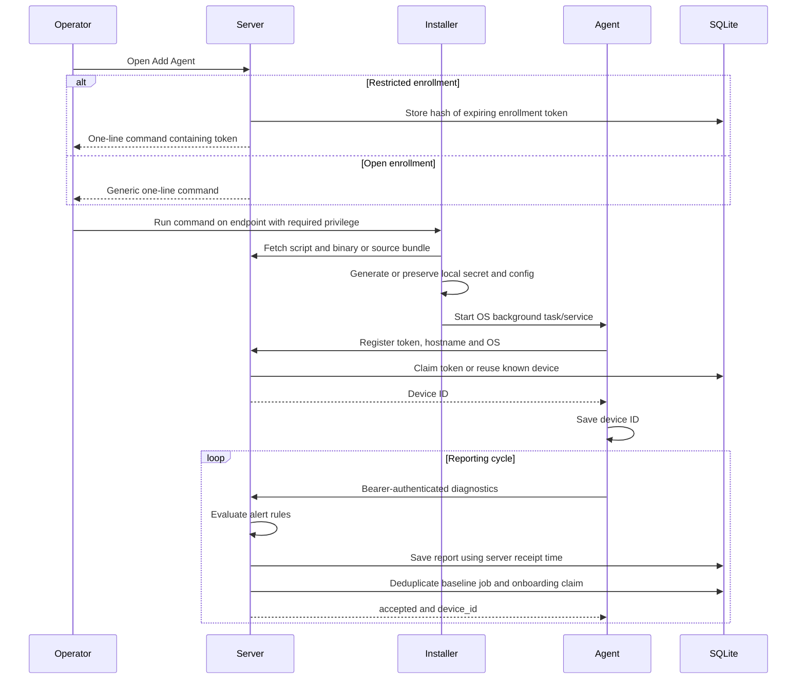

`create_pending_token` uses `secrets.token_urlsafe(32)`, SHA-256 storage, 24-hour default expiry and a 25-token cap. Enrollment expiry limits initial claiming; registered credentials persist. Open enrollment accepts a sufficiently long self-generated secret. Re-registration by the same token retains identity (`device_store.create_pending_token`, `register_device`). Reports reject non-object diagnostics, evaluate rules, save the latest 20 snapshots and use server time (`main.agent_report`; `device_store.save_report`). `_device_for_report` can recover an unknown token/device after a server reset when open enrollment is allowed; this is not address discovery.

### One-liner installation on each OS

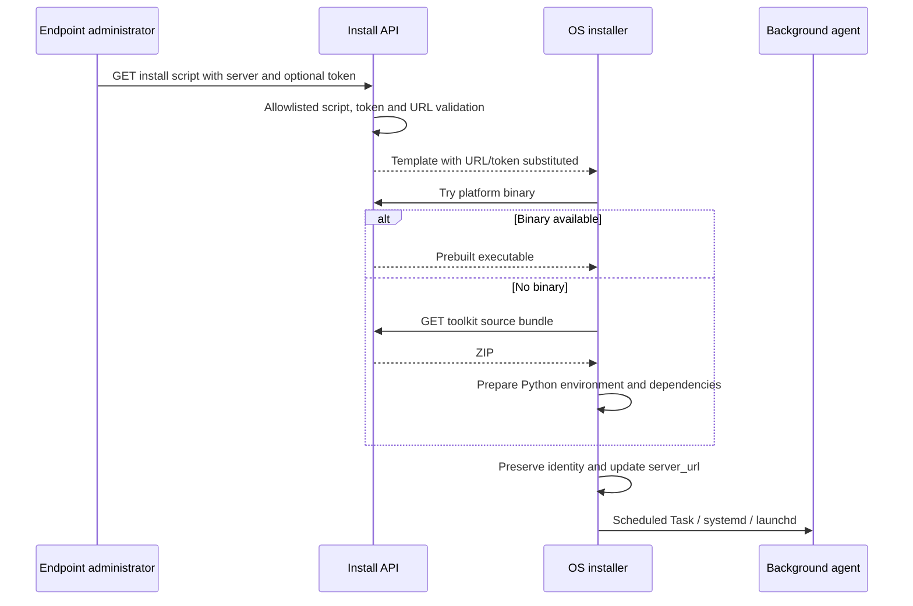

Windows uses a randomized locked staging folder, owner/reparse checks, selective identity/quarantine migration and a SYSTEM startup task. Linux uses `/opt/sentinel-agent` and a system systemd unit; macOS uses `/usr/local/sentinel-agent` and a LaunchDaemon. Both Unix templates create a mode-600 credential file on the new-config path. Only Windows includes the detailed connection-wait loop. No code-signature or manifest-hash verification accompanies downloads. Legacy `agent/install_*` scripts differ materially and should not be confused with served templates (`backend/main.py:install_script`, `agent_bundle`; `backend/install_templates/*`; `agent/install_*`).

### Remote command queue

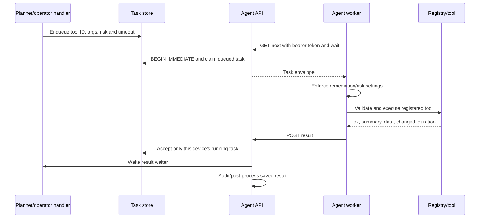

Polling waits at most 30 seconds server-side (default 25), with wake-up signals and periodic database rechecks. A shared four-slot semaphore bounds tasks; reads use a four-worker pool and changes a separate one-worker pool. Reads can overlap a change. The result POST makes up to five attempts and returns immediately on any response below500, including rejection; exhausting retries does not durably preserve the result. Queued tasks expire after 75 seconds; running tasks expire after their timeout plus 60 seconds. `complete_task` accepts only `running`; late results after expiry are rejected, whereas results after a server restart can be recovered if the task remains running (`task_queue`; `monitor_agent._post_result`, `task_worker`; `main.agent_task_result`).

### Live monitor

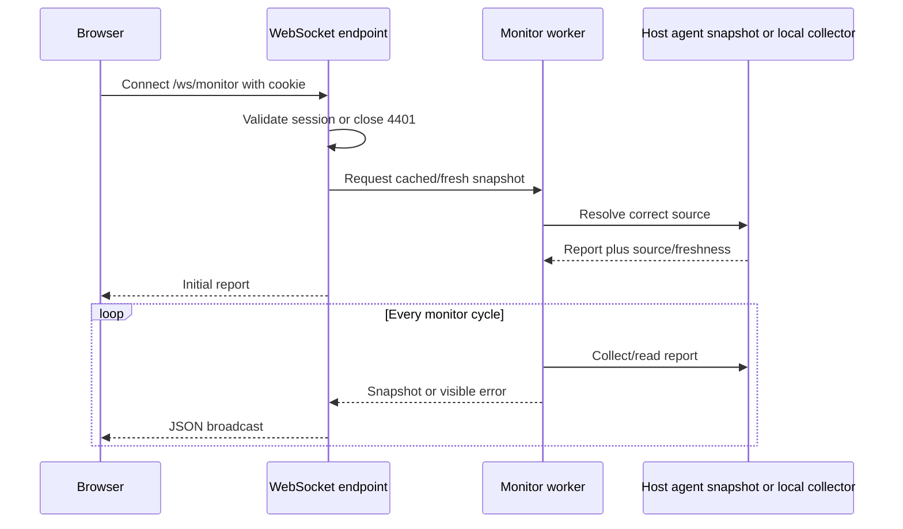

`main.current_snapshot` reuses a report younger than 15 seconds; the loop sleeps five seconds after work. `server_identity` prefers an enrolled host agent and distinguishes container snapshots. Browser disconnection causes retry, not proof the device itself is offline (`main.monitor`, `monitor_loop`; `server_identity.server_snapshot`; `frontend/app.js:connectMonitor`).

### AI diagnosis, chat and approved fixes

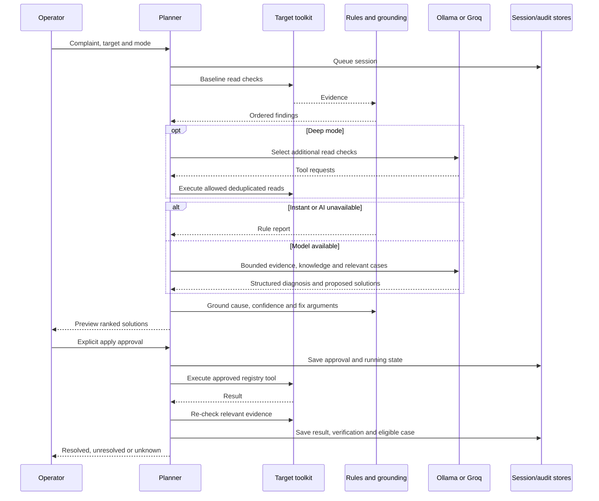

Normal chat does not execute tools: `main.agent_chat` selects device context/history, classifies intent, calls `ai_technician.chat`, records the response and returns compatible reply fields. Threat Chat can answer general questions without a scan, create a bounded investigation or propose an explicitly requested action. Proposing is separate from executing: `_bind_threat_card` creates a stable approval token and `/actions` consumes it (`main.threat_chat_endpoint`, `threat_proposal`, `threat_action`; `security_chat.intent`). Groq translates normalized messages/tool calls to its SDK format; it does not implement Ollama thinking streaming (`GroqProvider.chat`).

### Alert and online/offline lifecycle

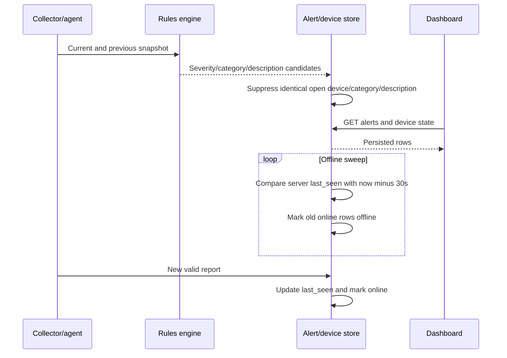

There is no general alert close/acknowledge API in `alert_store`/the current route catalog; threat marks are a separate store. Exact-description deduplication is not a cooldown or incident lifecycle. CPU/memory percentages embedded in descriptions can create successive distinct alerts (`alert_store.add_alert`; `rules_engine.evaluate_rules`). `get_device` returns stored status; sweeps/listing update it, so it is not recalculated on every getter (`device_store.mark_offline_devices`, `list_devices`).

### New security and provider workflow — PARTIAL

First valid report calls `security_store.job_create(kind='baseline')`. A policy-version unique index prevents duplicate baseline records. `security_agent.loop/run` resumes saved steps and uses deterministic remote task IDs, but a partial terminal baseline is not automatically retried. Agent security collection writes batch and cursor in one local transaction; batches are deleted only after matching ACK. Server ingestion commits first and correlates afterwards, leaving a crash gap. Hashes enter provider-specific queues; authorization and a memory key are required before external calls (`main.agent_report`; `security_store`; `security_agent`; `monitor_agent.security_worker`).

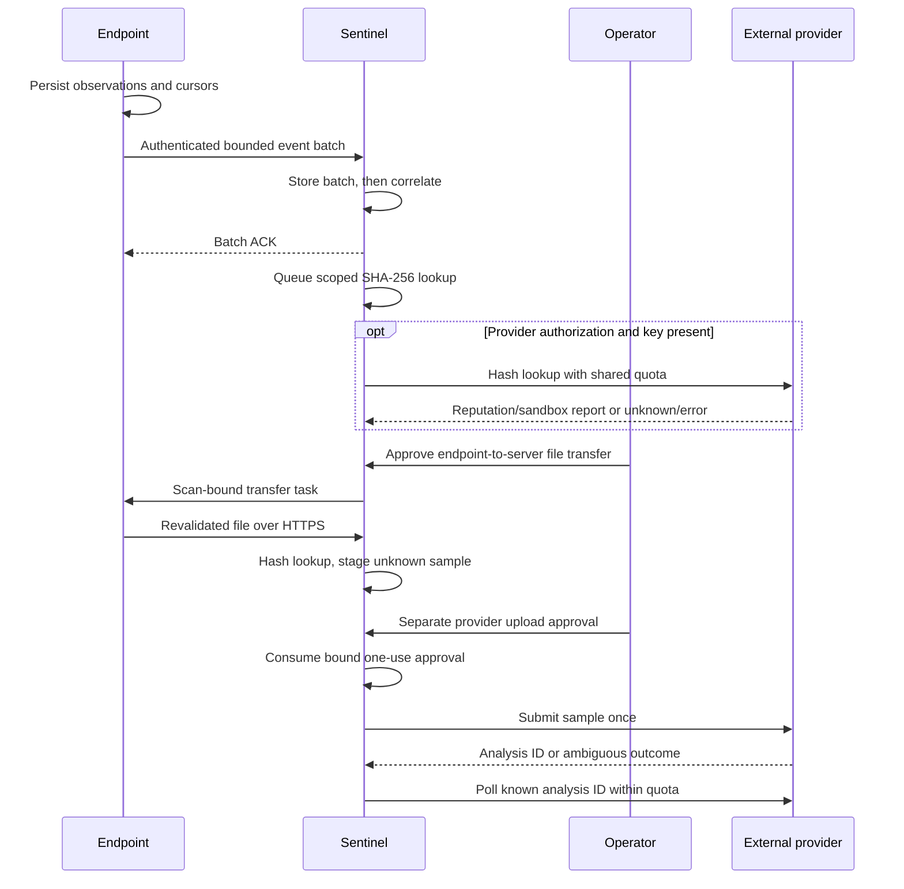

For browser-selected files the endpoint-transfer step is replaced by an explicit browser upload to Sentinel. External report provenance must remain distinct from endpoint observations. A sample is never executed by this code. Public/community credentials do not establish business permission; the backend gate requires an operator-recorded authorization basis, not automated legal verification (`intelligence.configure`; `security_samples.stage/upload`; [VirusTotal restrictions](https://docs.virustotal.com/reference/public-vs-premium-api)).

## 6. Algorithms & Core Logic

Complexity below describes the visible local algorithm, excluding external tools/LLM latency, OS enumeration cost and SQLite planner details. `n` means input records, `b` bytes, `k` returned items. These are analytical bounds, not measurements.

### Threshold rules and severity

`rules_engine.evaluate_rules` reads CPU, RAM, disks, battery and adapters; appends independent findings and sorts by severity. CPU/RAM trigger strictly above 85%; battery below 15% while unplugged; a CPU increase strictly above 40 percentage points triggers a spike. `SPIKE_WINDOW_SECONDS=10` is declared but the rule does not validate actual elapsed time between samples. Complexity is O(n + a log a) for n enumerated items and a alerts. Missing values often default to zero, so absence can suppress alerts rather than establish health (`rules_engine.py:6`, `:42`, `:80`).

Disk logic first requires usage at least 85%. With known free bytes: less than 3 GiB **or usage at least 98%** is critical; less than 8 GiB high; less than 20 GiB medium; otherwise low. Without free-size parsing, thresholds are 95/90/85 percent for critical/high/medium. Low does not create a disk alert. The initial 85% gate means a tiny volume with little absolute free space but lower utilization is not flagged. Size parsing uses powers of 1024 despite GB-style labels (`disk_space_severity:26`).

Security rules mark explicitly disabled available firewall/AV critical, explicitly unencrypted available system disk medium, and non-loopback listeners on ports 21/23/445/3389/5900 high. Listening does not prove remote reachability or maliciousness. Performance thresholds are under 10 MB/s disk throughput, over 300 ms mean TCP latency, and over 40% CPU benchmark throughput regression; no reachable target is high. Event rules flag any critical/fault event and at least five errors (`evaluate_security_rules`, `evaluate_performance_rules`, `evaluate_event_log_rules`).

`alert_store.add_alert` suppresses only an existing open row with the same device, category and exact description. No unique constraint makes concurrent check-then-insert atomic; no time cooldown, automatic recovery closure or retention is implemented. Without a supporting composite index, repeated lookup can become expensive as history grows.

### Health score

`health_report.detect_issues` combines rule families, merges noisy adapter/listener findings and adds resource hog/swap/AV-unknown observations. `score` sorts severity penalties 25/15/8/3 and computes:

`score = max(0, round(100 - sum(penalty[i] * 0.75**i)))`

Ratings are good >=85, fair >=65, poor >=40, critical below40. Sorting is O(n log n). This is a heuristic, not a failure probability. An empty/missing report can score highly because there are few findings; coverage should be read separately. The simple dashboard `health_from_report` differs: it checks CPU/RAM/disk only and is not this numerical score (`health_report.score`; `rules_engine.health_from_report`).

### Playbooks, deterministic findings and cause grounding

`text.words/stem` tokenizes English-like words and applies a small suffix stemmer. `playbooks.match_playbook` scores whole stemmed keyword occurrences rather than substring hits, preventing `ram` matching `program`. Baseline tools are deduplicated/OS-filtered; CPU-sensitive checks are split from other phases. `findings.analyze` dispatches tool-specific evaluators, deduplicates finding keys, groups processes per program, and sorts severity. `RELATED_FINDINGS` limits plausible causes per complaint. `ground_root_cause` replaces an unsupported blamed finding, caps confidence and handles healthy network checks/unreproduced complaints. Complexity is approximately linear in evidence plus keyword/rule matching and sorting; there is no learned causal graph (`playbooks.match_playbook`, `baseline_phases`; `findings.analyze`, `group_processes`; `planner.ground_root_cause`).

### AI planning, normalization and verification

Instant mode runs rules; Fast normally makes one direct report call; Deep allows additional read-only rounds, default three, at most three requested tools per turn. `(tool_id, sorted JSON arguments)` deduplicates tool execution. Provider failures can produce a rule report with a fallback reason; a dropped connection has a bounded retry path. Schema-guided output and lenient JSON recovery reduce discarded truncated answers; recovered JSON is still untrusted (`planner._diagnose`, `_investigate`, `parse_reply`, `_chat`; `llm.base.loads_lenient`).

`validate_fixes` rejects unknown/read-only/hidden/wrong-OS tools, invalid/unknown parameters, protected processes and process/startup targets absent from evidence, then deduplicates proposals. `complete_solutions` aims for 3–4 ranked options, mapping validated tools to cards and filling manual advice from relevant OS/playbook tips. The report's hypothesis/verification/escalation fields are largely server-computed annotations, not proof the model performed a scientific investigation (`planner.validate_fixes`, `complete_solutions`, `enrich_report`).

After approval, `_verify` reruns up to four prior checks, prioritizing sources of the targeted finding and excluding a benchmark repeat. Failed/missing required checks yield `resolved=None`. If relevant findings were observed, disappearance supports rule verification; otherwise a model verdict requires an actual JSON boolean. Fixing a separate finding or an unreproduced complaint must not mark the original problem resolved. This controls what enters trusted learning, but does not prove long-term stability (`planner._verify`; `learning.store.is_trusted`).

### Prompt construction and provider behavior

`ai_technician.compact_report` summarizes metrics, events and alerts, limits repeated event groups, and bounds chat to six messages/6000 characters. `normalize_chat_history` rejects privileged roles and preserves recommendations in assistant turns. General chat supplies source, age and missing-evidence context. Threat prompts cap findings and redact selected personal fields/user folders for a cloud provider; this is not universal PII sanitization across every diagnosis/tool result (`ai_technician.py:47`, `compact_report`, `normalize_chat_history`, `_for_ai`, `_threat_context`).

`planner._ai_report` combines complaint, numbered findings, compact evidence, same-scope past cases and budgeted domain/error-code knowledge. `knowledge.retrieve` selects one relevant domain card, trims on line boundaries, and limits code entries; it is deterministic lookup, not vector search. Untrusted filenames/events can still contain prompt-injection text; instructions explicitly reject those instructions, and registry/read-only boundaries limit actions, but explanation integrity remains a model risk (`security_chat.INSTRUCTIONS`; `planner._investigate`).

Ollama serializes sends with a lock, optionally streams content/thinking, bounds thinking characters and overall stream time, retries unsupported schema format as plain JSON, and normalizes usage/tool calls. Groq converts messages and requests JSON/tool output; `status()` only checks key presence, not network/account/model validity. Groq error mapping treats 4xx as model/request failure and other transport errors as unavailable (`llm/ollama_provider.py:_send`, `_stream`, `chat`; `llm/groq_provider.py:status`, `chat`). Actual model answer quality is **Not determinable from code**.

### Experience retrieval and fleet correlation

`learning.store.find_similar` examines at most 1000 cases, filters origin, trusted status, same OS and playbook, stems complaint tokens and builds sets. Term weight is `log(1 + N/(1 + df(term))) + 1`; cosine similarity uses squared weights over intersecting token sets. Threshold is 0.35, default top three. Root-cause wording is excluded from matching to avoid reinforcing earlier guesses. Approximate work is O(total tokens + N log N). `learned_fixes_for` uses ten similar cases, requires at least two resolved applications and a success rate >=0.6. These are small-sample heuristics, not causal effectiveness estimates (`learning/store.py:169`, `:218`).

Model rebuild writes a Modelfile with shared principles and exports eligible training examples; it does not fine-tune weights. Fingerprints/policy version refresh obsolete definitions. Fleet correlation groups recent cases by playbook and distinct device, default seven days and at least three devices. Same symptom class is a lead, not proof of a common incident (`learning/model_builder.py:build`, `ensure_brain`; `fleet_correlation.fleet_clusters`, `note_for`).

### Security scanning and behavioral correlation

`threats.threat_scan` reads existing antivirus/security evidence, groups repeated events, bounds results and writes an agent-owned scan manifest. Windows covers Defender/Kaspersky and security/system/PowerShell sources; Linux reads auth journal/files and ClamAV; macOS has limited native sources. A default seven-day lookback and six-hour scan-manifest TTL differ from the 30-day normalized-event retention. Sliding `peak_per_hour` counts maximum activity in a one-hour window after sorting (O(n log n)); group aggregation/dedup is approximately O(n). Heuristics distinguish AV-neutralized, suspicious-script, authentication, account/group, service/task and protection events (`threats.py:peak_per_hour`, `_Groups`, `threat_scan`; `threat_rules.analyze_threats`).

New `security_monitor` computes stable process IDs using boot/create context, observes up to 200 processes and bounded connections, hashes only observed executable candidates, denies environment/secret paths and link/reparse traversal, and enforces count/byte/time budgets. Authenticode/codesign attempts are limited; Linux signature verification remains unavailable. Existing Sysmon can be read but no collector is automatically installed (`process_snapshot`, `executable_hashes`, `_safe_path`, `capabilities`).

New event collection uses numeric Windows record bookmarks with a generation increment on reset, Linux journal cursors with a bounded tail and reset fallback, and overlapping one-minute macOS windows. These are different coverage levels. Journal tail limits can miss bursts; macOS is not Endpoint Security coverage. The current five Windows channels each allow100 events, matching the aggregate500 cap; adding channels would require revisiting that invariant. Linux burst loss and macOS overlapping windows need explicit recovery/deduplication handling (`collect_events`; `CHANNELS`).

`security_agent.correlate` uses five authentication failures in five minutes, indicator-based execution findings, persistence additions/changes, and a repeated connection observed three times when its process also has an indicator. Persistence entries are hashed normalized JSON; removals are not reported by the current comparison. Failure counters use receipt time and are not keyed by account/source identity; connection counts are not a statistical anomaly model. Findings have stable device/key hashes. Exact source heuristics, mutable baselines and replay limitations make this **PARTIAL**, not a complete behavioral detection engine (`security_agent.correlate`).

### Provider quotas, caching and approvals

`intelligence._reserve` uses an immediate SQLite transaction to count rolling-minute/day usage before reserving a request. Default VT budget is 4/minute and 500/day; HA's 1/minute and 60/day are local conservative settings, not validated account entitlements. 429 sets a bounded retry time; 401/403 remain visible restrictions. Lookup cache TTL is one hour unknown, six hours suspicious/malicious, 24 hours other known results. The unique `(provider, hash, operation)` job prevents duplicate queue rows, but direct lookup requests and the worker can still race to make duplicate external calls (`intelligence.enqueue_hash`, `lookup`, `worker`).

Provider response normalization keeps reputation/sandbox provenance and explicitly avoids a safe verdict from unknown/zero detections. Keys live in `_keys`, not SQLite. Configuration changes rotate a generation and clear staged samples. Remote key/file entry requires HTTPS; loopback HTTP is permitted (`intelligence.configure`, `secure_transport`, `normalize`).

`security_samples.stage` hashes bytes, performs lookup first and stages only unknown files, at most three, each <=32 MiB with a ten-minute TTL. Upload binds provider/hash/size/source/configuration to a one-use persisted approval, rehashes the bytes, consumes approval before I/O and saves `submitting`. Ambiguous outcomes become `outcome_unknown` on handled failures and are not automatically uploaded again. Crash-left `submitting` rows and timer-expired metadata lack complete reconciliation. Framework multipart handling can spool the incoming body before this memory stage, so the module docstring's no-persistence claim is stronger than the code establishes (`security_samples.stage`, `upload`, `discard`, `poll_due`; `security_api.accept_sample`).

The multipart caveat is supported by [Starlette's official UploadFile documentation](https://starlette.dev/requests/) and [parser source](https://github.com/Kludex/starlette/blob/main/starlette/formparsers.py): uploads use spooled temporary files. The exact installed Starlette version and spool configuration remain **Not determinable from this repository's direct pins**; no dependency was upgraded or executed during this audit.

### Software, leftovers, updates and destructive target identity

Software actions accept inventory/package IDs, refresh inventory and validate protected packages/uninstaller types. They do not expose an arbitrary shell endpoint. Leftover matching normalizes program names, limits candidates, checks ownership and links, exports registry backups and keeps a seven-day quarantine. Restores avoid merging into recreated keys; same-volume moves reduce link/copy hazards. Directory scans are bounded but can still be costly (`software.py`; `leftovers.find_leftovers`, `_still_safe`, `_written_by_agent`, `quarantine_leftovers`, `restore_quarantine`).

OS update installation re-searches selected IDs, rejects empty selections and does not automatically reboot. Windows uses update GUIDs; Linux/macOS use native package/update tools. Microsoft removal has Windows-specific protected AppX/framework lists, Office scrubber/manual paths and backup manifests; it is broader than ordinary uninstallation and should be treated as a privileged operator operation (`updates._wanted_ids`, `install_os_updates`; `microsoft.remove_microsoft`, `fix_install_blocker`).

Threat actions reference agent-owned scan/item IDs and path safeguards, but deletion/quarantine hash the _current_ file rather than comparing it to an approved original digest. `kill_process` compares PID/name, not creation time. Stable server approval identities therefore do not yet fully prevent endpoint target replacement/PID reuse (`threats._scan_item`, `quarantine_threat`, `delete_threat`; `remediation.kill_process`).

### Performance and component tests

`performance_checks` hashes a 1 KiB random payload for 0.5 seconds, writes/reads a 16 MiB temp file in 1 MiB chunks with fsync, and measures TCP connection latency to two DNS IPs on port53 (2-second timeout). It is a short benchmark, not network bandwidth, raw-disk health, FLOPS, or a comprehensive stress test. CPU cost is O(iterations), disk O(bytes), memory bounded by chunks; cache and background load affect results (`performance_checks.py`).

`component_tests.bounded_stress` is hidden from AI and medium-risk with an explicit approval argument. It targets a ten-second loop, checks 85°C and low unplugged battery (<20%), tests at most 128 MiB/10% available RAM, or up to 64 MiB temporary storage with a 512 MiB free-space guard. CPU uses one worker and checksum comparison. Blocking fsync/read/native calls mean the ten-second value is not a strict wall-clock cancellation guarantee; unavailable sensors do not establish safe temperature. Browser audio/camera/microphone/display/keyboard/mouse tests inspect the browsing computer and need interaction (`component_tests.py:86`; `frontend/workbench.js:164`; `app.js:wireInputTesters`). Existing Performance changes were not modified by this audit.

### Tokens, tasks and audit complexity

Enrollment token generation/hash verification is O(token length); token cap cleanup is bounded by its small intended collection, while device lookup needs indexes for scale. Session cookies are deterministic HMAC(password, constant); browser expiry is not server-side expiry or independent revocation. Queue claims serialize with `BEGIN IMMEDIATE`; scans for stale tasks are linear in active tasks. Agent result delivery is bounded retry without durable local persistence. Decision record creation sanitizes filenames and avoids common same-millisecond collisions under a process lock, then writes JSON and appends Markdown; it is not transactional across those files, tamper-evident, or fail-closed on disk errors (`auth.session_token`; `device_store`; `task_queue`; `monitor_agent._post_result`; `decision_log.record`).

## 7. Data Model

### Stores and relationships

Most server stores share `config.DB_PATH` (default project `alerts.db`; container `/data/sentinel.db`). Tables are created lazily, with selected additive upgrades. SQLite is used directly, without an ORM. Foreign-key-looking identifiers are generally logical associations, not enforced references. The endpoint security spool uses its own `agent_dir()/security_state/spool.db`. Other endpoint state is JSON manifests/quarantine files, and decisions are filesystem JSON plus daily Markdown (`config.py`; store `_connect`/`connect` functions; `security_monitor.state_db`; `leftovers`; `decision_log`).

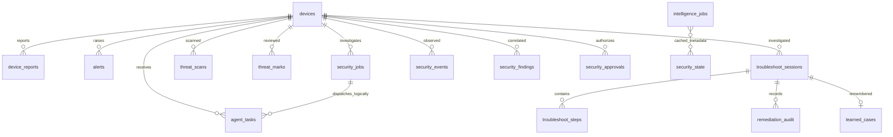

This diagram expresses logical relationships only; consult exact DDL below for actual names, primary keys and declared indexes. Some records use `local` or `local-server`, so not every device reference corresponds to a row in `devices`.

| Data | Retention/cleanup implemented | Important limit |
| --- | --- | --- |
| Device reports | Latest 20 per device | No full historical metrics series (`device_store.save_report`) |
| Pending enrollment tokens | Expiry purge when issuing; keep newest25 | Registration consumes token; concurrency caveat in section9 |
| Threat scans | Latest10 per device | Marks separate and survive scan replacement (`threat_store`) |
| Normalized events and batch receipts | 30days | Cleanup performed by new security loop (`security_store.cleanup`) |
| Correlated findings / approval metadata | 90days relative to stored timestamps | Approval cleanup uses expiry; recurring findings retained by updated time |
| Interactive security jobs | Completed/partial older90days | Baselines preserved for dedup; active jobs not aged out |
| Intelligence usage | Two days | Rolling-day quota history retained |
| Provider report/submission/transfer state | Selected state prefixes older90days | Other state and intelligence queue rows have no general expiry |
| Staged sample bytes | Ten minutes or cancel/submission/config reset | RAM stage only; multipart disk-spooling caveat |
| Local event spool | 1000 batches or about20MiB serialized body length | Drops oldest and reports loss (`security_monitor.enqueue_observations`) |
| Leftover quarantine | Seven days, daily purge attempt | Agent must run; not guaranteed wall-clock deletion (`leftovers.purge_expired`; agent `run`) |
| Alerts, tasks, sessions, learning, decisions | No comprehensive automatic retention found | Long-term storage growth and audit privacy need policy |

### Exact schema and index declarations

Additional explicit index: `CREATE INDEX IF NOT EXISTS threat_scans_device ON threat_scans (device_id, id)` (`backend/threat_store.py:29`). Additive migrations introduce `alerts.device_id`, `devices.agent_token_hash/token_expires_at/onboarding_session_id`, and `learned_cases.target_kind` (`backend/alert_store.py:25`; `device_store._upgrade`; `backend/learning/store.py:76`). There is no versioned migration framework here.

**`agent/toolkit/security_monitor.py:241`**

```sql
CREATE TABLE IF NOT EXISTS state (name TEXT PRIMARY KEY, body TEXT)
```

**`agent/toolkit/security_monitor.py:242`**

```sql
CREATE TABLE IF NOT EXISTS batches (id TEXT PRIMARY KEY, created REAL, body TEXT)
```

**`backend/agent_brain/session_store.py:18`**

```sql
CREATE TABLE IF NOT EXISTS troubleshoot_sessions (
            session_id TEXT PRIMARY KEY,
            device_id TEXT NOT NULL,
            device_label TEXT,
            os_type TEXT,
            issue TEXT NOT NULL,
            playbook_id TEXT,
            status TEXT NOT NULL,
            report_json TEXT,
            verify_json TEXT,
            error TEXT,
            created_at TEXT NOT NULL,
            updated_at TEXT NOT NULL
        )
```

**`backend/agent_brain/session_store.py:34`**

```sql
CREATE TABLE IF NOT EXISTS troubleshoot_steps (
            id INTEGER PRIMARY KEY AUTOINCREMENT,
            session_id TEXT NOT NULL,
            kind TEXT NOT NULL,
            tool_id TEXT,
            args_json TEXT,
            result_json TEXT,
            text TEXT,
            created_at TEXT NOT NULL
        )
```

**`backend/agent_brain/session_store.py:46`**

```sql
CREATE TABLE IF NOT EXISTS remediation_audit (
            id INTEGER PRIMARY KEY AUTOINCREMENT,
            timestamp TEXT NOT NULL,
            session_id TEXT,
            device_id TEXT NOT NULL,
            tool_id TEXT NOT NULL,
            args_json TEXT,
            approved_by TEXT NOT NULL,
            ok INTEGER NOT NULL,
            summary TEXT
        )
```

**`backend/alert_store.py:12`**

```sql
CREATE TABLE IF NOT EXISTS alerts (
            id INTEGER PRIMARY KEY AUTOINCREMENT,
            timestamp TEXT NOT NULL,
            severity TEXT NOT NULL,
            category TEXT NOT NULL,
            description TEXT NOT NULL,
            status TEXT NOT NULL DEFAULT 'open',
            device_id TEXT NOT NULL DEFAULT 'local-server'
        )
```

**`backend/device_store.py:27`**

```sql
CREATE TABLE IF NOT EXISTS devices (
            device_id TEXT PRIMARY KEY,
            nickname TEXT NOT NULL,
            hostname TEXT NOT NULL,
            os_type TEXT NOT NULL,
            agent_token TEXT,
            agent_token_hash TEXT,
            first_seen TEXT NOT NULL,
            last_seen TEXT NOT NULL,
            status TEXT NOT NULL DEFAULT 'offline',
            token_expires_at TEXT,
            onboarding_session_id TEXT
        )
```

**`backend/device_store.py:42`**

```sql
CREATE TABLE IF NOT EXISTS device_reports (
            id INTEGER PRIMARY KEY AUTOINCREMENT,
            device_id TEXT NOT NULL,
            timestamp TEXT NOT NULL,
            diagnostics_json TEXT NOT NULL,
            spike_detected INTEGER NOT NULL DEFAULT 0
        )
```

**`backend/device_store.py:51`**

```sql
CREATE TABLE IF NOT EXISTS pending_agent_tokens (
            token_hash TEXT PRIMARY KEY,
            expires_at TEXT NOT NULL
        )
```

**`backend/learning/store.py:54`**

```sql
CREATE TABLE IF NOT EXISTS learned_cases (
            id INTEGER PRIMARY KEY AUTOINCREMENT,
            session_id TEXT UNIQUE NOT NULL,
            device_id TEXT,
            target_kind TEXT,
            os_type TEXT,
            issue TEXT NOT NULL,
            playbook_id TEXT,
            root_cause TEXT,
            evidence_json TEXT,
            fixes_json TEXT,
            outcome TEXT NOT NULL,
            feedback TEXT,
            feedback_note TEXT,
            corrected_root_cause TEXT,
            created_at TEXT NOT NULL,
            updated_at TEXT NOT NULL
        )
```

**`backend/security_store.py:16`**

```sql
CREATE TABLE IF NOT EXISTS security_jobs (
      id TEXT PRIMARY KEY, device TEXT NOT NULL, policy TEXT NOT NULL, kind TEXT NOT NULL,
      state TEXT NOT NULL, created REAL NOT NULL, updated REAL NOT NULL, body TEXT NOT NULL);
    CREATE UNIQUE INDEX IF NOT EXISTS security_baseline ON security_jobs(device,policy) WHERE kind='baseline';
    CREATE TABLE IF NOT EXISTS security_batches (device TEXT, id TEXT, received REAL, PRIMARY KEY(device,id));
    CREATE TABLE IF NOT EXISTS security_events (id TEXT PRIMARY KEY, device TEXT, received REAL, body TEXT);
    CREATE INDEX IF NOT EXISTS security_events_device ON security_events(device,received);
    CREATE TABLE IF NOT EXISTS security_findings (id TEXT PRIMARY KEY, device TEXT, updated REAL, body TEXT);
    CREATE INDEX IF NOT EXISTS security_findings_device ON security_findings(device,updated);
    CREATE TABLE IF NOT EXISTS security_state (name TEXT PRIMARY KEY, updated REAL, body TEXT);
    CREATE TABLE IF NOT EXISTS security_approvals (id TEXT PRIMARY KEY, device TEXT, expires REAL, state TEXT, body TEXT);
    CREATE TABLE IF NOT EXISTS intelligence_jobs (id TEXT PRIMARY KEY, provider TEXT, hash TEXT, operation TEXT,
      state TEXT, due REAL, created REAL, body TEXT, UNIQUE(provider,hash,operation));
    CREATE TABLE IF NOT EXISTS intelligence_usage (provider TEXT, stamp REAL);
    CREATE INDEX IF NOT EXISTS intelligence_usage_provider ON intelligence_usage(provider,stamp);
```

**`backend/settings_store.py:10`**

```sql
CREATE TABLE IF NOT EXISTS settings (key TEXT PRIMARY KEY, value TEXT NOT NULL)
```

**`backend/software_store.py:12`**

```sql
CREATE TABLE IF NOT EXISTS software_inventory (device_id TEXT PRIMARY KEY, collected_at TEXT NOT NULL, data_json TEXT NOT NULL)
```

**`backend/task_queue.py:25`**

```sql
CREATE TABLE IF NOT EXISTS agent_tasks (
            task_id TEXT PRIMARY KEY,
            device_id TEXT NOT NULL,
            tool_id TEXT NOT NULL,
            args_json TEXT NOT NULL,
            max_risk TEXT NOT NULL,
            timeout_seconds INTEGER NOT NULL,
            status TEXT NOT NULL,
            result_json TEXT,
            session_id TEXT,
            created_at TEXT NOT NULL,
            claimed_at TEXT,
            completed_at TEXT
        )
```

**`backend/threat_store.py:20`**

```sql
CREATE TABLE IF NOT EXISTS threat_scans (
            id INTEGER PRIMARY KEY AUTOINCREMENT,
            device_id TEXT NOT NULL,
            scan_id TEXT,
            created_at TEXT NOT NULL,
            data_json TEXT NOT NULL
        )
```

**`backend/threat_store.py:30`**

```sql
CREATE TABLE IF NOT EXISTS threat_marks (
            device_id TEXT NOT NULL,
            dedup_key TEXT NOT NULL,
            status TEXT NOT NULL,
            note TEXT,
            updated_at TEXT NOT NULL,
            PRIMARY KEY (device_id, dedup_key)
        )
```

## 8. API Catalog

**Authentication legend:** `session*` means the shared dashboard cookie is required only when a dashboard/admin password is configured; otherwise ordinary routes are open. `operator` requires an enabled password and valid cookie, plus the provider service's Origin check. `agent token` denotes endpoint bearer verification. `install policy` denotes validated enrollment/existing-agent token unless open enrollment allows an empty token. `admin+session*` adds `X-Admin-Key`. WebSocket routes validate cookies in their handlers rather than HTTP middleware. `/static/` is public. Provider routes use the stronger operator dependency even when their prefix is mounted globally (`auth.py`; `main.dashboard_auth_middleware`; `intelligence.operator`).

Request fields below are extracted from handlers; they are **not** invented Pydantic schemas. Many endpoints accept arbitrary dictionaries and validate selected fields manually. Response columns show literal return fields and/or delegated return expressions; full nested payloads are defined by referenced stores/tools/planner functions. Errors are FastAPI `detail` objects unless handlers explicitly return another response. The catalog includes HTML, install, WS and compatibility routes, plus framework-generated routes separately.

| Method | Path | Authentication | Request | Response shape / delegate | Handler |
| --- | --- | --- | --- | --- | --- |
| GET | `/api/threat-intelligence/{provider}/settings` | operator | provider: str | status(provider) | `backend/intelligence.py:204` `get_settings` |
| POST | `/api/threat-intelligence/{provider}/settings` | operator | provider: str, payload: dict, request: Request | configure(provider, payload) | `backend/intelligence.py:209` `set_settings` |
| POST | `/api/threat-intelligence/{provider}/test` | operator | provider: str | result | `backend/intelligence.py:215` `test_connection` |
| GET | `/api/threat-intelligence/{provider}/files/{sha}` | operator | provider: str, sha: str | {job_id, **delegate} | `backend/intelligence.py:228` `get_file` |
| GET | `/login` | public; POST login checks password | | FileResponse(FRONTEND_DIR / 'login.html') | `backend/main.py:126` `login_page` |
| POST | `/login` | public; POST login checks password | request: Request | response; RedirectResponse(url='/login?error=1', status_code=303) | `backend/main.py:131` `login_submit` |
| GET | `/logout` | public; POST login checks password | | response | `backend/main.py:142` `logout` |
| GET | `/` | session* | | FileResponse(FRONTEND_DIR / 'index.html') | `backend/main.py:319` `frontend` |
| GET | `/api/diagnostics` | session* | | await current_snapshot() | `backend/main.py:324` `diagnostics` |
| GET | `/api/diagnostics/health` | session* | | health_from_report(await current_snapshot()) | `backend/main.py:329` `health` |
| GET | `/api/server/identity` | session* | | server_identity.identity() | `backend/main.py:334` `server_identity_endpoint` |
| WEBSOCKET | `/ws/monitor` | cookie check (session*) | websocket: WebSocket | WebSocket messages and close; see handler | `backend/main.py:340` `monitor` |
| GET | `/api/diagnostics/security` | session* | | latest_security_report; host; await refresh_security() | `backend/main.py:365` `security` |
| GET | `/api/diagnostics/logs` | session* | | latest_event_log_report; host; await refresh_event_logs() | `backend/main.py:375` `event_logs_endpoint` |
| POST | `/api/diagnostics/logs/diagnose` | session* | think: bool=False | result | `backend/main.py:385` `diagnose_event_logs_endpoint` |
| GET | `/api/alerts` | session* | limit: int=100 | {alerts} | `backend/main.py:401` `alerts` |
| POST | `/api/agents/generate-token` | enabled login + session | request: Request | JSONResponse({'token': token, 'expires_at': expires_at, 'message': 'Use this token once when registering a new agent.'}, headers={'Cache-Control': 'no-store'}) | `backend/main.py:412` `generate_agent_token` |
| POST | `/api/agents/register` | enrollment/existing token or open enrollment | payload: dict; JSON fields: device_id, token, hostname, os_type, nickname | register_device(token, hostname, str(payload.get('os_type', 'Unknown')), str(payload.get('nickname', '')), payload.get('device_id'), allow_open=open_enrollment()) | `backend/main.py:424` `register_agent` |
| POST | `/api/agents/report` | agent token or open-enrollment recovery | payload: dict, request: Request; JSON fields: diagnostics, spike_detected | {accepted, device_id, alerts_created} | `backend/main.py:465` `agent_report` |
| GET | `/api/agents/{device_id}/onboarding` | session* | device_id: str | {session_id, status, created_at, root_cause, severity, confidence, findings, fixes, manual_steps}; {session_id, status} | `backend/main.py:530` `onboarding_status` |
| POST | `/api/agents/{device_id}/onboarding` | session* | device_id: str | {session_id} | `backend/main.py:548` `rerun_onboarding` |
| GET | `/api/agents/{device_id}/software` | session* | device_id: str | {device_id, device, os_type, inventory, jobs} | `backend/main.py:732` `device_software` |
| POST | `/api/agents/{device_id}/software/scan` | session* | device_id: str | running or _start_software_job(target, 'scan', 'Software inventory', 'installed_software', {'check_updates': True}, 'read') | `backend/main.py:739` `scan_device_software` |
| POST | `/api/agents/{device_id}/software/uninstall` | session* | device_id: str, payload: dict; JSON fields: id, name | _start_software_job(target, 'uninstall', str(payload.get('name') or entry_id)[:200], 'uninstall_software', {'id': entry_id}, 'high') | `backend/main.py:746` `uninstall_device_software` |
| POST | `/api/agents/{device_id}/software/update` | session* | device_id: str, payload: dict; JSON fields: package_id, name | _start_software_job(target, 'update', str(payload.get('name') or package_id)[:200], 'update_software', {'package_id': package_id}, 'medium') | `backend/main.py:755` `update_device_software` |
| POST | `/api/agents/{device_id}/software/leftovers` | session* | device_id: str, payload: dict; JSON fields: id, name | _start_software_job(target, 'leftovers', str(payload.get('name') or entry_id)[:200], 'find_leftovers', {'id': entry_id}, 'read') | `backend/main.py:764` `find_device_leftovers` |
| POST | `/api/agents/{device_id}/software/quarantine` | session* | device_id: str, payload: dict; JSON fields: candidate_ids, scan_id, name | _start_software_job(target, 'quarantine', str(payload.get('name') or 'leftovers')[:200], 'quarantine_leftovers', {'scan_id': scan_id, 'candidate_ids': ','.join(ids)}, 'high') | `backend/main.py:774` `quarantine_device_leftovers` |
| POST | `/api/agents/{device_id}/software/restore` | session* | device_id: str, payload: dict; JSON fields: batch_id, name | _start_software_job(target, 'restore', str(payload.get('name') or batch_id)[:200], 'restore_quarantine', {'batch_id': batch_id}, 'medium') | `backend/main.py:786` `restore_device_quarantine` |
| POST | `/api/agents/{device_id}/software/quarantine-list` | session* | device_id: str | _start_software_job(target, 'quarantine-list', 'Quarantine', 'list_quarantine', {}, 'read') | `backend/main.py:795` `list_device_quarantine` |
| GET | `/api/microsoft/{device_id}` | session* | device_id: str | {device_id, device, os_type, jobs} | `backend/main.py:808` `device_microsoft` |
| POST | `/api/microsoft/{device_id}/scan` | session* | device_id: str | running or _start_software_job(target, 'ms-scan', 'Microsoft products', 'microsoft_products', {}, 'read') | `backend/main.py:815` `scan_device_microsoft` |
| POST | `/api/microsoft/{device_id}/remove` | session* | device_id: str, payload: dict; JSON fields: id, name | _start_software_job(target, 'ms-remove', str(payload.get('name') or product_id)[:200], 'remove_microsoft', {'id': product_id}, 'high') | `backend/main.py:822` `remove_device_microsoft` |
| POST | `/api/microsoft/{device_id}/fix-installer` | session* | device_id: str | _start_software_job(target, 'ms-fix', 'Fix install blocker', 'fix_install_blocker', {}, 'medium') | `backend/main.py:833` `fix_device_installer` |
| POST | `/api/agents/{device_id}/software/leftovers/review` | session* | device_id: str, payload: dict; JSON fields: think, job_id | result | `backend/main.py:840` `review_device_leftovers` |
| GET | `/api/software/jobs/{job_id}` | session* | job_id: str | job | `backend/main.py:857` `software_job` |
| GET | `/api/threats` | session* | | {devices, scan_minutes} | `backend/main.py:959` `threats_overview` |
| GET | `/api/threats/{device_id}` | session* | device_id: str | {device_id, device, os_type, scan, stored_at, stale, jobs, scan_minutes} | `backend/main.py:977` `device_threats` |
| POST | `/api/threats/{device_id}/scan` | session* | device_id: str | _start_threat_scan(_threat_target(device_id)) | `backend/main.py:986` `scan_device_threats` |
| POST | `/api/threats/{device_id}/actions` | session* | device_id: str, payload: dict; JSON fields: finding_id, pid, action, approval_id, confirm | _start_software_job(target, f'threat-{action}', name, threat_rules.ACTION_TOOLS[action], args, threat_rules.ACTION_RISK[action]) | `backend/main.py:1001` `threat_action` |
| POST | `/api/threats/{device_id}/proposal` | session* | device_id: str, payload: dict; JSON fields: finding_id, scan_id, action, pid | _bind_threat_card(target.device_id, analysis, card) | `backend/main.py:1042` `threat_proposal` |
| POST | `/api/threats/{device_id}/marks` | session* | device_id: str, payload: dict; JSON fields: finding_id, status, note | {ok, finding_id, status} | `backend/main.py:1054` `threat_mark` |
| POST | `/api/threats/{device_id}/explain` | session* | device_id: str, payload: dict; JSON fields: think | result; {**delegate, source}; {**delegate, source, note} | `backend/main.py:1069` `threat_explain` |
| POST | `/api/threats/{device_id}/chat` | session* | device_id: str, payload: dict; JSON fields: think, message | {reply, proposal, source, session_id, intent, evidence_refs, investigation} | `backend/main.py:1089` `threat_chat_endpoint` |
| POST | `/api/agents/{device_id}/os-updates/install` | session* | device_id: str, payload: dict; JSON fields: update_ids | _start_software_job(target, 'os-update', name, 'install_os_updates', {'update_ids': ','.join(ids)}, 'high') | `backend/main.py:1138` `install_device_os_updates` |
| POST | `/api/agents/{device_id}/performance/test` | session* | device_id: str, payload: dict &#124; None=None; JSON fields: section, approved | job; running | `backend/main.py:1238` `start_performance_test` |
| GET | `/api/performance/jobs/{job_id}` | session* | job_id: str | job | `backend/main.py:1278` `performance_job` |
| GET | `/api/agents/{device_id}/performance/latest` | session* | device_id: str | max(jobs, key=lambda job: job['started_at']); Response(status_code=204) | `backend/main.py:1286` `latest_performance_test` |
| POST | `/api/agents/{device_id}/performance/analyse` | session* | device_id: str, payload: dict; JSON fields: think, job_id | {session_id, status, device, mode} | `backend/main.py:1295` `analyse_performance_test` |
| GET | `/api/agents` | session* | | {agents} | `backend/main.py:1322` `agents` |
| GET | `/api/agents/{device_id}/diagnostics` | session* | device_id: str | latest | `backend/main.py:1332` `agent_diagnostics` |
| GET | `/api/agents/{device_id}/security` | session* | device_id: str | _device_diagnostics_field(device_id, 'security', 'This device has not reported security data yet') | `backend/main.py:1350` `agent_security` |
| GET | `/api/agents/{device_id}/performance` | session* | device_id: str | _device_diagnostics_field(device_id, 'performance', 'This device has not reported performance data yet') | `backend/main.py:1355` `agent_performance` |
| GET | `/api/agents/{device_id}/logs` | session* | device_id: str | _device_diagnostics_field(device_id, 'event_logs', 'This device has not reported event log data yet') | `backend/main.py:1360` `agent_logs` |
| POST | `/api/agents/{device_id}/logs/diagnose` | session* | device_id: str, think: bool=False | result | `backend/main.py:1365` `diagnose_device_event_logs` |
| GET | `/api/agents/{device_id}/alerts` | session* | device_id: str, limit: int=100 | {alerts} | `backend/main.py:1381` `agent_alerts` |
| DELETE | `/api/agents/{device_id}` | admin+session* | device_id: str, request: Request | {deleted, device_id} | `backend/main.py:1386` `revoke_agent` |
| GET | `/api/agents/{device_id}/health-report` | session* | device_id: str | health_report.build(latest['diagnostics'], latest.get('timestamp')) | `backend/main.py:1394` `device_health_report` |
| POST | `/api/agents/{device_id}/agent-diagnose` | session* | device_id: str, think: bool=False | result | `backend/main.py:1403` `diagnose_device` |
| GET | `/api/agents/download/{platform}` | session* | platform: str | FileResponse(path, filename=filename, media_type=media_type); JSONResponse(status_code=404, content={'available': False, 'message': messages[safe_platform], 'manual_install': 'pip install -r agent_requirements.txt && python monitor_agent.py'} | `backend/main.py:1421` `download_agent` |
| POST | `/api/agent/diagnose` | session* | payload: dict; JSON fields: diagnostics, report, alert_history | result | `backend/main.py:1459` `agent_diagnose` |
| GET | `/api/agent/chat` | session* | | ai_status() | `backend/main.py:1473` `chat_status` |
| POST | `/api/agent/chat` | session* | payload: dict; JSON fields: session_id, think, message, device_id | {reply, session_id, device_context, intent, evidence_refs, investigation} | `backend/main.py:1478` `agent_chat` |
| GET | `/api/ai/status` | session* | | {**delegate, load_error, suggest_only, diagnosis_thinking, diagnosis_mode, learned_model} | `backend/main.py:1541` `ai_status_endpoint` |
| GET | `/api/ai/models` | session* | | {provider, switchable, current, running_model, available, load_error, models}; {provider, switchable, current, models} | `backend/main.py:1561` `ai_models` |
| POST | `/api/ai/models/select` | session* | payload: dict | await asyncio.to_thread(ai_models) | `backend/main.py:1582` `ai_select_model` |
| POST | `/api/ai/models/pull` | session* | payload: dict | {model, started} | `backend/main.py:1598` `ai_pull_model` |
| GET | `/api/troubleshoot/playbooks` | session* | | {playbooks} | `backend/main.py:1616` `troubleshoot_playbooks` |
| GET | `/api/troubleshoot/targets` | session* | include_container: bool=False | {targets} | `backend/main.py:1621` `troubleshoot_targets` |
| GET | `/api/troubleshoot/tools` | session* | device_id: str=LOCAL_DEVICE_ID | {os_type, tools} | `backend/main.py:1648` `troubleshoot_tools` |
| POST | `/api/troubleshoot` | session* | payload: dict; JSON fields: mode, issue, playbook_id | {**delegate, sessions} | `backend/main.py:1680` `start_troubleshoot` |
| GET | `/api/troubleshoot/sessions` | session* | device_id: str &#124; None=None, limit: int=30 | {sessions} | `backend/main.py:1709` `troubleshoot_sessions` |
| GET | `/api/troubleshoot/active` | session* | | {limit, in_use, sessions, recent} | `backend/main.py:1714` `troubleshoot_active` |
| GET | `/api/troubleshoot/audit` | session* | device_id: str &#124; None=None, limit: int=100 | {audit} | `backend/main.py:1735` `troubleshoot_audit` |
| GET | `/api/troubleshoot/{session_id}` | session* | session_id: str | session | `backend/main.py:1740` `troubleshoot_session` |
| POST | `/api/troubleshoot/{session_id}/fixes/{index}/apply` | session* | session_id: str, index: int | {accepted, session_id, index} | `backend/main.py:1748` `troubleshoot_apply_fix` |
| POST | `/api/troubleshoot/{session_id}/solutions/{index}/decision` | session* | session_id: str, index: int, payload: dict; JSON fields: decision | {session_id, index, solution} | `backend/main.py:1776` `troubleshoot_solution_decision` |
| GET | `/api/decisions` | session* | limit: int=50 | {folder, decisions} | `backend/main.py:1786` `decisions_feed` |
| GET | `/api/fleet` | session* | | {clusters} | `backend/main.py:1794` `fleet_overview` |
| WEBSOCKET | `/ws/troubleshoot/{session_id}` | cookie check (session*) | websocket: WebSocket, session_id: str | WebSocket messages and close; see handler | `backend/main.py:1801` `troubleshoot_stream` |
| GET | `/api/agents/tasks/next` | agent token | request: Request, wait: int=25 | {task} | `backend/main.py:1830` `agent_next_task` |
| POST | `/api/agents/tasks/{task_id}/result` | agent token | task_id: str, payload: dict, request: Request | {accepted} | `backend/main.py:1847` `agent_task_result` |
| GET | `/api/agents/{device_id}/tasks` | session* | device_id: str, limit: int=50 | {tasks} | `backend/main.py:1866` `agent_tasks` |
| GET | `/api/agents/enrollment` | session* | request: Request | {open, server_url, ngrok_url, ngrok_note} | `backend/main.py:1904` `enrollment_info` |
| GET | `/install/{script_name}` | install policy; uninstall templates public | script_name: str, request: Request, token: str='', server: str='' | PlainTextResponse(text, headers={'Cache-Control': 'no-store'}) | `backend/main.py:1918` `install_script` |
| GET | `/api/agents/bundle` | install policy | token: str='' | Response(buffer.getvalue(), media_type='application/zip', headers=headers) | `backend/main.py:1933` `agent_bundle` |
| GET | `/api/agents/binary/{platform}` | install policy | platform: str, token: str='' | FileResponse(path, filename=filename, media_type='application/octet-stream') | `backend/main.py:1946` `agent_binary` |
| POST | `/api/troubleshoot/{session_id}/feedback` | session* | session_id: str, payload: dict; JSON fields: helpful, note, corrected_root_cause | {case, model_rebuilt} | `backend/main.py:1962` `troubleshoot_feedback` |
| GET | `/api/learning/stats` | session* | | {**delegate, model, rebuild_every, learned_model_name, base_model} | `backend/main.py:1979` `learning_stats` |
| GET | `/api/learning/cases` | session* | limit: int=50 | {cases} | `backend/main.py:1984` `learning_cases` |
| GET | `/api/learning/lessons` | session* | | {lessons} | `backend/main.py:1989` `learning_lessons` |
| POST | `/api/learning/rebuild` | session* | | info | `backend/main.py:1994` `learning_rebuild` |
| GET | `/api/learning/dataset` | session* | | Response(data, media_type='application/jsonl', headers={'Content-Disposition': 'attachment; filename="sentinel_training_data.jsonl"'}) | `backend/main.py:2001` `learning_dataset` |
| POST | `/api/security/investigations` | session* | payload: dict; JSON fields: device_id, question | job | `backend/security_api.py:20` `start` |
| GET | `/api/security/investigations/{identity}` | session* | identity: str | job | `backend/security_api.py:30` `progress` |
| GET | `/api/security/{device}/findings` | session* | device: str, q: str='', severity: str='', status: str='', source: str='', rule: str='', since: float=0, until: float &#124; None=None, offset: int=0, limit: int=50, events: bool=False | {**delegate, coverage, stale, device_status} | `backend/security_api.py:38` `findings` |
| POST | `/api/agents/security/events` | agent token | payload: dict, request: Request; JSON fields: id, events, coverage | {accepted, batch_id} | `backend/security_api.py:48` `ingest` |
| POST | `/api/security/{device}/sample-transfer` | operator | device: str, payload: dict, request: Request; JSON fields: approved_transfer, finding_id, scan_id, provider, sha256 | result | `backend/security_api.py:64` `prepare_sample` |
| POST | `/api/agents/security/sample-transfer` | agent token | request: Request, file: UploadFile=File(...) | security_samples.stage(body['provider'], content, 'agent:' + device['device_id']) | `backend/security_api.py:88` `accept_sample` |
| POST | `/api/threat-intelligence/{provider}/check-file` | operator | provider: str, request: Request, file: UploadFile=File(...) | stage(provider, content) | `backend/security_samples.py:55` `check_file` |
| DELETE | `/api/threat-intelligence/{provider}/uploads/{token}` | operator | provider: str, token: str | {discarded} | `backend/security_samples.py:65` `cancel` |
| POST | `/api/threat-intelligence/{provider}/uploads/{token}` | operator | provider: str, token: str, payload: dict, request: Request; JSON fields: environment_id, approved | {analysis_token, sha256, status, provider} | `backend/security_samples.py:75` `upload` |
| GET | `/api/threat-intelligence/{provider}/analyses/{token}` | operator | provider: str, token: str | {provider, sha256, status, **delegate, detail} | `backend/security_samples.py:118` `analysis` |
| GET | `/api/virustotal/settings` | operator | | {**delegate, max_file_bytes} | `backend/virustotal.py:29` `settings` |
| POST | `/api/virustotal/settings` | operator | payload: dict, request: Request | intel.configure('virustotal', payload) | `backend/virustotal.py:33` `configure` |
| GET | `/api/virustotal/files/{sha}` | operator | sha: str | intel.lookup('virustotal', sha) | `backend/virustotal.py:38` `lookup` |
| POST | `/api/virustotal/check-file` | operator | request: Request, file: UploadFile=File(...) | samples.check_file('virustotal', request, file) | `backend/virustotal.py:42` `check_file` |
| DELETE | `/api/virustotal/uploads/{token}` | operator | token: str | samples.cancel('virustotal', token) | `backend/virustotal.py:46` `discard` |
| POST | `/api/virustotal/uploads/{token}` | operator | token: str, payload: dict, request: Request | samples.upload('virustotal', token, payload, request) | `backend/virustotal.py:50` `upload` |
| GET | `/api/virustotal/analyses/{token}` | operator | token: str | samples.analysis('virustotal', token) | `backend/virustotal.py:54` `analysis` |

FastAPI default-generated `GET /openapi.json`, `/docs`, `/docs/oauth2-redirect`, `/redoc` inherit ordinary HTTP session middleware. `/static/{path}` is a public mounted static-file GET/HEAD interface. CORS may answer OPTIONS. These framework routes are not additional business handlers (`backend/main.py:54`, `:59`, `:64`).

## 9. Security Model Review

### Controls present

Password comparison uses constant-time byte comparison; bearer secrets are SHA-256 hashed at rest in the device store; enrollment tokens are random, bounded and expire before claiming. Cookies are HttpOnly/SameSite=Lax and Secure when the request scheme is HTTPS. Public paths are exact or slash-terminated prefixes to avoid accidental prefix collisions. Provider configuration adds authenticated operator/Origin checks and remote HTTPS requirements (`auth.py`; `device_store.py`; `main.login_submit`; `intelligence.operator`, `secure_transport`).

The registry validates known arguments, risk and OS; the AI investigation sees read tools, and executable suggestions are revalidated against evidence. Endpoint policy independently caps remediation. Software/threat/leftover operations use known IDs and protected-target checks. This is a named-tool allowlist, **not** absence of subprocesses: fixed PowerShell, shell-interpreter and native executable invocations exist inside tools/installers (`registry`; `planner.validate_fixes`; `monitor_agent._task_result_for`; `toolkit/common.py:powershell`).

Nginx rate-limits login POSTs to 10/minute with burst5, bounds request body to20MiB and trusts ngrok forwarding from a fixed address. Uvicorn trusts forwarded headers from all reachable proxies; Compose binds its host port to loopback, so maintaining that network boundary matters. CORS allows all origins/methods/headers with credentials disabled. CORS is not a substitute for authentication or WS Origin validation (`deploy/nginx/aiops.conf`; `Dockerfile`; `docker-compose.yml`; `main.py:59`).

### Severity-ranked risk register

Findings are static observations or explicitly labeled plausible failure scenarios; no exploit or destructive proof was executed. Severity reflects consequences in a privileged office deployment, not a measured CVSS score. Suggested fixes are descriptions only.

| ID | Severity | Evidence and consequence | Suggested fix |
| --- | --- | --- | --- |
| S01 | High, configuration-dependent | `auth.auth_enabled`, `has_valid_session`; `main.open_enrollment`: missing passwords open ordinary management routes, while enrollment defaults open. A reachable unconfigured instance has no operator boundary. | Fail closed outside an explicit local setup mode; validate authentication/enrollment at startup. |
| S02 | High, transport-dependent | `main.SERVER_URL_PATTERN`, `_server_url`; `monitor_agent.request_with_retry`; served install templates accept HTTP and download executable/source without artifact verification. LAN interception could expose credentials or alter privileged installation/tasks. | Require authenticated HTTPS for deployment/agents and signed/versioned artifact verification; provide an explicit migration path for existing identities. |
| S03 | High | `auth.session_token` is deterministic HMAC of a constant with the shared password. All browsers share the same bearer cookie; expiry/logout is browser-local and a copied cookie remains valid until password change. No RBAC/MFA/user attribution exists. | Random server-side expiring sessions with revocation and individual operator identities; require roles for destructive actions. |
| S04 | High | `remediation.kill_process` checks PID/name only; `threats.quarantine_threat/delete_threat` act on current path without comparing original approved hash/identity. Same-name PID reuse or file replacement can change the target after approval. | Bind process create/boot identity and file digest/size/stat identity through approval to endpoint execution; reject changed targets. |
| S05 | High, static crash scenario | `security_api.ingest` calls `store.ingest` then `correlate`; committed batch replay returns false. Crash/failure between them permanently skips correlation although the endpoint gets a successful ACK on retry. | Transactional event-processing outbox/cursor and idempotent correlation replay. |
| S06 | Medium, telemetry gap | `security_monitor.collect_events` uses journal tail `-n100` and advances to the returned cursor; bursts can skip older events. macOS one-minute windows cannot replay a long collection interruption. Coverage notices exist, but full incremental recovery does not. | Drain cursor-ordered batches with bounded backlog accounting; persist explicit loss intervals and avoid claiming complete history. |
| S07 | Medium–High | `security_agent.correlate` counts authentication failures each time handed an event, while event insert dedup occurs separately. Overlapping macOS windows/new batches can repeat events and inflate failures; counters use arrival time. | Correlate only newly accepted stable event IDs, preserve event time, and group appropriate identities. |
| S08 | Medium–High | `UploadFile` routes in `security_samples.check_file` and `security_api.accept_sample` read after multipart parsing; no custom memory-only parser or pre-parse limit is implemented. Code cannot guarantee bytes never hit disk. Nginx20MiB also contradicts application32MiB allowance. | Choose/document staged storage, enforce transport/parser limits before buffering, align proxy/application sizes, scrub all failure paths. |
| S09 | Medium | `security_agent.run` marks a job complete/partial before optional explanation and uses terminal partial baseline dedup. A crash can leave explanation unavailable; reconnect does not resume a terminal partial baseline. | Separate collection/explanation/recovery states and resumable retry policy within a defined budget. |
| S10 | Medium | `security_store.ingest` replaces the whole device coverage object per batch; `security_api.findings` uses one received time. A process snapshot can erase stale event-source coverage. | Merge source-specific freshness and loss counters; show each source independently. |
| S11 | Medium | `intelligence.test_connection` makes two immediate HA requests while default budget is1/minute, preventing normal completion of environment discovery. Lookup GET calls external lookup directly as well as enqueueing, without an in-flight hash lock. | Persist multi-step capability probes; single-flight provider requests through the shared queue. |
| S12 | Medium | `security_samples.discard/clear` remove bytes without updating persisted pending state; `poll_due` excludes crash-left `submitting`. HA `ERROR` is labeled completed. | Reconcile expired/abandoned submissions on startup; show failed vs completed vs unknown explicitly. |
| S13 | Medium | `frontend/workbench.js:wbVtKey` cannot set business authorization; no HA settings UI. `app.js:sendThreatChat` calls an absent investigation renderer only conditionally. | Finish authenticated policy/capability UI and progress/search integration before describing feature as complete. |
| S14 | Medium | `frontend/app.js:runThreatAction` lacks post-await device checks, so result/rescan can affect a newly selected device's view. | Capture device/scan/version at dispatch and revalidate before every UI write or follow-up scan. |
| S15 | Medium | `main.agent_chat` still accepts explicit common legacy session IDs and keeps unbounded server session keys; `security_chat.history` fixes this only for Threat Chat. | Share validated random session-ID handling, TTL and count limits across both chats. |
| S16 | Medium | `device_store.register_device` reads pending/existing rows before a write transaction; deletion of pending token has no checked rowcount. Concurrent claims have a plausible one-use race. | Transactionally claim a token with an atomic state transition and a unique device credential constraint; add concurrency tests. |
| S17 | Medium | `decision_log.record` logs and continues on filesystem failure; task-result persistence and `_after_task_result` auditing are separate. Audit records are mutable files with shared operator attribution. | Durable audit outbox, explicit degraded-audit status and protected append-only export; reconcile saved-but-unaudited results. |
| S18 | Medium | General/planner prompts include capped logs, paths, process/software names and case text; cloud redaction is concentrated in threat helpers (`ai_technician._for_ai`; `planner._ai_report`). | Define a provider-boundary data minimization/redaction policy and test every prompt family. |
| S19 | Medium | Unix install templates use existing fixed install directories without the Windows owner/link staging checks. Legacy manual installers have different protections and executable naming/fallback behavior. | Unify maintained installers; validate ownership, symlinks, permissions and artifact identity per OS; deprecate obsolete paths. |
| S20 | Medium | No global application request/AI admission rate limit or WS Origin check; raw dict payloads have uneven size/shape limits. Login limiting is only nginx-side (`main`; `auth`; `nginx/aiops.conf`). | Add bounded request schemas, per-operation limits, WS Origin checks and CSRF protection for cookie-authenticated mutations. |
| S21 | Medium | Agent `_post_result` makes up to five attempts without durable result spool; expired tasks reject later results (`task_queue.complete_task`). An executed change may remain unknown. | Persist result outbox and reconcile late outcomes without re-executing a change. |
| S22 | Low–Medium | Old alerts/tasks/cases/decision files and queue/state subsets lack retention; `delete_device` removes reports/device but leaves related history. | Explicit privacy/retention/revocation policy with scoped purge and preserved audit semantics. |

These findings do not imply that every deployed instance is exposed: active configuration, network reachability, permissions and installed artifacts were deliberately not inspected. Provider licensing is separately gated; operator attestation is not proof of provider permission ([official VirusTotal restrictions](https://docs.virustotal.com/reference/public-vs-premium-api); `intelligence.policy/configure`).

## 10. Quality & Operations

### Errors, observability and tests

The server logs uncaught exceptions and returns a generic500; collectors often return unavailable/unknown sections; registry exceptions become failed tool envelopes. Background loops catch/log errors to keep monitoring alive. Some UI and WS exceptions are suppressed; unknown and stale states vary by feature. Decisions deliberately do not stop diagnosis on filesystem errors, trading availability for possible audit loss (`main.generic_exception_handler`, background loops; `collectors`; `registry.run_tool`; `decision_log.record`).

Tests cover enrollment, tool allowlisting, learning hygiene, grounding, verification, hosting, queue/live sessions, software leftovers, threat parsing/actions, Microsoft tools and provider normalization. E2E scripts exist for API/browser and dummy leftover removal. Their presence does not prove a current pass, actual platform coverage, or acceptable detection quality. This audit did **not** execute pytest or E2E. Existing docs' historical counts belong to older snapshots and are not current validation (`tests/`; `tests/e2e/README.md`; `docs/09-sentinel-review-and-alignment.md`).

| Test file | Test-function declarations | Behavior examples |
| --- | --- | --- |
| `tests/conftest.py:1` | 0 | |
| `tests/e2e/api_check.py:1` | 0 | |
| `tests/e2e/browser_check.py:1` | 0 | |
| `tests/e2e/leftover_dummy_check.py:1` | 0 | |
| `tests/test_accuracy.py:1` | 21 | test_a_full_disk_with_plenty_of_space_left_is_not_a_serious_problem; test_memory_pressure_names_the_programs_and_suggests_what_to_close; test_findings_are_split_into_possible_causes_and_separate_problems; test_a_finding_that_cannot_cause_the_complaint_is_replaced_by_one_that_can; test_a_correct_answer_keeps_its_words_and_high_confidence; test_when_nothing_explains_the_complaint_confidence_is_low_and_no_fix_can_resolve_it; test_a_reply_cut_off_by_the_token_cap_keeps_its_complete_parts; test_the_fast_prompt_is_short_and_names_what_matters |
| `tests/test_agent_brain.py:1` | 8 | test_full_session_diagnose_fix_and_verify; test_inline_tool_calls_are_parsed; test_task_queue_lifecycle; test_manual_steps_that_a_tool_can_do_become_fixes; test_learning_memory_recalls_similar_cases_and_successful_fixes; test_operator_feedback_overrides_the_agent; test_model_builder_writes_modelfile_and_dataset; test_unrelated_fixes_are_dropped_for_a_playbook |
| `tests/test_ai_technician.py:1` | 10 | test_compact_report_is_small_and_keeps_the_signal; test_list_fields_returned_as_one_string_are_split_into_items; test_diagnose_sends_digest_with_a_length_cap; test_reply_cut_off_by_the_token_cap_keeps_its_complete_parts; test_empty_event_log_is_answered_without_the_ai; test_chat_preserves_follow_up_steps_and_snapshot_freshness; test_chat_without_a_report_does_not_invent_measurements; test_chat_uses_only_relevant_error_code_guidance |
| `tests/test_brain.py:1` | 17 | test_solutions_keep_only_real_tools_and_cap_at_four; test_report_is_topped_up_to_three_and_linked_to_runnable_fixes; test_a_filtered_out_fix_turns_its_solution_manual; test_no_code_path_applies_a_fix_without_a_person; test_decisions_are_saved_as_json_and_indexed; test_records_in_the_same_millisecond_are_all_kept; test_rejecting_a_solution_is_recorded_and_runs_nothing; test_streamed_reply_forwards_thinking_and_returns_the_answer |
| `tests/test_enrollment.py:1` | 12 | test_open_enrollment_accepts_a_self_generated_secret; test_open_enrollment_rejects_short_secrets; test_the_dashboard_login_alone_mints_a_one_time_token; test_tokens_are_refused_when_no_login_is_configured; test_revoking_needs_the_admin_key_and_odd_input_is_a_401_not_a_crash; test_expired_and_surplus_enrollment_tokens_are_purged; test_the_newest_token_survives_even_when_many_share_one_clock_tick; test_by_default_any_device_installs_with_the_same_command_and_no_token |
| `tests/test_eval_cases.py:1` | 4 | test_every_scenario_produces_the_findings_it_was_built_for; test_every_scenario_runs_through_the_pipeline_and_keeps_at_least_three_solutions; test_a_fast_run_with_a_model_is_scored; test_the_scorer_catches_a_finding_blamed_for_a_complaint_it_cannot_cause |
| `tests/test_eval_reasoning.py:1` | 3 | test_reasoning_cases_score_on_the_contract; test_hypotheses_check_fails_without_the_contract; test_training_export_includes_the_bad_to_good_exemplars |
| `tests/test_fast_diagnosis.py:1` | 15 | test_fast_mode_runs_the_baseline_in_parallel_and_calls_the_llm_once; test_parallel_phase_runs_tools_concurrently; test_instant_mode_needs_no_llm_and_verifies_fixes_by_rules; test_unavailable_ai_falls_back_to_the_rule_based_diagnosis; test_slow_llm_report_falls_back_to_rules; test_findings_rules; test_hardware_and_os_playbooks; test_remote_result_wakes_the_planner_immediately |
| `tests/test_fleet.py:1` | 4 | test_cluster_needs_several_distinct_devices; test_one_device_repeating_is_not_a_cluster; test_note_for_counts_other_devices_plus_this_one; test_note_for_ignores_missing_playbook |
| `tests/test_health_and_software.py:1` | 12 | test_healthy_snapshot_scores_100; test_issues_name_the_culprit_processes_and_lower_the_score; test_winget_table_is_parsed_by_column_positions; test_uninstall_method_comes_from_the_registry_entry; test_linux_refuses_protected_and_invalid_packages; test_inventory_store_tracks_uninstalls_and_updates; test_onboarding_is_claimed_once_per_device; test_old_agent_gets_an_actionable_message |
| `tests/test_hosting.py:1` | 5 | test_ngrok_https_tunnel_is_preferred; test_ngrok_lookup_is_skipped_when_disabled; test_configured_address_beats_the_temporary_ngrok_url; test_public_paths_are_exact; test_windows_installer_locks_the_agent_folder_to_system_and_administrators |
| `tests/test_knowledge.py:1` | 18 | test_matched_playbook_selects_its_domain_card; test_keyword_match_when_no_playbook; test_retrieve_is_selective_for_a_printer_issue; test_retrieve_empty_when_nothing_matches; test_retrieve_respects_the_budget_and_never_cuts_mid_line; test_investigate_tool_hint_names_relevant_checks; test_every_card_where_key_exists_in_the_map; test_tool_knowledge_and_card_tools_are_real_registered_tools |
| `tests/test_learning_admin.py:1` | 3 | test_changes_are_only_shown_until_yes_is_given; test_container_lessons_stop_being_trusted; test_only_test_tickets_since_the_date_are_deleted |
| `tests/test_learning_hygiene.py:1` | 11 | test_recall_requires_same_os_and_selected_playbook; test_weak_overlap_and_previous_root_cause_do_not_create_a_match; test_common_ticket_inflections_match; test_unknown_playbook_does_not_recall_a_known_different_domain; test_legacy_cases_infer_playbook_from_the_complaint; test_container_provenance_survives_moving_database_to_a_native_host; test_real_native_local_device_remains_eligible; test_legacy_database_migration_preserves_cases_and_excludes_ambiguous_local_origin |
| `tests/test_leftovers.py:1` | 16 | test_names_are_normalized_for_matching; test_leftover_scan_finds_the_program_and_skips_shared_and_other_programs; test_quarantine_moves_only_scanned_ids_and_restore_puts_everything_back; test_expired_scans_and_old_batches; test_scan_refuses_programs_that_are_still_installed_or_never_recorded; test_registry_leftover_is_exported_deleted_and_restored; test_storage_agent_and_folders_holding_another_program_are_never_offered; test_a_bare_first_word_folder_is_only_offered_beside_a_confident_match |
| `tests/test_live_sessions.py:1` | 5 | test_at_most_two_diagnoses_run_at_once_and_the_third_waits_in_line; test_the_limit_comes_from_the_environment; test_the_phase_says_when_a_diagnosis_waits_for_the_ai; test_one_start_diagnoses_up_to_two_devices; test_the_live_feed_route_is_not_taken_for_a_session_id |
| `tests/test_microsoft.py:1` | 9 | test_listing_separates_office_programs_and_store_apps; test_office_version_is_detected_for_the_scrubber; test_manual_office_removal_backs_everything_up_before_deleting; test_the_scrubber_is_used_when_present_and_registry_is_still_backed_up; test_remove_microsoft_dispatches_by_id; test_remove_appx_refuses_protected_packages; test_remove_appx_removes_and_deprovisions; test_fix_install_blocker_clears_the_stale_marker |
| `tests/test_microsoft_api.py:1` | 4 | test_scan_and_remove_start_jobs_with_the_right_tool_and_risk; test_remove_needs_a_valid_product_id; test_an_unknown_device_is_404; test_the_container_itself_cannot_be_targeted_in_docker |
| `tests/test_ollama_provider.py:1` | 9 | test_thinking_model_gets_think_false_by_default; test_non_thinking_model_never_gets_think; test_saved_model_choice_wins_over_env; test_switching_model_unloads_the_previous_one; test_model_mojibake_is_repaired; test_sampling_follows_qwens_advice_unless_a_temperature_is_given; test_a_json_schema_is_sent_and_plain_json_is_used_where_ollama_refuses_it; test_thinking_stops_at_its_budget_and_the_reasoning_so_far_is_returned |
| `tests/test_performance.py:1` | 12 | test_linux_input_devices_are_parsed_and_system_buttons_ignored; test_an_input_device_driver_problem_is_a_finding_with_a_rescan_fix; test_systemd_times_are_converted_to_seconds; test_windows_boot_timing_names_what_slowed_it; test_windows_update_search_is_parsed; test_os_update_install_takes_only_validated_ids_and_never_restarts; test_apt_and_linux_installs_only_upgrade_offered_packages; test_full_test_runs_every_check_read_only_and_feeds_the_ai_analysis |
| `tests/test_reasoning_contract.py:1` | 9 | test_memory_cause_names_the_component_and_rules_disk_out; test_tests_performed_and_verification_plan_point_at_the_cause; test_unreproduced_complaint_has_uncertainty_and_no_component; test_clean_machine_keeps_a_low_confidence_note; test_verification_steps_helper; test_enrich_is_safe_with_no_findings; test_uncertain_diagnosis_gets_clarifying_questions; test_confident_cause_has_no_clarifying_questions |
| `tests/test_records.py:1` | 14 | test_a_change_on_this_server_is_recorded_when_approved_and_when_finished; test_an_agent_result_is_recorded_when_it_arrives_even_without_the_job; test_read_only_results_are_not_recorded_as_changes; test_a_change_still_running_on_the_device_blocks_the_next_one_across_restarts; test_an_interrupted_fix_is_not_stuck_and_its_late_result_is_recorded; test_a_late_result_for_a_live_session_is_left_to_the_session; test_agent_download_answers_without_crashing; test_last_seen_uses_the_servers_clock |
| `tests/test_server_identity.py:1` | 7 | test_the_agent_on_the_host_is_this_server; test_without_a_host_agent_the_container_is_shown_and_labelled; test_in_docker_the_container_is_not_offered_as_a_device; test_outside_docker_this_server_is_still_a_target; test_a_device_enrolled_later_under_the_servers_name_does_not_take_its_place; test_container_diagnoses_teach_nothing_and_cannot_be_rated; test_the_performance_tab_tests_the_host_agent_instead_of_the_container |
| `tests/test_technician_chat.py:1` | 7 | test_browser_history_is_used_and_empty_history_starts_fresh; test_sessions_are_distinct_reusable_and_scoped_to_device; test_snapshot_age_and_device_status_reach_the_model; test_no_agent_snapshot_allows_general_questions_without_substituting_server_data; test_local_alias_uses_the_host_agent_even_if_offline; test_container_fallback_is_explicit_and_ignores_client_snapshot; test_unknown_device_and_invalid_history_do_not_reach_model |
| `tests/test_threat_api.py:1` | 7 | test_a_scan_is_stored_with_categorised_findings_and_alerts; test_actions_are_checked_again_on_the_server; test_the_action_chat_proposes_and_never_runs_anything; test_marks_and_the_rules_explanation; test_no_scan_yet_and_unknown_devices; test_a_cloud_ai_never_sees_names_or_addresses; test_an_old_agent_is_not_asked_again_for_a_while |
| `tests/test_threat_rules.py:1` | 10 | test_a_heuristic_hit_in_an_iso_is_high_with_proof_path_steps_and_actions; test_a_running_detection_is_critical_and_offers_to_end_the_process; test_a_file_the_antivirus_removed_is_low_and_offers_no_action; test_defender_switched_off_by_kaspersky_is_not_a_threat; test_failed_sign_ins_are_rated_by_their_busiest_hour; test_account_persistence_and_tampering_rules; test_old_kaspersky_databases_are_a_finding; test_marks_keep_across_scans_and_findings_are_ordered_by_category |
| `tests/test_threats_agent.py:1` | 11 | test_kaspersky_event_text_becomes_fields; test_606_detections_inside_one_iso_are_one_item_with_its_proof; test_a_huge_scan_stays_under_the_task_result_cap; test_an_unreadable_log_is_reported_never_shown_as_clean; test_the_scan_script_itself_has_no_attack_words; test_quarantine_moves_the_file_and_the_software_tab_restores_it; test_actions_refuse_protected_folders_folders_and_missing_files; test_delete_needs_the_file_name_typed |
| `tests/test_toolkit.py:1` | 11 | test_unknown_tool_is_refused; test_fix_tools_need_explicit_risk_permission; test_arguments_are_validated; test_restart_service_rejects_names_outside_allow_list; test_ping_rejects_option_injection; test_llm_only_sees_read_only_tools_by_default; test_os_specific_tools_are_filtered; test_system_overview_runs |
| `tests/test_verification_grounding.py:1` | 2 | test_missing_or_failed_checks_never_mark_fix_resolved; test_ai_verification_requires_a_boolean |
| `tests/test_workers.py:1` | 2 | test_queued_ai_calls_wait_without_threads_and_the_monitor_still_answers; test_the_server_report_survives_a_missing_cpu_frequency_and_a_broken_section |

Static count: **278 test-function declarations** across 34 Python test/support files. Parametrization changes collected case counts. Tests were read, not executed; no current pass count is claimed.

### Build, release and operational behavior

`Dockerfile` runs one Uvicorn worker deliberately: WS subscriptions, task signals, local caches, provider keys, approval sample bytes and progress maps are process-local. Adding workers without redesign can split sessions/keys/jobs and duplicate schedulers. The app container has no explicit non-root USER declaration. Healthcheck only GETs `/login`; it does not validate Ollama, database writes, agent reachability, security workers or provider readiness (`Dockerfile`; `main.start_monitor`; `security_samples._stages`; `intelligence._keys`).

Compose initializes Ollama's model before the app; models and database are persisted in volumes/bind mounts. Logs rotate at three10MB files per container. ngrok is optional; without a token its container sleeps rather than publishes. Model and app image tags are mutable; source-install dependency upgrades are unpinned. Windows build installs pinned agent requirements; Linux/macOS build scripts install PyInstaller without a version and assume other dependencies are present (`docker-compose.yml`; `agent/build_*`).

The self-hosted GitHub Actions workflow deploys on pushes to main using checkout `clean:false`, copies server-held configuration, ensures host-name configuration and runs `docker compose up -d --build` plus image pruning. No test job, signed artifact gate, health rollback or staged endpoint rollout is present in this workflow. Reading its script does not read the referenced configuration file or establish a deployment occurred (`.github/workflows/deploy.yml`).

`deploy/backup.sh` uses SQLite's backup API and integrity check, copies decisions and optionally server configuration, creates owner-restricted archives and applies a retention setting. Its actual cron schedule, successful backups and restorability are **Not determinable from code**. Export/import scripts package platform-specific images, optional models and private data; imports protect an existing database, but packaging is not a secret-free artifact when private-data options are selected (`deploy/backup.sh`, `export.*`, `import.*`). None was executed.

Configuration is distributed across process environment, persisted model setting, device `agent_config.json`, and new security policy state. `backend/config.py` calls `load_dotenv()` at import and creates the DB parent directory; therefore importing the app would violate the no-configuration-access audit constraint. The appendix lists names statically; it does not disclose actual values. Future tests should disable automatic dotenv loading before importing application modules and isolate all persistence.

### Performance and scalability

SQLite handles many independent connections and lazy schema checks. Several queries scan JSON bodies in Python, especially security search, and some history tables have no retention/index matching their access pattern. Security cleanup runs every scheduler iteration. Event delivery/correlation is synchronous in the handler; hashing/native commands and AI can be expensive despite bounded work (`security_store.connect/search/cleanup`; `security_api.ingest`; `workers`; `security_monitor`).

Diagnosis and AI admission are separate: default two diagnosis sessions, four AI threads, sixteen default threads, two monitor threads, with default one model generation. These improve responsiveness but are not a tested capacity statement (`workers.py`; `main.start_monitor`; `llm/ollama_provider.py`). A benchmark refresh can perturb telemetry; scheduling/report time is not constant. Actual CPU/RAM/network overhead, P95 diagnosis latency and supported fleet size are **Not determinable from code**.

## 11. Gaps, Technical Debt & Roadmap

### Current status, not roadmap marketing

| Area | Status | Reason/evidence |
| --- | --- | --- |
| Monitoring, rules, device registry, task queue | IMPLEMENTED | Active endpoints, collectors and stores (`main`, `device_store`, `task_queue`) |
| Local/Groq diagnosis, approved fixes and verification | IMPLEMENTED | Planner/provider/tool paths exist; no current live quality claim |
| Software, Microsoft removal, existing performance work | IMPLEMENTED with OS limits | Native-tool branches; live agents/binaries not verified; unchanged here |
| Technical follow-ups without scan | PARTIAL | Main paths exist; session inconsistency and intent heuristic limits remain (`security_chat`, `main.agent_chat`) |
| Security Specialist and baseline recovery | PARTIAL | Durable steps/allowlist exist; terminal partial retry and explanation lifecycle incomplete |
| Continuous behavior coverage on three OSes | PARTIAL | Native windows/journal/windowed macOS observations; no complete event coverage or OS pilot evidence |
| VT/HA integration | PARTIAL | Policy/queue/upload code exists; UI mismatch, capability probe issue, provider contracts and account access unverified |
| Full security search/progress/provenance dashboard | PARTIAL | Backend search exists; loaded UI lacks matching investigation/capability integration |
| Automatic hourly posture cadence in new plan | PLANNED change | Current main/agent posture interval remains300s, not3600 (`main.py:82`; `monitor_agent.py:34`) |
| Individual users, RBAC, MFA, distributed operation | Not implemented in this tree | Shared-password auth and process-local orchestration |
| Model weight fine-tuning | PLANNED/possible export use | Training JSONL export exists; no training loop (`learning/model_builder.py`) |
| Cross-OS measured pilot and gradual rollout | PLANNED/unverified | Requested acceptance gate; no current audit execution evidence |

### Priorities

1. **Before privileged remote production:** close default-open configuration and HTTP/artifact trust gaps; bind destructive actions to immutable endpoint identity; introduce revocable sessions. Acceptance: unauthorized calls fail, replayed/stale/changed targets cannot execute, and authenticated transport/artifact validation is demonstrated (S01–S04).
2. **Before enabling continuous detection:** repair ingest/correlation crash atomicity, burst/rotation gaps and replay counting; preserve per-source coverage. Acceptance: crash/reconnect/rotation/duplicate batches lose no acknowledged evidence or correlation and do not inflate findings (S05–S10).
3. **Before advertising provider integration:** finish business-permission/capability UI, single-flight queue requests, HA probe scheduling and staged-data reconciliation; align upload limits. Acceptance: mocked401/403/429/outage/unknown/hash-change/ambiguous outcomes remain truthful and no upload retries automatically (S08, S11–S13).
4. **Before closing chat/UI work:** unify bounded histories, validate device/scan context after awaits, implement investigation progress/search and retain provenance/freshness. Acceptance: definitions/negations never become action cards, technical follow-ups work without scans, and device switching cannot misattribute results (S14–S15; `security_chat.intent`).
5. **Operational hardening:** durable task result/audit outboxes, schema migrations/indexes/retention, reproducible signed builds and tests before deployment. Test at least one controlled endpoint per OS and record telemetry overhead/detection latency. Do not infer this evidence from tests of mocked OS commands (S16–S22; `.github/workflows/deploy.yml`).

`backend/main.py` and `planner.py` concentrate routing/orchestration/report policy. Splitting them by feature, with explicit typed request/response models, would reduce regression risk. Wrapper re-exports in backend are intentional sharing, not necessarily dead code. Older manual installers and the standalone diagnostic CLI are alternate entry points, not evidence of the current server's behavior. No symbol should be deleted merely because a static call scan does not see it: decorators, CLI execution and frontend callbacks can be dynamic (`backend/security_checks.py`; `event_logs.py`; `agent/install_*`; `device_diagnostic.py`; toolkit registry).

## 12. Appendix

### Glossary

| Term | Meaning in this repository |
| --- | --- |
| Agent | Privileged endpoint process that reports and executes registered tasks; separate from the AI planner |
| Security Specialist | Versioned instruction set plus bounded evidence workflow, not an independent trained model |
| Tool | Registered function with ID, parameter schema, OS support, risk and timeout metadata |
| Playbook | Complaint-specific deterministic baseline checks, relevance rules and manual advice |
| Finding | Rule interpretation of evidence, with severity/context; not necessarily a confirmed root cause or malicious event |
| Session | Persisted diagnosis/verification workflow; distinct from dashboard auth cookie and chat conversation ID |
| aiops-brain | Ollama model definition layered on selected base and instructions; no automatic weight updates |
| Quarantine | Agent-managed moved files/registry backups with restore metadata and seven-day policy |
| Provenance | Whether a fact came from endpoint observation, historical snapshot or external reputation/sandbox report |
| Unknown outcome | A change/submission may have happened but completion cannot be established; unsafe to blindly retry |

Evidence: `registry.Tool`; `playbooks`; `session_store`; `security_chat.VERSION`; `learning/model_builder`; `leftovers`; `security_samples.upload`.

### Source inventory and file tree

The inventory below lists maintained source/config templates, documentation and tests read for this audit. It excludes `.env` and private runtime configs, database files, endpoint/decision logs, model weight blobs, archives/executables, generated `dist/`, build/venv/cache contents and Git internals. Their deployed contents are not reverse-engineered by reading source. File-purpose summaries describe source responsibility, not validation results.

| Path | One-line purpose |
| --- | --- |
| `.dockerignore` | Files excluded from container build context. |
| `.env.example` | Configuration template only; no active environment values were inspected. |
| `.github/workflows/deploy.yml` | Self-hosted main-branch automatic Docker deployment. |
| `.gitignore` | Files excluded from version control. |
| `agent/agent_config.example.json` | Example endpoint URL/token/policy/interval configuration. |
| `agent/agent_requirements.txt` | Pinned endpoint runtime and PyInstaller build requirements. |
| `agent/build_installer.py` | Build the standalone agent on the target operating system. |
| `agent/build_linux.sh` | Build script: build_linux.sh; see dedicated script inventory below. |
| `agent/build_macos.sh` | Build script: build_macos.sh; see dedicated script inventory below. |
| `agent/build_windows.ps1` | Build script: build_windows.ps1; see dedicated script inventory below. |
| `agent/install_linux.sh` | Install script: install_linux.sh; see dedicated script inventory below. |
| `agent/install_mac.sh` | Install script: install_mac.sh; see dedicated script inventory below. |
| `agent/install_windows.ps1` | Install script: install_windows.ps1; see dedicated script inventory below. |
| `agent/monitor_agent.py` | Standalone cross-platform health reporter for the central Device Health server. |
| `agent/README.md` | AIops Monitor Agent |
| `agent/toolkit/__init__.py` | Shared, allow-listed diagnose/fix toolkit used by the AIops server and agents. |
| `agent/toolkit/common.py` | Small helpers shared by diagnostic and remediation tools. Commands are always passed as argument lists (never through a shell), so a tool argument can never be interpreted as extra shell syntax. |
| `agent/toolkit/component_tests.py` | Component observations and explicitly started, bounded load checks. |
| `agent/toolkit/diagnostics.py` | Read-only diagnostic tools the AI troubleshooter may call on its own. Each tool returns {ok, summary, data}. `summary` is a one-line, human-readable finding and `data` is kept compact on purpose: these results are fed to a small local LLM, so every extra token slows the |
| `agent/toolkit/event_logs.py` | Cross-platform recent error/warning event log collection. Reads the OS-native event log (Windows Event Viewer, Linux journald, macOS unified log) for recent Warning/Error/Critical entries. Read-only, capped in both time window and event count, and every branch fails saf |
| `agent/toolkit/hardware.py` | Hardware health diagnostics: temperatures, CPU throttling, RAM, GPU and driver/device errors. Everything is collected in as few subprocesses as possible (one PowerShell call on Windows), because spawning shells is the slowest part of a diagnosis on a laptop. |
| `agent/toolkit/leftovers.py` | Leftovers of an uninstalled program: find them, move them to a quarantine, restore them. The server only ever sends ids: an inventory id (resolved from the record this agent kept when the program was uninstalled), candidate ids from this agent's own last leftover scan, |
| `agent/toolkit/microsoft.py` | Microsoft products: list them, and remove one completely (its registry keys too), with a 7-day restore. Office and Microsoft 365 leave a Click-to-Run service, scheduled tasks, folders and registry keys behind that an ordinary uninstall misses, and that Click-to-Run upda |
| `agent/toolkit/performance_checks.py` | Active, on-demand performance benchmarks. Unlike collectors.py (which reads passive OS counters), these functions run a small real workload — writing/reading a temp file, hashing data, opening a TCP connection — so they measure actual throughput and latency rather than |
| `agent/toolkit/registry.py` | Allow-listed tool registry shared by the server and the remote agent. Every diagnostic or fix the AI can trigger is a registered Tool with a fixed id, a typed parameter schema, a risk level, and the operating systems it supports. Nothing outside this registry can be exe |
| `agent/toolkit/remediation.py` | Fix actions ("remediation") the AI may _propose_ but never run on its own. These only execute after a person approves them in the dashboard (there is no automatic path), and the device agent can refuse them with allow_remediation/max_risk in agent_config.json. Every act |
| `agent/toolkit/security_checks.py` | Cross-platform, read-only security posture checks. Every check fails safe to 'unknown' rather than raising. |
| `agent/toolkit/security_monitor.py` | Read-only security observations. No arbitrary paths, shell execution or environment-file access. |
| `agent/toolkit/software.py` | Installed software: inventory with available updates, plus uninstall and update actions. The server only ever sends an inventory id (or a package id). The agent looks the program up again on this device and runs that program's own registered silent uninstaller or the pa |
| `agent/toolkit/threats.py` | Endpoint threat detection: what the antivirus found and the security events worth a look, read from the device's own logs, plus the actions a person can approve on one finding (rescan, quarantine, delete). threat_scan is read-only. It reads Kaspersky Endpoint Security, |
| `agent/toolkit/updates.py` | Operating system updates: list what Windows Update, apt/dnf or softwareupdate offers, and install the updates a person approved. The server only sends update ids that os_updates reported. The agent searches again and installs only updates the fresh search still offers, |
| `backend/__init__.py` | Empty package marker. |
| `backend/agent_brain/__init__.py` | Agentic troubleshooting: plan, diagnose with tools, propose and apply fixes, verify. |
| `backend/agent_brain/eval_cases.py` | Diagnosis scenarios that measure how well the AI decides (python -m backend.agent_brain.evaluate) and that the unit tests reuse as regression cases. Each case is the evidence the baseline checks returned on a real ticket (names, addresses and SSIDs removed) and what a c |
| `backend/agent_brain/evaluate.py` | Measure the AI's diagnoses on fixed scenarios (eval_cases.py) without touching devices or the real database. docker compose exec -T sentinel python -m backend.agent_brain.evaluate [--mode fast&#124;deep] [--case id,id] [--model qwen3:8b] [--json-out PATH] It runs the same pi |
| `backend/agent_brain/events.py` | In-process pub/sub so the dashboard can watch a troubleshooting session live. |
| `backend/agent_brain/executor.py` | Run a toolkit tool on the right machine: in-process for this server, via the task queue for agents. |
| `backend/agent_brain/findings.py` | Instant, rule-based findings from diagnostic evidence (no LLM). These run in milliseconds right after the baseline checks, so the operator sees concrete problems within seconds. They also feed the LLM pre-digested facts, stand in for the AI report when the model is unav |
| `backend/agent_brain/knowledge/__init__.py` | Selective, budgeted knowledge retrieval (spec §34-35). NEVER inject the whole knowledge base. `retrieve()` picks at most one domain card for the current issue (keyed off the matched playbook, else the issue's keywords), renders it compactly, and trims it to a character |
| `backend/agent_brain/knowledge/bugchecks.py` | BSOD bugcheck knowledge (spec §12): correlate, never blame on sight. Each entry maps a bugcheck code/name to what it usually means and what to correlate it with. `triggers` match the hex code or the SCREAMING_CASE name in the issue text or the crash evidence. The guidin |
| `backend/agent_brain/knowledge/domains.py` | Domain knowledge cards (spec §9-24): how a senior engineer investigates each kind of problem. A card is terse, structured data, NOT prose: where to look (component keys from investigation_map), the investigative approach in one line, the likely causes, the read-only too |
| `backend/agent_brain/knowledge/error_codes.py` | Error-code knowledge (spec §25): how to INVESTIGATE a code, not just "X means Y". Each entry is terse data with `triggers` (regexes matched against the issue text and the evidence), a plain meaning, where to look next, and a "do not conclude" guard against the obvious w |
| `backend/agent_brain/knowledge/event_ids.py` | Event ID knowledge (spec §26): an Event ID is EVIDENCE, not a root cause. Each entry teaches what the event means, what to correlate it with, and the wrong conclusion to avoid. `triggers` match the provider name or an "event/id NNNN" mention in the issue text or the evi |
| `backend/agent_brain/knowledge/investigation_map.py` | The universal "where do I look?" map (spec §8). Each component is one place a problem can live, named in a few words and tied to the read-only tools that reveal it. Domain cards (domains.py) reference these keys so a card stays short and the labels stay consistent; the |
| `backend/agent_brain/knowledge/playbook_extras.py` | Playbook-engine extras (spec §27, §29, §40): the investigative logic layer on top of the domain cards. A domain card (domains.py) says WHAT a problem is and WHERE to look. These extras add HOW a senior engineer works it: the targeted questions that narrow an unclear rep |
| `backend/agent_brain/knowledge/tool_knowledge.py` | Tool knowledge (spec §42, §6-7): what question each read-only check answers. This teaches the model to pick a check to TEST A HYPOTHESIS, not run it because it exists. Kept to one short "question answered" line per tool (the registry already holds the description, risk, |
| `backend/agent_brain/planner.py` | The agentic troubleshooting loop. 1. Baseline: run system_overview plus the matched playbook's tools, in parallel (CPU-sensitive measurements first). The model is loaded at the same time. 2. Instant findings: deterministic rules turn the evidence into concrete problems |
| `backend/agent_brain/playbooks.py` | Built-in IT troubleshooting playbooks. A playbook gives the agent a deterministic head start: its baseline tools run before the LLM is consulted, so even a small local model starts from real evidence instead of guessing which checks matter. |
| `backend/agent_brain/session_store.py` | SQLite persistence for troubleshooting sessions, their steps, and the remediation audit log. |
| `backend/ai_technician.py` | One-shot AI technician (explain a snapshot, explain logs, chat) on the configured LLM provider. |
| `backend/alert_store.py` | Persistent SQLite storage for local diagnostic alerts. |
| `backend/auth.py` | Shared-password session auth for the dashboard. This is a single-operator local tool, not a multi-user system, so there is no user table — just one shared password gating the whole dashboard. When DASHBOARD_PASSWORD (or, as a fallback, ADMIN_API_KEY) is set in .env, a s |
| `backend/collectors.py` | Windows-safe psutil collectors returning JSON-serializable dictionaries. |
| `backend/config.py` | Process-wide paths and settings shared by the server modules. |
| `backend/decision_log.py` | Every AI decision and every human approval, saved as files in the decisions folder. `decisions/YYYY-MM-DD/HHMMSS_<kind>_<id>.json` holds the full record; `decisions/YYYY-MM-DD/index.md` gets one line per decision so a person can skim a day. The AI only ever _suggests_; reco |
| `backend/device_store.py` | SQLite persistence for registered agents using hashed bearer tokens. |
| `backend/event_logs.py` | Re-export of the shared agent toolkit module so server and agent run identical checks. |
| `backend/fleet_correlation.py` | Fleet-wide correlation (spec §31, §41): read-only, over the learned-cases store. When the same kind of problem (same playbook) is diagnosed on several DIFFERENT devices within a short window, it may be a common-cause incident — a bad update or driver rollout, a printer |
| `backend/health_report.py` | Detailed, rule-based health report for one device snapshot (no AI, instant). The AI analysis is layered on top of this: the rules decide _what_ is wrong from the measurements, the model explains _why_ and how to fix it, so a small local model cannot invent problems the |
| `backend/install_templates/linux.sh` | Install script: linux.sh; see dedicated script inventory below. |
| `backend/install_templates/macos.sh` | Install script: macos.sh; see dedicated script inventory below. |
| `backend/install_templates/uninstall-linux.sh` | Uninstall script: uninstall-linux.sh; see dedicated script inventory below. |
| `backend/install_templates/uninstall-macos.sh` | Uninstall script: uninstall-macos.sh; see dedicated script inventory below. |
| `backend/install_templates/uninstall-windows.ps1` | Uninstall script: uninstall-windows.ps1; see dedicated script inventory below. |
| `backend/install_templates/windows.ps1` | Install script: windows.ps1; see dedicated script inventory below. |
| `backend/intelligence.py` | Provider policy, memory-only credentials and durable shared lookup budgets. |
| `backend/learning/__init__.py` | Self-improvement: learn from every resolved ticket and distill it into the aiops-brain model. |
| `backend/learning/admin.py` | Inspect and clean the AI's learned cases (the memory it uses as hints and to build aiops-brain). docker compose exec -T sentinel python -m backend.learning.admin list [--trusted] [--device local] docker compose exec -T sentinel python -m backend.learning.admin delete -- |
| `backend/learning/model_builder.py` | Build the `aiops-brain` model: the AIops principles plus what the agent has learned. The brain is created at startup on top of the selected base model (and again whenever the base model or the principles change), so it always carries the AIops behaviour: best effort, su |
| `backend/learning/store.py` | Experience memory: every finished troubleshooting session becomes a learned case. The agent consults this memory before diagnosing (similar past cases and the fixes that actually resolved them) and the model builder distills it into the self-improving `aiops-brain` mode |
| `backend/llm/__init__.py` | Pluggable LLM providers for the AIops technician and troubleshooting agent. LLM_PROVIDER=ollama (default, free, runs locally) or LLM_PROVIDER=groq. All providers speak one normalized message format: {"role": "system" &#124; "user", "content": str} {"role": "assistant", "cont |
| `backend/llm/base.py` | Shared provider errors and helpers. |
| `backend/llm/brain.py` | How the AIops brain behaves, shared by every prompt and by the aiops-brain model. Ollama ignores a model's built-in SYSTEM prompt whenever a request brings its own system message (every AIops call does), so these principles are repeated in the request prompts rather tha |
| `backend/llm/catalog.py` | Local models offered in the dashboard's model switcher, the saved choice, and background downloads. |
| `backend/llm/groq_provider.py` | Groq cloud provider (optional fallback; needs GROQ_API_KEY). |
| `backend/llm/ollama_provider.py` | Ollama provider: a free, local model as the troubleshooting agent's brain. |
| `backend/main.py` | FastAPI server for a local, Wazuh-inspired, AI-powered device health monitor. |
| `backend/public_url.py` | The public https address ngrok gives this server (the free plan changes it on every restart). |
| `backend/rules_engine.py` | Local threshold rules. This runs without AI and before any Groq request. |
| `backend/security_agent.py` | Security Specialist: bounded read-only evidence collection, correlation and recovery. |
| `backend/security_api.py` | Dashboard investigations/search; agent batch ingress remains explicitly authenticated. |
| `backend/security_chat.py` | Shared conversational intent and isolated, device-scoped histories. |
| `backend/security_checks.py` | Re-export of the shared agent toolkit module so server and agent run identical checks. |
| `backend/security_samples.py` | Provider-bound, single-use submission approvals. Bytes are never executed or persisted. |
| `backend/security_store.py` | Versioned, bounded security state. Never stores provider credentials or sample bytes. |
| `backend/server_identity.py` | Which machine "This server" is. In Docker the AIops app only sees its own container: a random hostname and the container's processes, network and mounts. The real server appears once the AIops agent runs on the host itself. It is recognised by the host's hostname: AIOPS |
| `backend/settings_store.py` | Key/value settings changed from the dashboard; they outlive restarts and win over .env. |
| `backend/software_store.py` | Last software inventory per device, so the Software tab opens without a 1-2 minute rescan. |
| `backend/task_queue.py` | Pull-based command channel to remote agents (Wazuh-style: the agent polls, no inbound port). The server enqueues an allow-listed tool call for a device; the device's agent long-polls /api/agents/tasks/next, runs the tool from its own local registry (and its own risk lim |
| `backend/task_signals.py` | In-process wake-ups for the agent task channel. Without these, both sides of the channel poll SQLite once a second: the agent's long-poll waiting for work and the planner waiting for a result. A signal wakes the waiter immediately instead; the database stays the source |
| `backend/text.py` | Tiny text helpers shared by playbook matching and the learned-case memory. A very small stemmer: enough to make "hangs", "freezing" and "websites" match "hang", "freeze" and "website", without a language library. |
| `backend/threat_rules.py` | A device's threat_scan (agent/toolkit/threats.py) as categorised findings T1..Tn: each one with its proof (the real event fields), the file's path, a suggested action path (ordered steps) and the actions a person may approve. Rules only, no AI: what a finding is, how se |
| `backend/threat_store.py` | SQLite storage for endpoint threat scans and the marks people put on findings (acknowledged, false positive). Only the raw scan is stored: findings are worked out from it on every read (backend/threat_rules.py), so a better rule also applies to scans that ran before it. |
| `backend/virustotal.py` | Compatibility routes for the shared, policy-gated intelligence service. |
| `backend/workers.py` | Thread pools for blocking work, kept apart so slow AI calls cannot starve the rest of the server. asyncio.to_thread uses one shared pool of min(32, CPUs + 4) threads: about 6 on a 2-vCPU server. An AI call holds its thread for minutes (and used to wait inside it for the |
| `deploy/backup.sh` | Backup script: backup.sh; see dedicated script inventory below. |
| `deploy/deploy.md` | Deploy AIops on another laptop (Docker only, no source code) |
| `deploy/export.bat` | Export script: export.bat; see dedicated script inventory below. |
| `deploy/export.sh` | Export script: export.sh; see dedicated script inventory below. |
| `deploy/import.bat` | Import script: import.bat; see dedicated script inventory below. |
| `deploy/import.sh` | Import script: import.sh; see dedicated script inventory below. |
| `deploy/nginx/aiops.conf` | Reverse-proxy headers, websocket forwarding, login rate/body limits. |
| `device_diagnostic.py` | Cross-platform device diagnostic tool powered by psutil. Collects system, CPU, memory, disk, network, and optional battery details, then presents a threshold-based health verdict as console output, JSON, or HTML. |
| `docker-compose.yml` | Ollama/model-init/FastAPI/nginx/ngrok topology, persistence, ports and log rotation. |
| `Dockerfile` | Python container build, single-worker runtime and login-page healthcheck. |
| `docs/01-workspace-summary.md` | Workspace summary (before the AI work) |
| `docs/02-agentic-ai-plan.md` | AIops → Agentic AI IT Troubleshooter (Ollama brain) |
| `docs/03-implementation-log.md` | Implementation log |
| `docs/04-docker.md` | Running AIops in Docker |
| `docs/05-self-improving-model.md` | The AIops brain (`aiops-brain`) |
| `docs/06-models-and-licensing.md` | Model folder and licensing |
| `docs/07-moving-to-another-pc.md` | Moving AIops to another PC |
| `docs/08-ai-driven-replan.md` | AIops replan: AI-driven troubleshooting app, served by nginx + ngrok |
| `docs/09-sentinel-review-and-alignment.md` | Sentinel / AIops: purpose, history, and alignment review |
| `docs/10-threat-behavior-analysis-plan.md` | Automatic threat detection and behaviour analysis |
| `docs/README.md` | AIops project notes |
| `docs/TROUBLESHOOTING_INTELLIGENCE_PLAN.md` | Troubleshooting Intelligence Plan |
| `frontend/app.js` | Main dashboard state, rendering, tab loaders, WebSocket channels and approvals. |
| `frontend/index.html` | Dashboard navigation, panels/forms/dialogs and script inclusion. |
| `frontend/login.html` | Password POST form and inline theme/error handling. |
| `frontend/style.css` | Themes, component styles, tables/dialogs and responsive layouts. |
| `frontend/workbench.js` | Security search/scan extension, component rows, browser hardware tests and VT UI. |
| `models/migrate_model.py` | Copy an installed Ollama model into a portable project folder named after the model. python models/migrate_model.py qwen3:8b creates models/qwen3-8b/ with: model.gguf the weights (copied from the local Ollama store) Modelfile FROM ./model.gguf plus the original template |
| `models/qwen2.5-3b/LICENSE` | Model metadata/license/definition asset; source only, no weight file read. |
| `models/qwen2.5-3b/model.json` | Model metadata/license/definition asset; source only, no weight file read. |
| `models/qwen2.5-3b/Modelfile` | Model metadata/license/definition asset; source only, no weight file read. |
| `README.md` | AIops: AI IT troubleshooter |
| `requirements.txt` | Pinned server runtime dependency versions. |
| `task.md` | AIops task tracker |
| `tests/conftest.py` | Keep new security state isolated from a developer's device database. |
| `tests/e2e/api_check.py` | End-to-end check of every agentic flow through the real API (run against the live server). |
| `tests/e2e/browser_check.py` | Headless browser smoke test of the dashboard: real server, real data, JS errors collected. |
| `tests/e2e/leftover_dummy_check.py` | Full-removal check on a DUMMY program (Windows, current user, no admin): never touches real software. Creates "Contoso TestApp": an uninstall entry under HKCU whose "uninstaller" only deletes that entry (like many real uninstallers that leave files behind), leftover fol |
| `tests/e2e/README.md` | End-to-end checks |
| `tests/test_accuracy.py` | Diagnosis accuracy: which findings can explain a complaint, grounding, confidence, solutions, evidence, retries. |
| `tests/test_agent_brain.py` | Test/utility functions: temp_db, FakeProvider, fake_execute, test_full_session_diagnose_fix_and_verify, test_inline_tool_calls_are_parsed, test_task_queue_lifecycle, test_manual_steps_that_a_tool_can_do_become_fixes, _resolved_case, test_learning_memory_recalls_similar_ |
| `tests/test_ai_technician.py` | Test/utility functions: _big_report, test_compact_report_is_small_and_keeps_the_signal, test_list_fields_returned_as_one_string_are_split_into_items, test_diagnose_sends_digest_with_a_length_cap, test_reply_cut_off_by_the_token_cap_keeps_its_complete_parts, test_empty_e |
| `tests/test_brain.py` | Test/utility functions: temp_db, test_solutions_keep_only_real_tools_and_cap_at_four, test_report_is_topped_up_to_three_and_linked_to_runnable_fixes, test_a_filtered_out_fix_turns_its_solution_manual, test_no_code_path_applies_a_fix_without_a_person, test_decisions_are_ |
| `tests/test_enrollment.py` | Test/utility functions: `temp_db`, `test_open_enrollment_accepts_a_self_generated_secret`, `test_open_enrollment_rejects_short_secrets`, `_request`, `test_the_dashboard_login_alone_mints_a_one_time_token`, `test_tokens_are_refused_when_no_login_is_configured`, `test_revoking_needs_t` |
| `tests/test_eval_cases.py` | The evaluation scenarios (backend/agent_brain/eval_cases.py) and the scorer, run without a model. |
| `tests/test_eval_reasoning.py` | I6: reasoning-based evaluation and the learning (training-data) upgrade. Scores the new reasoning cases through the same rule pipeline a real diagnosis uses (no AI, no DB), so the eval's reasoning-contract check (`hypotheses`) is exercised, and checks that the curated b |
| `tests/test_fast_diagnosis.py` | Speed paths: parallel baseline, instant findings, fast/instant modes, rule verification, task wake-ups. |
| `tests/test_fleet.py` | I8: fleet-wide correlation over the learned-cases store (read-only). |
| `tests/test_health_and_software.py` | Test/utility functions: `temp_db`, `_report`, `test_healthy_snapshot_scores_100`, `test_issues_name_the_culprit_processes_and_lower_the_score`, `test_winget_table_is_parsed_by_column_positions`, `test_uninstall_method_comes_from_the_registry_entry`, `test_linux_refuses_protected_and` |
| `tests/test_hosting.py` | Test/utility functions: test_ngrok_https_tunnel_is_preferred, test_ngrok_lookup_is_skipped_when_disabled, test_configured_address_beats_the_temporary_ngrok_url, test_public_paths_are_exact, test_windows_installer_locks_the_agent_folder_to_system_and_administrators |
| `tests/test_knowledge.py` | I2 knowledge package: selective, budgeted retrieval of domain knowledge and tool hints. Pure functions — no AI, no database. |
| `tests/test_learning_admin.py` | Test/utility functions: `temp_db`, `_case`, `test_changes_are_only_shown_until_yes_is_given`, `test_container_lessons_stop_being_trusted`, `test_only_test_tickets_since_the_date_are_deleted` |
| `tests/test_learning_hygiene.py` | Past tickets must be relevant evidence, not global instructions for unrelated devices. |
| `tests/test_leftovers.py` | Test/utility functions: agent_data, test_names_are_normalized_for_matching, _layout, test_leftover_scan_finds_the_program_and_skips_shared_and_other_programs, _scan, test_quarantine_moves_only_scanned_ids_and_restore_puts_everything_back, test_expired_scans_and_old_batc |
| `tests/test_live_sessions.py` | Two devices at once: the global limit of diagnoses, the multi-device start, and the Live Troubleshooting feed. |
| `tests/test_microsoft.py` | Microsoft product removal on the agent: listing, Office cleanup with a full backup, Store apps, the install fix. |
| `tests/test_microsoft_api.py` | Server endpoints for Microsoft product removal: id validation, the job it starts, and the agent-risk guard. |
| `tests/test_ollama_provider.py` | Test/utility functions: `temp_db`, `FakeResponse`, `_provider`, `test_thinking_model_gets_think_false_by_default`, `test_non_thinking_model_never_gets_think`, `test_saved_model_choice_wins_over_env`, `test_switching_model_unloads_the_previous_one`, `test_model_mojibake_is_repaired`, `te` |
| `tests/test_performance.py` | Test/utility functions: temp_db, test_linux_input_devices_are_parsed_and_system_buttons_ignored, test_an_input_device_driver_problem_is_a_finding_with_a_rescan_fix, test_systemd_times_are_converted_to_seconds, test_windows_boot_timing_names_what_slowed_it, test_windows_ |
| `tests/test_reasoning_contract.py` | I1 reasoning contract: hypotheses, eliminated causes, tests performed, verification plan, remaining uncertainty and the affected component. All computed by rules, so these tests need no AI and no database — they drive the same rule pipeline a diagnosis uses. |
| `tests/test_records.py` | Approved changes are always on record, even when the server restarts while a device is still working. |
| `tests/test_server_identity.py` | Test/utility functions: isolated, _enroll, test_the_agent_on_the_host_is_this_server, test_without_a_host_agent_the_container_is_shown_and_labelled, test_in_docker_the_container_is_not_offered_as_a_device, test_outside_docker_this_server_is_still_a_target, test_a_device |
| `tests/test_technician_chat.py` | Chat conversation isolation and device grounding; no model or device actions. |
| `tests/test_threat_api.py` | The Threat Detection API: scan jobs, stored findings, approved actions (checked again on the server) and the action chat, which proposes but never runs anything. |
| `tests/test_threat_rules.py` | Threat findings: categories, severity from the evidence, proof and path, the action path, approvable actions. |
| `tests/test_threats_agent.py` | Endpoint threat detection on the agent: reading the logs, grouping, the scan file, and the approved actions. |
| `tests/test_toolkit.py` | Test/utility functions: test_unknown_tool_is_refused, test_fix_tools_need_explicit_risk_permission, test_arguments_are_validated, test_restart_service_rejects_names_outside_allow_list, test_ping_rejects_option_injection, test_llm_only_sees_read_only_tools_by_default, te |
| `tests/test_verification_grounding.py` | A successful command is not a verified resolution when the evidence is missing. |
| `tests/test_workers.py` | Test/utility functions: test_queued_ai_calls_wait_without_threads_and_the_monitor_still_answers, test_the_server_report_survives_a_missing_cpu_frequency_and_a_broken_section |

### Environment variable names only

This list is extracted from source/template references, `.env.example`, Docker/deployment interpolation and environment-access helpers. It includes OS-provided environment names when consumed by code, and separates those from script-local shell variables where possible. It is not an inventory of active secrets or configuration values. Dynamic names passed through helpers are included from literal call sites where identifiable; names computed from external/runtime input are **Not determinable from code**.

| Name | Source references |
| --- | --- |
| `ADMIN_API_KEY` | `.env.example:44`, `backend/auth.py:19`, `backend/main.py:96` |
| `AGENT_AI_TIMEOUT_SECONDS` | `.env.example:36` |
| `AGENT_AI_TIMEOUT_SECONDS_DEEP` | `.env.example:37` |
| `AGENT_MAX_STEPS` | `.env.example:31`, `backend/agent_brain/planner.py:175` |
| `AI_WORKER_THREADS` | `.env.example:64`, `backend/workers.py:23` |
| `AIOPS_AGENT_DATA` | `agent/toolkit/leftovers.py:50` |
| `AIOPS_BACKUP_DIR` | `deploy/backup.sh:10` |
| `AIOPS_BACKUP_KEEP_DAYS` | `deploy/backup.sh:11` |
| `AIOPS_CONTAINER` | `deploy/backup.sh:12` |
| `AIOPS_OFFICE_SCRUBBER` | `agent/toolkit/microsoft.py:31` |
| `AIOPS_SERVER_DEVICE_ID` | `.env.example:62`, `backend/server_identity.py:60` |
| `AIOPS_SERVER_HOSTNAME` | `.env.example:60`, `backend/server_identity.py:38` |
| `APPDATA` | `agent/toolkit/diagnostics.py:219` |
| `BASE_MODEL` | `docker-compose.yml:48` |
| `COMPUTERNAME` | `backend/install_templates/windows.ps1:235` |
| `DASHBOARD_PASSWORD` | `.env.example:45`, `backend/auth.py:19` |
| `DECISIONS_DIR` | `.env.example:81`, `backend/agent_brain/evaluate.py:141`, `backend/decision_log.py:30` |
| `DEFAULT_WORKER_THREADS` | `.env.example:65`, `backend/main.py:181` |
| `DIAGNOSIS_MODE` | `.env.example:29`, `backend/agent_brain/planner.py:181`, `docker-compose.yml:84` |
| `DIAGNOSIS_THINKING` | `.env.example:33`, `backend/agent_brain/planner.py:169` |
| `FLEET_MIN_DEVICES` | `backend/fleet_correlation.py:25` |
| `FLEET_WINDOW_DAYS` | `backend/fleet_correlation.py:18` |
| `GROQ_API_KEY` | `.env.example:24`, `backend/llm/groq_provider.py:19`, `backend/llm/groq_provider.py:26` |
| `GROQ_MODEL` | `.env.example:25`, `backend/llm/groq_provider.py:16` |
| `HOME` | `deploy/backup.sh:10` |
| `HOST_HOSTNAME_FILE` | `backend/server_identity.py:42` |
| `KNOWLEDGE_BUDGET_CHARS` | `backend/agent_brain/knowledge/__init__.py:36` |
| `KNOWLEDGE_CODES_CHARS` | `backend/agent_brain/knowledge/__init__.py:162` |
| `KNOWLEDGE_TOOL_HINT_CHARS` | `backend/agent_brain/knowledge/__init__.py:101` |
| `LEARNED_MODEL_NAME` | `.env.example:68`, `backend/learning/model_builder.py:44`, `backend/llm/ollama_provider.py:35` |
| `LEARNING_REBUILD_EVERY` | `.env.example:70`, `backend/learning/model_builder.py:53` |
| `LEARNING_USE_MODEL` | `.env.example:69`, `backend/agent_brain/evaluate.py:145`, `backend/llm/ollama_provider.py:36` |
| `LLM_PROVIDER` | `.env.example:3`, `backend/llm/__init__.py:24` |
| `MAX_CONCURRENT_DIAGNOSES` | `.env.example:40`, `backend/workers.py:58`, `backend/workers.py:61` |
| `MSYS_NO_PATHCONV` | `deploy/export.sh:13` |
| `NGROK_API_URL` | `backend/public_url.py:33`, `docker-compose.yml:88` |
| `NGROK_AUTHTOKEN` | `.env.example:75`, `docker-compose.yml:132` |
| `OLLAMA_FLASH_ATTENTION` | `docker-compose.yml:27` |
| `OLLAMA_HOST` | `.env.example:4`, `backend/learning/model_builder.py:171`, `backend/learning/model_builder.py:211` |
| `OLLAMA_KEEP_ALIVE` | `.env.example:19`, `backend/llm/ollama_provider.py:40`, `docker-compose.yml:22` |
| `OLLAMA_KV_CACHE_TYPE` | `docker-compose.yml:30` |
| `OLLAMA_MAX_LOADED_MODELS` | `docker-compose.yml:26` |
| `OLLAMA_MAX_PARALLEL` | `.env.example:21`, `backend/llm/ollama_provider.py:42`, `backend/workers.py:52` |
| `OLLAMA_MAX_THINKING_CHARS` | `.env.example:15`, `backend/llm/ollama_provider.py:48` |
| `OLLAMA_MODEL` | `.env.example:9`, `backend/agent_brain/evaluate.py:143`, `backend/llm/catalog.py:46` |
| `OLLAMA_NUM_CTX` | `.env.example:10`, `backend/llm/ollama_provider.py:37` |
| `OLLAMA_NUM_PARALLEL` | `docker-compose.yml:25` |
| `OLLAMA_SAMPLING` | `.env.example:17`, `backend/llm/ollama_provider.py:49` |
| `OLLAMA_THINK` | `.env.example:13`, `backend/llm/ollama_provider.py:45` |
| `OLLAMA_TIMEOUT_SECONDS` | `.env.example:11`, `backend/llm/ollama_provider.py:38` |
| `ONBOARDING_CHECK` | `.env.example:47`, `backend/main.py:513` |
| `OPEN_ENROLLMENT` | `.env.example:53`, `backend/main.py:1900` |
| `ProgramData` | `agent/toolkit/diagnostics.py:219`, `agent/toolkit/leftovers.py:173`, `agent/toolkit/leftovers.py:55` |
| `ProgramFiles` | `agent/toolkit/threats.py:594`, `agent/toolkit/threats.py:739`, `backend/install_templates/windows.ps1:188` |
| `ProgramFiles(x86)` | `agent/toolkit/threats.py:594` |
| `ProgramW6432` | `agent/toolkit/threats.py:594` |
| `PUBLIC_URL_FROM_NGROK` | `.env.example:77`, `backend/public_url.py:15` |
| `PYTHONDONTWRITEBYTECODE` | `Dockerfile:10` |
| `PYTHONUNBUFFERED` | `Dockerfile:11` |
| `SENTINEL_DB_PATH` | `Dockerfile:13`, `backend/agent_brain/evaluate.py:137`, `backend/agent_brain/evaluate.py:140` |
| `SENTINEL_IN_DOCKER` | `Dockerfile:12`, `backend/agent_brain/executor.py:35`, `backend/learning/store.py:115` |
| `SENTINEL_MODELS_DIR` | `Dockerfile:14`, `backend/config.py:15`, `docker-compose.yml:86` |
| `SENTINEL_PUBLIC_URL` | `.env.example:55`, `backend/main.py:1887` |
| `SystemDrive` | `agent/toolkit/diagnostics.py:54`, `agent/toolkit/diagnostics.py:64`, `agent/toolkit/leftovers.py:176` |
| `SystemRoot` | `agent/toolkit/diagnostics.py:191`, `agent/toolkit/diagnostics.py:51`, `agent/toolkit/leftovers.py:197` |
| `TEMP` | `backend/install_templates/windows.ps1:203` |
| `THREAT_SCAN_MINUTES` | `.env.example:50`, `backend/main.py:925` |
| `CommonProgramFiles` | `agent/toolkit/microsoft.py:51` |
| `CommonProgramFiles(x86)` | `agent/toolkit/microsoft.py:51` |
| `UserProfile` | `backend/agent_brain/findings.py:433` |
| `systemroot` | `backend/threat_rules.py:42` |

`UserProfile` appears in generated Windows advice rather than a direct Python environment read. Lowercase `systemroot` is a case-insensitive Windows path-pattern reference. Percent-wildcard SQL/PnP strings and generic `%ENV%` examples are not environment variables and are excluded.

### Static verification and remaining unknowns

- Read **164** maintained source/template/documentation/test files from the scoped paths; excluded live configuration, logs, databases and generated artifacts.
- Parsed **112 Python source files** without importing or executing application modules; syntax errors: **0**. Python emitted an invalid-escape SyntaxWarning in a test literal; this is not a syntax failure.
- Extracted **109 explicit decorated HTTP/WebSocket routes**, plus framework/static routes, and **23 CREATE TABLE declarations** (21 server tables, 2 endpoint spool tables).
- Inventoried **278 test-function declarations** across **34 Python test/support files**; no test run or pass count claimed.
- Parsed both frontend JavaScript files and three inline HTML script blocks with Node VM compilation without executing them: all five syntax checks passed.
- Parsed all four maintained PowerShell source scripts with the PowerShell language parser without executing them: zero syntax errors. Shell/batch scripts were read but not executed or shell-validated.
- Source edits present before this audit were left unchanged. Only this Markdown report was created.
- Mermaid blocks were checked structurally as source; browser rendering and live UI were not exercised.

Not verified: active `.env` values; the running LAN server; Docker/Ollama health; installed endpoint versions and privileges; real model wording/accuracy/timings; live Windows/Linux/macOS collectors; kernel/audit-source availability; provider account permission/contracts/quotas; live sample submission semantics; browser behavior; installation/uninstallation/restore on actual endpoints; network/TLS exposure; backup restoration; fleet capacity; detection false-positive/negative rates; complete behavior coverage. These are **Not determinable from code** alone. Historical notes/test counts are not substitutes for these checks.
